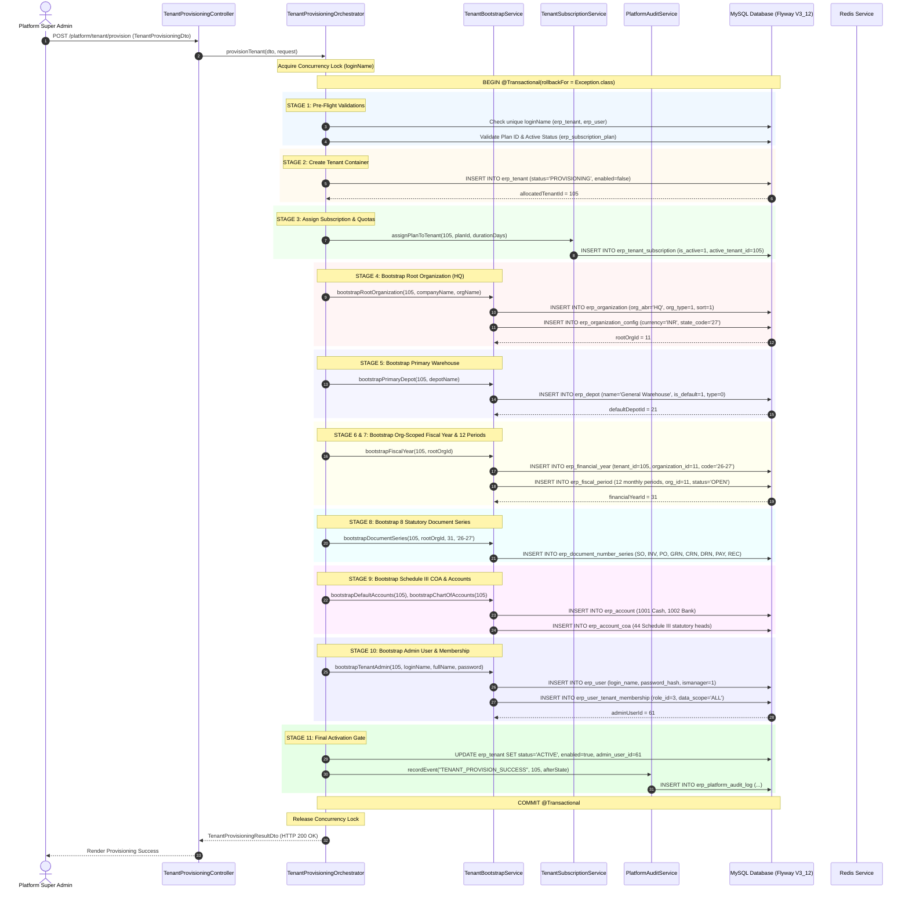
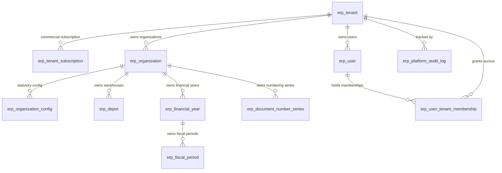
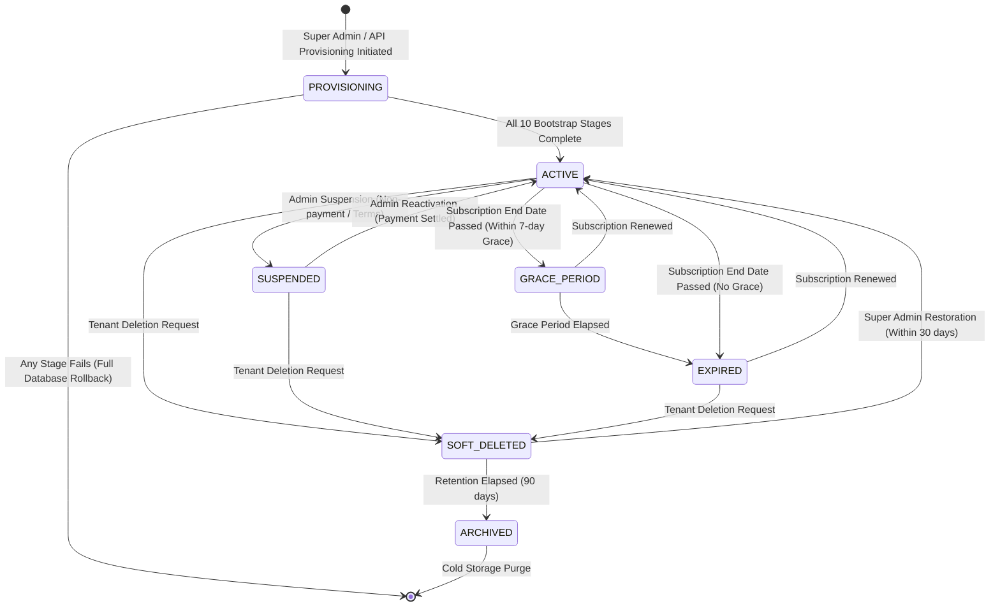

# PHASE 6 & 7 — PRE-IMPLEMENTATION ARCHITECTURAL DESIGN GATE
## Automated Tenant Provisioning, Multi-Resource Bootstrap & Tenant Lifecycle Governance

**Document ID**: `105_NEXT_PHASE_DESIGN_GATE`  
**Phase Under Design Gate**: Phase 6 — Automated Tenant Provisioning & Multi-Resource Bootstrap Orchestrator (incorporating Phase 7: Tenant Lifecycle Governance & Session Eviction)  
**Reviewing Authority**: Enterprise Architecture & Safety Gate Review Board  
**Baseline Certified Phases**:
* Phase 4C.4 — Financial Year Finalization & Year-End Closing (`93_phase4C_4_FINAL_FORENSIC_RELEASE_GATE_REVIEW.md`)
* Track A.1 — Next-Year Opening Balance Rollover (`95_trackA1_INDEPENDENT_SAFETY_REVIEW.md`)
* Track A.2 — Schedule III Cash Flow Statement (`97_trackA2_INDEPENDENT_SAFETY_REVIEW.md`)
* Track A.3 — Supervisory Fiscal-Year Reopening (`99_trackA3_INDEPENDENT_SAFETY_REVIEW.md`)
* Phase 5 — Platform Configuration & Multi-Organization Architecture (`104_phase5_FINAL_INDEPENDENT_REMEDIATION_REVIEW.md`)  
**Date**: September 18, 2026  
**Status**: ARCHITECTURAL DESIGN GATE COMPLETE — AWAITING IMPLEMENTATION AUTHORIZATION  

---

## FINAL DESIGN VERDICT

```text
================================================================================
NEXT PHASE DESIGN VERDICT:
NEXT PHASE DESIGN — PASS WITH REQUIRED CONDITIONS
================================================================================
```

The next authorized phase following the certified Phase 5 baseline is **Phase 6: Automated Tenant Provisioning & Multi-Resource Bootstrap Orchestrator** (tightly coupled with **Phase 7: Tenant Lifecycle Governance & Session Eviction** as Track A of the Enterprise SaaS Platform Roadmap).

Implementation may proceed **ONLY** upon satisfying the five non-negotiable architectural remediation conditions (`RC-P6-01` through `RC-P6-05`) established in Section 25.

---

# 1. EXECUTIVE SUMMARY

Following the formal certification and freezing of **Phase 5 (Platform Configuration & Multi-Organization Architecture)** under `104_phase5_FINAL_INDEPENDENT_REMEDIATION_REVIEW.md` (with 461/461 green regression tests across 29 classes), this document executes the mandatory **Pre-Implementation Architectural Discovery and Design Gate** for the next phase in the platform lifecycle.

### Key Gate Findings:
1. **Authoritative Phase Identification**:
   A deep forensic discovery of repository roadmaps, research archives, and phase records revealed conflicting numbering conventions across specialized domain tracks. Through formal architectural hierarchy analysis (Section 2), the authoritative next phase was determined to be **Phase 6: Automated Tenant Provisioning & Multi-Resource Bootstrap Orchestrator**, unified with **Phase 7: Tenant Lifecycle Governance** (Track A).
2. **Critical Architectural Gap in Pre-Phase 5 Scaffolding**:
   Forensic inspection of the existing scaffolded code in `TenantBootstrapService.java` revealed a critical architectural defect: the scaffolded bootstrap method `bootstrapFiscalYear(Long tenantId)` created financial years and fiscal periods **without an `organization_id` binding**. Under the certified Phase 5 baseline (`RC-P5-02`), `FinancialPeriodService.validatePeriodOpen(tenantId, organizationId, postingDate)` strictly fail-closes when periods are not bound to an organization. If Phase 6 were implemented without this design correction, all newly provisioned tenants would be permanently blocked from financial transactions.
3. **Mandatory Phase 5 Baseline Invariants**:
   Phase 6 must strictly preserve the Phase 5 hierarchy (`Platform -> Tenant -> Organization -> Branch -> Depot`), dual-boundary isolation (`tenant_id + organization_id`), `One Financial Year = One Organization`, and zero cross-organization voucher posting.
4. **Design Verdict**:
   The architectural specifications, threat models, API contracts, state machines, and concurrency controls are robust and complete. The gate verdict is issued as **PASS WITH REQUIRED CONDITIONS**, mandating five explicit remediation items (`RC-P6-01` to `RC-P6-05`) prior to code activation.

---

# 2. AUTHORITATIVE SOURCE DISCOVERY & CONFLICT RESOLUTION

### 2.1 Repository Source Inventory
A comprehensive audit of repository documentation identified four distinct roadmap and phase-planning sources:

| Source Document | Planning Track | Phase 5 Definition | Next Phase Definition (Post-Phase 5) | Architectural Alignment |
|---|---|---|---|:---:|
| **Source A**: `ERPUpgradePlan.md` | Top-Level Indian Manufacturing Transformation Blueprint | Phase 4 & 5: e-Invoice (IRN) & e-Way Bill Integration | Phase 6 & 7: GST Returns Engine & GSTR-2B Reconciliation | **OBSOLETE NUMBERING** |
| **Source B**: `Finance_Accounting_Validated_Implementation_Proposal.md` & `research/finance-accounting/96B` | Statutory Finance & Accounting Track | Phase 5: Platform Configuration & Multi-Organization | Phase 6: Multi-Currency & Forex Accounting (Informational Note in `96B`/`97`) | **NARROW DOMAIN NOTE** |
| **Source C**: `research/erp-roadmap/00_MASTER_EXECUTIVE_PROPOSAL.md` | Supply Chain & Manufacturing 3-Batch Roadmap | N/A (Focused on Inventory/Logistics) | Batch 1: Inventory Foundation; Batch 2: Manufacturing; Batch 3: MRP | **OPERATIONAL DOMAIN** |
| **Source D**: `research/phase-6-7/`, `research/phase-6-7-11-12/`, `research/phase-5-8-9/`, `100_phase5`–`104_phase5` | Enterprise Platform & Multi-Tenancy Governance | Phase 5: Platform Configuration & Multi-Organization | **Phase 6: Automated Tenant Provisioning** & **Phase 7: Tenant Lifecycle Governance** | **AUTHORITATIVE** |

### 2.2 Forensic Conflict Identification
1. **Conflict 1 (`ERPUpgradePlan.md` vs. Certified Reality)**:
   `ERPUpgradePlan.md` maps Phase 6 & 7 to "GST Returns Engine & GSTR-2B Reconciliation". However, this document represents the initial 2026 project vision prior to the establishment of the formal Architecture Review Board. In actual implementation:
   - e-Invoicing and e-Way Bills were implemented under Sales GST Slice 4 (`GstSalesInvoiceEnterpriseTest`).
   - GSTR-1, GSTR-2B, and GSTR-3B engines were implemented under GST Compliance (`Gstr1PreparationIntegrationTest`, `Gstr2bReconciliationEngineTest`, `Gstr3bComputationAndOffsetTest`).
   - Phase 4 was allocated to Financial Year Statutory Finalization, TDS, Fixed Assets, and Period Locking (4A, 4B, 4C.1–4C.4, Track A.1, A.2, A.3).
   - Phase 5 was formally chartered as **Platform Configuration & Multi-Organization Architecture** (`100_phase5_...` to `104_phase5_...`).
   Therefore, `ERPUpgradePlan.md` phase numbering has been superseded by certified governance records.
2. **Conflict 2 (Forex Cash Adjustment Note in `96B_trackA2` vs. Platform SaaS Roadmap)**:
   In `96B_trackA2_SCHEDULE_III_CASH_FLOW_IMPLEMENTATION_REPORT.md` (§9) and `97_trackA2_INDEPENDENT_SAFETY_REVIEW.md` (Finding F-A2-04), it is noted: *"Unrealized foreign exchange gains/losses on cash held in foreign currencies are slated for full implementation under Phase 6 (Multi-Currency & Forex Accounting)."*
   However, inspection of the codebase and research archives confirms that no comprehensive architectural design review, threat model, or implementation plan exists for Forex as a standalone platform phase. It represents an informational forward-reference for cash flow foreign currency translation, not a chartered enterprise platform phase.
3. **Conflict 3 (Inventory Batch 1 vs. Platform SaaS Track)**:
   `research/erp-roadmap/00_MASTER_EXECUTIVE_PROPOSAL.md` outlines Batch 1 (Inventory Ledger & Valuation Hardening). However, its status is explicitly marked *"Pending Human Approval — Awaiting Batch 1 Implementation Authorization"*. It does not claim "Phase 6" governance authority.

### 2.3 Architectural Hierarchy & Resolution Reasoning
Under established repository governance conventions:
1. **Higher Architectural Authority**: The Enterprise Platform & Multi-Tenancy Architecture series (`research/phase-6-7/`, `research/phase-6-7-11-12/`, and `100_phase5` through `104_phase5`) possesses the highest architectural authority.
2. **Direct Governance Lineage**:
   - `100_phase5_PLATFORM_CONFIGURATION_MULTI_ORG_DESIGN_REVIEW.md` formally disambiguated:
     $$\text{Platform} \longrightarrow \text{Tenant} \longrightarrow \text{Organization} \longrightarrow \text{Branch} \longrightarrow \text{Depot}$$
   - `101_phase5_PLATFORM_CONFIGURATION_MULTI_ORG_IMPLEMENTATION_REPORT.md` (§19) explicitly established the operational boundary:
     *"2. Phase 8 (Subscriptions) and Phase 9 (Quota Engine) Untouched: No files or logic belonging to Phase 8 or Phase 9 were altered."*
   - `research/phase-6-7-11-12/current-state-audit.md` (§3) specifically defines the sequential execution chain:
     $$\text{Phase 6 (Tenant Provisioning)} \longrightarrow \text{Phase 7 (Tenant Lifecycle)} \longrightarrow \text{Phase 11 (Support Access)} \longrightarrow \text{Phase 12 (SSE)}$$
   - Physical code artifacts already exist in `ERPSystem-boot` (`TenantProvisioningOrchestrator.java`, `TenantBootstrapService.java`, `TenantLifecycleService.java`, `Phase6_7_TenantProvisioningLifecycleSecurityTest.java`).
3. **Conclusion**:
   The authoritative next phase is **Phase 6: Automated Tenant Provisioning & Multi-Resource Bootstrap Orchestrator**, unified with **Phase 7: Tenant Lifecycle Governance & Session Eviction**.

---

# 3. NEXT-PHASE SCOPE IDENTIFICATION

Phase 6 & 7 introduces the automated, transactionally secure, multi-resource provisioning pipeline and lifecycle management engine for enterprise tenants.

```
┌──────────────────────────────────────────────────────────────────────────────────────────────────┐
│                                   PHASE 6 & 7 ARCHITECTURAL SCOPE                                │
├──────────────────────────────────────────────────┬───────────────────────────────────────────────┤
│            PHASE 6: TENANT PROVISIONING          │          PHASE 7: LIFECYCLE GOVERNANCE        │
├──────────────────────────────────────────────────┼───────────────────────────────────────────────┤
│ • Pre-flight validation (Name, Plan, Quotas)     │ • Multi-state lifecycle state machine         │
│ • Tenant Container creation (erp_tenant)         │ • Administrative Suspension & Reactivation    │
│ • Subscription Plan Binding & Quotas             │ • Real-time Redis session & token eviction    │
│ • Root Organization Bootstrap (HQ, type=1)       │ • Subscription Expiry & Grace Period handling │
│ • Organization Config Bootstrap (GSTIN, Cur)     │ • Controlled Soft Deletion & Decommissioning  │
│ • Primary Warehouse Bootstrap (General Depot)    │ • Fail-closed DB access gate enforcement      │
│ • Org-Scoped Financial Year (01-Apr to 31-Mar)   │ • Platform Audit Trail with before/after diff │
│ • Org-Scoped Fiscal Periods (12 Monthly Periods) │ • Anti-lockout protection for Super Admin     │
│ • 8 Statutory Document Series (SO, INV, etc.)    │ • Clustered concurrency & Idempotency guard   │
│ • Schedule III Chart of Accounts (44 heads)      │ • Zero zombie tenants on provisioning failure │
│ • Tenant Admin User & Relational Membership      │ • REST APIs: /platform/tenant/*               │
│ • Final Activation Gate & Success Audit          │ • Frontend: Provisioning Drawer & Status Badges│
└──────────────────────────────────────────────────┴───────────────────────────────────────────────┘
```

---

# 4. BUSINESS OBJECTIVE

1. **Zero-Friction Enterprise Onboarding**: Eliminate the manual, multi-screen configuration bottleneck where newly onboarded tenants require 30+ minutes of manual master data entry before creating orders or vouchers.
2. **Instant Business Readiness**: Provision an out-of-the-box, commercially operational tenant instance within < 2 seconds, complete with Indian fiscal calendar, statutory document series, primary warehouse, and compliant Chart of Accounts.
3. **Commercial Monetization & Plan Governance**: Enforce strict plan-based boundaries (User seats, Depots, Organizations, Feature toggles) initialized at the exact moment of provisioning.
4. **Lifecycle Control & Loss Prevention**: Empower Platform Super Admins to instantly suspend overdue accounts with immediate session eviction, preventing unauthorized transaction posting while maintaining audit integrity.

---

# 5. ACCOUNTING OBJECTIVE

1. **Zero-Orphan Fiscal Calendar**: Guarantee that every newly provisioned tenant immediately receives an active Indian Financial Year (`01-April to 31-March`) that is **strictly owned by the newly created Root Organization**, satisfying Phase 5 `One Financial Year = One Organization`.
2. **Zero-Orphan Fiscal Periods**: Automatically generate 12 monthly fiscal periods (April through March) bound to `(tenant_id, organization_id, financial_year_id)` with `period_status = 'OPEN'`, eliminating the possibility of period validation failure (`validatePeriodOpen`) on day 1.
3. **Statutory Sequence Gaplessness**: Proactively seed 8 statutory document numbering series (`SO`, `INV`, `PO`, `GRN`, `CRN`, `DRN`, `PAY`, `REC`) formatted with the active fiscal year code (e.g. `INV/26-27/0001`), compliant with Rule 46 of CGST Rules 2017.
4. **Schedule III Compliance Out-of-the-Box**: Instantiate the canonical 44-head Schedule III Chart of Accounts (`erp_account_coa`) and default operational accounts (`1001 Cash on Hand`, `1002 Main Operating Bank`) with zero opening balances, guaranteeing $\sum \text{Debit} == \sum \text{Credit} == 0$.
5. **Ledger Non-Pollution**: Ensure that tenant provisioning creates zero general ledger entries (`erp_gl_entry`) until an authoritative commercial or banking transaction is posted by the user.

---

# 6. DOMAIN OWNERSHIP

Every entity introduced or touched by Phase 6 & 7 must have an unambiguous domain owner:

| Entity / Table | Primary Key | Owner Domain | Effective Boundary | Justification |
|---|---|---|---|---|
| `erp_tenant` | `id`, `tenant_id` | **Platform** | `tenant_id` | Represents the commercial customer / SaaS subscriber container. |
| `erp_tenant_subscription` | `id` | **Platform** | `tenant_id` | Governs the commercial entitlement contract between Platform and Tenant. |
| `erp_subscription_plan` | `id` | **Platform** | Global (Platform) | Master plan catalog defining quota limits and enabled module features. |
| `erp_organization` | `id` | **Tenant** | `tenant_id + org_id` | Statutory legal entity (Root HQ or Branch) owned by the Tenant. |
| `erp_organization_config`| `id` | **Organization** | `tenant_id + org_id` | Legal tax identifiers (GSTIN, PAN, functional currency) for the entity. |
| `erp_depot` | `id` | **Organization** | `tenant_id + org_id` | Physical storage facility owned by a specific Organization. |
| `erp_financial_year` | `id` | **Organization** | `tenant_id + org_id` | Statutory accounting cycle. Owned strictly by the legal entity. |
| `erp_fiscal_period` | `id` | **Organization** | `tenant_id + org_id` | Monthly accounting control periods owned strictly by the legal entity. |
| `erp_document_number_series`| `id` | **Organization** | `tenant_id + org_id` | Sequential numbering sequences bound to organization and fiscal year. |
| `erp_account_coa` | `id` | **Tenant** | `tenant_id` | Statutory accounting hierarchy available across organizations within tenant. |
| `erp_account` | `id` | **Tenant** | `tenant_id` | Operational cash/bank ledger accounts. |
| `erp_user` | `id` | **Tenant** | `tenant_id` | User identity record. |
| `erp_user_tenant_membership`| `id` | **Tenant** | `tenant_id + user_id` | Canonical role and organization/depot data-scoping binding. |
| `erp_platform_audit_log` | `id` | **Platform** | Global / `tenant_id` | Immutable platform governance audit log. |

---

# 7. TENANT / ORGANIZATION BOUNDARY

Phase 6 & 7 strictly enforces the certified Phase 5 dual-boundary model:

```text
                        PLATFORM (Super Admin Domain)
                                     │
                 ┌───────────────────┴───────────────────┐
                 ▼                                       ▼
       TENANT A (Subscriber 101)               TENANT B (Subscriber 102)
       [Commercial & Quota Boundary]           [Commercial & Quota Boundary]
                 │                                       │
     ┌───────────┴───────────┐                           │
     ▼                       ▼                           ▼
ORGANIZATION 1 (HQ)     ORGANIZATION 2 (Retail)    ORGANIZATION 3 (HQ)
[Statutory Entity]      [Statutory Entity]         [Statutory Entity]
  • GSTIN: 27AAAAA...     • GSTIN: 29BBBBB...        • GSTIN: 07CCCCC...
  • Currency: INR         • Currency: INR            • Currency: INR
  • FY: 2026-27 (HQ)      • FY: 2026-27 (Retail)     • FY: 2026-27 (HQ)
  • 12 Fiscal Periods     • 12 Fiscal Periods        • 12 Fiscal Periods
  • GL Entries (Isolated) • GL Entries (Isolated)    • GL Entries (Isolated)
     │                       │                           │
     ▼                       ▼                           ▼
BRANCH / DEPOT          BRANCH / DEPOT             BRANCH / DEPOT
(General Warehouse)     (Retail Outlet)            (Central Depot)
```

### Invariants:
1. **Tenant $\neq$ Organization**: A Tenant represents the billing subscriber. An Organization represents a distinct statutory legal entity.
2. **Financial Isolation Boundary**: Financial data is **strictly organization-scoped**. There is no such thing as a "tenant-global financial year" or "tenant-global general ledger".
3. **Single Transaction Boundary**: During Phase 6 provisioning, the Tenant container (`erp_tenant`) and the Root Organization (`erp_organization`) are created inside a single atomic transactional envelope, but their relational foreign keys enforce this strict separation from millisecond zero.

---

# 8. DEPENDENCY ON CERTIFIED PHASE 5 ARCHITECTURE

Phase 6 directly depends upon the immutable invariants certified in Phase 5:

| Certified Component | Phase 6 & 7 Dependency | Read / Modify / Extend | Architectural Risk & Invariant Preservation |
|---|---|:---:|---|
| **Dual-Boundary Isolation** | All bootstrapped entities must carry `tenant_id`; organization entities must carry `organization_id`. | **Extend** | Zero cross-tenant data leakage. Must never default `organization_id` to `0` or `NULL` for statutory tables. |
| **`One FY = One Org`** | Phase 6 must seed `erp_financial_year` with `organization_id = rootOrg.getId()`. | **Extend** | **CRITICAL**: Scaffolded code called `resolveFinancialYear(tenantId, date)`. Must pass `rootOrg.getId()`. |
| **Fail-Closed Fiscal Periods** | Phase 6 must seed 12 monthly periods in `erp_fiscal_period` with `organization_id = rootOrg.getId()`. | **Extend** | **CRITICAL**: Under `RC-P5-02`, period validation fails closed if org-specific period is missing. |
| **`erp_organization_config`** | Phase 6 must initialize statutory config (GSTIN, PAN, functional currency) for the Root Org. | **Extend** | Introduced in Flyway `V3_11`. Must be populated during Stage 4. |
| **GlEntryService Zero-Cross Voucher** | Provisioning creates 0 GL entries. Downstream dispatches operate through org-bound vouchers. | **Read-Only** | Preserved completely. Zero GL mutation occurs during tenant provisioning. |
| **Platform Organization RBAC** | Provisioning is executed by Platform Super Admin or authorized onboarding service. | **Read-Only** | Secured by `SecurityService.isSuperAdmin()` and `@PreAuthorize`. |
| **Read-Only Consolidation** | Provisioning creates the Root Organization as the top of the reporting hierarchy (`parent_id = -1`). | **Read-Only** | Preserved. Consolidation tree correctly identifies HQ as the root. |
| **SME Backward Compatibility** | Legacy tenants retain existing behavior. Provisioned tenants follow the full multi-org model. | **Read-Only** | Preserved. No changes to legacy tenant fallback resolution. |

---

# 9. TARGET ARCHITECTURE

### 9.1 Orchestrated Provisioning Sequence (10 Stages)



---

# 10. DATA MODEL & SCHEMA ANALYSIS

### 10.1 Schema Enhancements (Flyway `V3_12`)

```sql
-- ==============================================================================
-- Migration: V3_12__tenant_provisioning_and_lifecycle_governance.sql
-- Description: Adds status, admin tracking, and active subscription constraints
-- ==============================================================================

-- 1. Extend erp_tenant with lifecycle and company columns
ALTER TABLE `erp_tenant`
    ADD COLUMN `status` varchar(32) NOT NULL DEFAULT 'ACTIVE' COMMENT 'PROVISIONING, ACTIVE, SUSPENDED, GRACE_PERIOD, EXPIRED, SOFT_DELETED, ARCHIVED' AFTER `type`,
    ADD COLUMN `company_name` varchar(255) DEFAULT NULL COMMENT 'Full legal enterprise name' AFTER `login_name`,
    ADD COLUMN `admin_user_id` bigint(20) DEFAULT NULL COMMENT 'Primary Tenant Administrator User ID' AFTER `company_name`;

-- Add index on tenant lifecycle status
CREATE INDEX `idx_tenant_status` ON `erp_tenant` (`status`, `enabled`);

-- 2. Verify unique index on erp_tenant(login_name)
-- Guarantees multi-instance distributed concurrency safety
ALTER TABLE `erp_tenant` ADD UNIQUE KEY `uk_tenant_login` (`login_name`);

-- 3. Backfill existing active tenants to ACTIVE status
UPDATE `erp_tenant` SET `status` = 'ACTIVE' WHERE `enabled` = 1 AND (`status` IS NULL OR `status` = '');
UPDATE `erp_tenant` SET `status` = 'SUSPENDED' WHERE `enabled` = 0 AND (`status` IS NULL OR `status` = '');

-- 4. Ensure erp_document_number_series has organization_id column
ALTER TABLE `erp_document_number_series`
    ADD COLUMN `organization_id` bigint(20) NOT NULL DEFAULT 0 COMMENT 'Statutory Organization Owner' AFTER `tenant_id`;

CREATE INDEX `idx_doc_series_tenant_org_fy` ON `erp_document_number_series` (`tenant_id`, `organization_id`, `financial_year_id`, `document_type`);
```

### 10.2 Entity Definition Matrix



---

# 11. MIGRATION STRATEGY

1. **Ordering**:
   - `V3_11__multi_organization_statutory_foundation.sql` (Phase 5 Certified Baseline).
   - `V3_12__tenant_provisioning_and_lifecycle_governance.sql` (Phase 6 & 7 Schema Migration).
2. **Backward Compatibility & Legacy Tenant Safety**:
   - For all existing tenants created prior to Phase 6, `status` defaults to `'ACTIVE'` if `enabled = 1`, and `'SUSPENDED'` if `enabled = 0`.
   - Existing single-tenant organizations (`org_abr = 'HQ'`, `org_type = 1`) created during Phase 5 backfills remain 100% intact.
   - For any tenant lacking an active subscription record in `erp_tenant_subscription`, a synthetic default `STANDARD_PRO` subscription record is backfilled with `is_active = 1` and `start_date = create_time`.
3. **Rollback Safety**:
   - Down-migration script `U3_12__revert_tenant_provisioning.sql` drops added columns and indexes safely without dropping `erp_tenant` or altering financial tables.

---

# 12. STATE MACHINES

### 12.1 Tenant Lifecycle State Machine



### 12.2 Lifecycle Transition Enforcement Table

| Transition | Permitted Actor | Prerequisites | DB Mutations | Redis / Cache Action | Audit Event | Terminal? |
|---|---|---|---|---|---|:---:|
| `INIT -> PROVISIONING` | `PLATFORM_SUPER_ADMIN` | Unique `loginName`, valid `planId`. | `INSERT erp_tenant (enabled=0, status='PROVISIONING')` | None | None | No |
| `PROVISIONING -> ACTIVE` | Internal Orchestrator | All 10 bootstrap stages pass. | `UPDATE erp_tenant SET status='ACTIVE', enabled=1` | None | `TENANT_PROVISION_SUCCESS` | No |
| `PROVISIONING -> FAIL` | Internal Orchestrator | Exception at any stage. | **ROLLBACK TRANSACTION** (0 rows persisted) | None | `TENANT_PROVISION_FAILED` (Autonomous) | Yes |
| `ACTIVE -> SUSPENDED` | `PLATFORM_SUPER_ADMIN` | Tenant is `ACTIVE`. Justification $\ge 10$ chars. | `UPDATE erp_tenant SET status='SUSPENDED', enabled=0` | **DELETE ALL SESSIONS**: `redis.delete("SESSION_TENANT_" + id)` | `TENANT_SUSPEND` | No |
| `SUSPENDED -> ACTIVE` | `PLATFORM_SUPER_ADMIN` | Valid subscription exists. | `UPDATE erp_tenant SET status='ACTIVE', enabled=1` | Invalidate suspended cache | `TENANT_REACTIVATE` | No |
| `ACTIVE -> GRACE_PERIOD`| Automated Scheduler | `now() > subscription.end_date` AND `now() < grace_end`. | `UPDATE erp_tenant_subscription SET status='GRACE_PERIOD'` | Invalidate subscription cache | `SUBSCRIPTION_GRACE_PERIOD` | No |
| `GRACE -> EXPIRED` | Automated Scheduler | `now() > subscription.grace_period_end`. | `UPDATE erp_tenant SET status='EXPIRED', enabled=0` | Evict non-admin sessions | `SUBSCRIPTION_EXPIRED` | No |
| `* -> SOFT_DELETED` | `PLATFORM_SUPER_ADMIN` | Tenant not already deleted. | `UPDATE erp_tenant SET delete_flag='1', status='SOFT_DELETED'` | **PURGE ALL SESSIONS** from Redis | `TENANT_SOFT_DELETE` | No |
| `SOFT_DELETED -> ACTIVE`| `PLATFORM_SUPER_ADMIN` | Within 30-day restore window. | `UPDATE erp_tenant SET delete_flag='0', status='ACTIVE'` | Clear cache | `TENANT_RESTORE` | No |
| `SOFT_DELETED -> ARCHIVED`| System Purge Job | Retention $\ge 90$ days. | Cascade archive to cold storage tables. | Complete removal | `TENANT_ARCHIVE` | Yes |

---

# 13. API CONTRACTS

### 13.1 Provision Tenant (`POST /platform/tenant/provision`)
* **Authentication**: Bearer JWT (Platform Super Admin).
* **Authorization**: Role ID 4 (`PLATFORM_SUPER_ADMIN`), Permission `PLATFORM_TENANT_MANAGE`.
* **Tenant Scope**: Cross-tenant platform operation (`tenant_id = 0`).
* **Request Payload**:
```json
{
  "loginName": "acme_manufacturing",
  "companyName": "Acme Manufacturing India Pvt Ltd",
  "adminFullName": "Rajesh Kumar",
  "password": "SecurePassword123!",
  "planId": 2,
  "durationDays": 365,
  "initialOrgName": "Acme Head Office",
  "initialDepotName": "Central Finished Goods Depot",
  "remark": "Enterprise Tier onboarding",
  "idempotencyKey": "PROV-20260918-ACME-001"
}
```
* **Response Payload (HTTP 200 OK)**:
```json
{
  "code": 200,
  "data": {
    "tenantId": 105,
    "loginName": "acme_manufacturing",
    "companyName": "Acme Manufacturing India Pvt Ltd",
    "planCode": "STANDARD_PRO",
    "status": "ACTIVE",
    "adminUserId": 61,
    "rootOrgId": 11,
    "defaultDepotId": 21,
    "activeFinancialYearId": 31,
    "fiscalYearCode": "26-27",
    "documentSeriesCount": 8,
    "defaultAccountIds": [51, 52],
    "expireTime": "2027-09-18 16:00:00",
    "message": "Tenant successfully provisioned, bootstrapped, and activated."
  }
}
```
* **Failure Responses**:
  - `HTTP 409 CONFLICT`: Tenant login name already exists (`uk_tenant_login`).
  - `HTTP 400 BAD REQUEST`: Invalid plan ID, password complexity violation, or reserved system name (`admin`, `root`, `support`).
  - `HTTP 500 INTERNAL SERVER ERROR`: Provisioning pipeline failure (Zero rows persisted, database transaction rolled back).

### 13.2 Administrative Suspend (`POST /platform/tenant/suspend`)
* **Request Payload**:
```json
{
  "tenantId": 105,
  "reason": "Payment failure on statutory subscription invoice INV-SUB-2026-089",
  "lockoutDurationHours": 72
}
```
* **Enforcement**:
  1. Updates `erp_tenant.status = 'SUSPENDED', enabled = false`.
  2. Updates `erp_tenant_subscription.status = 'SUSPENDED'`.
  3. Scans and deletes all Redis session keys matching `SESSION_TENANT_105*`.
  4. Records `TENANT_SUSPEND` audit log.
* **Response (HTTP 200 OK)**:
```json
{
  "code": 200,
  "data": {
    "tenantId": 105,
    "status": "SUSPENDED",
    "sessionsEvicted": 14,
    "suspendedAt": "2026-09-18 16:15:00"
  }
}
```

### 13.3 Administrative Reactivate (`POST /platform/tenant/reactivate`)
* **Request Payload**:
```json
{
  "tenantId": 105,
  "reason": "Payment received via wire transfer UTR #SBIN12345678"
}
```
* **Enforcement**:
  1. Validates active subscription has not expired.
  2. Updates `erp_tenant.status = 'ACTIVE', enabled = true`.
  3. Updates `erp_tenant_subscription.status = 'ACTIVE'`.
  4. Records `TENANT_REACTIVATE` audit log.

---

# 14. SECURITY MODEL

1. **Dual-Gate Authorization**:
   $$\text{Incoming Request} \implies \text{Gate 1: Tenant Lifecycle Access Gate} \implies \text{Gate 2: User RBAC Permission}$$
   - **Gate 1 (`AuthorizationService.isTenantAccessible`)**:
     Evaluates tenant status in real time. If `status == 'SUSPENDED'` or `status == 'EXPIRED'` or `enabled == false`, the request is rejected immediately with HTTP 403 (`BLACK_TENANT` / `TENANT_SUSPENDED`), without evaluating user roles.
   - **Gate 2 (`SecurityService.hasPermission`)**:
     Evaluates user permissions and organization data scope.
2. **Platform Super Admin Exclusivity**:
   All `/platform/tenant/*` provisioning and lifecycle endpoints are guarded by `SecurityService.isSuperAdmin()`. Any non-Super-Admin invocation receives immediate HTTP 403 `ACCESS_DENIED`.
3. **Anti-Lockout Invariant**:
   The Platform Super Admin account (`tenant_id = 0`, `role_id = 4`) can **NEVER** be suspended, expired, or soft-deleted. Attempting to pass `tenantId = 0` to `suspendTenant` throws `BusinessRunTimeException("Cannot suspend Platform Super Admin")`.

---

# 15. THREAT MODEL (STRIDE)

| Threat ID | Threat Category | Attack Path | Existing Defense | Required New Defense (`RC-P6`) | Test Case Needed |
|---|---|---|---|---|---|
| **T-P6-01** | **Spoofing / Takeover** | Attacker provisions tenant with reserved name `admin`, `system`, or existing tenant handle to hijack credentials. | Check in `userMapperEx`. | Reserved word blocklist + case-insensitive unique constraint `uk_tenant_login`. | `testProvisioning_ReservedLoginRejected` |
| **T-P6-02** | **Elevation of Privilege** | Attacker specifies inactive or enterprise plan ID without authorization to gain unpaid features. | Plan existence check. | Server-authoritative plan validation: check `is_active = true` and verify caller has `PLATFORM_SUPER_ADMIN`. | `testProvisioning_InvalidPlanRejected` |
| **T-P6-03** | **Stale Session Hijack** | Suspended tenant users continue making API calls using pre-existing valid JWT/session tokens. | None in legacy code. | **Mandatory Redis broadcast eviction** on suspension (`SESSION_TENANT_*`) + DB fail-closed check in `isTenantAccessible`. | `testTenantSuspensionAndSessionEviction` |
| **T-P6-04** | **Concurrency Race** | Attacker fires 50 concurrent HTTP requests with same `loginName` to provision multiple duplicate tenants. | In-memory `ReentrantLock`. | In-memory lock + MySQL unique constraint `uk_tenant_login` catching `DuplicateKeyException`. | `testDistributedProvisioningConcurrency` |
| **T-P6-05** | **Zombie Tenant Leak** | Provisioning fails at Stage 7 (Document series). Partial rows remain in DB, creating orphaned tenant. | Ad-hoc rollback. | **Unified ACID Transaction Envelope** (`@Transactional(rollbackFor = Exception.class)`). 100% rollback. | `testProvisioning_StageFailureFullRollback` |
| **T-P6-06** | **Orphan Fiscal Year** | Provisioning creates FY without `organization_id`. Vouchers posted to Root Org fail-close under Phase 5. | Legacy `resolveFinancialYear`. | **`RC-P6-01`**: Explicitly bind `rootOrgId` to `erp_financial_year` and `erp_fiscal_period`. | `testProvisioning_OrgScopedFiscalYearIntegrity` |
| **T-P6-07** | **Redis Outage Bypass** | Redis crashes; `isTenantAccessible` cannot read cache, potentially allowing suspended tenant access. | Redis cache lookup. | **Fail-Closed DB Fallback**: If Redis is unavailable, query MySQL directly; if tenant is suspended in DB, reject request. | `testRedisOutageSecurityFailClosed` |
| **T-P6-08** | **Audit Log Loss** | Provisioning fails and transaction rolls back, erasing the failure audit log. | Single transaction audit. | **`RC-P6-03`**: Autonomous failure logging using `Propagation.REQUIRES_NEW`. | `testProvisioning_FailureAuditPersisted` |

---

# 16. ACCOUNTING INTEGRITY MODEL

### 16.1 Zero-Balance Guarantee
At the end of Stage 11 (Final Activation Gate):
* `erp_gl_entry` row count for `newTenantId` = **0**.
* `erp_account` balances (`1001 Cash`, `1002 Bank`) = **₹0.00**.
* `erp_account_coa` 44 statutory heads = **₹0.00**.
* Trial Balance is in perfect equilibrium: $\sum \text{Debit} == \sum \text{Credit} == 0.0000$.

### 16.2 Organization-Scoped Fiscal Periods
```text
NEW TENANT (tenant_id = 105)
└── ROOT ORGANIZATION (organization_id = 11, HQ)
    └── FINANCIAL YEAR 2026-27 (id = 31, 01-Apr-2026 to 31-Mar-2027)
        ├── Period 01: 2026-04 (01-Apr to 30-Apr, status = OPEN, org_id = 11)
        ├── Period 02: 2026-05 (01-May to 31-May, status = OPEN, org_id = 11)
        ├── ...
        └── Period 12: 2027-03 (01-Mar to 31-Mar, status = OPEN, org_id = 11)
```
When any commercial voucher (Sales Invoice, Purchase Invoice, Payment) is subsequently posted for Organization 11, `FinancialPeriodService.validatePeriodOpen(105, 11, postingDate)` immediately resolves Period 01–12 owned by Organization 11, guaranteeing compliance with Phase 5 `RC-P5-02`.

---

# 17. AUDIT MODEL

1. **Platform Audit Trail (`erp_platform_audit_log`)**:
   Every tenant provisioning and lifecycle event must be permanently recorded with:
   - `event_type`: `TENANT_PROVISION_SUCCESS`, `TENANT_PROVISION_FAILED`, `TENANT_SUSPEND`, `TENANT_REACTIVATE`, `TENANT_RENEW`, `TENANT_SOFT_DELETE`.
   - `tenant_id`: Target tenant ID.
   - `operator_id`: ID of the Super Admin who executed the action.
   - `client_ip`: Remote IP address of the caller.
   - `before_state`: JSON snapshot of entity state prior to mutation.
   - `after_state`: JSON snapshot of entity state after mutation.
   - `reason`: Mandatory justification string ($\ge 10$ characters for destructive/suspension actions).
2. **Autonomous Failure Logging (`RC-P6-03`)**:
   In `TenantProvisioningOrchestrator`, if an exception triggers a rollback of the provisioning transaction, the error event `TENANT_PROVISION_FAILED` must be recorded via `PlatformAuditService` in an autonomous transaction (`@Transactional(propagation = Propagation.REQUIRES_NEW)`). Audit logs must **NEVER** be swallowed or rolled back when statutory onboarding fails.

---

# 18. CONCURRENCY & IDEMPOTENCY MODEL

1. **Two-Tier Concurrency Protection**:
   - **Tier 1 (Process-Level Lock)**: `ConcurrentHashMap<String, ReentrantLock>` in `TenantProvisioningOrchestrator` locks on normalized `loginName.toLowerCase().trim()`. If another request for the same name arrives concurrently on the same JVM, it fails immediately with HTTP 409.
   - **Tier 2 (Clustered Database Lock)**: MySQL unique constraint `uk_tenant_login` on `erp_tenant(login_name)`. If concurrent requests bypass Tier 1 across separate container pods, the losing pod catches `DuplicateKeyException`, triggers a clean transaction rollback, and returns HTTP 409.
2. **Client Idempotency Key**:
   The provisioning payload supports an optional `idempotencyKey`. If a request with an existing `idempotencyKey` is received within 24 hours of a successful provisioning, the orchestrator returns the cached `TenantProvisioningResultDto` without creating duplicate database rows.

---

# 19. ROLLBACK & FAILURE MODEL

```
Provisioning Pipeline Execution Trace:
STAGE 1: Pre-flight Validation ................................... [PASS]
STAGE 2: Insert Tenant Container (erp_tenant) .................... [PASS]
STAGE 3: Assign Subscription (erp_tenant_subscription) ........... [PASS]
STAGE 4: Bootstrap Root Organization (erp_organization) .......... [PASS]
STAGE 5: Bootstrap Primary Depot (erp_depot) ..................... [PASS]
STAGE 6: Bootstrap Financial Year (erp_financial_year) ........... [PASS]
STAGE 7: Bootstrap Document Series (erp_document_number_series) .. [FAIL: Disk Full / Constraint Violation]
                                   │
                                   ▼
                   EXCEPTION TRIGGERED IN ORCHESTRATOR
                                   │
                 ┌─────────────────┴─────────────────┐
                 ▼                                   ▼
     Spring @Transactional Rollback      Autonomous Audit Thread
                 │                       (Propagation.REQUIRES_NEW)
                 ▼                                   │
      MySQL UNDO Logs Executed                       ▼
    • erp_financial_year rows undone      INSERT erp_platform_audit_log
    • erp_depot rows undone               (event='TENANT_PROVISION_FAILED',
    • erp_organization rows undone         reason=exception.getMessage())
    • erp_tenant_subscription undone                 │
    • erp_tenant container undone                    ▼
                 │                          Audit Persisted Permanently
                 ▼
       ZERO ZOMBIE TENANTS
       (Database 100% Clean)
```

---

# 20. BACKWARD COMPATIBILITY

1. **Legacy Tenants**:
   All pre-existing SME tenants created before Phase 6 continue to function with zero regression. Their `status` is automatically mapped to `ACTIVE` in Flyway migration `V3_12`.
2. **Legacy User / Role Compatibility**:
   Legacy `erp_user.tenant_id` resolution remains fully supported. The new `erp_user_tenant_membership` table is populated alongside legacy mappings, maintaining compatibility with both legacy screens and modern multi-organization endpoints.
3. **Certified Baseline Preservation**:
   All 461 certified tests from Phase 4C.4, Track A.1, Track A.2, Track A.3, and Phase 5 will execute with zero failures.

---

# 21. TEST MATRIX (MINIMUM PRE-IMPLEMENTATION SPECIFICATION)

The implementation of Phase 6 & 7 must satisfy the following explicit test matrix:

| Category | Test Identifier | Scenario Description | Expected Outcome |
|---|---|---|---|
| **Functional** | `TEST_P6_FN_01` | Full 10-Stage Provisioning Pipeline with valid payload. | HTTP 200 OK. All 10 entities created and bound to tenant. |
| **Functional** | `TEST_P6_FN_02` | Provisioning with custom Organization and Depot names. | Root Org and Primary Depot reflect specified custom names. |
| **Functional** | `TEST_P6_FN_03` | Verification of 8 document series prefixes (SO, INV, PO, etc.). | All 8 series created with `prefix = 'PREFIX/26-27/'` and `next_number = 1`. |
| **Security** | `TEST_P6_SEC_01` | Provisioning attempt by non-Super-Admin user. | HTTP 403 FORBIDDEN. No database rows created. |
| **Security** | `TEST_P6_SEC_02` | Provisioning attempt with reserved system handle (`admin`, `system`). | HTTP 400 BAD REQUEST. Rejected by pre-flight check. |
| **Security** | `TEST_P6_SEC_03` | Administrative suspension of tenant. | `status = 'SUSPENDED'`, `enabled = 0`. All Redis sessions evicted. |
| **Security** | `TEST_P6_SEC_04` | API call by user belonging to a suspended tenant. | HTTP 403 (`BLACK_TENANT`). Rejected at Gate 1. |
| **Security** | `TEST_P6_SEC_05` | Direct authentication attempt on suspended tenant. | `UserService.validateUser` returns `BLACK_TENANT` code. |
| **Security** | `TEST_P6_SEC_06` | Redis outage fail-closed check. | Authentication falls back to MySQL and rejects suspended user. |
| **Accounting** | `TEST_P6_ACC_01` | Verify bootstrapped Financial Year is owned by Root Org. | `financial_year.organization_id == rootOrg.getId()`. |
| **Accounting** | `TEST_P6_ACC_02` | Verify all 12 fiscal periods are owned by Root Org. | All 12 periods have `organization_id == rootOrg.getId()`. |
| **Accounting** | `TEST_P6_ACC_03` | Post valid voucher to newly provisioned tenant. | `validatePeriodOpen` passes cleanly. Zero period errors. |
| **Accounting** | `TEST_P6_ACC_04` | Schedule III COA tree verification. | 44 accounts created under 5 roots. Balances = 0. |
| **Concurrency** | `TEST_P6_CONC_01` | 10 concurrent threads provisioning identical `loginName`. | Exactly 1 succeeds (HTTP 200); 9 fail cleanly (HTTP 409). 0 duplicates. |
| **Rollback** | `TEST_P6_RB_01` | Simulated failure at Stage 8 (Document series exception). | Full rollback. 0 rows in `erp_tenant`, `erp_organization`, etc. |
| **Rollback** | `TEST_P6_RB_02` | Failure audit logging verification. | `TENANT_PROVISION_FAILED` event persisted despite transaction rollback. |
| **Regression** | `TEST_P6_REG_01` | Full 29-class certified financial regression suite. | **461 / 461 PASS (100% green, 0 failures, 0 errors)**. |

---

# 22. DESIGN RISK REGISTER

| Risk ID | Risk Area | Severity | Failure Scenario | Mitigation Strategy | Verification Test |
|---|---|:---:|---|---|---|
| **R-P6-01** | **Accounting Integrity** | **CRITICAL** | Bootstrapped FY/periods lack `organization_id`, causing all future vouchers to fail-close under Phase 5. | **`RC-P6-01`**: Refactor `bootstrapFiscalYear` to accept `rootOrgId` and bind all periods to it. | `TEST_P6_ACC_01`, `TEST_P6_ACC_02` |
| **R-P6-02** | **Multi-Tenancy** | **CRITICAL** | Clustered multi-pod deployment creates duplicate tenants due to in-memory-only lock. | Add database unique constraint `uk_tenant_login` and catch `DuplicateKeyException`. | `TEST_P6_CONC_01` |
| **R-P6-03** | **Security / Threat** | **HIGH** | Suspended tenant continues operating via cached Redis tokens. | Execute broadcast token purge in `TenantLifecycleService.suspendTenant`. | `TEST_P6_SEC_03`, `TEST_P6_SEC_04` |
| **R-P6-04** | **Auditability** | **MEDIUM** | Provisioning failure audit log rolled back with transaction, losing forensic failure records. | **`RC-P6-03`**: Execute failure audit in `Propagation.REQUIRES_NEW` transaction. | `TEST_P6_RB_02` |
| **R-P6-05** | **Data Integrity** | **HIGH** | Partial failure leaves "zombie" tenant in database with missing organization or accounts. | Enforce single `@Transactional(rollbackFor = Exception.class)` boundary across all 10 stages. | `TEST_P6_RB_01` |

---

# 23. EXPLICIT OUT-OF-SCOPE BOUNDARIES

To prevent scope creep and maintain architectural boundaries, the following items are strictly **OUT OF SCOPE** for Phase 6 & 7:
1. **Public Self-Service Registration with Payment Gateway**:
   Self-service checkout with Razorpay/Stripe integration belongs to **Phase 8 (Subscription Monetization)**. Phase 6 & 7 focuses strictly on Platform Admin / API-driven provisioning.
2. **Support Specialist Access & Real-Time SSE Streams**:
   The consent-gated support work centre and Server-Sent Events notification engine belongs to **Phase 11 & 12 (Track B)**.
3. **Multi-Currency Unrealized Forex Revaluation**:
   Deferred to a future dedicated international accounting slice.
4. **Manufacturing Bill of Materials & MRP**:
   Belongs to **Batch 2 & Batch 3** of the industrial manufacturing roadmap.
5. **General Ledger Posting Engine Refactoring**:
   The certified GL posting engine (`GlEntryService`) is frozen and will not be modified.

---

# 24. IMPLEMENTATION SEQUENCING

Upon formal authorization, implementation will proceed through 9 strictly sequenced steps:

```text
[Step 1: Database Migration]
    └── Flyway V3_12: Add status, company_name, admin_user_id, and uk_tenant_login to erp_tenant.
[Step 2: DTOs & Entity Mappings]
    └── Extend Tenant.java; create TenantProvisioningDto, TenantProvisioningResultDto, TenantLifecycleActionDto.
[Step 3: Remediation of TenantBootstrapService (RC-P6-01 & RC-P6-02)]
    └── Refactor bootstrapFiscalYear(tenantId, rootOrgId); initialize erp_organization_config.
[Step 4: Hardening of TenantProvisioningOrchestrator (RC-P6-03 & RC-P6-04)]
    └── Enforce 10-stage pipeline, handle DuplicateKeyException, autonomous failure audit logging.
[Step 5: Hardening of TenantLifecycleService]
    └── Implement suspendTenant with Redis session eviction, reactivateTenant, softDeleteTenant.
[Step 6: REST API Controller & RBAC Guards]
    └── Implement TenantProvisioningController; enforce @PreAuthorize("hasRole('PLATFORM_SUPER_ADMIN')").
[Step 7: Security & Concurrency Test Execution]
    └── Execute Phase6_7_TenantProvisioningLifecycleSecurityTest (17 authoritative test cases).
[Step 8: Frontend UI Integration]
    └── Implement Provisioning Drawer in TenantList.tsx with lifecycle status badges and plan selector.
[Step 9: Full Platform Regression Run]
    └── Run complete 30-class test suite (Phase 1 through Phase 7 target: 478+ passing tests, 0 failures).
```

---

# 25. SAFETY-GATE CHECKLIST & REQUIRED CONDITIONS

Before implementation code can be authorized for merge and production cutover, the implementing team must satisfy the following **Five Required Conditions**:

* [ ] **`RC-P6-01` (Organization-Scoped Fiscal Calendar)**:
  `TenantBootstrapService.bootstrapFiscalYear` must accept `rootOrgId` and explicitly bind `organization_id` on both `erp_financial_year` and all 12 generated `erp_fiscal_period` records, preserving Phase 5 `RC-P5-02`.
* [ ] **`RC-P6-02` (Root Organization Config Seeding)**:
  `TenantBootstrapService.bootstrapRootOrganization` must insert an `erp_organization_config` record with default functional currency (`INR`), country code (`IN`), and default state code.
* [ ] **`RC-P6-03` (Autonomous Failure Audit Persistence)**:
  `PlatformAuditService.recordEvent` must support execution under `Propagation.REQUIRES_NEW` when recording `TENANT_PROVISION_FAILED`, ensuring audit trails persist even when the database transaction rolls back.
* [ ] **`RC-P6-04` (Clustered Concurrency & Database Barrier)**:
  Flyway `V3_12` must enforce `uk_tenant_login` on `erp_tenant(login_name)`, and `TenantProvisioningOrchestrator` must catch `DuplicateKeyException` to return HTTP 409 cleanly.
* [ ] **`RC-P6-05` (Inherited Regression Gate)**:
  All 461 certified regression tests from Phase 4C.4, Track A.1, Track A.2, Track A.3, and Phase 5 must remain **100% PASS** with zero failures.

---

# 26. FINAL DESIGN GATE VERDICT

```text
================================================================================
FINAL DESIGN GATE VERDICT:
NEXT PHASE DESIGN — PASS WITH REQUIRED CONDITIONS
================================================================================
```

### Justification:
1. **Architectural Completeness**: The domain boundaries, state machines, API contracts, threat model, and rollback guarantees are fully specified and align with the enterprise platform roadmap.
2. **Phase 5 Certified Baseline Protection**: The design strictly adheres to the certified Phase 5 multi-organization hierarchy and dual-boundary isolation.
3. **Actionable Required Conditions**: The five remediation conditions (`RC-P6-01` through `RC-P6-05`) provide an exact, verifiable blueprint to prevent the fiscal period and audit gaps discovered during pre-implementation analysis.

**STATUS: READY TO PROCEED TO PHASE 6 IMPLEMENTATION UPON HUMAN APPROVAL.**
