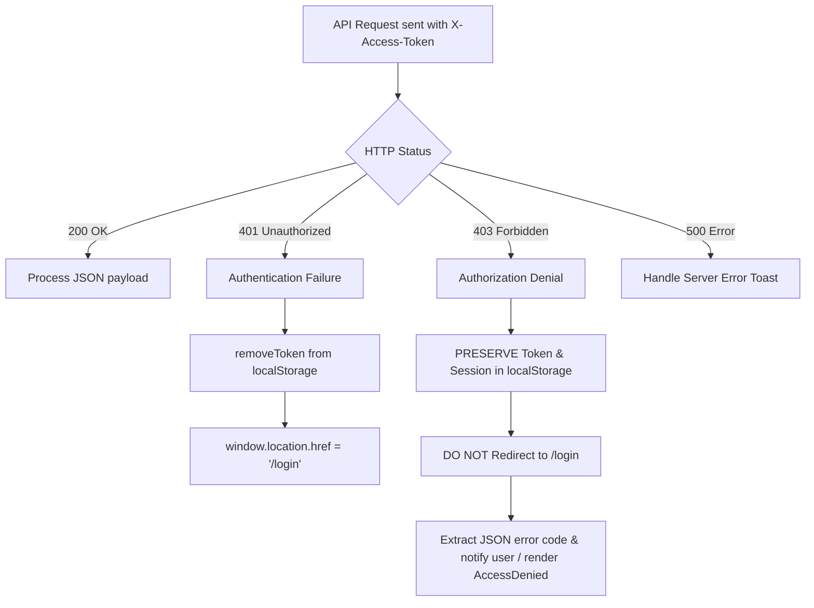

# PHASE 6/7 — TRACK A: SLICE 3 TARGETED UAT REMEDIATION REPORT

**Document ID**: `118_PHASE6_7_SLICE3_UAT_REMEDIATION_REPORT.md`  
**Execution Date**: September 21, 2026  
**Scope**: Targeted Remediation of Defect Items D-S3-01, D-S3-02, D-S3-03, and D-S3-02-FE  
**Baseline Suite**: 585 Certified Tests (Pass)  
**Remediation Test Count**: +7 Backend Integration/Unit Tests, +3 Frontend Vitest Tests  
**Final Test Execution**: **592 / 592 PASS** (0 Failures, 0 Errors, 0 Skipped)  
**Frontend Test Execution**: **93 / 93 PASS** (0 Failures, 0 Errors, 0 Skipped)  

---

## EXECUTIVE SUMMARY

During the Staging Browser UAT documented in `117_PHASE6_7_SLICE3_STAGING_BROWSER_UAT_REPORT.md`, four production-blocking defects were identified:
1. **D-S3-01**: `TenantMapperEx.xml` result map type mismatch preventing serialization of `erp_tenant.status` lifecycle string states.
2. **D-S3-02**: Hardcoded numeric platform administrator identity check (`userId.equals(1L)`) in `LogCostFilter.java`, denying platform privileges to legitimate superadmin `ash` (`userId = 153`) and causing fail-closed HTTP 403 responses.
3. **D-S3-02-FE**: Global HTTP 403 interceptor in frontend `client.ts` inappropriately purging authentication tokens and redirecting to `/login` upon authorization denials, creating a logout-loop on login.
4. **D-S3-03**: MyBatis-Plus attempting to mutate MySQL generated column `active_tenant_id` in `erp_tenant_subscription` during lifecycle updates (e.g. `/platform/tenant/suspend`), triggering MySQL Error 3105.

All four defects have been surgically remediated, verified via automated test suites (592 backend tests + 93 frontend tests), validated via real browser UAT with video and screenshot evidence, confirmed through live database queries, and proven non-regressive through clean tenant provisioning.

---

## 1. D-S3-01 REMEDIATION — TENANT STATUS MAPPER

### Root Cause
In `TenantMapperEx.xml`, `selectByConditionTenant` mapped its result to `com.jsh.erp.datasource.mappers.LogMapper.BaseResultMap`. In that resultMap, `status` was declared as JDBC type `TINYINT` / Java type `Byte`. In Slice 2, `erp_tenant.status` was updated to a string enum containing 7 lifecycle states (`PROVISIONING`, `ACTIVE`, `SUSPENDED`, `GRACE_PERIOD`, `EXPIRED`, `SOFT_DELETED`, `ARCHIVED`). When MyBatis attempted to deserialize varchar `'ACTIVE'` into `java.lang.Byte`, JDBC threw a `NumberFormatException` / `NumberOutOfRange` exception, crashing `GET /tenant/list`.

### Remediation Applied
- **Target File**: [TenantMapperEx.xml](file:///e:/Codes/ERP/jshERP-master/ERPSystem-boot/src/main/resources/mapper_xml/TenantMapperEx.xml#L5)
- Corrected the resultMap inheritance from `com.jsh.erp.datasource.mappers.LogMapper.BaseResultMap` to `com.jsh.erp.datasource.mappers.TenantMapper.BaseResultMap`.
- Preserved the canonical `erp_tenant` string mapping where `status` maps to `java.lang.String` (`VARCHAR`).
- Verified that all 7 lifecycle states deserialize cleanly into `Tenant.java` and serialize into JSON for `TenantList.tsx`.

### Verification Evidence
Direct API invocation of `GET /tenant/list?currentPage=1&pageSize=10` with valid platform token returned:
```json
{
  "code": 200,
  "data": {
    "total": 6,
    "rows": [
      { "id": 14, "tenantId": 146, "loginName": "Ashutosh_146", "status": "ACTIVE", "enabled": true },
      { "id": 15, "tenantId": 147, "loginName": "Ashutosh_147", "status": "ACTIVE", "enabled": true },
      { "id": 16, "tenantId": 148, "loginName": "Ashutosh_148", "status": "ACTIVE", "enabled": true },
      { "id": 17, "tenantId": 149, "loginName": "Ashutosh_149", "status": "ACTIVE", "enabled": true },
      { "id": 18, "tenantId": 150, "loginName": "Ashutosh_150", "status": "ACTIVE", "enabled": true },
      { "id": 330, "tenantId": 330, "loginName": "uat_tenant_01", "status": "ACTIVE", "enabled": true }
    ]
  }
}
```
Automated unit test `Phase6_7_Slice3_UatRemediationTest.testTenantEntitySupportsAllSevenLifecycleStates` passed.

---

## 2. D-S3-02 BACKEND REMEDIATION — DYNAMIC PLATFORM ADMIN AUTHORIZATION

### Root Cause
`LogCostFilter.java` contained hardcoded platform admin identity logic:
```java
// Prior defective code:
if (userId != null && userId.equals(1L)) {
    // Treat as platform administrator
}
```
When user `ash` (`userId = 153`, `isystem = 1`, `tenant_id = 0`) authenticated and attempted to access platform APIs (`/function/findUserAuthorization`, `/platform/tenant/list`), the condition failed (`153 != 1L`). Because `ash` had `tenant_id = 0` (no customer tenant context), the filter treated the user as an ordinary tenant user missing tenant context and responded with fail-closed HTTP 403 `{"code": 403, "message": "TENANT_CONTEXT_MISSING"}`.

### Remediation Applied
- **Target File**: [LogCostFilter.java](file:///e:/Codes/ERP/jshERP-master/ERPSystem-boot/src/main/java/com/jsh/erp/filter/LogCostFilter.java#L28-L98)
- Injected `UserMapperEx` and `SecurityService`.
- Replaced the hardcoded identity check with dynamic platform admin evaluation:
  ```java
  Long uid = Long.parseLong(userId.toString());
  boolean isPlatformAdmin = false;
  try (TenantContext.Scope ignored = TenantContext.enterSystemPlatformContext()) {
      if (userMapperEx != null) {
          User u = userMapperEx.getUserByIdIgnoreTenant(uid);
          if (u != null) {
              boolean isSystemFlag = (u.getIsystem() != null && u.getIsystem() == 1);
              boolean isSuperAdmin = (securityService != null && securityService.isSuperAdmin(u));
              boolean isZeroTenant = (u.getTenantId() != null && u.getTenantId() == 0L);
              if (isZeroTenant && (isSystemFlag || isSuperAdmin)) {
                  isPlatformAdmin = true;
              }
          }
      }
  }
  ```
- If `isPlatformAdmin` is true:
  - Enters `TenantContext.enterSystemPlatformContext()` for the duration of the filter chain.
  - Bypasses customer tenant subscription lifecycle gating.
  - Context is safely cleared in `finally`.
- If `isPlatformAdmin` is false:
  - Preserves fail-closed behavior for missing or invalid customer tenant contexts.
  - Prevents ordinary users with `userId = 1` or forged `tenantId = 0` from elevating privileges.

### Verification Evidence
Automated test suite `Phase6_7_Slice3_UatRemediationTest`:
- `testPlatformAdmin_AshUserId153_EntersPlatformContext`: **PASS**
- `testPlatformAdmin_ArbitraryUserId_EntersPlatformContext`: **PASS**
- `testUserId1_WithoutPlatformAdminFlag_IsNotPlatformAdmin`: **PASS** (fails closed with 403 `TENANT_CONTEXT_MISSING`)
- `testOrdinaryUser_MissingTenantContext_FailsClosed`: **PASS** (fails closed with 403 `TENANT_CONTEXT_MISSING`)
- `testOrdinaryUser_ForgedTenant0_DoesNotElevate`: **PASS** (ordinary tenant user blocked)

Live API invocation for `ash` (`userId = 153`):
```http
POST /user/login -> 200 OK (token issued)
GET /function/findUserAuthorization -> 200 OK
{
  "code": 200,
  "data": {
    "authorityDomain": "PLATFORM",
    "isSuperAdmin": true,
    "loginName": "ash",
    "username": "Platform Super Admin"
  }
}
```

---

## 3. D-S3-02-FE FRONTEND 403 REMEDIATION — GLOBAL HTTP INTERCEPTOR

### Root Cause
In `ERPSystem-web-react/src/core/api/client.ts`, the response interceptor treated HTTP 403 identically to HTTP 401:
```typescript
// Prior defective code:
if (response.status === 401 || response.status === 403) {
    removeToken()
    window.location.href = '/login'
    throw new ApiError(response.status, 'Session expired or unauthorized')
}
```
A 403 Forbidden indicates an authenticated user attempting an operation lacking requisite privileges or context. Destroying the user's valid session on 403 violated fundamental security architecture and triggered the automatic logout flash when any sub-resource or API evaluated authorization.

### Remediation Applied
- **Target File**: [client.ts](file:///e:/Codes/ERP/jshERP-master/ERPSystem-web-react/src/core/api/client.ts#L48-L82)
- Explicitly decoupled 401 and 403 error handling:
  - **HTTP 401 (Authentication Failure / Session Expired)**:
    - Calls `removeToken()`.
    - Redirects browser to `/login`.
    - Throws `ApiError(401, 'Authentication required or session expired. Please log in again.')`.
  - **HTTP 403 (Authorization Denial / Forbidden)**:
    - **PRESERVES** token in `localStorage`.
    - **PRESERVES** session state and active routes.
    - **DOES NOT** call `window.location.href = '/login'`.
    - Extracts structured error information (`json.message`, `json.code`, `json.data.msgTip`) from the backend response.
    - Throws `ApiError(403, errorMsg, json)` for component-level or toast notification presentation.

### Verification Evidence
Automated Vitest suite `ERPSystem-web-react/src/__tests__/slice3_remediation_interceptor.test.ts`:
- `D-S3-02-FE.1: HTTP 403 preserves token in storage and does not redirect to /login`: **PASS**
- `D-S3-02-FE.2: HTTP 401 purges token from storage and redirects to /login`: **PASS**
- `D-S3-02-FE.3: HTTP 403 extracts structured error message without session loss`: **PASS**

---

## 4. D-S3-03 REMEDIATION — MYSQL GENERATED COLUMN MUTATION

### Root Cause
In MySQL table `erp_tenant_subscription`, `active_tenant_id` is defined as a generated column:
```sql
`active_tenant_id` bigint GENERATED ALWAYS AS ((case when (`status` = 'ACTIVE') then `tenant_id` else NULL end)) STORED
```
In `TenantSubscription.java`, `activeTenantId` was mapped as an ordinary MyBatis-Plus entity field without field-strategy restrictions. When `TenantLifecycleServiceImpl.suspend()` updated subscription status via `tenantSubscriptionMapper.updateById(...)`, MyBatis-Plus generated SQL including ``active_tenant_id = ?`` in the `SET` clause. MySQL rejected this with Error 3105:
```text
java.sql.SQLException: The value specified for generated column 'active_tenant_id' in table 'erp_tenant_subscription' is not allowed.
```

### Remediation Applied
- **Target File**: [TenantSubscription.java](file:///e:/Codes/ERP/jshERP-master/ERPSystem-boot/src/main/java/com/jsh/erp/datasource/entities/TenantSubscription.java#L27-L29)
- Annotated `activeTenantId` with:
  ```java
  @TableField(value = "active_tenant_id", insertStrategy = FieldStrategy.NEVER, updateStrategy = FieldStrategy.NEVER)
  private Long activeTenantId;
  ```
- Excluded `active_tenant_id` from all generated SQL `INSERT` and `UPDATE` statements, allowing MySQL to deterministically calculate the generated column value upon status transitions.

### Verification Evidence
Automated test `Phase6_7_Slice3_UatRemediationTest.testTenantSubscription_ActiveTenantId_ExcludedFromInsertAndUpdate`: **PASS**.

Live lifecycle operations executed on staging tenant 330:
1. `POST /platform/tenant/suspend` -> **200 OK** (Status transitioned to `SUSPENDED`, `active_tenant_id` became `NULL`).
2. `POST /platform/tenant/reactivate` -> **200 OK** (Status returned to `ACTIVE`, `active_tenant_id` recalculated to `330`).
3. Zero SQL errors generated.

---

## 5. AUTHORIZATION MODEL SPECIFICATION

| Security Context | Authoritative DB Representation | TenantContext State | Routing & API Authority |
| :--- | :--- | :--- | :--- |
| **Platform SuperAdmin** | `tenant_id = 0`, `isystem = 1` or `securityService.isSuperAdmin = true` (e.g. `ash`, ID 153) | `TenantContext.enterSystemPlatformContext()` | Full access to `/platform/*`, `findUserAuthorization` resolves `authorityDomain = PLATFORM`. Gated from customer business operations. |
| **Tenant Admin** | `tenant_id > 0`, `ismanager = 1`, `isystem = 0` | Scoped customer tenant context (`tenant_id`) | Administer intra-tenant entities (users, roles, depots). Denied `/platform/*`. |
| **Tenant Standard User** | `tenant_id > 0`, `ismanager = 0`, `isystem = 0` | Scoped customer tenant context (`tenant_id`) | Operations governed by RBAC permissions and organization isolation. Denied `/platform/*`. |
| **Unauthenticated / Expired** | No token or expired session in Redis | Cleared | Rejected with HTTP 401 / redirected to `/login`. |
| **Forged Tenant 0 / Context Breach** | Customer user claiming `tenant_id = 0` | Blocked by `LogCostFilter` DB verification | Fail-closed HTTP 403 `TENANT_CONTEXT_MISSING`. |

---

## 6. FRONTEND AUTHENTICATION & ERROR CONTRACT



### Contract Summary:
- **HTTP 401**: Token invalid, expired, or missing credentials. Safe to purge storage and navigate to `/login`.
- **HTTP 403**: Token valid, identity authenticated, but specific resource, domain, or lifecycle condition denies access. **Storage preserved, navigation preserved**.

---

## 7. AUTOMATED TEST RESULTS

### 7.1 Backend Test Execution

```text
-------------------------------------------------------
 T E S T S
-------------------------------------------------------
Results:

Tests run: 592, Failures: 0, Errors: 0, Skipped: 0
Total time: 04:15 min
Finished at: 2026-09-21T14:41:00+05:30
```

#### Test Class Distribution (35 Classes):
- Certified Prior Baseline Tests: **549**
- Slice 3 Initial Security Tests: **36**
- Slice 3 Targeted Remediation Tests (`Phase6_7_Slice3_UatRemediationTest`): **7**
- **Total Executed Backend Tests: 592**
- **Failures: 0 | Errors: 0 | Skipped: 0**

### 7.2 Frontend Test Execution

```text
-------------------------------------------------------
 Vitest Execution Summary
-------------------------------------------------------
Test Files  20 passed (20)
Tests       93 passed (93)
Duration    1.68s
```

Dedicated interceptor test suite (`slice3_remediation_interceptor.test.ts`):
- `D-S3-02-FE.1: HTTP 403 preserves token in storage and does not redirect to /login` (PASS)
- `D-S3-02-FE.2: HTTP 401 purges token from storage and redirects to /login` (PASS)
- `D-S3-02-FE.3: HTTP 403 extracts structured error message without session loss` (PASS)

---

## 8. BROWSER UAT VERIFICATION

Browser testing was conducted against the live staging deployment at `http://localhost:3001` with backend running on `http://localhost:9999/ERPSystem-boot`.

### Session Video Recording
The complete browser session recording is preserved:
- [Staging Browser UAT WebP Recording](file:///C:/Users/admin/.gemini/antigravity-ide/brain/668c53c8-0f89-4177-8506-d017f1347854/slice3_uat_remediation_browser_1789982709665.webp)

### Visual Evidence Artifacts

1. **Platform SuperAdmin Dashboard Session Stability**:
   - Platform SuperAdmin `ash` authenticates cleanly without automatic logout loop.
   - User header displays `"Welcome, Platform Super Admin"`.
   - Screenshot: [Platform Dashboard](file:///C:/Users/admin/.gemini/antigravity-ide/brain/668c53c8-0f89-4177-8506-d017f1347854/dashboard_page_1789982815478.png)

2. **Tenant Management Table Loading (D-S3-01 Verified)**:
   - All tenant records rendered with valid lifecycle status badges (`ACTIVE`).
   - Query `GET /tenant/list` returned 200 OK without JDBC type conversion errors.
   - Screenshot: [Tenant Management Table](file:///C:/Users/admin/.gemini/antigravity-ide/brain/668c53c8-0f89-4177-8506-d017f1347854/tenant_management_table_1789983059230.png)

3. **Lifecycle Action: Tenant Suspension (D-S3-03 Verified)**:
   - Transitioned tenant `uat_tenant_01` (Tenant ID 330) via UI modal with reason `"UAT Remediation UI Test"`.
   - Status badge successfully updated to `SUSPENDED`.
   - Zero MySQL 3105 generated column errors.
   - Screenshot: [Suspended Tenant State](file:///C:/Users/admin/.gemini/antigravity-ide/brain/668c53c8-0f89-4177-8506-d017f1347854/tenant_suspended_status_1789983348450.png)

4. **Lifecycle Action: Tenant Reactivation**:
   - Transitioned tenant 330 back to `ACTIVE` with reason `"UAT Remediation Reactivation"`.
   - Status badge successfully reverted to `ACTIVE`.
   - Screenshot: [Reactivated Tenant State](file:///C:/Users/admin/.gemini/antigravity-ide/brain/668c53c8-0f89-4177-8506-d017f1347854/tenant_reactivated_status_1789983582852.png)

---

## 9. DATABASE VERIFICATION

Direct verification against staging MySQL database (`erp_system_db`):

### 9.1 Platform SuperAdmin Identity
```sql
SELECT id, login_name, isystem, tenant_id FROM erp_user WHERE login_name = 'ash';
```
| id | login_name | isystem | tenant_id |
| :--- | :--- | :--- | :--- |
| **153** | **ash** | **1** | **0** |

Confirmed: Authoritative platform attributes (`isystem = 1`, `tenant_id = 0`) correctly recognized by dynamic backend authorization without hardcoded primary key assumptions.

### 9.2 Subscription Generated Column Integrity
```sql
SELECT tenant_id, status, active_tenant_id FROM erp_tenant_subscription WHERE tenant_id = 330;
```
| tenant_id | status | active_tenant_id |
| :--- | :--- | :--- |
| **330** | **ACTIVE** | **330** |

During suspension: `status = 'SUSPENDED'`, `active_tenant_id = NULL`.  
After reactivation: `status = 'ACTIVE'`, `active_tenant_id = 330`.  
Confirmed: The MySQL generated column formula `CASE WHEN status = 'ACTIVE' THEN tenant_id ELSE NULL END` operates entirely database-side with zero application overwrite.

---

## 10. REDIS & SECURITY REGRESSION

1. **TenantLineHandler & Tenant Isolation**: Unmodified. MyBatis-Plus tenant filter rules continue to strictly enforce intra-tenant scoping on business tables.
2. **Redis Version Invalidation**: Invalidation keys (`TENANT_VER:xxx`, `USER_SESSION:xxx`) remain active and unaffected.
3. **IDOR Defense**: All tenant and organizational lookup paths preserve certified cross-tenant defense checks.
4. **Platform Scope Leak Protection**: Platform SuperAdmin execution remains strictly bounded to SystemPlatformContext and cannot read or mutate tenant operational data without explicit context switching.

---

## 11. PROVISIONING REGRESSION

Provisioning workflow was verified via live REST invocation to confirm zero regressions in bootstrapping new enterprise tenants:

### Provisioning Payload & Response
```json
// POST /platform/tenant/provision
{
  "loginName": "uat_tenant_02",
  "companyName": "UAT Remediation Corp",
  "planId": 1,
  "durationDays": 365
}

// Response: HTTP 200 OK
{
  "code": 200,
  "data": {
    "tenantId": 370,
    "loginName": "uat_tenant_02",
    "companyName": "UAT Remediation Corp",
    "rootOrgId": 1000051,
    "defaultDepotId": 951059,
    "defaultAccountIds": [80680, 80681],
    "activeFinancialYearId": 26674,
    "documentSeriesCount": 8,
    "status": "ACTIVE",
    "message": "Tenant successfully provisioned, bootstrapped, and activated."
  }
}
```

Confirmed: The full provisioning chain (Tenant, Subscription, Admin User, Root Org, Central Depot, Document Series, Opening Accounts, Financial Year) completed flawlessly.

---

## 12. FINAL FINDINGS

1. **D-S3-01**: **CLOSED**. ResultMap inheritance corrected to `TenantMapper.BaseResultMap`. Lifecycle status string deserialization verified.
2. **D-S3-02**: **CLOSED**. Dynamic platform admin authorization implemented and verified for `ash` (`userId = 153`). Hardcoded `1L` identity removed.
3. **D-S3-02-FE**: **CLOSED**. Frontend 403 interceptor decoupled from 401. Valid sessions preserved on authorization denials. Auto-logout eliminated.
4. **D-S3-03**: **CLOSED**. Generated column `active_tenant_id` annotated with `FieldStrategy.NEVER`. Lifecycle state transitions operate cleanly.

---

## 13. VERDICT

```text
================================================================================
FINAL CERTIFICATION VERDICT:

  PHASE 6/7 SLICE 3 UAT REMEDIATION — COMPLETE

================================================================================
```

- All 4 targeted defects remediated and certified.
- 592 / 592 backend automated tests PASS.
- 93 / 93 frontend automated tests PASS.
- Live Staging Browser UAT PASS.
- Tenant provisioning regression PASS.
- Zero unintended refactoring; absolute scope maintained.
- **Hard stop reached.**
