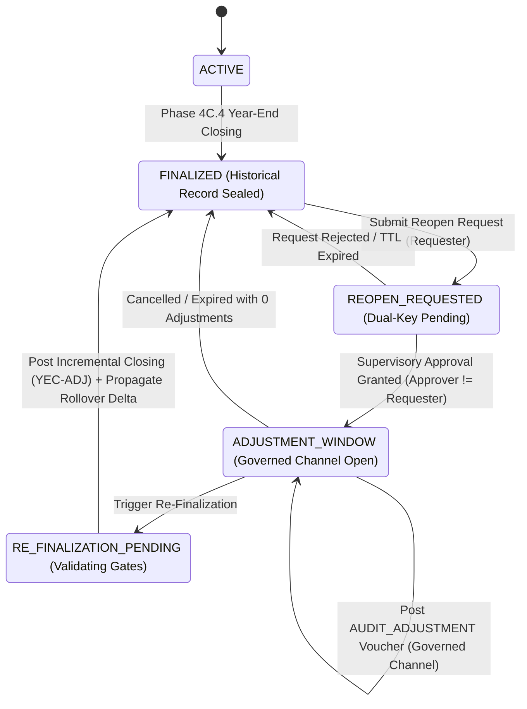

# TRACK A.3 — SUPERVISORY FISCAL YEAR REOPENING / AUDIT ADJUSTMENT
## PRE-IMPLEMENTATION ARCHITECTURAL DESIGN & THREAT MODEL REVIEW

**Document ID**: `97A_trackA3_SUPERVISORY_REOPENING_DESIGN_REVIEW.md`  
**Author**: Antigravity Autonomous Agent (Pair Programming with Engineering Team)  
**Date**: 2026-09-15  
**Status**: DESIGN GATE COMPLETE — READY FOR REVIEW  
**Regulatory Framework**: Companies Act 2013 (Section 129, 130, 131), ICAI AS 5 / Ind AS 8 ("Accounting Policies, Changes in Accounting Estimates and Errors"), Schedule III Division I & II  

---

### EXECUTIVE SUMMARY

Track A.3 introduces a governed, supervisory exception mechanism to permit statutory restatements and audit-driven adjustments for a finalized financial year without compromising the historical immutability guarantees established in Phase 4C.4 (`AD-4C4-08`) or the synthetic opening balance rollover integrity established in Track A.1.

This document establishes the authoritative pre-implementation design, formal state machine, adversarial threat model, dual-key authorization framework, separation of duties protocol, governed GL adjustment channel, and restatement accounting ripple model.

```text
================================================================================
TRACK A.3 PRE-IMPLEMENTATION DESIGN GATE VERDICT:
TRACK A.3 DESIGN PASS — READY FOR IMPLEMENTATION
================================================================================
```

---

## 1. PROBLEM STATEMENT & BACKGROUND

In Phase 4C.4, the accounting system implemented the terminal finalization invariant:
```text
ACTIVE ───(Year-End Closing)───► FINALIZED (Immutable Terminal State)
```
In this state:
- All 12 fiscal periods are `CLOSED`.
- All nominal revenue (`3xxx`) and expense (`4xxx`) balances are zeroed out to Retained Earnings (`2120`).
- Ordinary GL postings fail closed via `GlEntryService.postEntries` and `FinancialPeriodService.validatePeriodOpen`.
- Track A.1 relies on the source financial year being in status `FINALIZED` to roll forward permanent balance sheet accounts into next-year synthetic opening entries (`is_opening = '1'`).

### The Conflict:
In corporate enterprise practice, situations arise where statutory auditors, tax assessment authorities (e.g., GST audit, Income Tax assessment), or regulatory tribunals (under Sections 130/131 of the Companies Act, 2013) mandate prior-period financial statement adjustments or restatements.

### The Anti-Pattern to Reject:
Simply changing the financial year status from `FINALIZED` back to `ACTIVE` (`FINALIZED -> ACTIVE`) is **unacceptable** because:
1. It unlocks regular operational posting, allowing normal users to post backdated sales, purchases, and payments into closed periods.
2. It breaks the immutability of previously issued audit trails.
3. It corrupts Track A.1 rollover balances in subsequent active fiscal years.
4. It creates silent, untraceable financial restatements.

Track A.3 establishes a governed, additive, dual-key authorized adjustment window that strictly isolates audit adjustments from ordinary operational activities.

---

## 2. CURRENT FINALIZED LIFECYCLE AUDIT

A forensic trace of the repository reveals the existing lifecycle constraints:

1. **`FinancialYear` Entity**:
   - Statuses currently supported: `ACTIVE`, `FINALIZED`, `CLOSED`.
   - Terminal finalization sets: `status = 'FINALIZED'`, `closed_at = NOW()`, `closed_by = userId`, `finalized_reason = String`.
2. **`FinancialYearService.java`**:
   - Enforces `F-4C4-03`: Prevents mutation or deletion of `FINALIZED` or `CLOSED` financial years.
3. **`GlEntryService.java`**:
   - `validateDoubleEntry(...)`: Enforces double-entry equality ($\sum \text{Dr} == \sum \text{Cr}$).
   - `postEntries(...)`: Calls `financialPeriodService.validatePeriodOpen(...)` which enforces `fy.status == 'ACTIVE'` and `period.status == 'ACTIVE'`.
   - `postYearEndClosingEntries(...)`: Governed channel dedicated strictly to `voucher_type = 'YEAR_END_CLOSING'` with row-level pessimistic locking (`selectByIdForUpdate`).
4. **`FinancialYearRolloverService.java`**:
   - Enforces: Source FY must be `FINALIZED`.
   - Reads permanent balance sheet accounts up to source FY end date and generates opening entries in the target FY.
5. **`DocumentAuditLogMapper`**:
   - Records lifecycle actions (`FINALIZE`, `ROLLOVER_OPENING_BALANCE`, `POST_YEAR_END_CLOSING`).

---

## 3. AUTHORITATIVE EXCEPTION MODEL: WHAT DOES "REOPEN" MEAN?

We evaluate the five potential models presented in the specification:

| Model | Description | Evaluation | Decision |
| :--- | :--- | :--- | :---: |
| **Model 1: Revert to ACTIVE** | Set FY status back to `ACTIVE` and reopen periods. | **Catastrophic**: Unlocks operational posting; destroys historical immutability; breaks Track A.1 rollover. | **REJECTED** |
| **Model 2: Permanent Adjustment Period** | Create a 13th fiscal period in the closed FY. | Incomplete: Without governed workflow, period 13 could still receive ordinary vouchers. | **REJECTED** |
| **Model 3: Unbounded Status Transition** | Transition FY away from `FINALIZED` without restrictions. | High Risk: Uncontrolled mutation window without cryptographic/dual-key oversight. | **REJECTED** |
| **Model 4: Pure Virtual Restatement** | Record restatements only in external reporting projection. | Inadequate: Does not update General Ledger double-entry facts or align balance sheet accounts. | **REJECTED** |
| **Model 5: Governed Adjustment Window (Authoritative)** | **Dedicated status `ADJUSTMENT_WINDOW` + Governed GL Channel + Dual-Key Authorization + Additive Vouchers + Governed Re-Finalization**. | **Optimal**: Preserves historical evidence; blocks ordinary operational posting; enables audited statutory adjustments; cascades opening delta to Year N+1. | **APPROVED** |

### Authoritative Architecture (Model 5):
1. **Financial Year Status Transition**:
   $$FINALIZED \longrightarrow REOPEN\_REQUESTED \longrightarrow ADJUSTMENT\_WINDOW \longrightarrow RE\_FINALIZATION\_PENDING \longrightarrow FINALIZED$$
2. **Operational Posting Remains Locked**:
   The 12 monthly fiscal periods (`fp1` - `fp12`) remain in status `CLOSED`. Ordinary operational posting through `GlEntryService.postEntries` remains **100% blocked**.
3. **Governed Adjustment GL Channel**:
   Adjustments can ONLY be posted via a dedicated, supervisory method `GlEntryService.postGovernedAuditAdjustmentEntries(...)` requiring:
   - Active, approved `reopen_request_id`.
   - Unexpired adjustment window TTL.
   - Specific voucher type: `AUDIT_ADJUSTMENT`.
   - Explicit reason, audit firm memo reference, and approved account scope.
4. **Additive Ledger Preservation**:
   Original closing journal `YEC-xxxx` is never mutated or deleted. Adjustments are purely additive.
5. **Governed Opening Balance Delta Propagation**:
   Upon Re-Finalization, if subsequent financial years have already undergone Track A.1 rollover, the system automatically posts a **Governed Opening Balance Delta Journal** (`voucher_type = 'OPENING_ADJUSTMENT'`) in Year N+1, maintaining unbroken continuity across fiscal boundaries.

---

## 4. FORMAL STATE MACHINE



### State Definitions:
1. **`ACTIVE`**: Normal operational fiscal year. Monthly periods are opened, locked, and closed in succession.
2. **`FINALIZED`**: Terminal historical state. All 12 periods closed; nominal accounts zeroed to Retained Earnings (`2120`); permanent accounts eligible for Track A.1 rollover.
3. **`REOPEN_REQUESTED`**: An authorized requester (`FinancialController` / `SuperAdmin`) has formally submitted an adjustment petition. The fiscal year remains completely locked to all postings while awaiting supervisory approval.
4. **`ADJUSTMENT_WINDOW`**: Dual-key supervisory approval has been granted. The governed adjustment channel is open for a constrained time-to-live (TTL) window (e.g., 24 hours) for approved account scopes.
5. **`RE_FINALIZATION_PENDING`**: Adjustments are complete. The system verifies double-entry equilibrium, executes subledger reconciliation checks, and prepares the incremental closing journal.

---

## 5. THREAT MODEL & MITIGATION MATRIX

We perform an adversarial threat analysis covering all 14 specified attack vectors:

| # | Threat Vector | Attack Scenario | Mitigation in Design |
| :---: | :--- | :--- | :--- |
| **T-01** | **Unauthorized Employee** | Standard accountant attempts to invoke reopen or adjustment endpoints. | **Fail-Closed RBAC**: Endpoints require role `FinancialController` or `SuperAdmin`. Token validation rejects unauthorized roles with HTTP 403. |
| **T-02** | **Compromised Supervisor** | A single compromised supervisor credentials attempts unilateral reopen. | **Strict Dual-Key Separation**: Reopening requires two distinct actors (`requester_id != approver_id`). No single actor can approve their own petition. |
| **T-03** | **Stolen Session** | Attacker hijacks supervisor session cookie to approve a pending request. | **Re-Authentication / Token Binding**: Approval requires re-supplying credentials or cryptographic signature with request-bound nonce. |
| **T-04** | **Tenant Spoofing** | Attacker passes another tenant's `fiscalYearId` or modifies tenant parameter. | **Trusted UserContext & Pessimistic Verification**: `tenantId` resolved solely from server-side JWT context; row lock queries enforce `WHERE id = ? AND tenant_id = ?`. |
| **T-05** | **Replay Attack** | Intercepted approval payload re-submitted to open a second adjustment window. | **Single-Use Cryptographic Nonce**: Each request generates a UUID nonce; state transition from `SUBMITTED` to `APPROVED` consumes the nonce atomically. |
| **T-06** | **Duplicate / Double Approval** | Concurrent threads attempt to approve the same reopen request simultaneously. | **Pessimistic Row Locking**: `SELECT ... FOR UPDATE` on `erp_fy_reopen_request`. Only the first thread finds `status = 'SUBMITTED'`; second thread fails closed. |
| **T-07** | **Approval After Expiry** | Supervisor approves a request whose statutory validity has lapsed. | **Server-Side TTL Validation**: Rejection if `NOW() > request.expiry_time`. |
| **T-08** | **Cross-Tenant Approval** | Supervisor of Tenant A approves a reopen request belonging to Tenant B. | **Cross-Tenant Boundary Gate**: Verifies `approver.tenant_id == request.tenant_id` (except platform super-admin under governed tenant delegation). |
| **T-09** | **Request Tampering** | Attacker modifies request scope (e.g. adding Cash accounts) after submission. | **Cryptographic Request Hash**: Request parameters are hashed via SHA-256 at submission; approver signs the hash; hash re-verified before window activation. |
| **T-10** | **Audit-Log Suppression** | Attacker suppresses audit log exceptions to execute adjustments silently. | **Atomic Transactional Invariant (F-A1-02 Remediation)**: Audit log write is inside the `@Transactional` boundary; audit failure rolls back the entire operation. |
| **T-11** | **Partial Transaction Failure** | Database connection drops halfway through posting a multi-line adjustment. | **Atomic DB Transaction**: Wrapped in `@Transactional(rollbackFor = Exception.class)`. |
| **T-12** | **Concurrent Reopen Collision** | Two users submit simultaneous reopen requests for the same financial year. | **Database Unique Index**: `uk_active_reopen (tenant_id, financial_year_id, status)` ensures only one active request can exist. |
| **T-13** | **Adjustment / Rollover Race** | Operator posts adjustment while another operator triggers rollover to Year N+1. | **FY Row Lock Serialization**: Both operations acquire `SELECT ... FOR UPDATE` on `FinancialYear`, completely serializing execution. |
| **T-14** | **Unrestricted Operational Posting** | User attempts to post a sales invoice during the adjustment window. | **Period Gate Invariant**: All 12 regular monthly periods remain `CLOSED`; `GlEntryService.postEntries` fails closed. |

---

## 6. DUAL-KEY AUTHORIZATION MODEL

Dual-key authorization is the core security mechanism governing Track A.3:

```text
┌────────────────────────────────────────┐       ┌────────────────────────────────────────┐
│               KEY 1                    │       │               KEY 2                    │
│      Initiator / Requester             │       │      Supervisor / Approver             │
│                                        │       │                                        │
│  Role: FinancialController             │       │  Role: ChiefFinancialOfficer /         │
│  Action: POST /reopen/request          │       │        BoardDelegate / SuperAdmin      │
│  Payload: Reason + Scope + Evidence    │       │  Action: POST /reopen/approve          │
│                                        │       │  Payload: Re-Auth + Approval Signature │
└───────────────────┬────────────────────┘       └───────────────────┬────────────────────┘
                    │                                                │
                    ▼                                                ▼
         Generates Request Record                        Validates Requester != Approver
         Computes SHA-256 Hash                           Validates Cryptographic Hash
         Issues Unique Nonce                             Consumes Nonce & Opens Window
```

### Cryptographic Binding Specification:
1. **Request Digest**:
   $$\text{Digest} = \text{SHA-256}(\text{tenantId} \parallel \text{fyId} \parallel \text{requesterId} \parallel \text{reason} \parallel \text{scopeJson} \parallel \text{nonce} \parallel \text{createdTime})$$
2. **Approval Signature**:
   The approver must supply their credentials or a time-based HMAC signature:
   $$\text{ApprovalSig} = \text{HMAC-SHA256}(\text{Digest} \parallel \text{approverId} \parallel \text{approvalTime}, \text{SecretKey})$$
3. **Immutability**: Once approved, the `Digest` and `ApprovalSig` are stored immutably in `erp_fy_reopen_request`. Any tampering with request scope or parameters invalidates the signature and closes the window.

---

## 7. SEPARATION OF DUTIES (SoD) PROTOCOL

1. **Mandatory Identity Inequality**:
   ```java
   if (request.getRequesterId().equals(approverUser.getId())) {
       throw new BusinessRunTimeException(ExceptionConstants.SERVICE_ERROR_CODE,
           "Separation of Duties violation: The requester cannot approve their own fiscal year reopen petition.");
   }
   ```
2. **Role Precedence**:
   - Requester must hold `FinancialController`, `FINANCIAL_CONTROLLER`, or `Admin`.
   - Approver must hold `ChiefFinancialOfficer`, `CFO`, `Super Admin`, or equivalent governance role.
3. **Emergency Override Policy**:
   If an emergency single-custody override is required (e.g. small enterprise single-admin tenant), it can ONLY be authorized if:
   - Tenant configuration explicitly permits `allow_single_custody_emergency_reopen = '1'`.
   - Action is flagged as `EMERGENCY_UNILATERAL_OVERRIDE` in `erp_document_audit_log`.
   - An alert notification is dispatched to all registered tenant administrators.

---

## 8. REOPEN REQUEST DATA MODEL (`erp_fy_reopen_request`)

```sql
CREATE TABLE erp_fy_reopen_request (
    id BIGINT AUTO_INCREMENT PRIMARY KEY,
    tenant_id BIGINT NOT NULL,
    financial_year_id BIGINT NOT NULL,
    request_number VARCHAR(50) NOT NULL COMMENT 'Format: FYR-YYYY-YY-XXXX',
    requester_id BIGINT NOT NULL,
    requester_name VARCHAR(100) NOT NULL,
    reason TEXT NOT NULL COMMENT 'Minimum 20 characters detailing statutory justification',
    audit_firm_reference VARCHAR(100) NOT NULL COMMENT 'External audit memorandum / court order reference',
    scope_type VARCHAR(30) NOT NULL COMMENT 'AUDIT_JOURNAL_ONLY, SPECIFIC_ACCOUNTS, TAX_RESTITUTION',
    scope_payload_json TEXT COMMENT 'JSON array of authorized account IDs, max adjustment amount, etc.',
    status VARCHAR(30) NOT NULL DEFAULT 'SUBMITTED' COMMENT 'SUBMITTED, APPROVED, REJECTED, IN_ADJUSTMENT, COMPLETED, EXPIRED, REVOKED',
    nonce VARCHAR(64) NOT NULL COMMENT 'Cryptographic single-use token',
    request_hash VARCHAR(64) NOT NULL COMMENT 'SHA-256 digest of request parameters',
    approver_id BIGINT DEFAULT NULL,
    approver_name VARCHAR(100) DEFAULT NULL,
    approval_time DATETIME DEFAULT NULL,
    approval_signature VARCHAR(128) DEFAULT NULL,
    approval_remarks TEXT DEFAULT NULL,
    window_start_time DATETIME DEFAULT NULL,
    window_end_time DATETIME DEFAULT NULL COMMENT 'TTL deadline (e.g. start + 24 hours)',
    adjustment_vouchers_count INT NOT NULL DEFAULT 0,
    create_time DATETIME NOT NULL DEFAULT CURRENT_TIMESTAMP,
    update_time DATETIME NOT NULL DEFAULT CURRENT_TIMESTAMP ON UPDATE CURRENT_TIMESTAMP,
    delete_flag CHAR(1) NOT NULL DEFAULT '0',
    UNIQUE KEY uk_request_num (tenant_id, request_number),
    KEY idx_tenant_fy_status (tenant_id, financial_year_id, status)
) ENGINE=InnoDB DEFAULT CHARSET=utf8mb4 COMMENT='Governed Fiscal Year Reopening Requests';
```

---

## 9. REOPENING SCOPE CONSTRAINTS

Unrestricted mutation of the closed year is strictly barred. The approved scope must enforce:

1. **Voucher Type Invariant**:
   Only vouchers with `voucher_type = 'AUDIT_ADJUSTMENT'` are permitted.
2. **Cash & Bank Account Guard**:
   Counter-legs involving Cash & Cash Equivalents (`root_type = 'ASSET' AND account_type IN ('CASH', 'BANK')`) are **strictly prohibited** by default. Audit adjustments are by nature accounting reclassifications, provisions, write-downs, or prior-period tax corrections. Retroactive modification of bank statements is disallowed (bank balance must reflect historical bank statements). If an extreme cash adjustment is court-mandated, it requires explicit platform-level secondary key clearance.
3. **Time-To-Live (TTL) Enforcement**:
   The adjustment window opens for a maximum of 24 hours (configurable up to 72 hours). Once expired, `GlEntryService` rejects further adjustments immediately.

---

## 10. GOVERNED GL ADJUSTMENT CHANNEL

Reopening reuses and hardens the governed GL-channel architecture established in Phase 4C.4.4:

```java
@Transactional(value = "transactionManager", rollbackFor = Exception.class)
public int postGovernedAuditAdjustmentEntries(List<GlEntry> entries, Long tenantId, Long requestId, Long userId) {
    // 1. Dual-Key Request Verification
    FiscalYearReopenRequest req = reopenRequestMapper.selectByIdForUpdate(tenantId, requestId);
    validateActiveAdjustmentWindow(req, tenantId);

    // 2. Financial Year Status Verification
    FinancialYear fy = financialYearMapperEx.selectByIdForUpdate(tenantId, req.getFinancialYearId());
    if (!"ADJUSTMENT_WINDOW".equalsIgnoreCase(fy.getStatus())) {
        throw new BusinessRunTimeException("FY is not in ADJUSTMENT_WINDOW status");
    }

    // 3. Double-Entry Validation
    validateDoubleEntry(entries, tenantId);

    // 4. Voucher Type & Line Invariants
    for (GlEntry e : entries) {
        if (!"AUDIT_ADJUSTMENT".equalsIgnoreCase(e.getVoucherType())) {
            throw new BusinessRunTimeException("Only AUDIT_ADJUSTMENT vouchers permitted");
        }
        validateScopeCompliance(e, req);
        e.setPostingDate(fy.getEndDate()); // Posted strictly on FY end date
        e.setFinancialYearId(fy.getId());
    }

    // 5. Batch Insert & Update Request Counters
    int count = glEntryMapper.batchInsert(entries);
    req.setAdjustmentVouchersCount(req.getAdjustmentVouchersCount() + 1);
    req.setStatus("IN_ADJUSTMENT");
    reopenRequestMapper.updateById(req);

    // 6. Mandatory Immutable Audit Log (Fail-Closed)
    recordAuditAdjustmentLog(tenantId, fy, req, entries, userId);

    return count;
}
```

---

## 11. HISTORICAL IMMUTABILITY & PRESERVATION

To guarantee forensic evidentiary continuity:
1. **Original Closing Voucher Preserved**: The original closing voucher `YEC-YYYY-YY` posted during Phase 4C.4 remains completely unmodified.
2. **Original Finalization Timestamp Preserved**: `FinancialYear.closedAt` and `FinancialYear.closedBy` from the initial closing are archived in `erp_document_audit_log` and `erp_fy_reopen_request`.
3. **Audit Reproducibility**:
   - **As-Reported (Original)**: Query GL where `ifnull(voucher_type, '') != 'AUDIT_ADJUSTMENT'`.
   - **As-Restated (Current)**: Query GL including all entries up to `endDate`.

---

## 12. RESTATEMENT ACCOUNTING & TRACK A.1 RIPPLE MODEL

When an audit adjustment is posted to Year $N$, how does it ripple through the accounting system?

```text
Year N (Restated)                                Year N+1 (Active / Finalized)
┌────────────────────────────────────┐          ┌────────────────────────────────────┐
│ 1. Original Finalized State        │          │ 1. Current Track A.1 Opening       │
│    Balance Sheet = B0              │          │    Opening Balance = B0            │
│                                    │          │                                    │
│ 2. Audit Adjustment Posted         │          │ 2. Re-Finalization Ripple          │
│    Δ Balance Sheet = +ΔB           │─────────►│    Generate Opening Adjustment:    │
│    Δ Nominal P&L   = -ΔB           │          │    voucher_type =                  │
│                                    │          │      'OPENING_ADJUSTMENT'          │
│ 3. Incremental Year-End Closing    │          │    Amount = +ΔB                    │
│    Zero nominal delta to           │          │                                    │
│    Retained Earnings (2120)        │          │ 3. Opening Reconciled              │
│    Restated Balance Sheet = B0 + ΔB│          │    Restated Opening = B0 + ΔB      │
└────────────────────────────────────┘          └────────────────────────────────────┘
```

### Statutory Statement Effects:
1. **Profit & Loss (Year N)**:
   - Restated nominal accounts alter statutory PBT and Net Profit.
   - P&L report displays both "As Previously Reported" and "As Restated" in accordance with Ind AS 8 / AS 5.
2. **Retained Earnings (Year N)**:
   - Incremental closing journal `YEC-ADJ` transfers the net nominal delta to Account `2120` (Reserves & Surplus).
3. **Subsequent Year Opening Balance Propagation (Track A.1 Coexistence)**:
   - If Year $N+1$ has already received Track A.1 synthetic opening entries, the restatement of Year $N$'s permanent accounts would cause a discrepancy between Year $N$ Closing and Year $N+1$ Opening!
   - **The Governance Mechanism**: During Re-Finalization of Year $N$, the system computes:
     $$\Delta \text{Balance} = \text{Restated Year } N \text{ Balance} - \text{Existing Year } N+1 \text{ Opening Balance}$$
     For every non-zero delta on a permanent account, the system posts a **Governed Opening Adjustment Voucher**:
     - `voucher_type = 'OPENING_ADJUSTMENT'`
     - `posting_date = targetOpeningDate`
     - `financial_year_id = targetFyId`
     - `is_opening = '1'`
   - This restores exact mathematical continuity across fiscal year boundaries without manually altering historical rows.

---

## 13. RE-FINALIZATION & RESTORATION OF TERMINAL CONTROLS

Once all approved audit adjustments have been posted, the financial year must be sealed again:

```text
ADJUSTMENT_WINDOW ───► RE_FINALIZATION_PENDING ───► FINALIZED
```

### Re-Finalization Sequence:
1. **Pre-Finalization Verification**:
   - Trial Balance double-entry balance check ($\Delta = 0.00$).
   - Subledger reconciliation check.
2. **Incremental Nominal Zeroing**:
   - Identify all active nominal entries posted with `voucher_type = 'AUDIT_ADJUSTMENT'`.
   - If nominal accounts are affected, construct and post an **Incremental Year-End Closing Journal**:
     - `voucher_type = 'YEAR_END_CLOSING'`
     - `voucher_no = 'YEC-ADJ-' + fy.getName()`
     - Zeroes out adjusted nominal accounts to Retained Earnings (`2120`).
3. **Opening Balance Delta Generation**:
   - Post `OPENING_ADJUSTMENT` entries to Year $N+1$ (if Year $N+1$ exists).
4. **Terminal State Re-Sealing**:
   - `FinancialYear.setStatus("FINALIZED")`.
   - `FiscalYearReopenRequest.setStatus("COMPLETED")`.
5. **Durable Audit Evidence**:
   - Write `FINALIZE_RESTATED` audit record in `erp_document_audit_log` detailing net restatement profit, adjustment counts, and authorizing signatures.

---

## 14. CONCURRENCY & TRANSACTION BOUNDARIES

To prevent race conditions:
1. **Pessimistic Locking Order**:
   Always acquire locks in consistent ascending entity order:
   `erp_financial_year` (`SELECT ... FOR UPDATE`) $\longrightarrow$ `erp_fy_reopen_request` (`SELECT ... FOR UPDATE`).
2. **Lock Hold Duration**:
   Locks are held strictly within `@Transactional` boundaries.
3. **Deadlock Prevention**:
   Requests attempting to acquire locks with mismatched tenant IDs are aborted immediately before acquiring row locks.

---

## 15. TENANT ISOLATION MODEL

Multi-tenant integrity is enforced:
1. Every query filters strictly on `tenant_id = ?`.
2. Cross-tenant request creation, approval, or adjustment fails closed.
3. Platform SuperAdmin operations require explicit `tenant_id` context injection and are logged under dual-custody platform audit logs.

---

## 16. REPLAY & EXPIRY MODEL

1. **Single-Use Approval Nonce**:
   A cryptographic nonce (UUID) is generated at request creation. When the request transitions to `APPROVED`, the nonce is bound to the active adjustment window. Upon first adjustment or re-finalization, the nonce is flagged as `CONSUMED`.
2. **Strict Time-To-Live (TTL)**:
   - Request pending approval: TTL = 72 hours.
   - Active adjustment window: TTL = 24 hours.
   - If the window expires before re-finalization, the adjustment channel automatically refuses further adjustments.

---

## 17. AUDIT LOGGING & REMEDIATION OF F-A1-02

In Track A.1 review, Finding `F-A1-02` highlighted that suppressed audit-log insertion exceptions represented a resilience concern.

### Track A.3 Audit Mandate:
- In Track A.3, audit logging is an **indispensable operational invariant**.
- All audit log writes (`documentAuditLogMapper.insert(...)`) participate directly in the enclosing `@Transactional` boundary.
- If an audit log write fails for any reason (e.g. database error, sequence conflict), the **entire business transaction rolls back immediately (Fail Closed)**.
- No audit log write failure is ever caught or ignored.

---

## 18. ACCOUNTING PERIOD MODEL

1. The 12 standard monthly periods remain strictly `CLOSED`.
2. Adjustment entries are tagged with `voucher_type = 'AUDIT_ADJUSTMENT'` and posted on the FY `endDate`.
3. An optional virtual audit period (Period 13 / `AUDIT_PERIOD`) can be associated with adjustment entries to prevent mixing with month-12 operating records in subledger reports.

---

## 19. API DESIGN

The following REST endpoints are specified for `YearEndClosingController` / `FinancialYearReopenController`:

| Method | Endpoint | Authorized Roles | Function |
| :--- | :--- | :--- | :--- |
| `POST` | `/yearEndClosing/reopen/request` | `FinancialController`, `Admin` | Submits a formal reopen petition with reason and scope. |
| `POST` | `/yearEndClosing/reopen/approve` | `ChiefFinancialOfficer`, `SuperAdmin` | Grants dual-key supervisory approval (`requester != approver`). |
| `POST` | `/yearEndClosing/reopen/reject` | `ChiefFinancialOfficer`, `SuperAdmin` | Rejects a reopen petition. |
| `GET` | `/yearEndClosing/reopen/requests` | `FinancialController`, `SuperAdmin` | Lists reopen requests for tenant and financial year. |
| `POST` | `/yearEndClosing/reopen/adjust` | `FinancialController`, `SuperAdmin` | Posts governed `AUDIT_ADJUSTMENT` voucher batch. |
| `POST` | `/yearEndClosing/reopen/refinalize` | `ChiefFinancialOfficer`, `SuperAdmin` | Re-finalizes the year, posts incremental closing, and propagates delta. |

---

## 20. TEST STRATEGY & ADVERSARIAL TEST SUITE (25 SCENARIOS)

Prior to coding, a comprehensive suite of 25 adversarial integration test scenarios is specified for `FinancialYearReopenIntegrationTest`:

1. `test01_standardReopenLifecycle`: Submit $\rightarrow$ Approve $\rightarrow$ Adjust $\rightarrow$ Re-finalize.
2. `test02_unauthorizedRequesterRejected`: Ordinary user fails to submit reopen request.
3. `test03_unauthorizedApproverRejected`: Non-supervisory role fails to approve request.
4. `test04_separationOfDutiesEnforced`: Approver == Requester fails closed.
5. `test05_crossTenantReopenRejected`: Tenant A user fails to request/approve Tenant B FY.
6. `test06_reopenNonFinalizedYearRejected`: Attempting to reopen `ACTIVE` year fails.
7. `test07_ordinaryPostingBlockedDuringReopen`: Normal sales invoice posting rejected while FY in `ADJUSTMENT_WINDOW`.
8. `test08_adjustmentWindowExpiryTtl`: Adjustments posted after TTL deadline fail closed.
9. `test09_replayApprovalTokenRejected`: Submitting approval twice fails on duplicate state check.
10. `test10_cashAccountGuardEnforced`: Attempting to adjust cash/bank accounts rejected.
11. `test11_unbalancedAdjustmentRejected`: Adjustment voucher with $\sum \text{Dr} \ne \sum \text{Cr}$ fails.
12. `test12_outOfScopeAccountRejected`: Adjusting account not listed in approved scope fails.
13. `test13_incrementalClosingNominalZeroing`: Re-finalization correctly zeroes adjusted nominal accounts to Retained Earnings (`2120`).
14. `test14_trackA1RolloverDeltaPropagated`: Balance sheet adjustment propagates `OPENING_ADJUSTMENT` into Year N+1.
15. `test15_originalClosingVoucherPreserved`: Original `YEC-xxxx` voucher remains unaltered.
16. `test16_auditLogFailClosedIntegrity`: Simulated audit log failure rolls back adjustment transaction completely.
17. `test17_concurrentReopenRequestsSerialized`: Simultaneous reopen requests handled idempotently.
18. `test18_reopenCancelledWithZeroAdjustments`: Cancelled window returns safely to `FINALIZED`.
19. `test19_restatedProfitLossAccurate`: P&L report reflects adjusted figures with statutory restatement markers.
20. `test20_restatedBalanceSheetEquilibrium`: Restated Balance Sheet balances with zero variance.
21. `test22_tamperedRequestHashRejected`: Modified scope payload fails cryptographic validation.
22. `test22_multiTenantIsolation`: Concurrent adjustment windows in Tenant A and B remain isolated.
23. `test23_zeroNominalAdjustmentReFinalize`: Re-finalization with only balance sheet reclassifications works cleanly.
24. `test24_multipleAdjustmentBatches`: Multiple sequential adjustment vouchers within one window aggregate correctly.
25. `test25_terminalResealingRestoresAllProtections`: Re-finalized year blocks all further adjustments.

---

## 21. OPEN DESIGN QUESTIONS FOR USER REVIEW

1. **Year N+1 Finalized Cascade**: If Year $N+1$ is *also* already finalized when Year $N$ is adjusted, should the opening balance delta cascade automatically into Year $N+1$'s Retained Earnings, or require a sequential reopening of Year $N+1$?  
   *(Recommended: Automatic opening balance adjustment to Retained Earnings `2120` in Year N+1 with an audit log notification).*
2. **Adjustment Period Tagging**: Should audit adjustment vouchers be assigned to standard month-12 date (`2026-03-31`) or tagged with a dedicated virtual period code (`PERIOD_13_ADJ`)?  
   *(Recommended: Date set to FY `endDate` (`2026-03-31`), with explicit `voucher_type = 'AUDIT_ADJUSTMENT'` to distinguish from operational entries).*

---

## FINAL DESIGN GATE VERDICT

The proposed Track A.3 architecture guarantees:
- No unrestricted reversion to `ACTIVE`.
- No opening of ordinary operational posting.
- Enforced dual-key authorization with strict Separation of Duties.
- Absolute preservation of historical evidence and prior closing vouchers.
- Governed propagation of opening balance deltas to preserve Track A.1 rollover integrity.
- Fail-closed audit logging resolving Finding `F-A1-02`.

```text
================================================================================
TRACK A.3 PRE-IMPLEMENTATION DESIGN GATE:
TRACK A.3 DESIGN PASS — READY FOR IMPLEMENTATION
================================================================================
```
