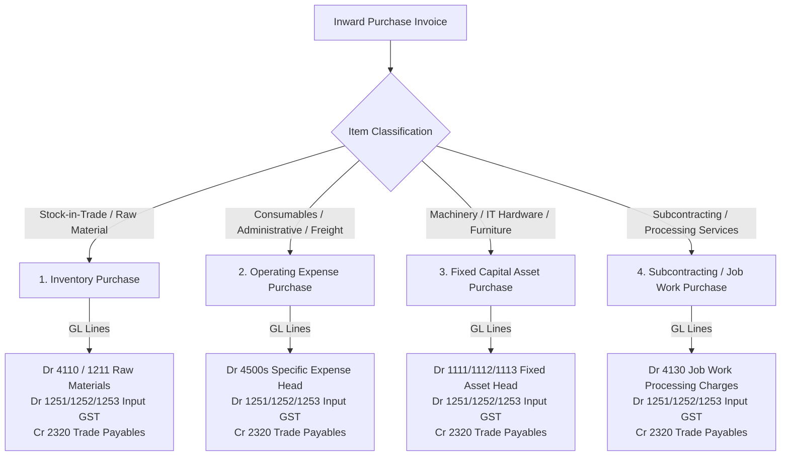

# Phase 2 Validation: Sales, Purchase & Inventory Accounting Validation

**Auditor:** Senior ERP Architect & Accounting Systems Auditor  
**Scope:** Forensic analysis of sales revenue, purchase procurement classification, GST calculation binding, and inventory valuation accounting.

---

## 1. Sales Invoice Accounting Validation

### 1.1. Calculations & Field Sources in Codebase
* **Customer Receivable (`Gross Total`):** In `GstSalesInvoiceService.java`, calculated as $\text{Taxable Value} + \text{CGST} + \text{SGST} + \text{IGST} + \text{CESS} + \text{Round-Off}$. This exact gross amount is added to `erp_supplier.all_need_get`.
* **Taxable Value:** Sum of line item amounts $\sum(\text{Quantity} \times \text{Unit Price} - \text{Discount})$.
* **GST Component Determination:** Handled by `GSTTaxCalculationEngine` using:
  * Place of Supply (POS) comparison between Supplier State (`CompanyGstin`) and Customer State (`Supplier.state_code`).
  * If $\text{Origin State} == \text{Destination State} \implies \text{Intrastate} \implies \text{CGST} + \text{SGST}$.
  * If $\text{Origin State} \neq \text{Destination State} \implies \text{Interstate} \implies \text{IGST}$.
  * If Customer is in SEZ / Export with LUT $\implies \text{Zero-Rated} \implies \text{IGST} = 0$.
* **Round-Off Handling:** Handled per Section 170 of CGST Act (rounding to nearest whole rupee). The difference between mathematical gross and rounded gross is captured in `roundOffAmount`.

### 1.2. Account Mapping Resolution
| Line Nature | Default Schedule III Account | Dynamic Resolution Mechanism |
| :--- | :--- | :--- |
| **Trade Receivable (Debtor)** | `1220 Trade Receivables` | Default tenant AR Control Head; linked to `party_type='CUSTOMER'` and `party_id=customer_id`. |
| **Domestic Sales Revenue** | `3110 Domestic Sales (Taxable Goods)` | If `MaterialCategory.coa_revenue_account_id` is set, uses category-specific account; else defaults to `3110`. |
| **Export Sales Revenue** | `3120 Export Sales / Zero-Rated Sales` | Triggered when transaction type is `EXPORT_LUT` or `EXPORT_TAX`. |
| **Job Work Service Revenue** | `3130 Job Work Service Revenue` | Triggered when invoice is generated from Job Work processing challans. |
| **Output CGST** | `2331 Output CGST (Electronic Liability Ledger)` | Central statutory tax liability account. |
| **Output SGST** | `2332 Output SGST (Electronic Liability Ledger)` | State statutory tax liability account. |
| **Output IGST** | `2333 Output IGST (Electronic Liability Ledger)` | Integrated statutory tax liability account. |
| **Fractional Round-Off** | `4560 Fractional Round-Off Difference` | If positive delta $\implies$ Credit; if negative delta $\implies$ Debit. |

---

## 2. Purchase Invoice Accounting Validation

### 2.1. Purchase Classification Matrix
Purchases in the ERP are classified based on the nature of the procured item (`Material.type`, `MaterialCategory`, or `InOutItem`):

### 2.2. Accounting Breakdown by Procurement Category
1. **Inventory Stock Purchases:**
   * $\text{Dr } 4110 \text{ Purchases of Stock / Raw Materials (or } 1211 \text{ Inventory Asset)}$
   * $\text{Dr } 1251 \text{ Input CGST} / 1252 \text{ Input SGST} / 1253 \text{ Input IGST}$
   * $\text{Cr } 2320 \text{ Trade Payables (Vendor Control Head)}$
2. **Operating Expense Purchases (e.g. Inward Freight, Legal Fees, Power, Utilities):**
   * $\text{Dr } 4510-4550 \text{ Operating Expense Head (mapped via in\_out\_item\_id)}$
   * $\text{Dr } 1251 / 1252 / 1253 \text{ Input GST (if tax invoice with GSTIN)}$
   * $\text{Cr } 2320 \text{ Trade Payables}$
3. **Fixed Capital Asset Purchases (e.g. Machinery, Laptops):**
   * $\text{Dr } 1111 \text{ Plant \& Machinery} / 1112 \text{ Office Equipment}$
   * $\text{Dr } 1251 / 1252 / 1253 \text{ Input GST (if capitalized or eligible ITC)}$
   * $\text{Cr } 2320 \text{ Trade Payables}$
4. **Subcontracting Processing Charges:**
   * $\text{Dr } 4130 \text{ Direct Job Work Processing Charges}$
   * $\text{Dr } 1251 / 1252 / 1253 \text{ Input GST}$
   * $\text{Cr } 2320 \text{ Trade Payables}$

---

## 3. Inventory Accounting & Perpetual Stock Integration Boundary

### 3.1. Perpetual Inventory vs Periodic Accounting Standard
In Indian Accounting Standard (Ind AS 2 / AS 2), inventory valuation and accounting follow the **Perpetual Moving-Average Cost Model**:
* **Physical Goods Receipt (GRN):**
  * When goods physically arrive and are accepted at warehouse (`CGRK` / Goods Receipt Note):
    * $\text{Dr } 1211 \text{ Raw Materials Inventory (Asset)}$
    * $\text{Cr } 2105 \text{ Goods Received Not Invoiced (GRNI Accrual Liability)}$
* **Financial Vendor Invoice Verification (Purchase Invoice / 3-Way Match):**
  * When vendor commercial invoice arrives and passes 3-Way Matching:
    * $\text{Dr } 2105 \text{ Goods Received Not Invoiced (GRNI Accrual Clearing)}$
    * $\text{Dr } 1251 / 1252 / 1253 \text{ Input GST Credit (ITC)}$
    * $\text{Cr } 2320 \text{ Trade Payables (Supplier Open Liability)}$
* **Direct 2-Way Billing (No separate GRN step):**
  * When a single Purchase Bill acts simultaneously as receipt and invoice:
    * $\text{Dr } 1211 \text{ Raw Materials Inventory (or } 4110 \text{ Purchases)}$
    * $\text{Dr } 1251 / 1252 / 1253 \text{ Input GST}$
    * $\text{Cr } 2320 \text{ Trade Payables}$
* **Outbound Commercial Dispatch (Sales Delivery):**
  * When goods leave warehouse upon customer order fulfillment:
    * $\text{Dr } 5001 / 4110 \text{ Cost of Goods Sold (COGS Expense)}$
    * $\text{Cr } 1212 \text{ Finished Goods Inventory (Asset)}$
