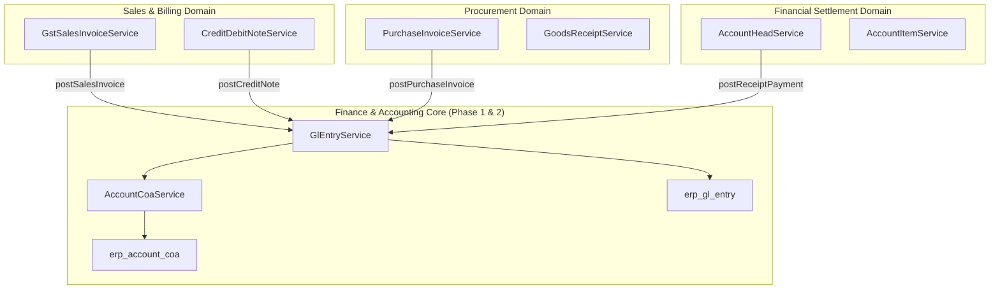

# Phase 2 Validation: Payment Structures, Sub-Ledger Reconciliation & Safety

**Auditor:** Senior ERP Architect & Accounting Systems Auditor  
**Scope:** Forensic analysis of payment allocation, sub-ledger control account parity, idempotency locks, graph dependencies, and Karpathy simplicity review.

---

## 1. Payment & Receipt Allocation Structures

### 1.1. Existing Allocation Architecture
The ERP handles financial collections and disbursements through `AccountHead` and `AccountItem`:
* **Single Invoice Full Settlement:** 1 `AccountHead` $\to$ 1 `AccountItem` where `each_amount == need_debt`.
* **Single Invoice Partial Settlement:** 1 `AccountHead` $\to$ 1 `AccountItem` where `each_amount < need_debt`. Updates `finish_debt` and decrements `Supplier.all_need_get`.
* **Multi-Invoice Batch Settlement:** 1 `AccountHead` $\to$ $N$ `AccountItem` rows where each row settles an individual `DepotHead` invoice (`bill_id`). Total receipt amount is $\sum(\text{each\_amount})$.
* **Unallocated Payment on Account:** 1 `AccountHead` with `type='Receipt'` where `organ_id` is specified but `AccountItem` rows have null `bill_id`. In this case, `total_price` reduces general party receivable `Supplier.all_need_get`.
* **Advance Deposit:** `type='Receive Advance Payment'` updates `Supplier.advance_in` without altering `all_need_get`.

### 1.2. GL Accounting Treatment for Payments
Regardless of whether a payment is full, partial, or multi-invoice:
* The GL posting captures the **exact total financial movement**:
  * $\text{Dr Bank / Cash Account (from erp\_account.coa\_id)}$ `[Total Received]`
  * $\text{Cr 1220 Trade Receivables (with party_type='CUSTOMER', party_id=customer_id)}$ `[Total Settled]`
* Each individual invoice settlement remains fully auditable through `AccountItem.bill_id` and sub-ledger statements.

---

## 2. Sub-Ledger to General Ledger Control Account Reconciliation

### 2.1. Mathematical Invariant Proof
At any point in time $T$, the following mathematical equalities must hold strictly:

$$\sum_{i \in \text{Customers}} \text{CustomerBalance}_i = \text{GL\_Balance}(\text{Account } 1220 \text{ Trade Receivables})$$

$$\sum_{j \in \text{Suppliers}} \text{SupplierBalance}_j = \text{GL\_Balance}(\text{Account } 2320 \text{ Trade Payables})$$

### 2.2. Reconciliation Logic
1. **Customer Sub-Ledger Breakdown:**
   $$\text{Customer AR} = \sum(\text{Approved Sales Invoices}) - \sum(\text{Approved Customer Receipts}) - \sum(\text{Approved Credit Notes}) + \sum(\text{Opening Receivables})$$
2. **General Ledger Control Account Breakdown:**
   $$\text{GL Account } 1220 = \sum(\text{Debits with Account } 1220) - \sum(\text{Credits with Account } 1220)$$
3. **Reconciliation Engine:**
   * A periodic/on-demand reconciliation query matches $\text{all\_need\_get}$ per party in `erp_supplier` against $\sum(\text{Dr} - \text{Cr})$ in `erp_gl_entry` grouped by `party_id` where `account_id = 1220`.
   * Any variance (delta $\neq 0$) is flagged immediately for audit investigation (e.g. unposted manual documents or direct database manipulation).

---

## 3. Duplicate Posting Protection & Idempotency Proof

### 3.1. Concurrency Threats & Mitigations
| Threat Scenario | Potential Risk | Architectural Defense |
| :--- | :--- | :--- |
| **Double Click on "Approve"** | Duplicate invoice posting $\implies$ Double revenue & receivable | **Unique Voucher Constraint & Cancellation Hook:** In `GlEntryService.postEntries()`, any existing uncancelled entries for `(tenant_id, voucher_type, voucher_id)` are cancelled prior to inserting the new entry batch. |
| **Network Timeout & Retry** | Reposting of same invoice ID | In `DepotHeadService` and `GstSalesInvoiceService`, state transition is gated by `DocumentStateMachineService` (`current_state == 'DRAFT'` $\to$ `'POSTED'`). Once in `'POSTED'`, subsequent requests are rejected. |
| **Concurrent Approvals** | Two threads approving simultaneously | Database row-level lock (`SELECT ... FOR UPDATE`) in `GstSalesInvoiceService` inside `@Transactional` boundary. |
| **Document Edited After Posting** | Altered quantities/rates mismatching GL | State machine blocks editing of documents in `'POSTED'` state. Revisions require an explicit Cancel/Reverse workflow. |

---

## 4. Graphify Architectural Dependency Impact

* **Decoupling Strategy:** Domains call `GlEntryService.postEntries()` with prepared, balanced `List<GlEntry>`.
* **Zero Reverse Coupling:** `GlEntryService` and `AccountCoaService` have zero dependencies on `DepotHeadService` or `AccountHeadService`, preserving clean layered architecture.

---

## 5. Karpathy Simplicity Review

| Evaluation Question | Assessment | Rationale / Decision |
| :--- | :--- | :--- |
| *Do we need a generic rules-engine (like Drools)?* | **NO** | Fixed, deterministic mappings for standard Indian Schedule III accounts are vastly simpler, faster, and 100% auditable. |
| *Do we need an asynchronous event-bus (RabbitMQ/Kafka)?* | **NO** | In-transaction synchronous GL posting ensures that if GL posting fails, the business transaction rolls back atomically. Zero risk of phantom invoices or desynchronized ledgers. |
| *Do we need duplicate tax calculation in GL engine?* | **NO** | Consume exact tax fields from `GSTTaxCalculationEngine` and `DocumentTaxSnapshot`. |
| *Do we need separate GL tables for sales vs purchases?* | **NO** | Single unified `erp_gl_entry` table created in Phase 1 handles all transactions cleanly with `voucher_type` discriminator. |
