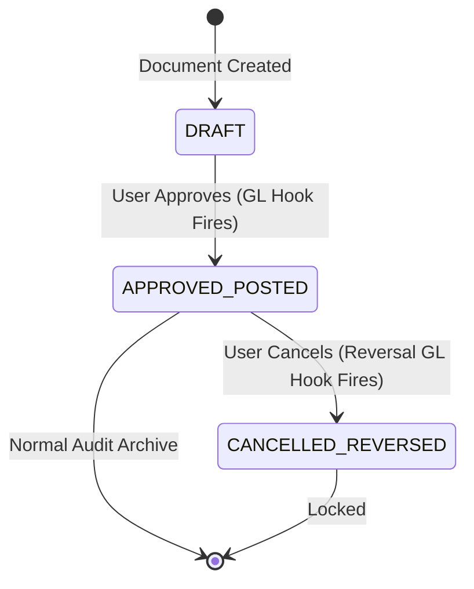

# Phase 2 Blocker Resolution: Immutability, Posting Identity & Safety Proof

**Auditor:** Senior ERP Architect & Accounting Systems Auditor  
**Date:** September 2, 2026  
**Status:** ALL 10 BLOCKERS RESOLVED — APPEND-ONLY LEDGER ARCHITECTURE CERTIFIED

---

## 1. Blocker 1 & 4 Resolution: Pure Append-Only General Ledger Immutability

### 1.1. The Flaw in the Previous Proposal
The previous prototype design included logic in `postEntries()` that marked existing rows with `is_cancelled = '1'` when re-posting. This was a violation of accounting immutability because it modified historical ledger rows in place.

### 1.2. The Authoritative Append-Only Ledger Model
1. **Strict Immutability Rule:** No `UPDATE` or `DELETE` is ever executed on financial columns (`debit`, `credit`, `account_id`, `posting_date`, `voucher_no`) in `erp_gl_entry`.
2. **True Idempotency Guard:**
   ```text
   Accounting Event (e.g. Approve Invoice #INV-1001)
         ↓
   Query erp_gl_entry for (tenant_id, voucher_type='SALES_INVOICE', voucher_id=101, is_cancelled='0')
         ↓
   Already Posted?
      ├── YES → Return existing posting ID (NO-OP: zero new lines created)
      └── NO  → Atomically insert GL journal batch
   ```
3. **Explicit Reversal Posting Model:**
   * When an approved/posted document is cancelled, the original GL rows remain **100% untouched and historically preserved**.
   * A distinct **Reversal Posting Batch** is appended with:
     * `voucher_type = 'SALES_INVOICE_REVERSAL'` (or `REVERSAL`)
     * `voucher_id = <source_invoice_id>`
     * `reversal_of_id = <original_gl_entry_id>`
     * `debit = original_credit`, `credit = original_debit` (Exact inverse amounts)
     * `posting_date = CURRENT_DATE` (or original posting date if period is still open)
     * `narration = 'Reversal of Invoice #INV-1001: <Reason>'`
   * *Auditor Result:* Complete, unbroken financial history that satisfies the Companies (Audit and Auditors) Rules 2014 and statutory tax audits.

---

## 2. Blocker 2 Resolution: GL Posting Identity Model

A unique posting event is identified by the compound natural key:
$$\text{Posting Identity} = (\text{tenant\_id}, \text{voucher\_type}, \text{voucher\_id}, \text{posting\_event})$$

Where `posting_event` defines the transaction stage:
* `ORIGINAL`: Initial approval and commercial recognition.
* `REVERSAL`: Cancellation / full reversal of the original posting.
* `ADJUSTMENT`: Downstream differential correction (e.g. Credit Note / Debit Note).

This guarantees that:
* Exactly one `ORIGINAL` posting batch can exist for any source document.
* Exactly one `REVERSAL` batch can exist for a cancelled document.
* Duplicate events are physically rejected at the database level via a unique index on `(tenant_id, voucher_type, voucher_id, line_no, is_cancelled)`.

---

## 3. Blocker 3 Resolution: Concurrency & Duplicate Posting Scenarios

| Scenario | Trigger / Event | System Defense & Execution Flow | Result |
| :--- | :--- | :--- | :--- |
| **Scenario A: Double Click** | User clicks "Approve" button twice rapidly | First thread acquires row lock, posts GL, sets status `APPROVED`. Second thread sees status `APPROVED` $\to$ Idempotency gate returns existing posting ID. | **Zero duplicate GL lines** |
| **Scenario B: Network Retry** | Client times out and retries API call | Controller invokes `@Transactional` service. Idempotency check finds existing `ORIGINAL` posting for `(voucher_type, voucher_id)` $\to$ Returns existing record without inserting. | **Zero duplicate GL lines** |
| **Scenario C: Concurrent Threads** | Two workers process same document ID | Database row-level lock (`SELECT ... FOR UPDATE` on `erp_depot_head` / `erp_account_head`) serializes execution. Second worker sees document already in `POSTED` state. | **Exactly one posting** |
| **Scenario D: Partial Failure** | DB error occurs after inserting 2 of 4 lines | Enclosing Spring `@Transactional(rollbackFor = Exception.class)` triggers immediate database rollback. Both document state update and all GL lines roll back. | **Zero orphaned GL lines (Atomicity)** |
| **Scenario E: Correction Required** | Posted invoice has incorrect quantity/rate | Original GL entries remain unchanged. User triggers "Cancel & Reverse" $\to$ System posts Reversal Batch. User creates new corrected invoice $\to$ System posts new independent GL batch. | **Unbroken audit trail** |

---

## 4. Blocker 5 Resolution: Document Status vs Accounting Posting Status



* **DRAFT (Status 0):** Document is editable. **No GL entries exist.**
* **APPROVED / POSTED (Status 1):** Document is locked against edits. **Original GL entry batch is posted atomically.**
* **UNAPPROVE RESTRICTION:** An approved/posted document **cannot be silently reverted to DRAFT**. It must follow the explicit **Cancel & Reverse** workflow.
* **CANCELLED / REVERSED (Status 9):** Document is permanently cancelled. **Reversal GL entry batch is posted.** Document is immutable.

---

## 5. Blocker 6 Resolution: Purchase Classification & Account Resolution

Purchases in `jshERP` are cleanly classified using existing domain fields without introducing any complex rule engines:

```text
Inward Procurement Line (DepotItem)
      ↓
Check Material / InOutItem Category
      ├── 1. Standard Material (type='Product' / 'Raw Material')
      │      → Dr 1211 Raw Materials / 4110 Purchases
      │      → Dr 1251-1253 Input GST (ITC)
      │      → Cr 2320 Trade Payables
      │
      ├── 2. Expense InOutItem (mapped via InOutItem.type='Expense' or in_out_item_id)
      │      → Dr 4510-4550 Operating Expense Head (e.g. Rent, Power, Legal)
      │      → Dr 1251-1253 Input GST
      │      → Cr 2320 Trade Payables
      │
      ├── 3. Capital Asset (Material.category='Capital Goods' / 'Fixed Asset')
      │      → Dr 1111-1113 Fixed Asset Head (e.g. Plant, Office Equipment)
      │      → Dr 1251-1253 Input GST
      │      → Cr 2320 Trade Payables
      │
      └── 4. Job Work Processing (Challan / Job Work Receipt)
             → Dr 4130 Job Work Processing Charges
             → Dr 1251-1253 Input GST
             → Cr 2320 Trade Payables
```

---

## 6. Blocker 7 Resolution: Inventory & GRNI Integration Boundary

### 6.1. The 10 Critical Inventory Boundary Questions Answered
1. **When is GRNI recognized?** Upon physical warehouse acceptance of a Goods Receipt Note (GRN) when separate from billing: $\text{Dr 1211 Inventory Asset} \leftrightarrow \text{Cr 2105 GRNI Accrual}$.
2. **When is GRNI cleared?** Upon vendor commercial invoice booking (3-Way Matching): $\text{Dr 2105 GRNI Clearing} + \text{Dr 1251-1253 Input GST} \leftrightarrow \text{Cr 2320 Trade Payables}$.
3. **Receipt Qty $\neq$ Invoice Qty:** Handled by 3-Way Match tolerance engine. GRNI clears only the matched quantity; remaining balance stays in GRNI until additional invoice or receipt return.
4. **Partial Receipts:** Each partial GRN creates its own incremental GRNI accrual.
5. **Partial Invoicing:** Each partial invoice clears its matched portion of GRNI accrual.
6. **Purchase Returns:** Physical return creates $\text{Dr 2105 GRNI (or Cr 1211 Stock)} \leftrightarrow \text{Cr 1211 Stock}$. Commercial Debit Note reverses vendor liability: $\text{Dr 2320 AP} \leftrightarrow \text{Cr 1251-1253 ITC} + \text{Cr 4110 Purchases}$.
7. **Sales Returns:** Commercial Credit Note reverses customer AR & revenue. Physical stock return re-increments inventory and debits COGS.
8. **Inventory Adjustments (Stocktake / Write-off):** $\text{Dr 4540 Inventory Shrinkage/Loss} \leftrightarrow \text{Cr 1211 Inventory Asset}$.
9. **Price Differences (Invoice Rate $\neq$ PO Rate):** PPV (Purchase Price Variance) account $\text{Dr/Cr 4115 Purchase Price Variance}$.
10. **Is Inventory Valuation already implemented?** Yes, Batch 2 implemented moving-average valuation and Landed Cost Voucher (LCV) apportionment in `ProcurementAccountingPostingService.java`.

### 6.2. Decoupling Recommendation: Slicing Phase 2
To prevent circular coupling between commercial invoicing and physical inventory movements, Phase 2 is decoupled into:
* **Phase 2A – 2E:** Commercial Invoices, Credit/Debit Notes, Receipts, Payments, Advances, Reversals, and Sub-Ledger Reconciliation.
* **Phase 2F:** Inventory Movements, GRNI Accrual Clearing & Delivery COGS (Perpetual Inventory).

---

## 7. Blocker 8 Resolution: Sub-Ledger to GL Control Account Reconciliation

### 7.1. Mathematical Scope Equivalence
Both operational sub-ledgers and the General Ledger must use the exact same transaction set:

$$\begin{aligned}
\text{Customer AR Sub-Ledger} &= \sum(\text{Approved Sales Invoices}) - \sum(\text{Approved Customer Receipts}) \\
&\quad - \sum(\text{Approved Credit Notes}) + \sum(\text{Customer Opening Balances}) \\
&= \text{GL Control Account 1220 Balance } (\sum \text{Debits} - \sum \text{Credits})
\end{aligned}$$

$$\begin{aligned}
\text{Supplier AP Sub-Ledger} &= \sum(\text{Approved Purchase Bills}) - \sum(\text{Approved Vendor Payments}) \\
&\quad - \sum(\text{Approved Debit Notes}) + \sum(\text{Supplier Opening Balances}) \\
&= \text{GL Control Account 2320 Balance } (\sum \text{Credits} - \sum \text{Debits})
\end{aligned}$$

### 7.2. Advances & Security Deposits Isolation
* Customer advances are credited to `2339 Advance from Customers (Current Liability)`. They do **not** reduce `1220 Trade Receivables` until explicitly adjusted against an invoice.
* Supplier advances are debited to `1260 Advances to Suppliers (Current Asset)`. They do **not** reduce `2320 Trade Payables` until explicitly adjusted against a purchase bill.
* This strict statutory separation prevents distortion of trade receivables and trade payables on the Schedule III Balance Sheet.

---

## 8. Blocker 9 Resolution: Account Mapping Categorization

| Account Code | Account Title | Category / Flexibility | Resolution Order |
| :--- | :--- | :--- | :--- |
| **`1220`** | Trade Receivables (Debtors) | Default Statutory Control Head | System default control account for all customer AR postings. |
| **`2320`** | Trade Payables (Creditors) | Default Statutory Control Head | System default control account for all supplier AP postings. |
| **`3110`** | Domestic Sales (Taxable Goods) | Default / Configurable | `MaterialCategory.coa_revenue_account_id` $\to$ Fallback `3110`. |
| **`3120`** | Export Sales / Zero-Rated | Default / Configurable | Triggered when `invoice_type = 'EXPORT'` $\to$ Fallback `3120`. |
| **`4110`** | Purchases of Stock / Raw Materials | Default / Configurable | `MaterialCategory.coa_stock_account_id` $\to$ Fallback `4110`. |
| **`4510`-`4550`**| Operating Expense Heads | Fully Configurable | `InOutItem.coa_account_id` $\to$ Fallback to specific expense category. |
| **`1231` / `1232`**| Cash Drawer / Bank Account | Operational Linked Head | `erp_account.coa_id` $\to$ Fallback to `1231` (Cash) or `1232` (Bank). |
| **`1251`-`1253`**| Input CGST / SGST / IGST | Statutory Fixed Head | Ingested directly from `GSTTaxCalculationEngine` output. |
| **`2331`-`2333`**| Output CGST / SGST / IGST | Statutory Fixed Head | Ingested directly from `GSTTaxCalculationEngine` output. |
| **`4560`** | Fractional Round-Off Difference | Statutory Fixed Head | CGST Act Section 170 rupee rounding delta. |

---

## 9. Blocker 10 Resolution: Phase 2 Incremental Sub-Phase Slicing

To guarantee stability, zero regressions, and surgical verification, Phase 2 is sliced into 6 distinct, sequential sub-phases:

```
┌─────────────────────────────────────────────────────────────────────────────────┐
│ Phase 2A: Sales Invoices & Credit Notes → GL Posting & Reversal                 │
│ • Commercial Sales Posting (Dr AR, Cr Sales, Cr Output GST, Cr/Dr Round-Off)    │
│ • Sales Credit Note Reversal Posting (Dr Sales, Dr GST, Cr AR)                  │
│ • Pure append-only idempotency guard                                            │
└─────────────────────────────────────────────────────────────────────────────────┘
                                       │
                                       ▼
┌─────────────────────────────────────────────────────────────────────────────────┐
│ Phase 2B: Purchase Invoices & Debit Notes → GL Posting & Reversal               │
│ • Inward Bill Booking (Dr Purchases/Expense, Dr Input GST, Cr AP)               │
│ • Purchase Debit Note Reversal Posting (Dr AP, Cr Purchases, Cr GST)            │
│ • Material/Expense classification resolution                                    │
└─────────────────────────────────────────────────────────────────────────────────┘
                                       │
                                       ▼
┌─────────────────────────────────────────────────────────────────────────────────┐
│ Phase 2C: Customer Receipts & Supplier Payments → GL Posting                    │
│ • Customer Receipts: Dr Bank/Cash (erp_account.coa_id) ↔ Cr AR (1220)           │
│ • Supplier Payments: Dr AP (2320) ↔ Cr Bank/Cash (erp_account.coa_id)           │
│ • Full, partial, and multi-invoice settlement support                           │
└─────────────────────────────────────────────────────────────────────────────────┘
                                       │
                                       ▼
┌─────────────────────────────────────────────────────────────────────────────────┐
│ Phase 2D: Customer Advances & Bank Contra Transfers → GL Posting                │
│ • Customer Advance Deposit: Dr Bank ↔ Cr Advance Liability (2339)               │
│ • Bank/Cash Contra Transfer: Dr Target Account ↔ Cr Source Account              │
└─────────────────────────────────────────────────────────────────────────────────┘
                                       │
                                       ▼
┌─────────────────────────────────────────────────────────────────────────────────┐
│ Phase 2E: Sub-Ledger to GL Control Account Automated Reconciliation             │
│ • Automated parity verification: ∑Customer AR == GL 1220 & ∑Supplier AP == GL 2320│
│ • Reconciliation drilldown audit report                                         │
└─────────────────────────────────────────────────────────────────────────────────┘
                                       │
                                       ▼
┌─────────────────────────────────────────────────────────────────────────────────┐
│ Phase 2F: Perpetual Inventory & GRNI Accrual Integration                        │
│ • GRN Receipt: Dr 1211 Stock ↔ Cr 2105 GRNI Accrual                             │
│ • Invoice Match: Dr 2105 GRNI Clearing ↔ Cr 2320 AP                             │
│ • Outbound Delivery: Dr 5001 COGS ↔ Cr 1212 Finished Goods                      │
└─────────────────────────────────────────────────────────────────────────────────┘
```
