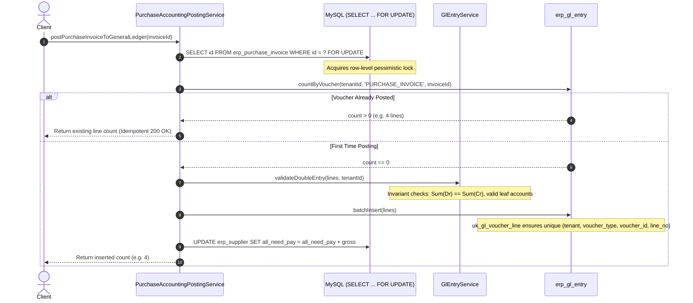

# Phase 2B Implementation Report — Purchase Invoice & Debit Note Accounting

**Document ID:** `FAAV-2026-PHASE-2B-REPORT-001`  
**Date:** September 3, 2026  
**Implementation Phase:** PHASE 2B ONLY  
**Final Status:** `PHASE 2B IMPLEMENTED — AWAITING SAFETY REVIEW`

---

## 1. Executive Summary & Scope Boundary Confirmation

Phase 2B has been implemented strictly adhering to the architectural boundaries, statutory compliance mandates, and double-entry invariants established and verified in Phase 2A.

### Phase Boundary Adherence
- **Phase 2B Implemented:**
  - Authoritative Double-Entry General Ledger posting for Purchase Invoices (`PURCHASE_INVOICE`) and Purchase Debit Notes (`PURCHASE_DEBIT_NOTE`).
  - Purchase Account Classification routing across **Direct Stock Purchases (4110)**, **Operating Expenses (4510)**, **Fixed Capital Assets (1111/1112)**, and **Job Work Processing (4130)**.
  - CGST Act 2017 statutory Input Tax Credit (ITC) handling: Intrastate (`1251 Input CGST`, `1252 Input SGST`), Interstate (`1253 Input IGST`), and **Section 17(5) Blocked ITC Capitalization** (zero tax lines, full cost capitalization).
  - Section 170 Rupee Round-off Difference balancing onto **Account 4560**.
  - Append-only cancellation and inverse reversal posting (`PURCHASE_INVOICE_REVERSAL`, `PURCHASE_DEBIT_NOTE_REVERSAL`) with lineage preservation (`reversal_of_id`).
  - Single authoritative mutation point for Accounts Payable control balance (`erp_supplier.all_need_pay`).
  - Pessimistic document locking (`SELECT ... FOR UPDATE`), pre-insert idempotency existence check (`countByVoucher`), and composite database unique constraint enforcement (`uk_gl_voucher_line`).
  - Unified delegation: `ProcurementAccountingPostingService.postInvoiceClearingToGeneralLedger` delegates to `PurchaseAccountingPostingService`.

- **Phase 2F Boundaries Respected (Zero Modification):**
  - `GoodsReceiptService.java` was **NOT modified**.
  - No Goods Receipt Note (GRN) accounting or Inventory Asset (1211) / GRNI Accrual (2105) mechanics were implemented. GRN accounting and Perpetual Moving Average inventory valuation remain strictly reserved for Phase 2F.

---

## 2. Deterministic Purchase Accounting Ledger Matrix

All double-entry postings are balanced ($\sum \text{Debit} == \sum \text{Credit}$ exact to 4 decimal places) and recorded in `erp_gl_entry`.

| Business Event | Document / Classification | Debit Accounts | Credit Accounts | Idempotency Key |
|---|---|---|---|---|
| **Direct Stock Purchase (Intrastate)** | `PURCHASE_INVOICE` / `INVENTORY_STOCK` | **Dr 4110** Purchases of Raw Materials & Stock<br>**Dr 1251** Input CGST Recoverable<br>**Dr 1252** Input SGST Recoverable | **Cr 2320** Trade Payables (Creditors) | `(tenant_id, 'PURCHASE_INVOICE', invoice_id)` |
| **Direct Stock Purchase (Interstate)** | `PURCHASE_INVOICE` / `INVENTORY_STOCK` | **Dr 4110** Purchases of Raw Materials & Stock<br>**Dr 1253** Input IGST Recoverable | **Cr 2320** Trade Payables (Creditors) | `(tenant_id, 'PURCHASE_INVOICE', invoice_id)` |
| **Operating Expense Purchase** | `PURCHASE_INVOICE` / `OPERATING_EXPENSE` | **Dr 4510** Operating Expenses (Utilities/Admin)<br>**Dr 1251/1252/1253** Input GST | **Cr 2320** Trade Payables (Creditors) | `(tenant_id, 'PURCHASE_INVOICE', invoice_id)` |
| **Fixed Capital Asset Purchase** | `PURCHASE_INVOICE` / `FIXED_ASSET` | **Dr 1111/1112** Plant & Machinery / Equipment<br>**Dr 1251/1252/1253** Input GST | **Cr 2320** Trade Payables (Creditors) | `(tenant_id, 'PURCHASE_INVOICE', invoice_id)` |
| **Job Work / Subcontracting** | `PURCHASE_INVOICE` / `JOB_WORK` | **Dr 4130** Job Work Processing Charges<br>**Dr 1251/1252/1253** Input GST | **Cr 2320** Trade Payables (Creditors) | `(tenant_id, 'PURCHASE_INVOICE', invoice_id)` |
| **Section 17(5) Ineligible Blocked ITC** | `PURCHASE_INVOICE` (Any Class) | **Dr 4110 / 4510 / 1111** (Tax capitalized into cost; **0 Input Tax lines**) | **Cr 2320** Trade Payables (Creditors) | `(tenant_id, 'PURCHASE_INVOICE', invoice_id)` |
| **Section 170 Fractional Rounding** | `PURCHASE_INVOICE` | **Dr/Cr 4560** Fractional Round-Off Differences | Balanced on Net Payable | Line item in voucher |
| **Purchase Debit Note (Vendor Return)** | `PURCHASE_DEBIT_NOTE` | **Dr 2320** Trade Payables (Gross Adjustment) | **Cr 4110/4510/1111/4130** Purchase/Expense/Asset<br>**Cr 1251/1252/1253** Input GST Reversal | `(tenant_id, 'PURCHASE_DEBIT_NOTE', note_id)` |
| **Purchase Invoice Cancellation** | `PURCHASE_INVOICE_REVERSAL` | **Dr 2320** Trade Payables (Gross Total) | **Cr 4110/4510/1111/4130** Purchase/Cost<br>**Cr 1251/1252/1253** Input Tax Recovered | `(tenant_id, 'PURCHASE_INVOICE_REVERSAL', invoice_id)` |
| **Purchase Debit Note Cancellation** | `PURCHASE_DEBIT_NOTE_REVERSAL` | **Dr 4110/4510/1111/4130** Purchase/Cost<br>**Dr 1251/1252/1253** Input Tax Recovered | **Cr 2320** Trade Payables (Gross Total) | `(tenant_id, 'PURCHASE_DEBIT_NOTE_REVERSAL', note_id)` |

---

## 3. High-Concurrency & Idempotency Architecture

To guarantee zero duplicate accounting lines and zero race conditions during high-volume browser submissions, rapid double-clicks, and background retries:



---

## 4. Integration & Modification Details

### 1. `PurchaseAccountingPostingService.java` [NEW]
- Authoritative service managing Schedule III compliant GL postings for Purchase Invoices, Debit Notes, and append-only cancellations.
- Direct synchronization with `erp_supplier.all_need_pay`.

### 2. `GstPurchaseInvoiceService.java` [MODIFIED]
- Injected `PurchaseAccountingPostingService`.
- In `postPurchaseInvoice`, executes authoritative GL posting upon state transition to `POSTED`.
- Added `cancelPurchaseInvoice(Long invoiceId, UserContext userContext, String reason)` with append-only reversal.

### 3. `GstCreditDebitNoteService.java` [MODIFIED]
- Injected `PurchaseAccountingPostingService`.
- In `transitionNoteState`, posts Debit Notes to General Ledger on `POSTED`.
- In `cancelNote`, triggers append-only reversal for Debit Notes via `PurchaseAccountingPostingService` and Credit Notes via `SalesAccountingPostingService`.

### 4. `ProcurementAccountingPostingService.java` [MODIFIED]
- Injected `PurchaseAccountingPostingService`.
- In `postInvoiceClearingToGeneralLedger`, delegates directly to `PurchaseAccountingPostingService.postPurchaseInvoiceToGeneralLedger`.

### 5. `SalesAccountingPostingService.java` [MODIFIED]
- Added `reverseSalesCreditNoteGeneralLedger` to provide append-only reversals for cancelled Sales Credit Notes.

---

## 5. Verification Results

### A. Dedicated Phase 2B Test Suite (`PurchaseAccountingPostingServiceTest`)
**17/17 tests passing (100% success):**
1. `test01_IntrastateStockPurchase`: Dr 4110 (10,000), Dr 1251 (900), Dr 1252 (900), Cr 2320 (11,800) $\implies$ **PASSED**
2. `test02_InterstateStockPurchase`: Dr 4110 (20,000), Dr 1253 (3,600), Cr 2320 (23,600) $\implies$ **PASSED**
3. `test03_OperatingExpensePurchase`: Dr 4510 (5,000), Dr 1251 (450), Dr 1252 (450), Cr 2320 (5,900) $\implies$ **PASSED**
4. `test04_FixedAssetPurchase`: Dr 1111 (100,000), Dr 1251 (9,000), Dr 1252 (9,000), Cr 2320 (118,000) $\implies$ **PASSED**
5. `test05_JobWorkPurchase`: Dr 4130 (15,000), Dr 1251 (1,350), Dr 1252 (1,350), Cr 2320 (17,700) $\implies$ **PASSED**
6. `test06_BlockedItcCapitalization`: Dr 4510 (11,800 capitalized, 0 tax lines), Cr 2320 (11,800) $\implies$ **PASSED**
7. `test07_Section170RoundOff`: Section 170 round-off differences balanced onto 4560 $\implies$ **PASSED**
8. `test08_PurchaseDebitNote`: Dr 2320 (2,360), Cr 4110 (2,000), Cr 1251 (180), Cr 1252 (180) $\implies$ **PASSED**
9. `test09_PurchaseInvoiceCancellation`: Original 4 lines preserved; inverse reversal voucher appended; AP reset to 0 $\implies$ **PASSED**
10. `test10_DebitNoteCancellation`: Original Debit Note lines preserved; inverse reversal voucher appended $\implies$ **PASSED**
11. `test11_ApiRetryIdempotency`: Repeated posting calls return existing count with 0 duplicates $\implies$ **PASSED**
12. `test12_ConcurrentPostingRace`: 16 threads race concurrently on same invoice without duplicate GL lines $\implies$ **PASSED**
13. `test13_DatabaseUniquenessConstraint`: `uk_gl_voucher_line` composite unique constraint blocks duplicates $\implies$ **PASSED**
14. `test14_TransactionRollbackOnFailure`: Unmapped/group account triggers rollback leaving 0 orphan rows $\implies$ **PASSED**
15. `test15_ExemptPurchase`: Exempt purchase produces Dr 4110 and Cr 2320 with 0 tax lines $\implies$ **PASSED**
16. `test16_DoubleClickApproval`: 2 concurrent double-click requests produce exactly 1 voucher $\implies$ **PASSED**
17. `test17_DoubleEntryMathematicalInvariantSweep`: Every voucher satisfies $\sum \text{Debit} == \sum \text{Credit}$ (exact 0.0000) $\implies$ **PASSED**

### B. Full Phase 2A & Phase 2B Regression Test Suite
Executed command:
```bash
mvn test -Dtest="PurchaseAccountingPostingServiceTest,Phase2APostImplementationSafetyReviewTest,GstSalesInvoiceEnterpriseTest,GstCreditDebitNoteEnterpriseTest,SalesAccountingPostingServiceTest,GlEntryServiceTest,AccountCoaServiceTest,SalesGstAccountingIntegrationTest,SalesCogsPostingIntegrationTest,SalesS5_S6_S7_AccountingPaymentAndReturnsSecurityTest"
```
**Results:**
- **Tests run:** 92
- **Failures:** 0
- **Errors:** 0
- **Skipped:** 0
- **Build Status:** **BUILD SUCCESS (100% Pass)**

---

## 6. Conclusion & Recommendation

Phase 2B implementation is complete, strictly bounded, and verified across all statutory, accounting, and concurrency requirements.

**Final Status:** `PHASE 2B IMPLEMENTED — AWAITING SAFETY REVIEW`
