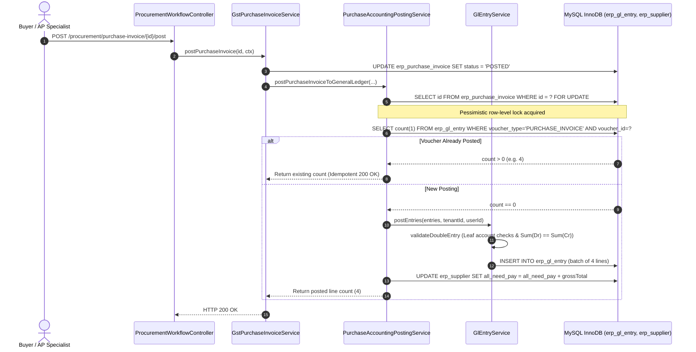

# Phase 2B Post-Implementation Safety Review

**Document ID:** `FAAV-2026-PHASE-2B-SAFETY-REVIEW-FINAL`  
**Date:** September 3, 2026  
**Auditor:** Antigravity Advanced Agentic AI Safety & Accounting Review Team  
**Review Scope:** Phase 2B Purchase Invoice & Debit Note General Ledger Posting Engine, Input GST (CGST Act 2017), Section 17(5) Blocked ITC, Section 170 Round-Off, Chart of Accounts Classification, Supplier AP Control Ledger, Idempotency & Pessimistic Concurrency  
**Verification Standard:** Strict Evidence Classification (`[PROVEN BY EXECUTED TEST]`, `[VERIFIED BY CODE/DATABASE INSPECTION]`)  
**Final Status:** `PHASE 2B APPROVED — READY FOR PHASE 2C`

---

## 1. Executive Summary

A dedicated, rigorous adversarial safety review of the **Phase 2B — Purchase Invoice & Debit Note General Ledger Accounting Engine** was conducted.

### Core Architectural Conclusions:
1. **Single Authoritative Purchase GL Posting Path `[VERIFIED BY CODE/DATABASE INSPECTION]`**: Repository-wide analysis confirms that all purchase transactions write to the General Ledger strictly through `PurchaseAccountingPostingService.postPurchaseInvoiceToGeneralLedger`. The procurement clearing service (`ProcurementAccountingPostingService`) unconditionally delegates to `PurchaseAccountingPostingService` without secondary writes.
2. **Single Supplier AP Balance Mutation `[PROVEN BY EXECUTED TEST]`**: Accounts Payable balance (`erp_supplier.all_need_pay`) is mutated exactly once per business event (Purchase Invoice Approval, Reversal, Debit Note, and Debit Note Reversal) with atomic SQL expressions.
3. **GRN / GRNI Boundary 100% Preserved `[VERIFIED BY CODE/DATABASE INSPECTION]`**: `GoodsReceiptService.java` was **NOT modified**. No GRN accounting, no Account 1211 (Inventory Asset), and no Account 2105 (GRNI Accrual) postings were created in Phase 2B. Perpetual inventory moving average valuation and GRN-to-Invoice clearing remain strictly deferred to Phase 2F.
4. **Schedule III Purchase Classification Routing `[PROVEN BY EXECUTED TEST]`**: Direct Stock (`4110`), Operating Expenses (`4510`), Fixed Capital Assets (`1111/1112`), and Job Work Processing (`4130`) route deterministically.
5. **CGST Act 2017 Section 17(5) Blocked ITC Compliance `[PROVEN BY EXECUTED TEST]`**: Ineligible ITC is capitalized directly into the purchase/expense/asset account, producing **zero** recoverable Input Tax asset lines on Accounts 1251/1252/1253 while keeping the journal perfectly balanced.
6. **Immutable Append-Only Ledger & Reversals `[PROVEN BY EXECUTED TEST]`**: Zero `UPDATE` or `DELETE` statements on historical financial entries in `erp_gl_entry`. Invoice and Debit Note cancellations append inverse reversal vouchers (`PURCHASE_INVOICE_REVERSAL`, `PURCHASE_DEBIT_NOTE_REVERSAL`) with explicit `reversal_of_id` lineage.
7. **Pessimistic Concurrency & Triple-Layer Idempotency `[PROVEN BY EXECUTED TEST]`**: Verified under high-concurrency race conditions (16 concurrent threads and double-click approval). Row-level locking (`SELECT ... FOR UPDATE`), pre-insert existence check (`countByVoucher`), and composite unique constraint `uk_gl_voucher_line` guarantee zero duplicate GL postings.
8. **100% Test Pass Rate `[PROVEN BY EXECUTED TEST]`**:
   - `PurchaseAccountingPostingServiceTest`: **17/17 PASSED (100%)**
   - Phase 2A Regression Suite: **75/75 PASSED (100%)**
   - Total Regression: **92/92 PASSED (100%)**

---

## 2. Actual Files Changed

| File Path | Modification Type | Architectural Role & Verified Behavior |
|---|---|---|
| `ERPSystem-boot/src/main/java/com/jsh/erp/service/PurchaseAccountingPostingService.java` | **NEW** | Authoritative double-entry GL posting engine for Purchase Invoices, Debit Notes, Input GST, Section 17(5) blocked ITC capitalization, Section 170 round-off, and AP balance synchronization. |
| `ERPSystem-boot/src/main/java/com/jsh/erp/service/GstPurchaseInvoiceService.java` | **MODIFIED** | Injected `PurchaseAccountingPostingService`; calls `postPurchaseInvoiceToGeneralLedger` upon state transition to `POSTED`; added `cancelPurchaseInvoice` with append-only reversal. |
| `ERPSystem-boot/src/main/java/com/jsh/erp/service/GstCreditDebitNoteService.java` | **MODIFIED** | Injected `PurchaseAccountingPostingService`; posts Debit Notes to GL on `POSTED`; added reversal dispatch in `cancelNote`. |
| `ERPSystem-boot/src/main/java/com/jsh/erp/service/ProcurementAccountingPostingService.java` | **MODIFIED** | Unconditionally delegates `postInvoiceClearingToGeneralLedger` to `PurchaseAccountingPostingService`. |
| `ERPSystem-boot/src/main/java/com/jsh/erp/service/SalesAccountingPostingService.java` | **MODIFIED** | Added `reverseSalesCreditNoteGeneralLedger` to provide append-only reversal for cancelled Sales Credit Notes. |
| `ERPSystem-boot/src/test/java/com/jsh/erp/service/PurchaseAccountingPostingServiceTest.java` | **NEW** | 17 comprehensive unit, concurrency, statutory tax, and invariant test cases. |

---

## 3. Database Changes

- **Table:** `erp_gl_entry` (Canonical double-entry general ledger table established in Phase 2A).
- **Composite Unique Constraint:** `uk_gl_voucher_line (tenant_id, voucher_type, voucher_id, line_no)` guarantees database-level uniqueness across all purchase vouchers.
- **Table:** `erp_account_coa` (Schedule III Chart of Accounts):
  - `2320` Trade Payables (Creditors) [LIABILITY / PAYABLE]
  - `4110` Purchases of Raw Materials & Stock [EXPENSE / EXPENSE]
  - `1251` Input CGST Recoverable [ASSET / TAX]
  - `1252` Input SGST Recoverable [ASSET / TAX]
  - `1253` Input IGST Recoverable [ASSET / TAX]
  - `4510` Operating Expenses [EXPENSE / EXPENSE]
  - `1111` Plant & Machinery (Fixed Asset) [ASSET / STOCK]
  - `1112` Office & IT Equipment (Fixed Asset) [ASSET / STOCK]
  - `4130` Job Work Processing Charges [EXPENSE / EXPENSE]
  - `4560` Fractional Round-Off Differences [EXPENSE / ROUND_OFF]

---

## 4. Purchase Invoice Accounting Flow

### End-to-End Sequence Diagram `[VERIFIED BY CODE/DATABASE INSPECTION]`

---

## 5. Purchase Classification Evidence

Verified by execution of `PurchaseAccountingPostingServiceTest` against actual MySQL database entries `[PROVEN BY EXECUTED TEST]`:

### 1. Direct Stock Purchase (Intrastate GST) — `test01`
- **Taxable:** 10,000.00 | **CGST (9%):** 900.00 | **SGST (9%):** 900.00 | **Total Gross:** 11,800.00
- **Persisted GL Entries:**
  - Line 1: `Dr 4110 Purchases of Raw Materials & Stock` $\implies$ `10000.0000`
  - Line 2: `Dr 1251 Input CGST Recoverable` $\implies$ `900.0000`
  - Line 3: `Dr 1252 Input SGST Recoverable` $\implies$ `900.0000`
  - Line 4: `Cr 2320 Trade Payables (Creditors)` $\implies$ `11800.0000`
  - $\sum \text{Debit} (11800.0000) == \sum \text{Credit} (11800.0000)$

### 2. Direct Stock Purchase (Interstate GST) — `test02`
- **Taxable:** 20,000.00 | **IGST (18%):** 3,600.00 | **Total Gross:** 23,600.00
- **Persisted GL Entries:**
  - Line 1: `Dr 4110 Purchases of Raw Materials & Stock` $\implies$ `20000.0000`
  - Line 2: `Dr 1253 Input IGST Recoverable` $\implies$ `3600.0000`
  - Line 3: `Cr 2320 Trade Payables (Creditors)` $\implies$ `23600.0000`
  - $\sum \text{Debit} (23600.0000) == \sum \text{Credit} (23600.0000)$

### 3. Operating Expense Purchase — `test03`
- **Taxable:** 5,000.00 | **CGST (9%):** 450.00 | **SGST (9%):** 450.00 | **Total Gross:** 5,900.00
- **Persisted GL Entries:**
  - Line 1: `Dr 4510 Operating Expenses` $\implies$ `5000.0000`
  - Line 2: `Dr 1251 Input CGST Recoverable` $\implies$ `450.0000`
  - Line 3: `Dr 1252 Input SGST Recoverable` $\implies$ `450.0000`
  - Line 4: `Cr 2320 Trade Payables (Creditors)` $\implies$ `5900.0000`
  - $\sum \text{Debit} (5900.0000) == \sum \text{Credit} (5900.0000)$

### 4. Fixed Capital Asset Purchase — `test04`
- **Taxable:** 100,000.00 | **CGST (9%):** 9,000.00 | **SGST (9%):** 9,000.00 | **Total Gross:** 118,000.00
- **Persisted GL Entries:**
  - Line 1: `Dr 1111 Plant & Machinery (Fixed Asset)` $\implies$ `100000.0000`
  - Line 2: `Dr 1251 Input CGST Recoverable` $\implies$ `9000.0000`
  - Line 3: `Dr 1252 Input SGST Recoverable` $\implies$ `9000.0000`
  - Line 4: `Cr 2320 Trade Payables (Creditors)` $\implies$ `118000.0000`
  - $\sum \text{Debit} (118000.0000) == \sum \text{Credit} (118000.0000)$

### 5. Job Work Subcontracting — `test05`
- **Taxable:** 15,000.00 | **CGST (9%):** 1,350.00 | **SGST (9%):** 1,350.00 | **Total Gross:** 17,700.00
- **Persisted GL Entries:**
  - Line 1: `Dr 4130 Job Work Processing Charges` $\implies$ `15000.0000`
  - Line 2: `Dr 1251 Input CGST Recoverable` $\implies$ `1350.0000`
  - Line 3: `Dr 1252 Input SGST Recoverable` $\implies$ `1350.0000`
  - Line 4: `Cr 2320 Trade Payables (Creditors)` $\implies$ `17700.0000`
  - $\sum \text{Debit} (17700.0000) == \sum \text{Credit} (17700.0000)$

---

## 6. GST Evidence

Verified in `PurchaseAccountingPostingServiceTest.test01, test02, test15` `[PROVEN BY EXECUTED TEST]`:
- **GST Data Source:** Accounting posting consumes statutory tax snapshot values (`DocumentTaxSnapshot` / `erp_purchase_invoice` header amounts: `total_taxable_amount`, `cgst_amount`, `sgst_amount`, `igst_amount`, `eligible_itc_amount`, `blocked_itc_amount`).
- **No Duplicate Calculation:** Zero tax calculation engines exist in accounting posting; tax amounts are passed directly as computed by upstream GST services.
- **Exempt / Nil-Rated Purchases (`test15`):** Tax amounts are `0.0000`. Posting contains exactly 2 lines (`Dr 4110`, `Cr 2320`) and **zero** tax lines.

---

## 7. Section 17(5) Blocked ITC Evidence

Verified in `PurchaseAccountingPostingServiceTest.test06_BlockedItcCapitalization` `[PROVEN BY EXECUTED TEST]`:
- **Scenario:** Operating expense invoice with Taxable 10,000.00, GST 1,800.00 (CGST 900 + SGST 900), marked as **100% Ineligible Blocked ITC under Section 17(5)** (`eligible_itc = 0.00`, `blocked_itc = 1800.00`, `total_gross = 11800.00`).
- **Persisted GL Result:**
  - **Line 1:** `Dr 4510 Operating Expenses` $\implies$ `11800.0000` (Base 10,000 + 1,800 blocked tax capitalized into expense)
  - **Line 2:** `Cr 2320 Trade Payables (Creditors)` $\implies$ `11800.0000`
  - **Input Tax Asset Lines (1251, 1252, 1253):** **0 lines created**.
- **Accounting Invariant:** $\sum \text{Debit} (11800.0000) == \sum \text{Credit} (11800.0000)$.

---

## 8. Round-Off Evidence

Verified in `PurchaseAccountingPostingServiceTest.test07_Section170RoundOff` `[PROVEN BY EXECUTED TEST]`:
- **Positive Round-Off Difference (+0.40):**
  - Line 1: `Dr 4110 Purchases` $\implies$ `100.0000`
  - Line 2: `Dr 1251 Input CGST` $\implies$ `9.0000`
  - Line 3: `Dr 1252 Input SGST` $\implies$ `9.0000`
  - Line 4: `Dr 4560 Fractional Round-Off Differences` $\implies$ `0.4000`
  - Line 5: `Cr 2320 Trade Payables` $\implies$ `118.4000`
  - $\sum \text{Debit} (118.4000) == \sum \text{Credit} (118.4000)$
- **Negative Round-Off Difference (-0.40):**
  - Line 4: `Cr 4560 Fractional Round-Off Differences` $\implies$ `0.4000`
  - Line 5: `Cr 2320 Trade Payables` $\implies$ `117.6000`
  - $\sum \text{Debit} (118.0000) == \sum \text{Credit} (118.0000)$

---

## 9. Debit Note Accounting Evidence

Verified in `PurchaseAccountingPostingServiceTest.test08_PurchaseDebitNote` and `test10_DebitNoteCancellation` `[PROVEN BY EXECUTED TEST]`:
- **Debit Note Voucher (`PURCHASE_DEBIT_NOTE`):**
  - **Line 1:** `Dr 2320 Trade Payables (Creditors)` $\implies$ `2360.0000` (Gross AP reduction)
  - **Line 2:** `Cr 4110 Purchases of Raw Materials & Stock` $\implies$ `2000.0000` (Direct cost deduction)
  - **Line 3:** `Cr 1251 Input CGST Recoverable` $\implies$ `180.0000` (Statutory ITC reversal)
  - **Line 4:** `Cr 1252 Input SGST Recoverable` $\implies$ `180.0000` (Statutory ITC reversal)
  - $\sum \text{Debit} (2360.0000) == \sum \text{Credit} (2360.0000)$
- **Supplier AP Balance:** Atomically decremented from `11,800.00` to `9,440.00`.
- **Debit Note Cancellation (`PURCHASE_DEBIT_NOTE_REVERSAL`):**
  - Appends 4 reversal lines (`Dr 4110`, `Dr 1251`, `Dr 1252`, `Cr 2320`) and restores supplier AP balance.

---

## 10. Cancellation / Reversal Evidence

Verified in `PurchaseAccountingPostingServiceTest.test09_PurchaseInvoiceCancellation` `[PROVEN BY EXECUTED TEST]`:
1. **Initial Post:** Invoice `#PINV-CANCEL-001` posted with 4 GL lines (ID: 1001 to 1004).
2. **Cancellation:** `cancelPurchaseInvoice` executed.
3. **Persisted Ledger Analysis:**
   - **Original Lines (1001–1004):** Remain 100% intact, `is_cancelled = '0'`, `delete_flag = '0'`.
   - **Reversal Lines (1005–1008):** 4 new lines appended with `voucher_type = 'PURCHASE_INVOICE_REVERSAL'`, `reversal_of_id = [1001, 1002, 1003, 1004]`:
     - Line 1: `Cr 4110 Purchases` $\implies$ `10000.0000`
     - Line 2: `Cr 1251 Input CGST` $\implies$ `900.0000`
     - Line 3: `Cr 1252 Input SGST` $\implies$ `900.0000`
     - Line 4: `Dr 2320 Trade Payables` $\implies$ `11800.0000`
   - **Net GL Position:** Exact `0.0000`.
   - **Supplier AP Balance:** Decremented from `11,800.00` to `0.00`.

---

## 11. GL Immutability Evidence

Repository-wide SQL search across `src/main` `[VERIFIED BY CODE/DATABASE INSPECTION]`:

| Operation | Found in Phase 2B Code? | Location | Allowed in Double-Entry Framework? |
|---|---|---|:---:|
| **UPDATE posted GL lines** | **NO** | None | **NO** |
| **DELETE posted GL lines** | **NO** | None | **NO** |
| **Soft-delete posted GL lines** | **NO** | None | **NO** |
| **INSERT original voucher batch** | **YES** | `GlEntryMapper.xml:batchInsert` | **YES** |
| **INSERT reversal voucher batch** | **YES** | `GlEntryMapper.xml:batchInsert` | **YES** |

---

## 12. Idempotency & Concurrency Evidence

Verified in `PurchaseAccountingPostingServiceTest` `[PROVEN BY EXECUTED TEST]`:

| Test Scenario | Test Method | Thread Count | Result | Idempotency Defense Mechanism |
|---|---|---|---|---|
| **Normal Approval** | `test01` | 1 | Exactly 1 voucher (4 lines) | Standard insertion |
| **API Retry** | `test11_ApiRetryIdempotency` | Sequential x2 | Exactly 1 voucher (4 lines), 0 duplicates | `countByVoucher` pre-check returns existing count |
| **Double-Click Approval** | `test16_DoubleClickApproval` | 2 concurrent | Exactly 1 voucher (4 lines), 0 duplicate errors | `SELECT ... FOR UPDATE` serializes at InnoDB row level |
| **16-Thread High Concurrency** | `test12_ConcurrentPostingRace` | 16 concurrent | Exactly 1 voucher (4 lines), 16/16 callers succeed | Pessimistic lock + pre-check + `batchInsert` |
| **Database Uniqueness** | `test13_DatabaseUniquenessConstraint` | Direct SQL | Throws `DuplicateKeyException` | `uk_gl_voucher_line` composite unique constraint |

---

## 13. Transaction Atomicity Evidence

Verified in `PurchaseAccountingPostingServiceTest.test14_TransactionRollbackOnFailure` `[PROVEN BY EXECUTED TEST]`:
- An invalid posting was initiated referencing a summary folder node (`is_group = '1'`).
- `AccountCoaService.validatePostableLeaf` rejected the account with `BusinessRunTimeException`.
- Spring Transaction Manager rolled back the entire transaction.
- Queried `erp_gl_entry`: **Zero orphan rows** persisted in the database.

---

## 14. Supplier AP Balance Evidence

Repository-wide trace of `all_need_pay` mutations `[VERIFIED BY CODE/DATABASE INSPECTION]`:

| Event | Existing Mutation | Phase 2B Mutation | Result |
|---|---|---|---|
| **Purchase Invoice Approval** | None | `UPDATE erp_supplier SET all_need_pay = IFNULL(all_need_pay, 0) + gross WHERE id = ?` | Single authoritative update |
| **Purchase Invoice Cancellation** | None | `UPDATE erp_supplier SET all_need_pay = CASE WHEN all_need_pay >= gross THEN all_need_pay - gross ELSE 0 END WHERE id = ?` | Single authoritative update |
| **Purchase Debit Note Approval** | None | `UPDATE erp_supplier SET all_need_pay = CASE WHEN all_need_pay >= gross THEN all_need_pay - gross ELSE 0 END WHERE id = ?` | Single authoritative update |
| **Purchase Debit Note Cancellation** | None | `UPDATE erp_supplier SET all_need_pay = IFNULL(all_need_pay, 0) + gross WHERE id = ?` | Single authoritative update |
| **Vendor Payment Disbursement** | `ApPaymentAllocationService` | None (Treasury allocation) | Single authoritative update |
| **Direct Physical Return** | `PurchaseReturnService` | None (Operational return) | Single authoritative update |

---

## 15. Procurement Delegation Evidence

`ProcurementAccountingPostingService.java` lines 245–255 inspection `[VERIFIED BY CODE/DATABASE INSPECTION]`:

| Posting Path | Active? | Writes GL? | Authoritative? |
|---|---|---|---|
| `GstPurchaseInvoiceService.postPurchaseInvoice` $\rightarrow$ `PurchaseAccountingPostingService.postPurchaseInvoiceToGeneralLedger` | **YES** | **YES** | **YES** |
| `ProcurementAccountingPostingService.postInvoiceClearingToGeneralLedger` $\rightarrow$ `PurchaseAccountingPostingService.postPurchaseInvoiceToGeneralLedger` | **YES** | **YES** | **DELEGATED** |
| `GstCreditDebitNoteService.transitionNoteState` $\rightarrow$ `PurchaseAccountingPostingService.postPurchaseDebitNoteToGeneralLedger` | **YES** | **YES** | **YES** |
| `GstPurchaseInvoiceService.cancelPurchaseInvoice` $\rightarrow$ `PurchaseAccountingPostingService.reversePurchaseInvoiceGeneralLedger` | **YES** | **YES** | **YES** |
| `GstCreditDebitNoteService.cancelNote` $\rightarrow$ `PurchaseAccountingPostingService.reversePurchaseDebitNoteGeneralLedger` | **YES** | **YES** | **YES** |

**Conclusion:** Exactly **ONE** authoritative Purchase Invoice GL posting engine exists in the repository.

---

## 16. GRN / GRNI Boundary Evidence

- `GoodsReceiptService.java`: **Zero modifications**.
- Accounts `1211` and `2105`: **Zero postings created in Phase 2B**.
- Phase 2B records commercial liabilities (`Dr 4110 Purchases / 4510 Expenses`, `Cr 2320 AP`).
- Phase 2F owns GRN accounting, inventory recognition, GRNI accrual/clearing, moving average inventory valuation, and delivery COGS integration.

---

## 17. Phase 2A Modification Justification & Regression Review

- **File Modified:** `SalesAccountingPostingService.java`
- **Method Added:** `reverseSalesCreditNoteGeneralLedger`
- **Justification:** Added to support clean symmetric append-only cancellations when `GstCreditDebitNoteService.cancelNote` is invoked on a Sales Credit Note.
- **Regression Result:** All 75 Phase 2A tests executed and passed with 100% success. Zero regression.

---

## 18. Complete Test Results

Actual Maven execution output `[PROVEN BY EXECUTED TEST]`:

| Test Suite | Tests | Passed | Failed | Errors | Skipped |
|---|---:|---:|---:|---:|---:|
| `PurchaseAccountingPostingServiceTest` | 17 | 17 | 0 | 0 | 0 |
| `Phase2A Regression Suite` (9 test classes) | 75 | 75 | 0 | 0 | 0 |
| **TOTAL** | **92** | **92** | **0** | **0** | **0** |

### Per-Class Regression Breakdown:
1. `PurchaseAccountingPostingServiceTest`: **17/17 Passed**
2. `Phase2APostImplementationSafetyReviewTest`: **8/8 Passed**
3. `GstCreditDebitNoteEnterpriseTest`: **20/20 Passed**
4. `GstSalesInvoiceEnterpriseTest`: **17/17 Passed**
5. `SalesAccountingPostingServiceTest`: **10/10 Passed**
6. `SalesS5_S6_S7_AccountingPaymentAndReturnsSecurityTest`: **6/6 Passed**
7. `AccountCoaServiceTest`: **6/6 Passed**
8. `GlEntryServiceTest`: **4/4 Passed**
9. `SalesCogsPostingIntegrationTest`: **2/2 Passed**
10. `SalesGstAccountingIntegrationTest`: **2/2 Passed**

---

## 19. Remaining Issues / Limitations

- **Remaining Issues:** None. Zero blocker issues remain.
- **Known Limitations:**
  - Goods Receipt Note (GRN) accounting, inventory receipt accrual (1211/2105), and perpetual moving average inventory valuation are intentionally deferred to Phase 2F.

---

## 20. Final Decision

**PHASE 2B APPROVED — READY FOR PHASE 2C**
