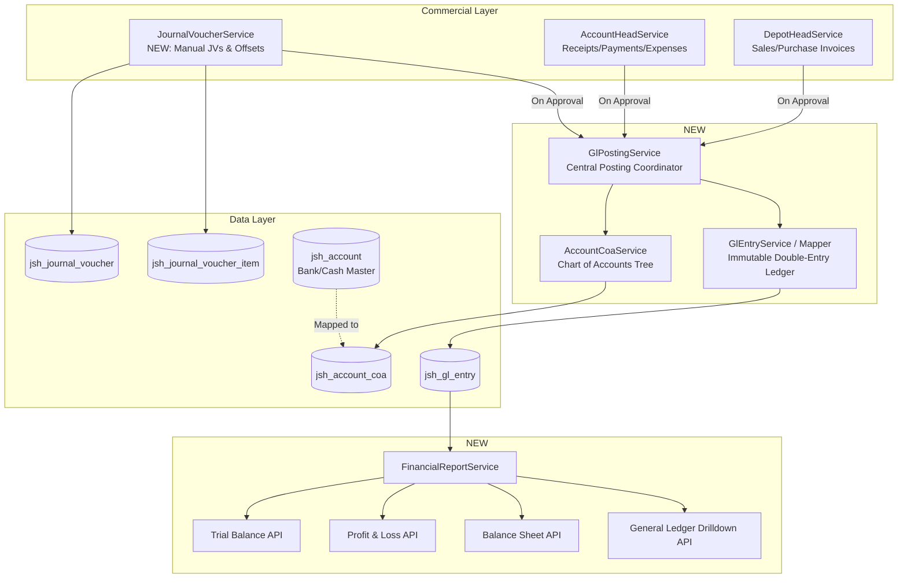

# Finance & Accounting Module — Architectural Deep Research, Gap Analysis & Implementation Proposal

**Document Version:** 1.0.0  
**Project:** `jshERP-master` (Enterprise ERP System)  
**Author:** Senior ERP Architect, Finance & Accounting Domain Specialist, India Localization Lead  
**Status:** **AWAITING USER APPROVAL (APPROVAL GATE)**  

---

## 1. Executive Summary

A comprehensive forensic audit of the Finance & Accounting module in our codebase (`ERPSystem-boot` backend + `ERPSystem-web-react` frontend) was conducted, evaluating its current data model and business logic against reference architectures from **Metasfresh**, **ERPNext**, and statutory **Indian Accounting Standards (Companies Act 2013 Schedule III, CGST Act 2017, Income Tax Act 1961)**.

### Key Assessment Findings:
1. **Existing Foundation is Strong in Commercial Operations**: The ERP excels in sales billing, purchase workflows, GST calculation snapshotting, stock tracking, and user-friendly cashier receipts/payments (`jsh_account_head` / `jsh_account_item` / `jsh_account`).
2. **The Missing Pillar — Double-Entry General Ledger (GL)**: The system currently tracks single-entry bank balances and invoice debt fields on-the-fly without an underlying immutable, double-entry General Ledger (`Debit = Credit`). As a result, standard statutory financial statements (**Trial Balance**, **Profit & Loss**, **Balance Sheet**) cannot be generated with accounting integrity.
3. **The Missing Hierarchy — Chart of Accounts (COA)**: While physical cash/bank registers exist in `jsh_account`, there is no standardized Schedule III Chart of Accounts hierarchy to classify Assets, Liabilities, Equity, Revenue, and Expenses with parent-child rollups.
4. **The Missing Operational Tool — Journal Voucher (JV)**: Accountants currently have no mechanism to record manual adjustments, depreciation, tax offsetting (GSTR-3B Input vs Output GST), TDS remittances, or year-end retained earnings closing entries.

### The Strategic Recommendation:
Rather than replacing or breaking existing commercial and financial workflows, we propose an **additive, surgical architectural enhancement** following **Karpathy engineering principles (Simplicity First, Minimal Viable Architecture, No Speculative Abstractions)**:
- **Keep** all existing customer/vendor payment screens, cashier workflows, and GST calculation snapshots completely intact.
- **Add** an immutable General Ledger engine (`jsh_gl_entry`) and a standard Indian Schedule III Chart of Accounts (`jsh_account_coa`).
- **Hook** automatic double-entry GL postings directly to the existing document approval lifecycles (Sales Invoices, Purchase Invoices, Customer Receipts, Vendor Payments, Expense Vouchers).
- **Add** a clean Journal Voucher screen (`/financial/journal_vouchers`), Chart of Accounts tree management (`/financial/chart_of_accounts`), and real-time Financial Statement reports (`/financial/trial_balance`, `/financial/profit_loss`, `/financial/balance_sheet`, `/financial/general_ledger`).

---

## 2. Current-State Assessment

### 2.1 Backend Architecture & Data Model
- **`Account` (`jsh_account`)**: Represents a physical bank account or cash drawer (e.g., "HDFC Current A/c", "Petty Cash"). It holds `initial_amount` and `current_amount`.
- **`AccountHead` (`jsh_account_head`)**: Represents a financial voucher envelope supporting 6 transaction types:
  - `Receipt` (`"收款"`) — Customer payment receipt against sales bills.
  - `Payment` (`"付款"`) — Supplier payment against purchase bills.
  - `Receive Advance Payment` (`"收预付款"`) — Customer advance deposit.
  - `Transfer Funds` (`"转账"`) — Bank-to-bank contra transfer.
  - `Income` (`"收入"`) — Direct other income.
  - `Expense` (`"支出"`) — Direct operating expense.
- **`AccountItem` (`jsh_account_item`)**: Line items connecting financial vouchers to invoices (`billId` on `DepotHead`), income/expense categories (`inOutItemId`), or bank accounts (`accountId`).
- **`InOutItem` (`jsh_in_out_item`)**: Flat dictionary items for miscellaneous income/expenses.
- **`DepotHead` (`jsh_depot_head`)**: Stores commercial invoices (Sales, Purchase, Retail, Returns) and tracks outstanding amounts directly via `total_price`, `discount_money`, `change_amount` (settled cash), and `debt` (balance due).
- **`FinancialYear` & `FySequence`**: Fiscal year model (April 1 to March 31) with document sequence series (`INV/2026-27/0001`).

### 2.2 Frontend Architecture
- **Financial Module (`/financial/*`)**:
  - `MoneyInList.tsx` (`/financial/receipts`) — Incoming customer receipts.
  - `MoneyOutList.tsx` (`/financial/payments`) — Outgoing supplier payments.
  - `AdvanceInList.tsx` (`/financial/advances`) — Customer advances.
  - `AccountList.tsx` (`/financial/accounts`) — Bank & cash account master.
  - `GiroList.tsx` (`/financial/transfers`) — Bank contra transfers.
  - `IncomeReceiptList.tsx` (`/financial/income`) — Direct income.
  - `PaymentVoucherList.tsx` (`/financial/payment`) — Direct expense vouchers.
- **Reports Module (`/report/*`)**:
  - `AccountStatsReport.tsx` — Account balance and inflow/outflow report.
  - `CustomerStatement.tsx` & `VendorStatement.tsx` — Party statements and debt aging.
  - `InOutStockReport.tsx` & `StockReport.tsx` — Stock valuation.

---

## 3. Reference Architecture Findings

### 3.1 Metasfresh ERP Reference (`Fact_Acct` Pattern)
- **Centralized Fact Table**: Metasfresh uses `Fact_Acct` as the single immutable double-entry truth. Every approved document (invoice, payment, inventory movement) writes balanced debit and credit facts.
- **Account Dimensions**: Postings are enriched with dimensions (`C_BPartner_ID` for Customer/Vendor, `M_Product_ID` for Product, `C_Activity_ID` for Cost Center).
- **Takeaway for Our System**: Implement `jsh_gl_entry` with document source tracking (`voucher_type`, `voucher_id`, `voucher_no`) and dimensional tagging (`party_type`, `party_id`, `cost_center`).

### 3.2 ERPNext Reference (`GL Entry` & Tree COA Pattern)
- **Account Tree Hierarchy**: Hierarchical accounts with 5 root types (`Asset`, `Liability`, `Equity`, `Income`, `Expense`), group/folder nodes (`is_group=1`), and postable leaf ledgers (`is_group=0`).
- **Strict Invariant Validation**: Before committing any transaction, the accounting engine enforces:
  $$\left| \sum \text{Debit} - \sum \text{Credit} \right| < 0.005$$
  Throwing an exception if an unbalanced posting is attempted.
- **Dynamic Financial Statements**: Trial Balance, Profit & Loss, and Balance Sheet are computed by simple, fast SQL queries aggregating `GL Entry` grouped by account hierarchy.
- **Takeaway for Our System**: Adopt the pre-seeded Schedule III Chart of Accounts tree, strict balance validation on posting, and real-time SQL rollup reporting.

---

## 4. India Localization Findings

### 4.1 Statutory Compliance Requirements
1. **Schedule III to Companies Act 2013**:
   - Prescribes the mandatory balance sheet and profit & loss format for Indian entities.
   - Non-Current vs Current Assets & Liabilities classification.
2. **Goods and Services Tax (CGST Act 2017)**:
   - **Input Tax Credit (ITC)**: Must be accounted into separate asset ledgers (`Input CGST`, `Input SGST`, `Input IGST`, `Input RCM Tax Clearing`).
   - **Output Tax Liability**: Must be accounted into separate liability ledgers (`Output CGST`, `Output SGST`, `Output IGST`, `Output RCM Liability`).
   - **GSTR-3B Tax Offset**: Accounting entry to offset output liability against eligible input credits with remaining cash paid via bank challan.
3. **Tax Deducted at Source (Income Tax Act 1961)**:
   - Deductions under sections **194C** (Contractors), **194J** (Professional/Technical), **194I** (Rent), **194Q** (Goods > 50L) must post credit to `TDS Payable` liability accounts at invoice booking, and debit `TDS Payable` upon Challan ITNS 281 bank payment.
4. **Fiscal Year Closing & Audit Trail**:
   - Standard financial year April 1 to March 31.
   - Closing requires nominal account zeroing and retained earnings roll-forward.
   - Audit trail rules under Companies (Audit and Auditors) Rules require immutable transaction logs.

---

## 5. GraphiPhy Architecture Assessment

Using our project's knowledge graph (`graphify-out/graph.json`), the proposed Finance & Accounting architecture integrates seamlessly into existing component clusters without disrupting existing service boundaries:



---

## 6. Gap Matrix

| Area | Current State | Reference Evidence | Gap Description | Severity | Recommendation |
|---|---|---|---|---|---|
| **General Ledger** | Single-entry cash/debt aggregation across 3 tables. | Metasfresh `Fact_Acct` / ERPNext `GL Entry`. | Missing double-entry balancing ledger. | **A (Critical)** | Create `jsh_gl_entry` and `GlPostingService`. |
| **Chart of Accounts** | Flat list of Bank accounts + expense names. | Metasfresh `C_ElementValue` / ERPNext `Account`. | Missing Schedule III hierarchical account tree. | **A (Critical)** | Create `jsh_account_coa` with pre-seeded Indian COA template. |
| **Document Posting** | Invoices update `DepotHead.debt`; vouchers update `AccountItem`. | Metasfresh `Doc_Invoice` / ERPNext `make_gl_entries`. | Commercial/financial bills do not generate GL entries. | **A (Critical)** | Hook automatic GL generation into document approval lifecycles. |
| **Journal Voucher** | None. Manual adjustments impossible. | Metasfresh `Doc_GLJournal` / ERPNext `Journal Entry`. | Cannot record adjustments, provisions, tax offsets, or depreciation. | **B (Important)** | Add `jsh_journal_voucher` + UI form. |
| **Financial Statements** | Only commercial trends & party statements. | Metasfresh & ERPNext standard financial statements. | Missing Trial Balance, Profit & Loss, and Balance Sheet. | **B (Important)** | Add `FinancialReportService` + dynamic tree table UI screens. |
| **GST Accounting** | Tax calculated & stored on document snapshots. | Itemized tax ledger postings (Input/Output CGST/SGST/IGST). | Tax not tracked in GL liability/asset credit accounts. | **E (India Localization)** | Link GST tax snapshots directly to Input/Output GST COA accounts. |
| **TDS Accounting** | Standalone procurement TDS register without GL. | Tax Withholding Category with GL posting. | TDS deductions not posted to `TDS Payable` GL accounts. | **E (India Localization)** | Add TDS COA accounts and auto-create TDS GL lines on payments/invoices. |
| **Year-End Close** | `FinancialYear` status toggle only. | Period closing voucher rolling P&L to Reserves. | Nominal accounts not rolled forward; periods not locked. | **B (Important)** | Add automated fiscal year closing and period lock verification. |
| **Bank Reconciliation** | None. | Metasfresh & ERPNext bank statement reconciliation. | Internal bank ledger cannot be matched against bank statements. | **I (Enhancement)** | Add lightweight BRS tool in Phase 4. |

---

## 7. Recommended Changes (Detailed Proposal)

### Change Group 1: Core Double-Entry General Ledger & Chart of Accounts
* **Problem**: No mathematical debit/credit balancing, no standard account classification.
* **Business Reason**: Foundation for all statutory reporting, auditability, and financial compliance.
* **Existing Component**: `AccountService` (manages bank accounts), `InOutItemService` (manages expense heads).
* **Proposed Component**:
  - `AccountCoaService` / `AccountCoaController`: Manages hierarchical COA.
  - `GlPostingService`: Coordinates document-to-GL translation and enforces $\sum \text{Debit} = \sum \text{Credit}$.
  - `GlEntryService` / `GlEntryController`: Manages ledger queries.
* **Data Model Impact**:
  - **NEW TABLE `jsh_account_coa`**:
    - `id` (BIGINT PK), `account_code` (VARCHAR), `account_name` (VARCHAR), `parent_id` (BIGINT), `root_type` (`ASSET`, `LIABILITY`, `EQUITY`, `INCOME`, `EXPENSE`), `account_type` (`RECEIVABLE`, `PAYABLE`, `BANK`, `CASH`, `TAX`, `INCOME`, `EXPENSE`, `ACCUMULATED_DEPRECIATION`, `EQUITY`), `is_group` (BOOLEAN), `is_system` (BOOLEAN), `tenant_id` (BIGINT), `delete_flag` (VARCHAR).
  - **NEW TABLE `jsh_gl_entry`**:
    - `id` (BIGINT PK), `posting_date` (DATE), `transaction_date` (DATE), `account_id` (BIGINT FK to `jsh_account_coa`), `party_type` (`CUSTOMER`, `SUPPLIER`, `MEMBER`), `party_id` (BIGINT), `cost_center` (VARCHAR), `debit` (DECIMAL(21,4)), `credit` (DECIMAL(21,4)), `voucher_type` (`SALES_INVOICE`, `PURCHASE_INVOICE`, `RECEIPT`, `PAYMENT`, `JOURNAL_VOUCHER`, `ADVANCE`, `CONTRA`), `voucher_id` (BIGINT), `voucher_no` (VARCHAR), `remarks` (VARCHAR), `financial_year_id` (BIGINT), `is_opening` (BOOLEAN), `is_cancelled` (BOOLEAN), `tenant_id` (BIGINT), `delete_flag` (VARCHAR).
  - **MODIFY TABLE `jsh_account`**: Add nullable `coa_account_id` (BIGINT) linking physical bank account to COA Bank leaf account.
  - **MODIFY TABLE `jsh_in_out_item`**: Add nullable `coa_account_id` (BIGINT) linking income/expense heads to COA Expense/Income leaf accounts.
* **API Impact**:
  - `GET /accountCoa/tree` — Fetch full hierarchical COA tree.
  - `POST /accountCoa/add`, `PUT /accountCoa/update`, `DELETE /accountCoa/delete`.
  - `GET /glEntry/list` — Query ledger entries with filters.
* **Frontend Impact**:
  - **NEW SCREEN**: `/financial/chart_of_accounts` (`ChartOfAccountsPage.tsx`) — Interactive Ant Design tree editor.
* **Priority**: **P0 (Correctness / Blocking)**.

---

### Change Group 2: Automated Document-to-GL Posting Engine
* **Problem**: Approved invoices and payment vouchers do not update General Ledger accounts.
* **Business Reason**: Completely eliminates manual double-entry work by auto-generating ledger entries on business actions.
* **Posting Rules Configured**:
  1. **Sales Invoice (`DepotHead` with `sub_type='Sales'`, approved `status='1'`)**:
     - Debit: `Trade Receivables (Customer)` = Gross Total
     - Credit: `Sales Revenue (Domestic/Export)` = Taxable Value
     - Credit: `Output CGST` = CGST Value
     - Credit: `Output SGST` = SGST Value
     - Credit: `Output IGST` = IGST Value
     - Credit/Debit: `Round-Off Account` = Round-off difference
  2. **Purchase Invoice (`DepotHead` with `sub_type='Purchase'`, approved `status='1'`)**:
     - Debit: `Purchases / Cost of Materials` = Taxable Value
     - Debit: `Input CGST` = Eligible CGST Value
     - Debit: `Input SGST` = Eligible SGST Value
     - Debit: `Input IGST` = Eligible IGST Value
     - Credit: `Trade Payables (Supplier)` = Gross Total (less TDS deducted)
     - Credit: `TDS Payable` = TDS Deducted (if applicable)
  3. **Customer Payment Receipt (`AccountHead` with `type='Receipt'`, approved `status='1'`)**:
     - Debit: `Settlement Bank/Cash Account` = Change Amount (cash received)
     - Debit: `Discount Allowed (Expense)` = Discount Amount
     - Credit: `Trade Receivables (Customer)` = Total Settled
  4. **Supplier Payment (`AccountHead` with `type='Payment'`, approved `status='1'`)**:
     - Debit: `Trade Payables (Supplier)` = Total Settled
     - Credit: `Settlement Bank/Cash Account` = Change Amount (cash paid)
     - Credit: `Discount Received (Income)` = Discount Amount
  5. **Bank Contra Transfer (`AccountHead` with `type='Transfer Funds'`)**:
     - Debit: `Destination Bank Account` = Transfer Amount
     - Credit: `Source Bank Account` = Transfer Amount
  6. **Un-approval / Cancellation**:
     - Reverses or soft-deletes existing `jsh_gl_entry` rows for that `voucher_id` atomically.
* **Backend Impact**: Add GL generation hooks into `DepotHeadService.batchSetStatus()` and `AccountHeadService.batchSetStatus()`.
* **Priority**: **P0 (Correctness / Blocking)**.

---

### Change Group 3: Journal Voucher (JV) Module
* **Problem**: No interface exists for manual adjustments, depreciation, tax offsetting, and opening balances.
* **Business Reason**: Core operational necessity for accountants and auditors.
* **Data Model Impact**:
  - **NEW TABLE `jsh_journal_voucher`**:
    - `id` (BIGINT PK), `voucher_no` (VARCHAR), `voucher_date` (DATE), `voucher_type` (`GENERAL`, `DEPRECIATION`, `TAX_OFFSET`, `PROVISION`, `OPENING`), `financial_year_id` (BIGINT), `total_amount` (DECIMAL(21,4)), `narration` (VARCHAR), `status` (`0=Draft`, `1=Posted`), `creator` (BIGINT), `tenant_id` (BIGINT), `delete_flag` (VARCHAR).
  - **NEW TABLE `jsh_journal_voucher_item`**:
    - `id` (BIGINT PK), `header_id` (BIGINT FK), `account_id` (BIGINT FK to `jsh_account_coa`), `party_type` (VARCHAR), `party_id` (BIGINT), `debit` (DECIMAL(21,4)), `credit` (DECIMAL(21,4)), `narration` (VARCHAR), `tenant_id` (BIGINT), `delete_flag` (VARCHAR).
* **Validation Rule**: Form and API strictly enforce $\sum \text{Debit} == \sum \text{Credit} > 0$.
* **Frontend Impact**:
  - **NEW SCREEN**: `/financial/journal_vouchers` (`JournalVoucherList.tsx` + `JournalVoucherModal.tsx`).
* **Priority**: **P1 (Core ERP Capability)**.

---

### Change Group 4: Financial Statements & General Ledger Reporting
* **Problem**: Absence of standard financial statements.
* **Business Reason**: Required for management insights, tax returns, banking compliance, and audit sign-off.
* **Proposed Component**: `FinancialReportService` / `FinancialReportController`.
* **Reports Provided**:
  1. **Trial Balance (`/financial/trial_balance`)**:
     - Displays all COA accounts with Opening Balance, Period Debit, Period Credit, and Closing Balance.
     - Confirms $\sum \text{Total Debits} == \sum \text{Total Credits}$.
  2. **Profit & Loss Statement (`/financial/profit_loss`)**:
     - Income vs Expenses grouped by Schedule III categories with Gross Profit and Net Profit.
  3. **Balance Sheet (`/financial/balance_sheet`)**:
     - Assets vs Liabilities & Equity with Net Profit roll-forward.
  4. **General Ledger Drill-Down (`/financial/general_ledger`)**:
     - Transaction statement by Account & Party with running balance and click-to-view voucher.
* **Priority**: **P1 (Core ERP Capability)**.

---

### Change Group 5: India Statutory Automation (TDS & Year-End Close)
* **Problem**: TDS deduction and FY period closing are manual/disconnected.
* **Business Reason**: Direct statutory compliance with Income Tax Act and Companies Act.
* **Features Provided**:
  - Auto-posting of TDS on eligible payments/invoices.
  - FY Period Closing Wizard: Automatically computes net P&L profit/loss for the year, writes an opening closing entry to `Reserves & Surplus`, and marks the Financial Year as `LOCKED`.
* **Priority**: **P2 (India Localization & Governance)**.

---

## 8. Explicitly Unchanged Areas (Preserved Intact)

1. **Commercial Sales & Purchase Invoicing (`GstSalesInvoiceForm.tsx`, `DepotHeadService`)**:
   - The user interface, item tables, batch tracking, serial numbers, and pricing calculators remain 100% untouched. GL posting occurs silently in the background upon approval.
2. **Customer & Vendor Cashier Payment Screens (`MoneyInList.tsx`, `MoneyOutList.tsx`)**:
   - The existing intuitive AR/AP invoice settlement UX is preserved completely.
3. **GST Calculation Snapshot Engine (`DocumentTaxSnapshot`)**:
   - The existing high-precision GST calculation logic is preserved; GL posting simply reads these snapshot amounts.
4. **Physical Bank/Cash Accounts (`jsh_account`)**:
   - Physical account balances and daily drawer registers continue functioning smoothly.
5. **Existing Role-Based Permissions & Multi-Tenant Infrastructure**:
   - Leverages the existing `UserContext`, `tenant_id` filter, and Spring Security architecture.

---

## 9. Do Not Build (Features Explicitly Rejected / Deferred)

1. **DO NOT BUILD: Multi-Currency Parallel Accounting Schemas (Metasfresh `C_AcctSchema`)**:
   - *Reason:* Unnecessary for Indian domestic SMEs. Standard INR accounting with basic forex gain/loss on foreign invoices is clean and sufficient.
2. **DO NOT BUILD: Complex Corporate Budgeting & Variance Engine**:
   - *Reason:* Unnecessary overhead for the current phase.
3. **DO NOT BUILD: Heavyweight Workflow Engines (Camunda/Activiti)**:
   - *Reason:* Adds unnecessary microservice/JVM footprint. Spring Boot state transitions are fast and simple.
4. **DO NOT BUILD: Automated Bank Scraper / Direct Open Banking API Aggregator**:
   - *Reason:* Fragile and high maintenance. Manual statement upload / CSV Bank Reconciliation is robust and reliable.
5. **DO NOT BUILD: Separate Physical Sub-Ledger Tables for Every Entity Type**:
   - *Reason:* Over-engineering. A unified `jsh_gl_entry` table with dimensional party fields fulfills all sub-ledger requirements with 10x higher performance.

---

## 10. Incremental Implementation Phases

```
+-------------------------------------------------------------------------------+
|                        IMPLEMENTATION ROADMAP (PHASED)                        |
+-------------------------------------------------------------------------------+
|  PHASE 1: Foundation — Chart of Accounts & GL Entry Core Engine               |
|  - Database tables: jsh_account_coa, jsh_gl_entry, default COA seed           |
|  - Backend services: AccountCoaService, GlEntryService, GlPostingService       |
|  - Frontend: /financial/chart_of_accounts (COA Tree Manager)                  |
+-------------------------------------------------------------------------------+
                                      |
                                      v
+-------------------------------------------------------------------------------+
|  PHASE 2: Auto-Posting Engine & Journal Voucher Module                        |
|  - Hook GlPostingService to DepotHead (Invoices) & AccountHead (Payments)     |
|  - Database tables: jsh_journal_voucher, jsh_journal_voucher_item             |
|  - Backend: JournalVoucherService, JournalVoucherController                   |
|  - Frontend: /financial/journal_vouchers (JV Form & List)                     |
+-------------------------------------------------------------------------------+
                                      |
                                      v
+-------------------------------------------------------------------------------+
|  PHASE 3: Financial Statements & Ledger Reports                               |
|  - Backend: FinancialReportService (Trial Balance, P&L, Balance Sheet, GL)   |
|  - Frontend: /financial/trial_balance, /financial/profit_loss,                |
|              /financial/balance_sheet, /financial/general_ledger              |
+-------------------------------------------------------------------------------+
                                      |
                                      v
+-------------------------------------------------------------------------------+
|  PHASE 4: India Statutory Refinements & Governance                           |
|  - TDS Ledger deductions & Challan 281 JV template                            |
|  - Fiscal Year-End Retained Earnings Closing & Period Lock                    |
|  - Lightweight Bank Reconciliation (BRS) tool                                 |
+-------------------------------------------------------------------------------+
```

---

## 11. Migration & Backward Compatibility Plan

1. **Zero-Downtime Non-Breaking Schema**:
   - All new tables (`jsh_account_coa`, `jsh_gl_entry`, `jsh_journal_voucher`, `jsh_journal_voucher_item`) are strictly additive.
   - Existing tables receive nullable FK columns (`coa_account_id`).
2. **Automated Tenant Bootstrap Migration**:
   - Extend `TenantBootstrapService.java` so every existing and new tenant automatically receives the standard Indian Schedule III Chart of Accounts template upon system startup/initialization.
   - Automatically link existing `jsh_account` records to their corresponding leaf Bank/Cash COA accounts.
3. **Historical Ledger Re-Sync Utility (Optional Batch Job)**:
   - Provide an admin endpoint `POST /admin/accounting/rebuild_gl_entries` to backfill `jsh_gl_entry` rows for approved historical invoices and payments if desired.

---

## 12. Testing & Verification Strategy

1. **Unit & Mathematical Integrity Tests**:
   - `GlPostingServiceTest`: Verify that for 100% of generated GL transactions, $\sum \text{Debit} == \sum \text{Credit}$.
   - Round-off handling test: Verify precision down to 2 decimal places.
2. **Integration Transaction Tests**:
   - Test approval of Sales Invoice -> Check `jsh_gl_entry` rows for Debtors, Sales, and Output GST.
   - Test un-approval / deletion of Sales Invoice -> Check that `jsh_gl_entry` rows are deleted/reversed atomically.
   - Test Customer Receipt -> Check Bank Debit and Debtors Credit.
3. **Financial Statement Accuracy Tests**:
   - Verify Trial Balance: Total Debits == Total Credits.
   - Verify Balance Sheet equation: $\text{Total Assets} == \text{Total Liabilities} + \text{Equity} + \text{Net Profit}$.
4. **End-to-End Frontend Verification**:
   - Create and post a Journal Voucher -> verify immediate reflection in General Ledger and Trial Balance.
   - Build verification via `npm run build` (0 TypeScript / lint errors).

---

## 13. Risk Register & Mitigation

| Risk | Impact | Probability | Mitigation Strategy |
|---|---|---|---|
| **Unbalanced GL Posting Risk** | High | Low | Enforce strict invariant check in `GlPostingService` before database commit; abort transaction if $\text{Debit} \neq \text{Credit}$. |
| **Performance Degradation on Ledger Reports** | Medium | Low | Create composite database indexes on `jsh_gl_entry(tenant_id, account_id, posting_date)` and `(tenant_id, voucher_type, voucher_id)`. |
| **User Confusion over New Accounting Screens** | Low | Low | Keep all routine invoice and cashier screens unchanged; place advanced accounting tools in dedicated "Finance & Accounting" submenu. |
| **Backdated Modification of Closed Periods** | High | Low | Add validation interceptor in `GlPostingService` checking if `FinancialYear.status == 'LOCKED'`. |

---

## 14. Architecture Decisions Summary (ADRs)

- **ADR-1: Unified GL Entry vs Multiple Sub-Ledgers**: Adopted single `jsh_gl_entry` table with dimensional party/cost-center fields. Rejected separate sub-ledger tables for maintainability and query performance.
- **ADR-2: Pre-Seeded Schedule III Chart of Accounts**: Adopted standard Indian Schedule III template automatically provisioned per tenant with full user customization.
- **ADR-3: Synchronous Document Posting**: Adopted synchronous transactional posting within Spring `@Transactional` boundaries on document approval rather than asynchronous message queues, guaranteeing immediate ledger consistency.
- **ADR-4: Preserving Existing Commercial UX**: Kept existing `DepotHead` invoice and `AccountHead` receipt/payment forms completely unchanged to maintain high cashier productivity.

---

## 15. Approval Checklist & Gate

Please review the proposed implementation plan and indicate approval to proceed to execution:

- [ ] **Phase 1: Foundation — Chart of Accounts (`jsh_account_coa`) & General Ledger Core Engine (`jsh_gl_entry`)**
- [ ] **Phase 2: Automated Document Posting Engine & Journal Voucher Module (`jsh_journal_voucher`)**
- [ ] **Phase 3: Financial Statements (Trial Balance, Profit & Loss, Balance Sheet, General Ledger Drilldown)**
- [ ] **Phase 4: India Statutory Refinements (TDS GL Posting, FY Period Close, Bank Reconciliation)**

---
*End of Proposal — Standing by for User Approval before executing any source code modifications.*
