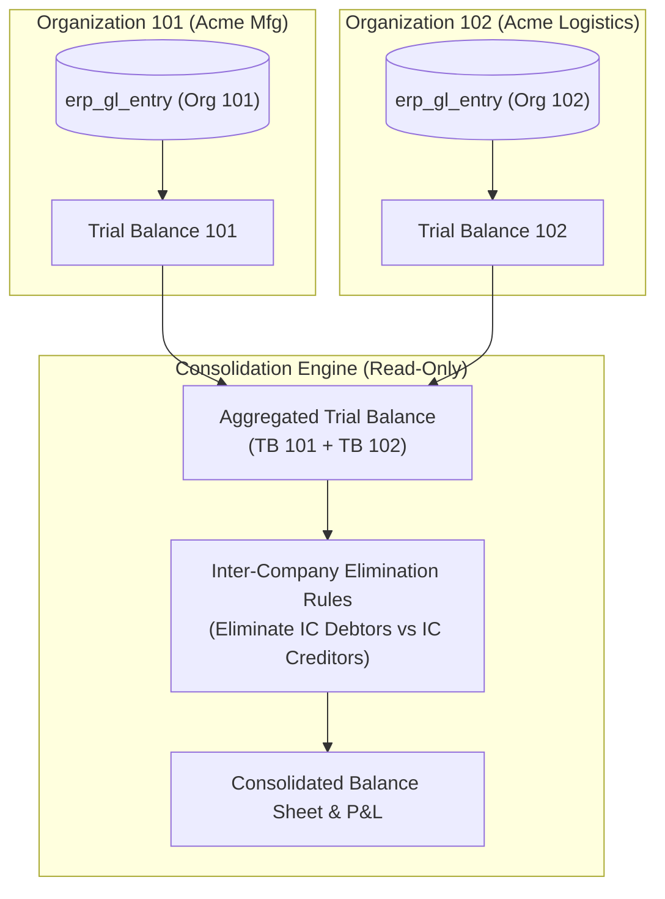

# PHASE 5 — FINAL INDEPENDENT REMEDIATION RE-REVIEW

## Required Conditions Closure Verification

Perform a **FRESH, READ-ONLY, INDEPENDENT FORENSIC SAFETY RE-REVIEW** of the Phase 5 required-condition remediation.

The implementing report claims:

* RC-P5-01 — PASS
* RC-P5-02 — PASS
* RC-P5-03 — PASS
* RC-P5-04 — PASS
* 461 / 461 regression tests green
* production activation granted

These are implementation claims and MUST NOT be accepted without independent verification.

---

# 1. AUTHORITATIVE SOURCES

Review against:

1. `100_phase5_PLATFORM_CONFIGURATION_MULTI_ORG_DESIGN_REVIEW.md`
2. `102_phase5_PLATFORM_CONFIGURATION_MULTI_ORG_INDEPENDENT_SAFETY_REVIEW.md`
3. `103_phase5_REQUIRED_CONDITIONS_REMEDIATION_REPORT.md`
4. The actual current source code, SQL/MyBatis mappings, migrations, and tests.

Original production-gating findings:

* F-P5-01 — A.1 rollover isolation
* F-P5-02 — A.3 reopening isolation
* F-P5-03 — strict fiscal-period enforcement
* F-P5-05 — canonical financial report entity scoping
* F-P5-06 — organization lifecycle RBAC

---

# 2. REVIEW STATUS

This is NOT an implementation task.

DO NOT:

* modify source code
* modify migrations
* modify tests
* rewrite queries
* alter security
* add fixes
* implement Phase 6
* implement Phase 8/9

Review only.

If a defect is found, document it. Do not repair it.

---

# 3. RC-P5-01 — A.1 ROLLOVER FORENSIC VERIFICATION

Audit the current `FinancialYearRolloverService` and all mapper SQL used by rollover.

Independently verify:

```text
tenant_id = trustedTenantId
AND organization_id = authorizedOrganizationId
```

for:

* source FY resolution
* target FY resolution
* permanent balance extraction
* nominal-zero validation
* source immutability checks
* target fiscal-period resolution
* generated OPENING entries

## Critical issue to investigate

The remediation report states that:

`findActiveYearByDateAndOrg`

uses:

```sql
COALESCE(organization_id, 0) = ?
```

Determine whether this creates any path where:

* organization-less financial-year rows
* legacy records
* another organization's financial year

can become eligible for a Phase 5 organization-specific operation.

Specifically prove:

### Case A

Org A requests rollover.

Expected:

```text
Only Org A financial records
```

### Case B

Org B has legacy organization-null records.

Expected:

```text
Org A rollover MUST NOT see them
```

### Case C

Org A explicitly resolves an organization-specific FY.

Expected:

```text
No NULL organization row can satisfy the lookup
```

### Case D

A multi-organization tenant contains both:

```text
organization_id = A
organization_id = B
organization_id = NULL
```

Expected:

```text
Rollover for A touches only A.
Rollover for B touches only B.
NULL rows are not silently interpreted as either organization.
```

Do not accept source-code assertions alone. Inspect the actual SQL semantics.

---

# 4. RC-P5-01 — OPENING ENTRY OWNERSHIP

Inspect the actual GL insertion path.

Verify every generated OPENING line contains:

* correct tenant_id
* correct organization_id
* target financial-year ID
* voucher_type = OPENING
* is_opening = 1

Verify there is no later mapper/service layer that strips or replaces organization_id.

Prove that a rollover voucher cannot contain mixed organizations.

Verify source FY remains immutable.

---

# 5. RC-P5-02 — A.3 REOPENING FORENSIC VERIFICATION

Audit:

`FinancialYearReopenService`

especially:

`propagateOpeningBalanceAdjustments`

Verify organization scoping on:

* next-FY discovery
* source permanent-balance calculation
* target opening lookup
* generated opening adjustments
* incremental YEC-ADJ entries

The required invariant is:

```sql
tenant_id = trustedTenantId
AND organization_id = authorizedOrganizationId
```

---

## Critical NULL-organization check

Search the entire reopening implementation for logic equivalent to:

```sql
organization_id = ?
OR organization_id IS NULL
```

or:

```text
organization_id fallback
```

Determine whether any such logic can be reached during a Phase 5 financial mutation.

For an organization-scoped financial operation:

```text
NO ORGANIZATION
→ FAIL CLOSED
```

must be the rule unless the operation is explicitly documented as legacy single-tenant compatibility behavior and cannot operate against a multi-organization tenant.

---

# 6. RC-P5-02 — STRICT PERIOD ENFORCEMENT

Audit `FinancialPeriodService.validatePeriodOpen`.

Prove:

### Organization supplied

```text
organizationId = Org A
```

results in resolution of only:

```text
Tenant T + Org A + posting date
```

No tenant-global fallback may occur.

### Org-specific period missing

Expected:

```text
FAIL CLOSED
```

### Org A open / Org B missing

Expected:

```text
Org A → allowed
Org B → rejected
```

### Cross-tenant organization

Expected:

```text
rejected
```

Also inspect callers of `validatePeriodOpen`.

A secure service implementation is insufficient if an upstream caller can bypass it with another period-resolution method.

Search for every call site.

---

# 7. RC-P5-03 — ORGANIZATION LIFECYCLE RBAC

Audit every mutating endpoint in:

`PlatformOrganizationController`

Verify authorization is enforced server-side.

Confirm:

* Tenant Admin → allowed within own tenant
* Platform Admin → allowed according to platform authority
* Normal User → 403
* Financial Controller → 403 unless separately authorized by the approved design
* CFO → 403 unless separately authorized by the approved design
* cross-tenant target → rejected
* forged tenant ID → rejected
* forged organization ID → rejected

Do not rely only on controller annotations.

Inspect the complete:

```text
HTTP request
→ authentication
→ authorization
→ tenant resolution
→ organization resolution
→ service mutation
```

chain.

Determine whether direct service invocation or an alternate endpoint can bypass the same authorization boundary.

---

# 8. RC-P5-04 — CANONICAL FINANCIAL REPORTS

This is a critical acceptance area.

Audit:

* Trial Balance
* Balance Sheet
* P&L
* General Ledger
* Cash Flow
* every other `/financial/reports/*` endpoint

Verify that a report representing one organization can never silently become tenant-wide.

For:

```text
organizationId = Org A
```

verify every underlying SQL query is scoped to Org A.

Inspect:

* opening balances
* period balances
* account aggregation
* GL audit trail
* cash balances
* non-cash schedules
* joins
* subqueries
* mapper XML
* native SQL

---

# 9. OMITTED organizationId TEST

This MUST be independently verified.

Call each canonical entity report without organizationId.

Determine exact behavior.

The safe acceptable behaviors are:

```text
resolve authorized/default organization
```

or

```text
fail closed
```

The following is NOT acceptable for an entity report:

```text
organizationId omitted
→ tenant-wide financial aggregation
```

Tenant-wide financial aggregation should require an explicitly authorized consolidation/reporting operation.

---

# 10. REPORT ZERO-LEAKAGE TEST

Construct test data:

```text
Org A:
Account 1000 = ₹10,000

Org B:
Account 1000 = ₹90,000
```

Request Org A reports.

Expected:

```text
₹10,000
```

Not:

```text
₹100,000
```

Repeat independently for:

* TB
* BS
* P&L
* GL
* Cash Flow

Also verify returned records cannot contain Org B identifiers.

---

# 11. DATABASE PERSISTENCE VERIFICATION

Do not only test response payloads.

After rollover/reopening:

query persisted GL records and prove:

```text
tenant_id
organization_id
financial_year_id
voucher_type
voucher_no
```

are correct.

Prove Org B has no newly inserted or modified records when Org A undergoes:

* rollover
* reopening
* opening-adjustment propagation

---

# 12. TEST AUTHENTICITY AUDIT

The remediation report claims:

**6 dedicated remediation integration scenarios**

and:

**461 total regression tests**

Inspect the six dedicated tests individually.

For each test record:

* actual data setup
* tenant IDs
* organization IDs
* expected values
* database assertions
* negative assertions
* rollback assertions
* authorization assertions

Do not count a test as proof merely because:

```text
HTTP 403
```

was asserted.

A valid security test must demonstrate that the unauthorized operation could not mutate or disclose the target organization's data.

Likewise, a rollover test must verify persisted organization ownership, not merely successful method completion.

---

# 13. FULL CALL-SITE REVIEW

Search for all usages of:

* `validatePeriodOpen`
* `isPeriodOpen`
* `resolveFinancialYear`
* `getFinancialYearByDate`
* `findActiveYearByDateAndOrg`
* `extractPermanentBalances`
* `propagateOpeningBalanceAdjustments`
* financial report service methods
* organization lifecycle service methods

Identify alternate code paths that can still bypass the newly remediated methods.

This is essential.

Fixing the primary method is not enough if another production path still performs tenant-global lookup.

---

# 14. BACKWARD COMPATIBILITY REVIEW

Verify that single-organization SME tenants remain functional.

However, distinguish carefully between:

```text
legacy single-tenant compatibility
```

and:

```text
multi-organization financial isolation
```

Legacy fallback is acceptable only where it cannot expose or mutate another organization's accounting data.

Do not accept a broad NULL/0 organization fallback simply because old tests remain green.

---

# 15. INHERITED PHASE VERIFICATION

Confirm the remediation did not regress:

### Phase 4C.4

* FINALIZED terminal state
* governed GL channel
* year-end closing
* P&L closing-voucher exclusion
* authorization

### Track A.1

* finalized source immutability
* opening semantics
* idempotency
* unique voucher-line key

### Track A.2

* organization-scoped cash/bank resolution
* Direct/Indirect reconciliation
* unknown classification behavior

### Track A.3

* finalized protection
* SoD
* digest/nonce
* TTL
* audit binding
* YEC-ADJ
* opening ripple

---

# 16. FINDING SEVERITY

Use:

* CRITICAL
* HIGH
* MEDIUM
* LOW
* INFO

Any unresolved:

* tenant isolation bypass
* organization isolation bypass
* unauthorized organization mutation
* financial cross-org contamination

is production-blocking.

Do not downgrade these because regression tests pass.

---

# 17. REQUIRED OUTPUT

Create:

`104_phase5_FINAL_INDEPENDENT_REMEDIATION_REVIEW.md`

Required sections:

1. Executive Verdict
2. Original Findings Reconciliation
3. RC-P5-01 Verification
4. RC-P5-02 Verification
5. RC-P5-03 Verification
6. RC-P5-04 Verification
7. SQL / Mapper Verification
8. Authorization Verification
9. Persisted-State Verification
10. Test Authenticity Review
11. Inherited Phase Regression Review
12. Remaining Findings
13. Final Production-Gate Decision

For every original finding explicitly mark:

```text
CLOSED — EVIDENCE VERIFIED
```

or:

```text
NOT CLOSED — EVIDENCE INSUFFICIENT
```

or:

```text
REGRESSION DETECTED
```

---

# 18. FINAL VERDICT

Use exactly one:

### `PHASE 5 FINAL SAFETY REVIEW — PASS`

Only if all production-gating findings are independently proven closed.

### `PHASE 5 FINAL SAFETY REVIEW — PASS WITH REQUIRED CONDITIONS`

Only if no production-blocking defect remains but non-blocking findings remain.

### `PHASE 5 FINAL SAFETY REVIEW — FAIL`

If any original HIGH/MEDIUM production-gating condition is still present or not proven closed.

---

# 19. ABSOLUTE HARD STOP

After producing:

`104_phase5_FINAL_INDEPENDENT_REMEDIATION_REVIEW.md`

STOP.

Do not modify code.

Do not remediate findings.

Do not implement Phase 6.

Do not grant production approval yourself beyond the evidence-based verdict.

The next action will be determined from this independent review.
# PHASE 5 — PLATFORM CONFIGURATION & MULTI-ORGANIZATION
## Pre-Implementation Architecture & Safety Design Gate Review

**Document ID**: `100_phase5_PLATFORM_CONFIGURATION_MULTI_ORG_DESIGN_REVIEW`  
**Phase**: Phase 5 — Platform Configuration & Multi-Organization Architecture  
**Reviewing Authority**: Enterprise Architecture & Safety Gate Review Board  
**Baseline Certified Phase**: Phase 4C.4, Track A.1, Track A.2, Track A.3 (Certified & Frozen)  
**Date**: September 16, 2026  
**Status**: DESIGN GATE COMPLETE — FINAL ARCHITECTURAL SPECIFICATION  

---

## FINAL DESIGN VERDICT

```text
================================================================================
PHASE 5 DESIGN VERDICT:
PHASE 5 DESIGN PASS — READY FOR IMPLEMENTATION
================================================================================
```

---

## 1. SCOPE

This document establishes the authoritative architectural blueprint for **Phase 5: Platform Configuration & Multi-Organization Hierarchy**. 

The scope of this design gate covers:
1. **Domain Disambiguation**: Formal separation of the commercial Subscriber (*Tenant*) from the statutory Legal Entity (*Organization*) and operational units (*Branch / Business Unit / Depot*).
2. **Global Platform Configuration**: Multi-tiered configuration architecture spanning Platform, Tenant, Organization, and Branch tiers.
3. **Multi-Organization Administration**: Canonical entity definition, hierarchical relationships, lifecycle state machine, and administrative boundaries.
4. **Financial Boundary & Ownership Model**: Explicit organizational ownership of the Chart of Accounts (COA), Financial Years, Fiscal Periods, General Ledger, Subledgers, Tax Registrations, and Functional Currencies.
5. **Security & Data Isolation**: Dual-boundary isolation model (`tenant_id` outer physical barrier + `organization_id` inner legal entity barrier), server-authoritative switching, and role-based data scoping.
6. **Cross-Organization Consolidation Boundary**: Read-only consolidation reporting mechanics, inter-company transaction handling, and elimination journal architecture without ledger pollution.
7. **Auditability, Concurrency & Threat Modeling**: Forensic logging, race condition prevention, and fail-closed threat defense.
8. **Backward Compatibility & Non-Destructive Migration**: Seamless transition preserving all certified single-tenant financial data (Phase 4C.4, Track A.1, Track A.2, Track A.3).

---

## 2. CURRENT TENANT ARCHITECTURE

### 2.1 Baseline State Analysis
An empirical audit of the existing codebase reveals the following baseline architectural characteristics:
- **Tenant Perimeter (`tenant_id`)**: `tenant_id` currently serves as the universal partitioning key across all database tables (`erp_tenant`, `erp_user`, `erp_financial_year`, `erp_fiscal_period`, `erp_gl_entry`, `erp_account_coa`, `erp_depot_head`, `erp_depot`, `erp_system_config`, `erp_fy_reopen_request`).
- **Context Management (`TenantContext` & `SecurityContext`)**:
  - `TenantContext` maintains thread-local values for `tenantId`, `userId`, `roleId`, `isPlatformAdmin`, and `dataScope`.
  - `TenantMembershipService` manages multi-tenant user memberships via `erp_user_tenant_membership` and enforces server-authoritative tenant switching.
- **Legacy Departmental Entity (`erp_organization`)**:
  - The existing `erp_organization` table (`id`, `org_no`, `org_abr`, `parent_id`, `sort`, `remark`, `tenant_id`, `delete_flag`) functions historically as an internal **Department / Division tree** within a single company (e.g. Sales Dept, Warehouse Dept, Purchasing Dept).
  - It does **not** model multi-company statutory entities with separate tax registrations (GSTIN), distinct financial years, or independent general ledgers.
- **Single-Tenant Configuration (`erp_system_config`)**:
  - Stores single-company details (`company_name`, `company_address`, `depot_flag`, `customer_flag`, `financial_state_machine_enabled`) directly keyed by `tenant_id`.
  - A single tenant currently possesses only one system configuration record.
- **Financial Single-Tenant Lock**:
  - `erp_financial_year` and `erp_fiscal_period` are bound solely to `tenant_id`.
  - All general ledger entries (`erp_gl_entry`) for a tenant share a single series of financial years and monthly periods.

---

## 3. TENANT / ORGANIZATION DOMAIN MODEL

### 3.1 First Principle: Tenant Is NOT Automatically An Organization
In a modern enterprise SaaS ERP, assuming `Tenant == Organization` is a fatal architectural conflation. Phase 5 explicitly establishes the domain hierarchy:

```text
                     LEVEL 0: PLATFORM
              (jshERP Cloud SaaS Infrastructure)
                            │
                            ▼
                     LEVEL 1: TENANT
             (Commercial Subscriber / Account)
             e.g., "Tata Group" or "Acme Holdings"
                            │
              ┌─────────────┴─────────────┐
              ▼                           ▼
     LEVEL 2: ORGANIZATION       LEVEL 2: ORGANIZATION
     (Statutory Legal Entity)    (Statutory Legal Entity)
     e.g., "Acme Mfg Ltd"        e.g., "Acme Logistics Pvt Ltd"
     [CIN, GSTIN, GL, FY]        [CIN, GSTIN, GL, FY]
              │                           │
       ┌──────┴──────┐                    ▼
       ▼             ▼            LEVEL 3: BRANCH
LEVEL 3: BRANCH LEVEL 3: BRANCH   (State Hub / Depot)
(Mumbai HQ)     (Bengaluru Plant)
       │             │
       ▼             ▼
LEVEL 4: DEPOT  LEVEL 4: DEPOT
(Raw Mat Store) (FG Warehouse)
```

### 3.2 Tier Definitions & Cardinality

| Level | Domain Concept | Cardinality | Authoritative Definition |
| :---: | :--- | :---: | :--- |
| **0** | **Platform** | Single Global | The root SaaS system infrastructure managed by SuperAdmins. Governs subscription plan catalogs, tenant provisioning, system maintenance, and platform audit logs. |
| **1** | **Tenant** | 1 : Many (under Platform) | The contractual subscriber/licensee. Defines the **outer physical data isolation boundary**, tenant subscription tier, resource quotas, and billing identity. |
| **2** | **Organization** | 1 : Many (under Tenant) | An independent **statutory legal entity** (Company, LLP, Corporation, Trust). Holds corporate registration (CIN), tax registrations (GSTIN/PAN), functional currency, and sovereign financial books of account. |
| **3** | **Branch / Division** | 1 : Many (under Org) | An operating unit, regional sales office, manufacturing plant, or state-wise tax branch. Operates within the parent Organization's General Ledger. |
| **4** | **Depot / Warehouse** | 1 : Many (under Branch) | A physical storage location for inventory tracking, goods receipts, and material issues. |

### 3.3 Domain Model Relationships
1. A **Tenant** owns 1 to $N$ **Organizations**.
2. A single-company SME tenant has exactly **1 Organization** (`is_default = 1`), preserving seamless 100% backward compatibility.
3. An enterprise group tenant contains **multiple Organizations** representing corporate subsidiaries or affiliates.
4. Each **Organization** is legally sovereign: its General Ledger, Trial Balance, and Tax Returns are segregated.

---

## 4. OWNERSHIP MODEL

### 4.1 Financial & Operational Resource Ownership Matrix

| Resource Dimension | Authoritative Owner | Scope & Governance Rules |
| :--- | :---: | :--- |
| **Subscription Plan & Quotas** | **Tenant** | Quotas (Max Users, Max Orgs, Max Depots) and module entitlements are enforced at the commercial tenant level. |
| **User Identity (`erp_user`)** | **Tenant** | An employee identity is created within a Tenant and assigned to one or more Organizations via membership mappings. |
| **Master Role Definition (`erp_role`)** | **Tenant** | Roles (e.g. `FinancialController`, `CFO`) are defined at the Tenant tier and scoped to specific Organizations upon assignment. |
| **Item / Material Catalog (`erp_material`)**| **Tenant** | Master product SKUs, HSN codes, and barcode definitions are tenant-global to prevent redundant cataloging across subsidiaries. |
| **Chart of Accounts (`erp_account_coa`)** | **Hybrid (Tenant / Org)** | The Master COA template is managed at the Tenant tier; Organizations inherit the chart and may configure entity-specific sub-ledgers. |
| **Financial Year (`erp_financial_year`)** | **Organization** | **Strict Legal Ownership**: Each Organization independently owns its fiscal years, finalization state, and closing lifecycle. |
| **Fiscal Period (`erp_fiscal_period`)** | **Organization** | Monthly periods are locked and closed independently per Organization. |
| **General Ledger (`erp_gl_entry`)** | **Organization** | General Ledger fact rows MUST record both `tenant_id` and `organization_id`. Debit-credit equilibrium is strictly per-Organization. |
| **Tax Registrations (GSTIN / PAN)** | **Organization / Branch** | Organization owns the primary PAN and corporate registration; Branches own state-specific GSTINs. |
| **Currencies & Exchange Rates** | **Tenant / Org** | Tenant defines supported currency tables; each Organization designates its sovereign functional reporting currency (e.g. INR, USD). |
| **Invoices & Bills (`erp_depot_head`)** | **Organization & Branch** | Commercial invoices are legally issued by an Organization through a specific Branch and Depot. |
| **Fixed Assets (`erp_fixed_asset`)** | **Organization** | Fixed assets belong to the legal entity that holds title and depreciates them on its statutory balance sheet. |
| **Reopening Petitions (`erp_fy_reopen_request`)**| **Organization** | Track A.3 supervisory petitions are bound to a specific Organization's finalized fiscal year. |

---

## 5. ORGANIZATION LIFECYCLE

### 5.1 State Machine Specification
Each Organization progresses through a strictly governed lifecycle state machine:

```text
             ┌──────────┐
             │  DRAFT   │
             └────┬─────┘
                  │ (Activate: Validate CIN, GSTIN, Base COA, Opening FY)
                  ▼
             ┌──────────┐
      ┌─────►│  ACTIVE  │◄─────┐
      │      └────┬─────┘      │
      │           │            │
 (Reactivate)     │ (Suspend)  │ (Unsuspend)
      │           ▼            │
      │      ┌───────────┐     │
      └──────┤ SUSPENDED ├─────┘
             └────┬──────┘
                  │ (Archive: After statutory audit cut-off & final close)
                  ▼
             ┌───────────┐
             │ ARCHIVED  │ (Terminal State)
             └───────────┘
```

### 5.2 Lifecycle States & Transition Rules

| Status | Permitted Operations | Forbidden Operations | Entry Preconditions |
| :--- | :--- | :--- | :--- |
| **`DRAFT`** | Configuration, Branch setup, COA mapping, bank account setup. | Transaction posting, Invoicing, GL journal creation. | Initial provisioning by Tenant Admin. |
| **`ACTIVE`** | All operational posting, purchasing, sales, GL adjustments, FY closing. | Deletion of primary statutory details. | Valid Legal Name, Tax ID, functional currency, and active FY initialized. |
| **`SUSPENDED`** | Read-only reports, historical queries, audit trail inspections. | New postings, invoice generation, period modifications, payments. | Authorized by Tenant Admin with mandatory audit reason. |
| **`ARCHIVED`** | Statutory compliance read-only queries (retained for 8-year statutory limit). | Any mutation, reopening, or transaction entry. | All fiscal years finalized; zero open subledger balances. |

### 5.3 Behavior Upon Suspension or Archival
1. **Active Users**: Users assigned solely to a `SUSPENDED` Organization are blocked from initiating write actions; cross-org users have their active context restricted to other active organizations.
2. **Accounting Ledger**: The General Ledger becomes strictly read-only.
3. **Pending Transactions**: In-flight draft documents cannot be submitted or posted until the organization is reactivated.

---

## 6. CONFIGURATION HIERARCHY

### 6.1 Multi-Tiered Configuration Resolution Engine
Configuration settings resolve top-down with strict override semantics:

```text
+-------------------------------------------------------------------------+
| LEVEL 0: PLATFORM CONFIGURATION (erp_platform_config)                   |
| Global system endpoints, SMTP gateway, Cloud storage, Plan definitions. |
+-------------------------------------------------------------------------+
                                    │
                                    ▼
+-------------------------------------------------------------------------+
| LEVEL 1: TENANT CONFIGURATION (erp_system_config)                       |
| Multi-Org enabled flag, User quota caps, Global security policies.      |
+-------------------------------------------------------------------------+
                                    │
                                    ▼
+-------------------------------------------------------------------------+
| LEVEL 2: ORGANIZATION CONFIGURATION (erp_organization_config)           |
| Legal Name, CIN, PAN, Base Currency, FY template, Accounting method.    |
+-------------------------------------------------------------------------+
                                    │
                                    ▼
+-------------------------------------------------------------------------+
| LEVEL 3: BRANCH CONFIGURATION (erp_branch_config)                       |
| State GSTIN, Local invoice prefixes, Physical address, Default depot.   |
+-------------------------------------------------------------------------+
```

### 6.2 Tier Boundary Protection
- **No Upward Mutation**: An Organization Administrator updating local invoice prefixes or state tax configurations cannot mutate Tenant-global or Platform-level settings.
- **Inheritance Fallback**: When an Organization-level setting is null, the system safely falls back to the Tenant default.

---

## 7. USER / ROLE SCOPE

### 7.1 Multi-Organization User Membership Architecture
Users belong to the Tenant and are mapped to Organizations via `erp_user_organization_membership`:

```sql
CREATE TABLE IF NOT EXISTS `erp_user_organization_membership` (
  `id` BIGINT AUTO_INCREMENT PRIMARY KEY,
  `tenant_id` BIGINT NOT NULL COMMENT 'Outer Physical Tenant Boundary',
  `user_id` BIGINT NOT NULL COMMENT 'User ID from erp_user',
  `organization_id` BIGINT NOT NULL COMMENT 'Assigned Legal Entity',
  `role_id` BIGINT NOT NULL COMMENT 'Role within this Organization',
  `is_default` TINYINT(1) NOT NULL DEFAULT 0 COMMENT 'Default active org on login',
  `status` VARCHAR(20) NOT NULL DEFAULT 'ACTIVE' COMMENT 'ACTIVE, SUSPENDED',
  `data_scope_type` VARCHAR(20) NOT NULL DEFAULT 'ALL' COMMENT 'ALL, BRANCH, DEPOT, SELF',
  `data_scope_values` VARCHAR(500) DEFAULT '' COMMENT 'Comma-separated Branch/Depot IDs',
  `create_time` DATETIME NOT NULL DEFAULT CURRENT_TIMESTAMP,
  `update_time` DATETIME NOT NULL DEFAULT CURRENT_TIMESTAMP ON UPDATE CURRENT_TIMESTAMP,
  `delete_flag` CHAR(1) NOT NULL DEFAULT '0',
  UNIQUE KEY `uk_user_org_active` (`tenant_id`, `user_id`, `organization_id`, `delete_flag`),
  INDEX `idx_user_tenant` (`tenant_id`, `user_id`, `status`),
  INDEX `idx_org_tenant` (`tenant_id`, `organization_id`, `status`)
) ENGINE=InnoDB DEFAULT CHARSET=utf8mb4 COMMENT='User Organization Assignment & Scoped Roles';
```

### 7.2 Role Scope Interaction
- **Platform Admin (Tenant 0)**: Unrestricted platform-wide maintenance.
- **Tenant Admin**: Administrative management of all Organizations under their Tenant.
- **Organization Admin**: Operational and administrative authority confined to their assigned Organization.
- **Financial Controller / Chief Financial Officer**:
  - Can be assigned **Tenant-wide** (governing consolidation and cross-org financial oversight), OR
  - Assigned to **Specific Organizations** (e.g. User A is Controller for Org 101, User B is Controller for Org 102).
- **Normal Operator (Sales / Inventory)**: Scoped to specific Branches or Depots within an Organization.

---

## 8. AUTHORIZATION MATRIX

| Capability | Platform Admin | Tenant Admin | Org Admin | Financial Controller | Chief Financial Officer | Normal User |
| :--- | :---: | :---: | :---: | :---: | :---: | :---: |
| **Create Tenant** | **YES** | NO | NO | NO | NO | NO |
| **Manage Subscription Plans** | **YES** | NO | NO | NO | NO | NO |
| **Create Organization** | NO | **YES** | NO | NO | NO | NO |
| **Edit Organization Legal Profile**| NO | **YES** | **YES** (Own) | NO | NO | NO |
| **Suspend / Archive Organization**| NO | **YES** | NO | NO | NO | NO |
| **Configure Org Accounting / COA**| NO | **YES** | **YES** | **YES** (Own) | **YES** (Own) | NO |
| **Post Operational Transactions** | NO | NO | **YES** (Own) | **YES** (Own) | NO | **YES** (Scoped) |
| **Perform Month-End Period Lock** | NO | NO | NO | **YES** (Own) | **YES** (Own) | NO |
| **Execute Year-End Close (4C.4)** | NO | NO | NO | **YES** (Own) | **YES** (Own) | NO |
| **Submit Reopen Petition (A.3 K1)**| NO | NO | NO | **YES** (Own) | NO | NO |
| **Approve Reopen Petition (A.3 K2)**| NO | NO | NO | NO | **YES** (Own) | NO |
| **View Organization Reports** | NO | **YES** | **YES** (Own) | **YES** (Own) | **YES** (Own) | Scoped |
| **Run Consolidated Reports** | NO | **YES** | NO | Multi-Org Only | **YES** (Tenant) | NO |

---

## 9. DATA-ISOLATION MODEL

### 9.1 The Compound Query Invariant
To ensure mathematical security and prevent horizontal privilege escalation, every data query and mutation in Phase 5 must strictly enforce the **Dual-Boundary Compound Predicate**:

```sql
WHERE tenant_id = :trustedTenantId 
  AND organization_id = :authorizedOrgId
```

### 9.2 Non-Negotiable Isolation Rules
1. **Zero Raw `organization_id` Lookups**: Querying by `organization_id` alone without binding `tenant_id` is an architectural violation.
2. **Server-Side Trusted Resolution**: `:trustedTenantId` and `:authorizedOrgId` are derived strictly from the validated server-side security session (`TenantContext`), **never** from client-supplied HTTP request parameters.
3. **Pessimistic Cross-Tenant Defense**: If a user requests Org ID 205, the query verifies:
   ```sql
   SELECT id FROM erp_organization 
   WHERE id = 205 AND tenant_id = :sessionTenantId AND status = 'ACTIVE'
   ```
   If Org 205 belongs to Tenant B while the session is Tenant A, the lookup returns `null` and fails closed with an access-denied exception.

---

## 10. FINANCIAL-YEAR BOUNDARY

### 10.1 Authoritative Ownership: Organization
Financial Years and Monthly Fiscal Periods must be **Organization-Owned**.

### 10.2 Architectural Proof
1. **Closing Independence**: Legal Entity A and Legal Entity B close their annual books at different operational tempos. Sharing an FY record would link their closing gates.
2. **Reopening Isolation**: Under Track A.3, supervisory reopening operates on an approved petition for a specific FY. Reopening Entity A's FY 2024-2025 must NEVER unlock or affect Entity B's finalized FY 2024-2025.
3. **Database Schema Realization**:
   - `erp_financial_year` adds `organization_id BIGINT NOT NULL`.
   - `erp_fiscal_period` adds `organization_id BIGINT NOT NULL`.
   - Unique constraints:
     - `uk_fy_org_code (tenant_id, organization_id, code, delete_flag)`
     - `uk_period_org_name (tenant_id, organization_id, period_name, delete_flag)`

---

## 11. GLOBAL VS ORGANIZATION CHART OF ACCOUNTS

### 11.1 Centralized Template with Entity Partitioning
To combine reporting standardization with operational flexibility:
1. **Tenant Master COA Template**:
   - Standard chart accounts seeded at the Tenant tier (`organization_id = NULL` or `0`).
   - Defines Schedule III statutory codes (`1000 Assets`, `2000 Liabilities`, `3000 Income`, `4000 Expenses`, `2120 Retained Earnings`).
2. **Organization-Specific Leaf Ledgers**:
   - Organizations inherit the Tenant Master COA.
   - Specific bank accounts (e.g. "HDFC Current A/c - Acme Mfg") or vendor accounts are bound to the specific `organization_id`.
3. **GL Tagging**:
   - Every row in `erp_gl_entry` records `account_id`, `account_code`, `tenant_id`, and `organization_id`.
   - Account code semantics (`root_type`, `account_type`, Schedule III classification) remain 100% consistent across all organizations.

---

## 12. REPORTING SCOPE

### 12.1 Report Scoping Rules

| Report Type | Entity-Level Scope | Consolidated Scope |
| :--- | :--- | :--- |
| **Trial Balance** | Strict `organization_id = X`. Sum Dr == Sum Cr. | Sum of all selected Orgs. In-equilibrium prior to elimination. |
| **Profit & Loss** | Operating revenue/expense for Org X. Phase 4C.4 voucher exclusions active. | Aggregated P&L minus inter-company revenues/expenses. |
| **Balance Sheet** | Assets, Liabilities, and Equity of Org X. | Consolidated Assets/Liabilities minus inter-company debts/equities. |
| **Cash Flow Statement**| Operating, investing, and financing cash flows for Org X (Schedule III / AS 3). | Aggregated group cash flows minus inter-company cash transfers. |
| **GL Audit Trail** | Monotonic sequence for Org X. | Separate audit trail per Organization; no interleaved sequences. |

---

## 13. CONSOLIDATION ARCHITECTURE

### 13.1 Non-Polluting Read-Only Consolidation
Consolidated reporting must never mutate, pollute, or merge underlying organization general ledgers:



### 13.2 Consolidation Integrity Guarantees
1. **Read-Only Projection**: Consolidation queries read from underlying GL tables without writing temporary closing rows to `erp_gl_entry`.
2. **Inter-Company Elimination**:
   - Partner accounts tagged with `inter_company_org_id`.
   - Matching balances (Receivable in Org A vs Payable in Org B) are netted out in the consolidated projection.
3. **Currency Conversion**: Non-functional currencies are translated at historical, average, or closing rates per Ind AS 21 / AS 11.
4. **Independent Auditability**: Consolidated reports display an itemized reconciliation bridge showing individual balances, eliminations, and final consolidated figures.

---

## 14. API BOUNDARY

### 14.1 REST API Specification
All endpoints reside under `/platform` and `/organization`:

```text
POST   /platform/organizations/create       - Create new Organization under active Tenant
GET    /platform/organizations/list         - List all Organizations for active Tenant
GET    /platform/organizations/{id}         - Retrieve Organization profile & status
PUT    /platform/organizations/{id}         - Update Organization metadata (CIN, Name)
POST   /platform/organizations/{id}/suspend - Suspend Organization (Requires Tenant Admin)
POST   /platform/organizations/{id}/activate- Reactivate Suspended Organization
POST   /platform/organizations/switch       - Server-authoritative Organization switch
GET    /platform/organizations/memberships  - List user's authorized Organizations
GET    /financialReports/consolidated/tb    - Generate Consolidated Trial Balance
GET    /financialReports/consolidated/bs    - Generate Consolidated Balance Sheet
GET    /financialReports/consolidated/pl    - Generate Consolidated Profit & Loss
```

### 14.2 Thin Controllers & Thick Services
Controllers must remain strictly non-business wrappers. All authorization checks, tenant boundary validations, quota locks, and cryptographic audits execute inside the service layer (`OrganizationService`, `AuthorizationService`).

---

## 15. AUDIT MODEL

### 15.1 Multi-Tiered Audit Event Catalog

| Event Code | Target Tier | Description | Log Target |
| :--- | :---: | :--- | :--- |
| `ORG_PROVISION` | Tenant / Org | New Organization provisioned under Tenant. | `erp_platform_audit_log` & `erp_document_audit_log` |
| `ORG_STATUS_CHANGE` | Organization | Organization transitioned (`ACTIVE → SUSPENDED`). | `erp_document_audit_log` |
| `ORG_SWITCH` | User / Org | User switched active organization context. | `erp_user_audit_log` |
| `ORG_MEMBERSHIP_GRANT`| User / Org | User assigned role in Organization. | `erp_document_audit_log` |
| `CONSOLIDATION_RUN` | Tenant | Consolidated financial statements generated. | `erp_document_audit_log` |

All audit logs remain strictly immutable, append-only, and tenant-bound.

---

## 16. MIGRATION & BACKWARD COMPATIBILITY

### 16.1 The Non-Destructive Auto-Seed Strategy
Phase 5 introduces multi-organization support without disrupting existing tenants:

```text
[ Existing Tenant (e.g. Tenant 149) ]
                 │
                 ▼ (Phase 5 Non-Destructive Migration)
Creates Default Primary Organization:
  - id: auto-generated
  - tenant_id: 149
  - org_code: 'ORG-MAIN'
  - org_name: SystemConfig.company_name
  - is_default: 1
  - status: 'ACTIVE'
                 │
                 ▼
Backfill Financial & Operational Tables:
  - erp_financial_year: SET organization_id = default_org_id WHERE tenant_id = 149
  - erp_fiscal_period:  SET organization_id = default_org_id WHERE tenant_id = 149
  - erp_gl_entry:       SET organization_id = default_org_id WHERE tenant_id = 149
  - erp_depot_head:     SET organization_id = default_org_id WHERE tenant_id = 149
  - erp_depot:          SET organization_id = default_org_id WHERE tenant_id = 149
  - erp_fy_reopen_req:  SET organization_id = default_org_id WHERE tenant_id = 149
```

### 16.2 Invariant Preservation
- All 440 certified financial tests (Phase 4C.4, Track A.1, Track A.2, Track A.3) run against existing tenants. Because default organizations are auto-seeded and backfilled, every certified test continues to pass with zero regressions.

---

## 17. CONCURRENCY

### 17.1 Concurrency Hazards & Guards

| Race Condition Scenario | Potential Hazard | Protective Mechanism |
| :--- | :--- | :--- |
| **Concurrent Org Creation** | Exceeding subscription quota (`override_org_limit`) | Pessimistic subscription row lock (`SELECT ... FOR UPDATE` in `QuotaEnforcementService`). |
| **Concurrent Org Profile Edit** | Lost update to tax details or CIN | Optimistic locking via `update_time` timestamp or version counter. |
| **Posting During Suspension** | Transaction posted into suspended entity | Pre-insert organization status check inside transaction boundary. |
| **Membership Revocation Race** | User posts after role revoked | Dynamic cache eviction and authoritative database check in `AuthorizationService`. |

---

## 18. SECURITY THREAT MODEL

### 18.1 Threat Matrix & Mitigations

| Threat Vector | Attack Scenario | Architectural Defense |
| :--- | :--- | :--- |
| **Tenant Spoofing** | Attacker modifies `tenantId` parameter in API request. | Fail-closed: `TenantContext` extracts tenant ID from signed server token; client parameters ignored. |
| **Horizontal Org Hijacking** | Tenant A User requests Organization belonging to Tenant B. | Mandatory SQL predicate: `WHERE id = ? AND tenant_id = :sessionTenantId`. Returns 404/403. |
| **Stale Context Abuse** | User operates under revoked organization membership. | Security context re-validates active membership on every write operation. |
| **ID Enumeration** | Brute-forcing organization primary keys. | All queries fail closed if the enumerated ID does not belong to the caller's authorized tenant. |
| **Cross-Org GL Leakage** | Voucher lines from Org A debited into Org B accounts. | Voucher validation asserts that all lines in a journal belong strictly to the same `organization_id`. |

---

## 19. TEST STRATEGY

### 19.1 Authoritative Multi-Organization Test Matrix

```text
================================================================================
PHASE 5 TEST SUITE ARCHITECTURE (Target: 30+ Integration Scenarios)
================================================================================
1. Isolation Tests:
   - TEST-ORG-01: Org A user cannot read Org B documents.
   - TEST-ORG-02: Tenant A cannot access Tenant B organizations.
   - TEST-ORG-03: Forged organization ID in request body fails closed.

2. Financial Boundary Tests:
   - TEST-ORG-04: Org A Trial Balance balances independently (Sum Dr == Sum Cr).
   - TEST-ORG-05: Org B GL entry insertion does not alter Org A account balances.
   - TEST-ORG-06: Finalizing FY in Org A leaves Org B FY in ACTIVE state.
   - TEST-ORG-07: Track A.3 reopening in Org A has zero impact on Org B.

3. Lifecycle & Governance Tests:
   - TEST-ORG-08: Suspended Organization rejects all transaction postings.
   - TEST-ORG-09: Suspended Organization permits read-only historical queries.
   - TEST-ORG-10: Quota enforcement blocks creating Orgs beyond subscription limit.

4. Consolidation Tests:
   - TEST-ORG-11: Consolidated Trial Balance matches sum of individual TBs.
   - TEST-ORG-12: Inter-company receivables and payables eliminate cleanly.
   - TEST-ORG-13: Consolidation does not mutate underlying erp_gl_entry rows.

5. Migration & Regression:
   - TEST-ORG-14: Existing single-tenant data backfills to default organization.
   - TEST-ORG-15: Complete 440-test financial regression suite passes 100%.
================================================================================
```

---

## 20. RISKS & MITIGATION

1. **Risk: Query Performance on Compound Keys**:
   - *Mitigation*: Ensure composite indexes `(tenant_id, organization_id, ...)` are provisioned on high-volume tables (`erp_gl_entry`, `erp_depot_head`).
2. **Risk: Legacy Code Calling Deprecated Tenant-Only Methods**:
   - *Mitigation*: Implement overloaded service methods with backward-compatible defaults mapping to `default_org_id`.

---

## 21. OPEN DECISIONS & RECOMMENDATIONS

1. **Inter-Company Elimination Engine**: Recommended for implementation as a modular extension in Phase 5 Slice 3, keeping basic multi-org isolation as Slice 1 and 2.
2. **Carry-Forward Items from Track A.3**:
   - `F-A3-01` (Controller cancel endpoint parameter standardization): Implement during API refinement.
   - `F-A3-02` (Conditional unique index on active reopen requests): Include in Phase 5 DDL migration.
   - `F-A3-03` (Startup DDL fallback): Disable in production deployment runbooks.

---

```text
================================================================================
PHASE 5 PRE-IMPLEMENTATION DESIGN GATE COMPLETE
Final Verdict: PHASE 5 DESIGN PASS — READY FOR IMPLEMENTATION
Signed: Enterprise Safety Review Board
Date: September 16, 2026
================================================================================
```
