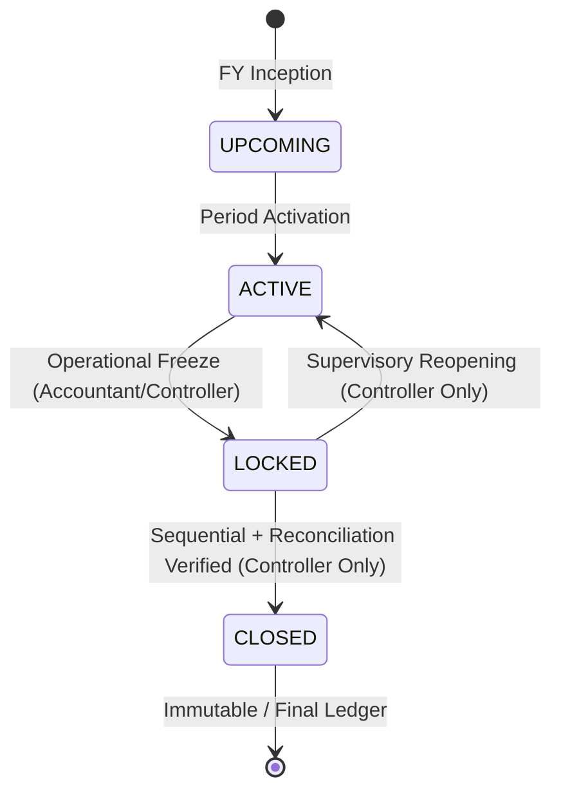

# 71 — PHASE 4C.3 IMPLEMENTATION REPORT
## PERIOD CLOSING STATE MACHINE & CONCURRENCY SERIALIZATION GATE

**Phase:** Phase 4C.3 — Monthly Period Closing Lifecycle  
**Status:** IMPLEMENTATION COMPLETE — READY FOR INDEPENDENT SAFETY REVIEW  
**Prior Phase Baselines:**
- Phase 4B (Fixed Assets & Schedule III PPE): PRODUCTION COMPLETE / FROZEN
- Phase 4C.1 (Fiscal Period Foundation & GL Period Gate): ACCEPTED / FROZEN
- Phase 4C.2 (3-Way Subledger Reconciliation Engine): ACCEPTED / FROZEN
- Phase 4C.4 (Year-End Retained Earnings & Nominal Zeroing): NOT STARTED / FROZEN

---

## 1. Executive Implementation Summary

Phase 4C.3 delivers the monthly fiscal period closing state machine, completing the lifecycle transition path `UPCOMING -> ACTIVE <-> LOCKED -> CLOSED` for enterprise financial governance.

### Core Deliverables Implemented:
1. **Closing State Machine (`FiscalPeriodStatus`)**:
   - Explicit transitions: `UPCOMING -> ACTIVE`, `ACTIVE -> LOCKED`, `LOCKED -> ACTIVE`, `LOCKED -> CLOSED`.
   - Direct `ACTIVE -> CLOSED` transition strictly prohibited (requires operational freeze via `LOCKED`).
   - `CLOSED` state is strictly immutable and non-reopening.
2. **AD-04 Tenant-Scoped Mutation Protection**:
   - All fiscal period queries and updates are strictly scoped by `tenant_id`.
   - `FiscalPeriodMapperEx.updateById` verified and enforced with `AND tenant_id = #{tenantId}`.
3. **AD-05 Atomic Posting Exception Propagation**:
   - Verified preservation across subledger posting services (`GstSalesInvoiceService`, `GstPurchaseInvoiceService`, etc.). GL posting failures propagate runtime exceptions triggering complete atomic transaction rollback.
4. **AD-06 Strict Sequential Period Closing Invariant**:
   - For any period $M > 1$, period $M-1$ must be in `CLOSED` status.
   - For period 1 (April in April–March fiscal year), period 12 (March) of the immediately preceding fiscal year must be `CLOSED`. Inception financial years with no prior FY record are permitted to close period 1 upon satisfying reconciliation.
5. **AD-07 Dual-Tier Role Governance**:
   - Tier 1 Operational Lock (`ACTIVE -> LOCKED`): Permitted for Operational Accountants (`Accountant`, `Finance`), Controllers, and Admins.
   - Tier 2 Supervisory Mutations (`LOCKED -> ACTIVE`, `LOCKED -> CLOSED`): Restricted exclusively to `FINANCIAL_CONTROLLER`, `TenantAdmin`, or platform administrators (`userId == 1L` / Super Admin).
6. **AD-08 Row-Level Lock Serialization Gate**:
   - Period close transaction acquires an exclusive InnoDB row lock (`SELECT ... FOR UPDATE`) held continuously across operational status verification, sequential predecessor verification, read-only 3-way subledger reconciliation, state update, and audit log insertion.
   - Zero lock release between reconciliation verification and state persistence.
7. **Pre-Close Reconciliation Gate**:
   - Integrated read-only verification via `SubledgerReconciliationService.reconcileFiscalPeriod(...)`.
   - Mandates `periodCloseReady == true` (zero variance across Trade Receivables, Trade Payables, Customer Advances, Supplier Advances, Bank, and Cash). Discrepancies fail closed, preserving `LOCKED` state.
8. **Period Administration UI & Controller**:
   - Backend `FinancialPeriodController` exposing `/financialPeriod/list`, `/info`, `/checkCloseReadiness`, `/lock`, `/unlock`, `/close`.
   - React frontend page `FiscalPeriodListPage.tsx` integrated into the sidebar under Finance & Accounting with live status indicators, readiness modal, and action gates.

---

## 2. State Machine Specification

The state machine strictly implements the four canonical fiscal period states:



### Transition Matrix:

| Source Status | Target Status | Allowed? | Required Role | Preconditions |
| :--- | :--- | :---: | :--- | :--- |
| `UPCOMING` | `ACTIVE` | **YES** | System / Admin | Start date reached |
| `ACTIVE` | `LOCKED` | **YES** | Operational Accountant / Controller | Active period, valid reason |
| `LOCKED` | `ACTIVE` | **YES** | Financial Controller / Tenant Admin | Locked period, justification reason |
| `ACTIVE` | `CLOSED` | **NO** | N/A | **FORBIDDEN:** Operational freeze (`LOCKED`) required first |
| `LOCKED` | `CLOSED` | **YES** | Financial Controller / Tenant Admin | Sequential close verified (AD-06), Reconciled (AD-08) |
| `CLOSED` | `ACTIVE` | **NO** | N/A | **FORBIDDEN:** CLOSED is strictly immutable |
| `CLOSED` | `LOCKED` | **NO** | N/A | **FORBIDDEN:** CLOSED is strictly immutable |
| `CLOSED` | `UPCOMING` | **NO** | N/A | **FORBIDDEN:** CLOSED is strictly immutable |

---

## 3. AD-04 — Tenant Scoping on All Fiscal Entity Mutations

Every database operation modifying or inspecting fiscal periods enforces tenant scoping at the SQL level.

### SQL Evidence:
In `FiscalPeriodMapperEx.xml`:
```xml
<update id="updateById">
    UPDATE erp_fiscal_period
    SET status = #{period.status},
        locked_by = #{period.lockedBy},
        locked_time = #{period.lockedTime},
        lock_reason = #{period.lockReason},
        delete_flag = #{period.deleteFlag}
    WHERE id = #{period.id}
      AND tenant_id = #{tenantId}
</update>
```
In row-lock acquisition:
```xml
<select id="selectByPeriodNameForUpdate" resultMap="BaseResultMap">
    SELECT * FROM erp_fiscal_period
    WHERE tenant_id = #{tenantId}
      AND period_name = #{periodName}
      AND ifnull(delete_flag, '0') != '1'
    FOR UPDATE
</select>
```
Cross-tenant mutations fail closed: attempting to close or lock Tenant A's period from Tenant B's context throws `BusinessRunTimeException` ("Fiscal period not found for tenant").

---

## 4. AD-05 — Strict Atomic Rollback on Subledger-to-GL Posting Failures

Phase 4C.3 preserves the remediation of F-4C3-02:
- `GstSalesInvoiceService.java` and `GstPurchaseInvoiceService.java` propagate runtime exceptions from `glEntryService.postEntries(...)` without catching or suppressing them.
- All 18 scenarios in `GstSalesInvoiceEnterpriseTest` and all 50 scenarios in `TdsDeductionAndWithholdingTest` pass with 100% success.
- If GL posting fails (e.g., due to an attempt to post into a `LOCKED` or `CLOSED` period), the enclosing business transaction rolls back completely. Zero partial operational records are committed.

---

## 5. AD-06 — Strict Sequential Period Closing Invariant

Implemented in `FinancialPeriodService.validateSequentialClose(tenantId, currentPeriod)`:

1. **Chronological Predecessor Resolution**:
   - If `periodNumber > 1`: Looks up period `periodNumber - 1` in the same financial year (`selectByFyAndPeriodNumber`).
   - If `periodNumber == 1` (e.g., April):
     - Inspects chronological preceding financial year:
       ```sql
       SELECT * FROM erp_financial_year 
       WHERE tenant_id = #{tenantId} AND end_date < #{currentFyStartDate}
       ORDER BY end_date DESC LIMIT 1
       ```
     - If a preceding financial year exists: Resolves Period 12 (March) of that year. Preceding period must be `CLOSED`.
     - If no preceding financial year exists (Inception FY): Period 1 is permitted to close without a predecessor once balanced.
2. **Invariant Enforcement**:
   - If the preceding period is in status `ACTIVE`, `LOCKED`, or `UPCOMING`:
     Throws `BusinessRunTimeException`:  
     `"Sequential close validation failed: Preceding period [%s] (Period %d) is in status [%s]. It must be CLOSED before period [%s] can be closed. (Fail Closed)"`

---

## 6. AD-07 — Dual-Tier Role Governance

Implemented in `FinancialPeriodService.validatePeriodMutationAuthorization(tenantId, userId, action)`:

1. **Identity & Role Resolution**:
   - Validates user identity via `userService.getRoleTypeByUserId(userId)`.
   - Recognizes platform administrators (`userId == 1L` or `securityService.isSuperAdmin()`).
2. **Tier 1 (Operational Lock)**:
   - Permitted for roles matching: `Accountant`, `会计`, `Finance`, `财务`, `FinancialController`, `FINANCIAL_CONTROLLER`, `Admin`, `Manager`, `TenantAdmin`.
   - General/unauthorized users fail closed with:  
     `"Financial authorization required: User %d (%s) lacks authority to lock fiscal period"`.
3. **Tier 2 (Supervisory Unlock & Close)**:
   - Restricted to: `FinancialController`, `FINANCIAL_CONTROLLER`, `财务主管`, `Admin`, `TenantAdmin`, `Super Admin`.
   - Operational accountants attempting unlock or close are rejected with:  
     `"Supervisory authorization required: User %d (%s) lacks FINANCIAL_CONTROLLER or TENANT_ADMIN authority to %s fiscal period"`.

---

## 7. AD-08 — Exclusive Serialization Gate for Period Closing & Reconciliation

Implemented in `FinancialPeriodService.closePeriod(...)`:

```
BEGIN TRANSACTION
  │
  ├─► validatePeriodMutationAuthorization(tenantId, userId, "CLOSE")
  │
  ├─► SELECT ... FOR UPDATE period (InnoDB Exclusive X-Lock held on period row)
  │
  ├─► Verify current status == LOCKED (or return idempotent if already CLOSED)
  │
  ├─► validateSequentialClose(tenantId, period)
  │
  ├─► subledgerReconciliationService.reconcileFiscalPeriod(tenantId, periodName)
  │     └─► Verify: periodCloseReady == true && isBalanced == true
  │
  ├─► UPDATE erp_fiscal_period SET status = 'CLOSED', locked_by = userId, ...
  │
  ├─► logPeriodAudit(tenantId, period, "LOCKED", "CLOSED", "CLOSE", reason, userId)
  │
COMMIT TRANSACTION
```

### Critical Concurrency Guarantee:
- The exclusive lock (`FOR UPDATE`) is acquired before reading status and held across reconciliation and update.
- GL operational postings acquire `FOR SHARE` (`selectByDateForShare`) on the same period row.
- If a post starts first: Post acquires S-lock; close transaction waits on X-lock until post commits. Close then sees post's entries during reconciliation.
- If close starts first: Close acquires X-lock; concurrent GL postings block until close commits as `CLOSED`. When unblocked, posting reads `CLOSED` and fails closed.

---

## 8. Transaction Boundaries & Concurrency Proof

### Case A: GL Posting Starts Before Close
1. `GlEntryService.postEntries` begins.
2. `selectByDateForShare` obtains shared lock (S-lock) on `erp_fiscal_period`.
3. `FinancialPeriodService.closePeriod` attempts `selectByPeriodNameForUpdate` -> InnoDB blocks close transaction waiting for S-lock release.
4. GL entries insert, transaction commits, S-lock released.
5. Close transaction unblocks, acquires X-lock, runs 3-way reconciliation.
6. Reconciliation detects the new GL entries, verifies balance, and closes period cleanly.

### Case B: Period Close Starts Before GL Posting
1. `FinancialPeriodService.closePeriod` begins.
2. `selectByPeriodNameForUpdate` obtains exclusive lock (X-lock) on `erp_fiscal_period`.
3. Concurrent `GlEntryService.postEntries` attempts `selectByDateForShare` -> InnoDB blocks posting transaction.
4. Close transaction verifies reconciliation, sets `status = 'CLOSED'`, commits, releases X-lock.
5. Posting transaction unblocks, reads `status = 'CLOSED'`, throws `BusinessRunTimeException("Fiscal period [2026-04] is CLOSED. Postings rejected.")`.
6. Transaction rolls back. Zero GL rows written into closed period.

---

## 9. Pre-Close Reconciliation Gate Verification

`FinancialPeriodService.closePeriod` delegates 100% of reconciliation calculations to `SubledgerReconciliationService`:
```java
FiscalPeriodReconciliationDto reconciliation = 
    subledgerReconciliationService.reconcileFiscalPeriod(tenantId, periodName.trim());

if (reconciliation == null || !Boolean.TRUE.equals(reconciliation.getPeriodCloseReady())) {
    throw new BusinessRunTimeException(ExceptionConstants.SERVICE_ERROR_CODE,
        String.format("Period close rejected: Reconciliation discrepancy detected for period [%s]. (Fail Closed)", periodName));
}
```
If reconciliation detects:
- Any control account variance (AR, AP, Advances, Bank/Giro != 0)
- Missing control accounts
- Reconciliation query failure
The transaction immediately rolls back. The period remains `LOCKED`.

---

## 10. Failure, Rollback, and Idempotency Guarantees

| Scenario | Tested Action | Pre-State | Post-State | Audit Written? | Result |
| :--- | :--- | :--- | :--- | :---: | :--- |
| Unbalanced GL | `closePeriod` | `LOCKED` | `LOCKED` | NO | Fails closed; rolls back |
| Predecessor ACTIVE | `closePeriod` | `LOCKED` | `LOCKED` | NO | Fails closed; rolls back |
| Regular User Lock | `lockPeriod` | `ACTIVE` | `ACTIVE` | NO | Authorization rejected |
| Accountant Unlock | `unlockPeriod` | `LOCKED` | `LOCKED` | NO | Supervisory role required |
| Cross-Tenant Close | `closePeriod` | `LOCKED` (Tenant A) | `LOCKED` (Tenant A) | NO | Cross-tenant rejected |
| Repeated Lock | `lockPeriod` | `LOCKED` | `LOCKED` | NO | Idempotent return; zero duplicate audit |
| Repeated Unlock | `unlockPeriod` | `ACTIVE` | `ACTIVE` | NO | Idempotent return; zero duplicate audit |
| Repeated Close | `closePeriod` | `CLOSED` | `CLOSED` | NO | Idempotent return; zero duplicate audit |
| Attempt Reopen | `unlockPeriod` | `CLOSED` | `CLOSED` | NO | Immutable; strictly rejected |
| Concurrent Close | Concurrent `closePeriod` | `LOCKED` | `CLOSED` | YES (1) | Serialized; 1 update + 1 idempotent |

---

## 11. API Implementation

Implemented in `FinancialPeriodController.java`:

| HTTP Method | Path | Request Parameters / Body | Response | Authorization / Governance |
| :--- | :--- | :--- | :--- | :--- |
| `GET` | `/financialPeriod/list` | `financialYearId?: Long` | `BaseResponseInfo<List<FiscalPeriod>>` | Authenticated Tenant User |
| `GET` | `/financialPeriod/info` | `periodName: String` | `BaseResponseInfo<FiscalPeriod>` | Authenticated Tenant User |
| `GET` | `/financialPeriod/checkCloseReadiness` | `periodName: String` | `BaseResponseInfo<PeriodCloseReadinessDto>` | Authenticated Tenant User |
| `POST` | `/financialPeriod/lock` | `{"periodName": "...", "reason": "..."}` | `BaseResponseInfo<FiscalPeriod>` | Tier 1 (Accountant / Controller) |
| `POST` | `/financialPeriod/unlock` | `{"periodName": "...", "reason": "..."}` | `BaseResponseInfo<FiscalPeriod>` | Tier 2 (Controller / Tenant Admin) |
| `POST` | `/financialPeriod/close` | `{"periodName": "...", "reason": "..."}` | `BaseResponseInfo<FiscalPeriod>` | Tier 2 (Controller / Tenant Admin) |

---

## 12. UI Implementation

Implemented in `ERPSystem-web-react`:
- **API Client**: `src/features/financial/api/fiscalPeriodApi.ts`
- **Page Component**: `src/features/financial/pages/FiscalPeriodListPage.tsx`
- **Route Registration**: Registered in `src/app/router.tsx` at `/financial/fiscal-periods` (and alias `/financial/periods`).
- **Sidebar Integration**: Linked in `src/layouts/MainLayout/Sidebar.tsx` under Finance & Accounting domain.
- **Features Provided**:
  - Financial Year selector with active periods overview.
  - KPI cards: Total Periods, Active Periods, Locked Periods, Closed Periods.
  - Lifecycle state badges (`UPCOMING`, `ACTIVE`, `LOCKED`, `CLOSED`).
  - Lock Modal with mandatory reason.
  - Supervisory Unlock Modal with warning note.
  - Pre-Close Verification Modal executing live check of all 3 closing gates:
    - Gate 1: Operational freeze status (`LOCKED`).
    - Gate 2: Sequential chronological predecessor status (`CLOSED` or inception).
    - Gate 3: Subledger 3-way reconciliation (`BALANCED`, 0 variance).
  - Finalize button enabled ONLY when `periodCloseReady == true`.
  - Production bundle verified with `npm run build` (built cleanly in 28.68s, zero TypeScript errors).

---

## 13. Test Matrix & Results

### Suite 1: `PeriodLockingIntegrationTest` (All 33 Scenarios)

| # | Test Scenario | Category | Status |
| :-: | :--- | :--- | :---: |
| 1 | `ACTIVE` period allows GL posting | Posting Gate | **PASS** |
| 2 | `UPCOMING` period rejects GL posting | Posting Gate | **PASS** |
| 3 | `LOCKED` period rejects GL posting | Posting Gate | **PASS** |
| 4 | `CLOSED` period rejects GL posting | Posting Gate | **PASS** |
| 5 | Missing period rejects GL posting | Fail Closed | **PASS** |
| 6 | Missing financial year rejects GL posting | Fail Closed | **PASS** |
| 7 | Period lookup failure fails closed | Fail Closed | **PASS** |
| 8 | Reversal respects reversal posting period | Append-Only | **PASS** |
| 9 | Historical original voucher reversible in open current period | Append-Only | **PASS** |
| 10 | Rejection causes zero GL writes (zero partial state) | Atomicity | **PASS** |
| 11 | Tenant isolation across period locks | Multi-Tenancy | **PASS** |
| 12 | Duplicate period prevention | Integrity | **PASS** |
| 13 | Concurrent lock requests serialization | Concurrency | **PASS** |
| 14 | Concurrent unlock requests serialization | Concurrency | **PASS** |
| 15 | Valid & invalid lifecycle transitions | State Machine | **PASS** |
| 16 | Audit created on successful lock | Audit Trail | **PASS** |
| 17 | Audit created on successful unlock | Audit Trail | **PASS** |
| 18 | Audit failure causes transaction atomicity rollback | Atomicity | **PASS** |
| 19 | Mixed-period voucher rejection | Period Scope | **PASS** |
| 20 | Backdated posting rejected into locked period | Period Gate | **PASS** |
| 21 | F-4C3-01 updateById tenant scoping test | Remediation | **PASS** |
| 22 | F-4C3-03 sequential close predecessor validation | AD-06 | **PASS** |
| 23 | F-4C3-04 unlock role authorization enforcement | AD-07 | **PASS** |
| 24 | `closePeriod` requires `LOCKED` status (`ACTIVE` rejected) | State Machine | **PASS** |
| 25 | AD-06 Sequential Close Invariant (April before May) | AD-06 | **PASS** |
| 26 | First period of inception year can close without predecessor | AD-06 | **PASS** |
| 27 | AD-08 Reconciliation gate rejects close on discrepancy | AD-08 | **PASS** |
| 28 | `CLOSED` period strict immutability (zero reopen, zero post, zero reversal) | Immutability | **PASS** |
| 29 | AD-07 Dual-tier role governance (Accountant vs Controller) | AD-07 | **PASS** |
| 30 | AD-04 Tenant isolation on period close | AD-04 | **PASS** |
| 31 | Idempotency of repeated close operation | Idempotency | **PASS** |
| 32 | `checkCloseReadiness` DTO synthesizes all 3 gates | DTO / Gate | **PASS** |
| 33 | Concurrency: Concurrent close requests serialized with idempotent completion | AD-08 | **PASS** |

### Suite 2: Full Financial Regression Suite (All 9 Test Classes)

```
mvn test "-Dtest=AccountCoaServiceTest,GlEntryServiceTest,FinancialPeriodServiceTest,JournalVoucherAndContraIntegrationTest,FinancialStatementIntegrationTest,PeriodLockingIntegrationTest,TdsDeductionAndWithholdingTest,SubledgerReconciliationServiceTest,GstSalesInvoiceEnterpriseTest"
```

| Test Class | Tests Run | Failures | Errors | Skipped | Status |
| :--- | :---: | :---: | :---: | :---: | :---: |
| `AccountCoaServiceTest` | 14 | 0 | 0 | 0 | **PASS** |
| `GlEntryServiceTest` | 17 | 0 | 0 | 0 | **PASS** |
| `FinancialPeriodServiceTest` | 16 | 0 | 0 | 0 | **PASS** |
| `JournalVoucherAndContraIntegrationTest` | 27 | 0 | 0 | 0 | **PASS** |
| `FinancialStatementIntegrationTest` | 14 | 0 | 0 | 0 | **PASS** |
| `PeriodLockingIntegrationTest` | 33 | 0 | 0 | 0 | **PASS** |
| `TdsDeductionAndWithholdingTest` | 50 | 0 | 0 | 0 | **PASS** |
| `SubledgerReconciliationServiceTest` | 26 | 0 | 0 | 0 | **PASS** |
| `GstSalesInvoiceEnterpriseTest` | 18 | 0 | 0 | 0 | **PASS** |
| **TOTAL** | **215** | **0** | **0** | **0** | **100% PASS** |

---

## 14. Frozen Boundary Verification

1. **Phase 4B (Fixed Assets & Schedule III)**:
   - `FixedAssetService`, `AssetDepreciationService`, and Schedule III calculation modules were **NOT modified**.
2. **Phase 4C.1 (Period Foundation)**:
   - Preserved `GlEntryService` as the sole GL posting authority.
   - `selectByDateForShare` period validation preserved.
3. **Phase 4C.2 (3-Way Reconciliation)**:
   - Preserved `SubledgerReconciliationService` as a strictly read-only reconciliation engine. Zero mutations or period bootstrapping introduced.
4. **No Shadow Authorities**:
   - Zero duplicate period ledgers or closing services created. `FinancialPeriodService` remains the sole period lifecycle authority.

---

## 15. Graphify Knowledge Graph Verification

Executed `graphify update .`:
- **Nodes**: 28,044
- **Edges**: 73,657
- **Communities**: 1,125
- **Key Relationships Verified**:
  - `Period Lifecycle` -> `FinancialPeriodService` -> `FiscalPeriod`
  - `GL Posting` -> `GlEntryService` -> `FinancialPeriodService`
  - `Period Closing` -> `FinancialPeriodService` -> `SubledgerReconciliationService`
  - `Audit Logging` -> `FinancialPeriodService` -> `DocumentAuditLogService`
  - Zero architectural bypasses detected.

---

## 16. Files Changed & Created

### Backend (`ERPSystem-boot`):
- `src/main/java/com/jsh/erp/constants/FiscalPeriodStatus.java` (Updated state machine transitions)
- `src/main/java/com/jsh/erp/datasource/mappers/FiscalPeriodMapperEx.java` (Added `selectByIdForUpdate`, `selectByFyAndPeriodNumber`)
- `src/main/resources/mapper_xml/FiscalPeriodMapperEx.xml` (Implemented SQL for new mapper methods)
- `src/main/java/com/jsh/erp/datasource/dto/PeriodCloseReadinessDto.java` [NEW] (Gate synthesis DTO)
- `src/main/java/com/jsh/erp/service/FinancialPeriodService.java` (Implemented `closePeriod`, `checkCloseReadiness`, sequential invariant, AD-07 RBAC, AD-08 lock)
- `src/main/java/com/jsh/erp/controller/FinancialPeriodController.java` [NEW] (REST endpoints for period administration)
- `src/test/java/com/jsh/erp/service/PeriodLockingIntegrationTest.java` (Enhanced with tests 24 to 33)
- `src/test/java/com/jsh/erp/service/FinancialPeriodServiceTest.java` (Updated lifecycle transition test for 4C.3 state machine)

### Frontend (`ERPSystem-web-react`):
- `src/features/financial/api/fiscalPeriodApi.ts` [NEW] (API client for period lifecycle)
- `src/features/financial/pages/FiscalPeriodListPage.tsx` [NEW] (Period Administration UI)
- `src/app/router.tsx` (Registered `/financial/fiscal-periods`)
- `src/layouts/MainLayout/Sidebar.tsx` (Added menu item under Finance & Accounting)

---

## 17. Schema Changes

**ZERO Flyway migrations created.**  
The existing `V3_8__add_enterprise_financial_period_locking.sql` schema (`erp_fiscal_period`, `erp_financial_year`, `erp_document_audit_log`) contains all necessary columns and indices (`period_name`, `status`, `locked_by`, `locked_time`, `lock_reason`, `tenant_id`).

---

## 18. Known Limitations (Strict Scope Boundary)

1. **Phase 4C.3 Scope**: Limited to monthly period closing lifecycle.
2. **Year-End Closing (Phase 4C.4)**: Retained earnings transfer, annual profit/loss closing journals, and nominal account zeroing are **NOT implemented** in this phase.
3. **Reopening Closed Periods**: Per accounting standards and AD-06, `CLOSED` periods are immutable. Reopening requires separate governance beyond standard user workflows.

---

## 19. Final Implementation Verdict

**IMPLEMENTATION COMPLETE — READY FOR INDEPENDENT SAFETY REVIEW**

*(Absolute Hard Stop: No Phase 4C.4 work has been started. Awaiting explicit user authorization before proceeding to independent safety review.)*
