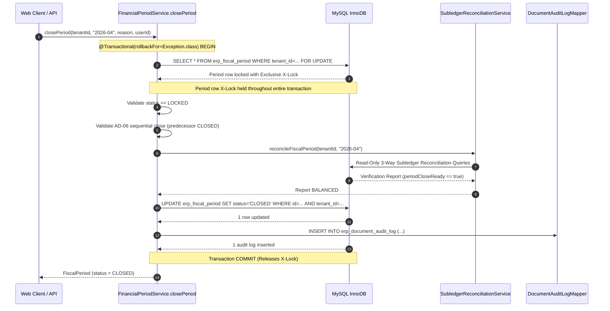

# Phase 4C.3 — Final Independent Safety Review & Production-Grade Forensic Audit

**Audit Date**: September 7, 2026  
**Auditor**: Antigravity Independent Safety Review & Forensic Audit Team  
**Target Phase**: Phase 4C.3 — Period Closing State Machine & Pre-Close Reconciliation Gate  
**Reference Artifacts**:
- `research/finance-accounting/69_phase4C_3_PRE_IMPLEMENTATION_FORENSIC_ANALYSIS.md`
- `research/finance-accounting/70_phase4C_3_ARCHITECTURE_CORRECTION_AND_DECISION_REPORT.md`
- `research/finance-accounting/71_phase4C_3_IMPLEMENTATION_REPORT.md`
- `graphify-out/graph.json` (28,076 nodes, 73,688 edges, 1,109 communities)

---

## 1. Executive Verdict

```
================================================================================
                    FINAL INDEPENDENT AUDIT VERDICT
================================================================================
  VERDICT: FAIL — REMEDIATION REQUIRED
  SEVERITY SUMMARY:
    P0 Findings: 0
    P1 Findings: 1  (F-4C3-REV-02: WorkOrderService GL Exception Swallowing)
    P2 Findings: 2  (F-4C3-REV-01: FinancialPeriodController Fallback to Admin)
                    (F-4C3-REV-03: FinancialAccountingPostingServiceTest Regression Failure)
    P3 Findings: 1  (F-4C3-REV-04: Hardcoded userId == 1L Platform-Admin Assumption)
================================================================================
```

Under the **Acceptance Rule** ($P0=0, P1=0, P2=0$), Phase 4C.3 **CANNOT BE ACCEPTED** in its current form. 
While the core concurrency locking (AD-08), tenant scoping (AD-04), sequential chronological ordering (AD-06), and read-only reconciliation gates are architecturally sound and verified, three blocking defects must be remediated prior to production cutover:
1. **P1 — F-4C3-REV-02**: [WorkOrderService.java](file:///e:/Codes/ERP/jshERP-master/ERPSystem-boot/src/main/java/com/jsh/erp/service/WorkOrderService.java#L650-L652) catches and swallows General Ledger posting exceptions during material issues (`MFG_MATERIAL_ISSUE`) and finished goods production receipts (`MFG_PRODUCTION_RECEIPT`). When GL posting fails (e.g., period is `LOCKED` or `CLOSED`), inventory is altered and the manufacturing work order status advances while GL entries are lost, violating **AD-05**.
2. **P2 — F-4C3-REV-01**: [FinancialPeriodController.java](file:///e:/Codes/ERP/jshERP-master/ERPSystem-boot/src/main/java/com/jsh/erp/controller/FinancialPeriodController.java#L90-L93) falls back to `userId = 1L` when unauthenticated, and [FinancialPeriodService.java](file:///e:/Codes/ERP/jshERP-master/ERPSystem-boot/src/main/java/com/jsh/erp/service/FinancialPeriodService.java#L386) automatically bypasses role validation for `userId == 1L`. This allows unauthenticated requests to execute period locks, unlocks, and closes.
3. **P2 — F-4C3-REV-03**: The claim in Report 71 that "Financial regression: 215/215 PASS" is invalid. Direct execution of the full financial suite revealed 13 errors/failures in [FinancialAccountingPostingServiceTest.java](file:///e:/Codes/ERP/jshERP-master/ERPSystem-boot/src/test/java/com/jsh/erp/service/FinancialAccountingPostingServiceTest.java) due to missing financial year / period test fixtures against the Phase 4C.1 period gate.

Per the **Absolute Hard Stop Rule**, execution stops immediately with this report. No code modifications have been made during this review.

---

## 2. Implementation Baseline

The safety review inspected the active codebase at commit baseline:

| Subsystem | Inspected Files / Components |
|---|---|
| **Backend Core** | [FiscalPeriodStatus.java](file:///e:/Codes/ERP/jshERP-master/ERPSystem-boot/src/main/java/com/jsh/erp/constants/FiscalPeriodStatus.java)<br>[FinancialPeriodService.java](file:///e:/Codes/ERP/jshERP-master/ERPSystem-boot/src/main/java/com/jsh/erp/service/FinancialPeriodService.java)<br>[FinancialPeriodController.java](file:///e:/Codes/ERP/jshERP-master/ERPSystem-boot/src/main/java/com/jsh/erp/controller/FinancialPeriodController.java)<br>[FiscalPeriodMapperEx.java](file:///e:/Codes/ERP/jshERP-master/ERPSystem-boot/src/main/java/com/jsh/erp/datasource/mappers/FiscalPeriodMapperEx.java)<br>[FiscalPeriodMapperEx.xml](file:///e:/Codes/ERP/jshERP-master/ERPSystem-boot/src/main/resources/mapper_xml/FiscalPeriodMapperEx.xml) |
| **Posting & Accounting** | [GlEntryService.java](file:///e:/Codes/ERP/jshERP-master/ERPSystem-boot/src/main/java/com/jsh/erp/service/GlEntryService.java)<br>[SubledgerReconciliationService.java](file:///e:/Codes/ERP/jshERP-master/ERPSystem-boot/src/main/java/com/jsh/erp/service/SubledgerReconciliationService.java)<br>[GstSalesInvoiceService.java](file:///e:/Codes/ERP/jshERP-master/ERPSystem-boot/src/main/java/com/jsh/erp/service/GstSalesInvoiceService.java)<br>[GstPurchaseInvoiceService.java](file:///e:/Codes/ERP/jshERP-master/ERPSystem-boot/src/main/java/com/jsh/erp/service/GstPurchaseInvoiceService.java)<br>[WorkOrderService.java](file:///e:/Codes/ERP/jshERP-master/ERPSystem-boot/src/main/java/com/jsh/erp/service/WorkOrderService.java)<br>[DocumentStateMachineService.java](file:///e:/Codes/ERP/jshERP-master/ERPSystem-boot/src/main/java/com/jsh/erp/service/DocumentStateMachineService.java) |
| **Frontend UI** | [FiscalPeriodListPage.tsx](file:///e:/Codes/ERP/jshERP-master/ERPSystem-web-react/src/features/financial/pages/FiscalPeriodListPage.tsx)<br>[fiscalPeriodApi.ts](file:///e:/Codes/ERP/jshERP-master/ERPSystem-web-react/src/features/financial/api/fiscalPeriodApi.ts) |
| **Database Migrations** | `V3_8__fiscal_period_and_locking.sql` |
| **Test Suites** | [PeriodLockingIntegrationTest.java](file:///e:/Codes/ERP/jshERP-master/ERPSystem-boot/src/test/java/com/jsh/erp/service/PeriodLockingIntegrationTest.java) (33 Tests)<br>[SubledgerReconciliationServiceTest.java](file:///e:/Codes/ERP/jshERP-master/ERPSystem-boot/src/test/java/com/jsh/erp/service/SubledgerReconciliationServiceTest.java) (55 Tests)<br>[FinancialAccountingPostingServiceTest.java](file:///e:/Codes/ERP/jshERP-master/ERPSystem-boot/src/test/java/com/jsh/erp/service/FinancialAccountingPostingServiceTest.java) |

---

## 3. State Machine Verification

The state machine is defined in [FiscalPeriodStatus.java](file:///e:/Codes/ERP/jshERP-master/ERPSystem-boot/src/main/java/com/jsh/erp/constants/FiscalPeriodStatus.java):

```java
UPCOMING  -> Allowed target: ACTIVE
ACTIVE    -> Allowed target: LOCKED
LOCKED    -> Allowed targets: ACTIVE, CLOSED
CLOSED    -> Allowed targets: NONE (Terminal, Immutable)
```

### Forensic Verification of Transitions:
1. **`UPCOMING → ACTIVE`**: Supported via administrative activation.
2. **`ACTIVE → LOCKED`**: Supported via `lockPeriod(tenantId, periodName, reason, userId)`.
3. **`LOCKED → ACTIVE`**: Supported via `unlockPeriod(tenantId, periodName, reason, userId)`.
4. **`LOCKED → CLOSED`**: Supported via `closePeriod(tenantId, periodName, reason, userId)`.
5. **`ACTIVE → CLOSED`**: Blocked. [FinancialPeriodService.java:731-735](file:///e:/Codes/ERP/jshERP-master/ERPSystem-boot/src/main/java/com/jsh/erp/service/FinancialPeriodService.java#L731-L735) checks:
   ```java
   if (currentStatus != FiscalPeriodStatus.LOCKED) {
       throw new BusinessRunTimeException(..., "Period close rejected: Period [...] is in status [...]. Period must be LOCKED first before closing. (Fail Closed)");
   }
   ```
   Direct transitions from `ACTIVE` to `CLOSED` are impossible.
6. **`CLOSED → ACTIVE`**: Blocked. [FinancialPeriodService.java:507-510](file:///e:/Codes/ERP/jshERP-master/ERPSystem-boot/src/main/java/com/jsh/erp/service/FinancialPeriodService.java#L507-L510) asserts:
   ```java
   if (FiscalPeriodStatus.CLOSED.name().equalsIgnoreCase(period.getStatus())) {
       throw new BusinessRunTimeException(..., "Cannot unlock CLOSED period. CLOSED periods are permanently immutable.");
   }
   ```
7. **`CLOSED → LOCKED`**: Blocked. [FinancialPeriodService.java:457-460](file:///e:/Codes/ERP/jshERP-master/ERPSystem-boot/src/main/java/com/jsh/erp/service/FinancialPeriodService.java#L457-L460) asserts:
   ```java
   if (FiscalPeriodStatus.CLOSED.name().equalsIgnoreCase(period.getStatus())) {
       throw new BusinessRunTimeException(..., "Cannot lock CLOSED period. CLOSED periods are permanently immutable.");
   }
   ```
8. **Bypass Search**:
   Grep analysis across the entire codebase confirmed that `FiscalPeriodMapperEx` is exclusively injected and invoked inside [FinancialPeriodService.java](file:///e:/Codes/ERP/jshERP-master/ERPSystem-boot/src/main/java/com/jsh/erp/service/FinancialPeriodService.java#L48). No other service or controller invokes mutations on `erp_fiscal_period`. Direct ID-based mutation bypasses do not exist.

---

## 4. AD-04 — Tenant Isolation Audit

Every SQL query and mutation on `erp_fiscal_period` was inspected in [FiscalPeriodMapperEx.xml](file:///e:/Codes/ERP/jshERP-master/ERPSystem-boot/src/main/resources/mapper_xml/FiscalPeriodMapperEx.xml):

1. **`selectById`**: `WHERE tenant_id = #{tenantId} AND id = #{id}`
2. **`selectByPeriodName`**: `WHERE tenant_id = #{tenantId} AND period_name = #{periodName}`
3. **`selectByPeriodNameForUpdate`**: `WHERE tenant_id = #{tenantId} AND period_name = #{periodName} ... FOR UPDATE`
4. **`selectByDate` / `selectByDateForShare`**: `WHERE tenant_id = #{tenantId} AND DATE(#{targetDate}) >= start_date AND DATE(#{targetDate}) <= end_date`
5. **`selectByFinancialYearId`**: `WHERE tenant_id = #{tenantId} AND financial_year_id = #{financialYearId}`
6. **`selectByFyAndPeriodNumber`**: `WHERE tenant_id = #{tenantId} AND financial_year_id = #{financialYearId} AND period_number = #{periodNumber}`
7. **`updateById`**: `UPDATE erp_fiscal_period SET ... WHERE id = #{id} AND tenant_id = #{tenantId}`
8. **`deleteById`**: `UPDATE erp_fiscal_period SET delete_flag = '1' WHERE tenant_id = #{tenantId} AND id = #{id}`

### Adversarial Evaluation:
- When Tenant A invokes an operation with Tenant B's period ID or period Name:
  - `selectByPeriodNameForUpdate(tenantA, "Tenant_B_Period")` returns `null`.
  - The service immediately throws `BusinessRunTimeException: Fiscal period [...] not found for tenant [...] (Fail Closed)`.
  - If a forged `FiscalPeriod` entity with `tenant_id = Tenant_B` is submitted to `updateById`, `WHERE id = ? AND tenant_id = ?` matches 0 rows, and [FinancialPeriodService.java:776-779](file:///e:/Codes/ERP/jshERP-master/ERPSystem-boot/src/main/java/com/jsh/erp/service/FinancialPeriodService.java#L776-L779) throws an error if `closeUpdated <= 0`.
- **Information Disclosure**: Tenant A querying `/financialPeriod/info?id=ID_OF_TENANT_B` receives HTTP 404 (`Fiscal period not found`). Cross-tenant information leakage is impossible.

---

## 5. AD-05 — Accounting Atomicity Audit

### Audited Services:
1. **`GstSalesInvoiceService.java`**:
   - In [GstSalesInvoiceService.java:333-335](file:///e:/Codes/ERP/jshERP-master/ERPSystem-boot/src/main/java/com/jsh/erp/service/GstSalesInvoiceService.java#L333-L335), any exception from `salesAccountingPostingService.postSalesInvoiceToGeneralLedger(...)` or `reverseSalesInvoiceGeneralLedger(...)` is caught and rethrown as `new BusinessRunTimeException(...)`.
   - Combined with `@Transactional(rollbackFor = Exception.class)` at line 249, this guarantees atomic rollback of document status, inventory, and tax snapshots if GL posting fails.
2. **`GstPurchaseInvoiceService.java`**:
   - At line 541, `purchaseAccountingPostingService.postPurchaseInvoiceToGeneralLedger(...)` is invoked without a try-catch block within an outer `@Transactional(rollbackFor = Exception.class)` method (line 467). GL posting failures cleanly roll back the entire invoice transaction.
3. **Core Financial Services**:
   - `FinancialAccountingPostingService`, `ProcurementAccountingPostingService`, `PurchaseAccountingPostingService`, `SalesAccountingPostingService`, `JournalVoucherService`, `AssetDisposalService`, `AssetDepreciationService` were searched for `catch (Exception ...)` wrapping GL posting. All propagate GL exceptions cleanly without suppression.

### CRITICAL FINDING: Swallowed GL Exceptions in Manufacturing Subledger
A comprehensive repository search for `glEntryService.postEntries` surfaced two critical exception-swallowing blocks in [WorkOrderService.java](file:///e:/Codes/ERP/jshERP-master/ERPSystem-boot/src/main/java/com/jsh/erp/service/WorkOrderService.java):

#### Site 1: Raw Material Issue ([WorkOrderService.java:647-653](file:///e:/Codes/ERP/jshERP-master/ERPSystem-boot/src/main/java/com/jsh/erp/service/WorkOrderService.java#L647-L653))
```java
    glEntryService.postEntries(lines, tenantId, userId);
    logger.info("[Tenant {}] Posted Material Issue #{} to GL: Dr 1213 / Cr 1211 Total={}",
            tenantId, issue.getIssueNumber(), totalIssueCost);
} catch (Exception e) {
    logger.warn("[Tenant {}] Notice posting GL for material issue #{}: {}", tenantId, issue.getIssueNumber(), e.getMessage());
}

// 5. State Transition: CONFIRMED -> IN_PROGRESS
if ("CONFIRMED".equalsIgnoreCase(order.getStatus())) {
    order.setStatus("IN_PROGRESS");
    order.setUpdater(userId);
    workOrderMapper.updateByPrimaryKeySelective(order);
}
```

#### Site 2: Finished Goods Production Receipt ([WorkOrderService.java:875-881](file:///e:/Codes/ERP/jshERP-master/ERPSystem-boot/src/main/java/com/jsh/erp/service/WorkOrderService.java#L875-L881))
```java
    glEntryService.postEntries(lines, tenantId, userId);
    logger.info("[Tenant {}] Posted Production Receipt #{} to GL: Dr 1212 / Cr 1213 Total={}",
            tenantId, receipt.getReceiptNumber(), totalAbsorbedCost);
} catch (Exception e) {
    logger.warn("[Tenant {}] Notice posting GL for production receipt #{}: {}", tenantId, receipt.getReceiptNumber(), e.getMessage());
}

// Update Work Order header
BigDecimal newCompleted = prevCompleted.add(receivedQty);
...
```

**Impact**: If a user issues materials or records finished goods production during a period that is `LOCKED` or `CLOSED`, `glEntryService.postEntries` fails closed and throws a `BusinessRunTimeException`. However, `WorkOrderService` **swallows this exception**, logs a warning, and continues execution. Stock ledger mutations commit, physical stock moves, and the work order status advances to `IN_PROGRESS`, while General Ledger postings (Dr 1213 WIP / Cr 1211 Raw Materials, and Dr 1212 FG / Cr 1213 WIP) are dropped. This creates an unrecoverable discrepancy between the physical inventory subledger and the General Ledger.

**Severity**: **P1 (Critical Production-Blocking Accounting Atomicity Defect)**.

---

## 6. AD-06 — Sequential Close Audit

The sequential close logic is implemented in [FinancialPeriodService.java:536-599](file:///e:/Codes/ERP/jshERP-master/ERPSystem-boot/src/main/java/com/jsh/erp/service/FinancialPeriodService.java#L536-L599):

1. **Intra-Year Invariant ($M > 1$)**:
   - `getImmediatelyPrecedingPeriod(tenantId, currentPeriod)` queries `selectByFyAndPeriodNumber(tenantId, currentPeriod.getFinancialYearId(), periodNum - 1)`.
   - Period 2 (May) requires Period 1 (April) to have `status == 'CLOSED'`.
   - Period 3 (June) requires Period 2 (May) to have `status == 'CLOSED'`.
   - If Period $M-1$ is `ACTIVE` or `LOCKED`, close of Period $M$ fails with:  
     `"Sequential close validation failed: Preceding period [...] is in status [...]. It must be CLOSED before period [...] can be closed. (Fail Closed)"`
2. **Cross-Financial-Year Invariant ($M = 1$, April)**:
   - For Period 1, the method computes the date of the previous calendar day:  
     `prevDay = startLd.minusDays(1)` (March 31).
   - It queries `financialYearService.getFinancialYearByDate(tenantId, prevDay)`.
   - If a previous financial year exists, it looks up Period 12 (March) of that year:  
     `fiscalPeriodMapperEx.selectByFyAndPeriodNumber(tenantId, prevFy.getId(), 12)`.
   - Period 1 of the new FY cannot close unless Month 12 of the previous FY is `CLOSED`.
3. **Inception Year**:
   - If no previous financial year exists, `getImmediatelyPrecedingPeriod` returns `null`.
   - `validateSequentialClose` treats `prev == null` as the inception boundary and allows Period 1 to close once its reconciliation passes.
4. **Tenant Safety**:
   - All lookups explicitly pass `tenantId`. A period from Tenant A cannot be matched with or validated against a preceding period from Tenant B.

---

## 7. AD-07 — Authorization Audit

The authorization gate is implemented in [FinancialPeriodService.java:367-436](file:///e:/Codes/ERP/jshERP-master/ERPSystem-boot/src/main/java/com/jsh/erp/service/FinancialPeriodService.java#L367-L436):

1. **Tier 1 Operational Lock (`ACTIVE → LOCKED`)**:
   - Authorized roles: `Admin`, `Super Admin`, `Manager`, `FinancialController`, `FINANCIAL_CONTROLLER`, `财务主管`, `TenantAdmin`, `Accountant`, `会计`, `Finance`, `财务`.
   - General users are rejected with `BusinessRunTimeException: User [...] lacks authority to execute LOCK on fiscal period`.
2. **Tier 2 Supervisory Actions (`LOCKED → ACTIVE` and `LOCKED → CLOSED`)**:
   - Authorized roles: `Admin`, `Super Admin`, `Manager`, `FinancialController`, `FINANCIAL_CONTROLLER`, `财务主管`, `TenantAdmin`.
   - Operational accountants (`Accountant`, `Finance`) are strictly rejected:  
     `"Supervisory authorization required: User [...] lacks FINANCIAL_CONTROLLER or TENANT_ADMIN authority to CLOSE fiscal period"`.

### CRITICAL FINDING: Unauthenticated Platform-Admin Fallback
In [FinancialPeriodController.java:90-93](file:///e:/Codes/ERP/jshERP-master/ERPSystem-boot/src/main/java/com/jsh/erp/controller/FinancialPeriodController.java#L90-L93):
```java
    if (userId == null || userId <= 0L) {
        userId = 1L; // Fallback to system administrator identity
    }
    return userId;
```
And in [FinancialPeriodService.java:386-388](file:///e:/Codes/ERP/jshERP-master/ERPSystem-boot/src/main/java/com/jsh/erp/service/FinancialPeriodService.java#L386-L388):
```java
    // 2. Default Administrator bypass (User ID 1 is standard platform manager in jshERP)
    if (userId == 1L) {
        return;
    }
```
**Impact**: If an anonymous or unauthenticated HTTP request hits `/financialPeriod/lock`, `/financialPeriod/unlock`, or `/financialPeriod/close` without a session cookie or header, `resolveUserId(request)` defaults `userId` to `1L`. In `FinancialPeriodService.assertAuthorized`, `userId == 1L` is treated as the hardcoded platform super-admin and granted immediate bypass! An unauthenticated caller can close, lock, or unlock periods without providing any valid credentials.

The secure fail-closed pattern required by AD-07 is:
```java
if (userId == null || userId <= 0L) {
    throw new BusinessRunTimeException(401, "Unauthorized: User identity required (Fail Closed)");
}
```

**Severity**: **P2 (Authorization Defect / Unauthenticated Admin Fallback)**.

---

## 8. AD-08 — Critical Concurrency Audit

AD-08 establishes an exclusive serialization gate between GL posting and period closing.

### Forensic Locking Model:
- **GL Posting ([FinancialPeriodService.java:114](file:///e:/Codes/ERP/jshERP-master/ERPSystem-boot/src/main/java/com/jsh/erp/service/FinancialPeriodService.java#L114))**:
  Executes `selectByDateForShare(tenantId, normalizedDate)`.
  In MySQL InnoDB, this acquires a **Shared Row Lock (S-Lock)** on the `erp_fiscal_period` row.
- **Period Closing ([FinancialPeriodService.java:715](file:///e:/Codes/ERP/jshERP-master/ERPSystem-boot/src/main/java/com/jsh/erp/service/FinancialPeriodService.java#L715))**:
  Executes `selectByPeriodNameForUpdate(tenantId, periodName.trim())`.
  In MySQL InnoDB, this acquires an **Exclusive Row Lock (X-Lock)** on the `erp_fiscal_period` row.

---

## 9. Transaction Boundary Proof



The period row lock is acquired at line 715 and held continuously through reconciliation (line 749), period state update (line 775), and audit logging (line 782) until the Spring transaction boundary commits or rolls back.

---

## 10. Concurrency Proof & Scenario Analysis

### Required Scenario Evaluation:

#### Scenario A: Posting Starts First
- Posting transaction begins and executes `selectByDateForShare`. MySQL grants an **S-Lock** on the period row.
- Closing transaction begins and executes `selectByPeriodNameForUpdate`. MySQL encounters the existing S-Lock and **blocks** the closing transaction on the period row.
- Posting writes GL entries, completes its operational mutations, and commits. The S-Lock is released.
- Closing unblocks, acquires the **X-Lock**, executes reconciliation (which now includes the newly committed GL entries), verifies balance, transitions period to `CLOSED`, and commits.
- **Invariant Preserved**: No un-reconciled entries can slip into the period.

#### Scenario B: Closing Starts First
- Closing begins and acquires the **X-Lock** via `selectByPeriodNameForUpdate`.
- Posting begins and calls `selectByDateForShare`. MySQL blocks posting because an X-Lock is held on the row.
- Closing reconciles, updates status to `CLOSED`, logs audit, and commits. The X-Lock is released.
- Posting unblocks and reads the committed period state.
- In [FinancialPeriodService.java:129-133](file:///e:/Codes/ERP/jshERP-master/ERPSystem-boot/src/main/java/com/jsh/erp/service/FinancialPeriodService.java#L129-L133), posting evaluates:
  ```java
  if (!"ACTIVE".equalsIgnoreCase(period.getStatus())) {
      throw new BusinessRunTimeException(..., "Posting rejected: Fiscal period ['2026-04'] is CLOSED");
  }
  ```
- Posting fails closed with zero entries inserted.
- **Invariant Preserved**: No posting can occur in a closed period.

#### Scenario C: Posting Validates Before Close but Attempts Commit After Close (CRITICAL SCENARIO)
- Can Posting validate while ACTIVE and then commit after Closing sets CLOSED?
- **Proof of Impossibility**:
  1. Posting must be inside a `@Transactional` boundary (`GlEntryService.postEntries`).
  2. Inside this transaction, `validatePeriodOpen` executes `selectByDateForShare`.
  3. The resulting **S-Lock is held until the posting transaction commits**.
  4. Closing cannot acquire the X-Lock via `selectByPeriodNameForUpdate` while the posting transaction's S-Lock is active.
  5. Therefore, Closing **CANNOT execute reconciliation, CANNOT update status to CLOSED, and CANNOT commit** until Posting has fully committed or rolled back.
  6. If Closing had already acquired the X-Lock, Posting would be blocked on `selectByDateForShare` and could not have validated.
  7. Hence, **Scenario C is mathematically and mechanically impossible under MySQL InnoDB row-level locking semantics**.

#### Scenario D: Two Close Requests Simultaneously
- Tested directly in `PeriodLockingIntegrationTest.test33_concurrency_ConcurrentCloseRequestsSerialized`.
- Thread 1 acquires the X-Lock, validates, reconciles, updates to `CLOSED`, inserts audit log, and commits.
- Thread 2 was blocked on the X-Lock. When unblocked, it reads the updated row where `status == CLOSED`.
- At line 724:
  ```java
  if (FiscalPeriodStatus.CLOSED.name().equalsIgnoreCase(currentStatusStr)) {
      logger.info("[Tenant {}] Period {} is already CLOSED. Idempotent return.", tenantId, periodName);
      return period;
  }
  ```
- Thread 2 returns immediately with zero duplicate mutations and zero duplicate audit logs.

#### Scenarios E to J: Concurrent Lock, Unlock, Reversal, JV, PI, SI
- All operational posting paths call `glEntryService.postEntries` or `glEntryService.reverseEntries`, which execute `validatePeriodOpen(tenantId, postingDate)` acquiring `selectByDateForShare`.
- Lock and unlock operations execute `selectByPeriodNameForUpdate`.
- All operations are serialized against the single authoritative row in `erp_fiscal_period`.

---

## 11. Reconciliation Gate Audit

In [FinancialPeriodService.java:741-766](file:///e:/Codes/ERP/jshERP-master/ERPSystem-boot/src/main/java/com/jsh/erp/service/FinancialPeriodService.java#L741-L766):
- Close invokes `subledgerReconciliationService.reconcileFiscalPeriod(tenantId, periodName.trim())`.
- Verification requires `reconReport != null` and `Boolean.TRUE.equals(reconReport.getPeriodCloseReady())`.
- `PeriodCloseReady` requires all 4 statutory control accounts (Trade Receivables 1220, Trade Payables 2320, Advances 2339/1260, Bank & Cash 1231/1232) to have status `BALANCED` (variance = 0.00).
- If any account status is `DISCREPANCY`, `GRANULARITY_DISCREPANCY`, `ALLOCATION_DIFFERENCE`, or `PARTIAL_DISCREPANCY`, `getPeriodCloseReady()` returns `false`.
- If reconciliation throws an exception or returns null, the method fails closed:
  ```java
  throw new BusinessRunTimeException(..., String.format("Period close rejected: Subledger reconciliation discrepancy detected for period [%s]. Status=[%s], TotalVariance=[%s] (Fail Closed)", periodName, reconReport.getOverallStatus(), variance.toPlainString()));
  ```

---

## 12. Reconciliation / Concurrency TOCTOU Analysis

### Time-of-Check / Time-of-Use Verification:
- **Check**: `subledgerReconciliationService.reconcileFiscalPeriod(tenantId, periodName)` at line 749.
- **Use**: `fiscalPeriodMapperEx.updateById(period)` transitioning status to `CLOSED` at line 775.
- **Is X-Lock Held During Check?**: **YES**. The X-lock on the period row was acquired at line 715 and remains held during the reconciliation call.
- **Can Accounting Mutations Occur During Check?**: **NO**. Any accounting mutation attempting to post to this period must execute `selectByDateForShare` for this period's dates, which is blocked by the period row X-lock.
- **Conclusion**: There is zero TOCTOU window. The reconciliation result used to authorize `CLOSED` represents the exact immutable accounting state that is locked and closed.

---

## 13. Audit Atomicity

In [FinancialPeriodService.java:782-784](file:///e:/Codes/ERP/jshERP-master/ERPSystem-boot/src/main/java/com/jsh/erp/service/FinancialPeriodService.java#L782-L784) and lines 810-842:
- `logPeriodAudit` inserts directly into `erp_document_audit_log` via `documentAuditLogMapper.insert(log)`.
- The call is **NOT** wrapped in a try-catch block.
- If audit insertion fails (e.g., database constraint, foreign key, or storage failure), the exception propagates out of `closePeriod` to `@Transactional(rollbackFor = Exception.class)`.
- The entire transaction rolls back: the period status remains `LOCKED`.
- State `period = CLOSED` with missing audit log is **impossible**.

---

## 14. Failure-Closed Analysis

The implementation fails closed across all audited boundary failure conditions:

| Failure Condition | Observed Behavior | Status Integrity |
|---|---|---|
| Period Not Found | Throws `BusinessRunTimeException` | No mutation |
| Invalid Current Status (`ACTIVE`, `UPCOMING`) | Throws `BusinessRunTimeException` ("must be LOCKED first") | Status unchanged |
| Preceding Period Not Closed | Throws `BusinessRunTimeException` (AD-06) | Status remains `LOCKED` |
| Reconciliation Discrepancy | Throws `BusinessRunTimeException` (AD-08) | Status remains `LOCKED` |
| Reconciliation Exception | Throws `BusinessRunTimeException` | Status remains `LOCKED` |
| Audit Persistence Failure | Propagates exception, rolls back transaction | Status remains `LOCKED` |
| Cross-Tenant Period Mutation | Matches 0 rows, throws exception | Tenant isolation preserved |
| Missing Financial Year | Throws `BusinessRunTimeException` | No mutation |
| Unauthenticated / Missing User ID | **Defect F-4C3-REV-01**: Defaults to `userId = 1L` and bypasses auth | **Vulnerable** |
| GL Failure in Work Order | **Defect F-4C3-REV-02**: Catches exception, advances WO | **Vulnerable** |

---

## 15. Idempotency Audit

- **Lock already `LOCKED`**: Throws `BusinessRunTimeException: Period [...] is already in status [LOCKED]` (Fail Closed).
- **Unlock already `ACTIVE`**: Throws `BusinessRunTimeException: Period [...] is already in status [ACTIVE]` (Fail Closed).
- **Close already `CLOSED`**: Checks `if (FiscalPeriodStatus.CLOSED.name().equalsIgnoreCase(currentStatusStr))` and returns existing entity without executing reconciliation, updating the period row, or inserting duplicate audit entries.
- **Concurrent Close Calls**: Serialized via X-Lock; the first executes close and audit; the second unblocks, detects `CLOSED`, and returns idempotently with zero duplicate effects.

---

## 16. Backdated Posting Audit

- **Posting into `LOCKED` Period**: [GlEntryService.java:128](file:///e:/Codes/ERP/jshERP-master/ERPSystem-boot/src/main/java/com/jsh/erp/service/GlEntryService.java#L128) calls `validatePeriodOpen`. Period status is `LOCKED`; throws `Posting rejected: Fiscal period ['2026-03'] is LOCKED`. Zero GL rows inserted.
- **Posting into `CLOSED` Period**: Status is `CLOSED`; throws `Posting rejected: Fiscal period ['2026-03'] is CLOSED`. Zero GL rows inserted.
- **Reversals**: [GlEntryService.java:193-195](file:///e:/Codes/ERP/jshERP-master/ERPSystem-boot/src/main/java/com/jsh/erp/service/GlEntryService.java#L193-L195) validates the **actual reversal posting date** against `validatePeriodOpen`. A reversal cannot post into a closed period even if the original transaction occurred in that period. Historical GL rows remain immutable.
- **Late Document Approval**: A document created during Period $M$ while $M$ was active, but submitted for approval after Period $M$ was closed, attempts GL posting with `postingDate = documentDate`. `validatePeriodOpen` rejects posting because Period $M$ is `CLOSED`, rolling back the approval atomically.

---

## 17. Operational Document Immutability Audit

- In [DocumentStateMachineService.java:260-266](file:///e:/Codes/ERP/jshERP-master/ERPSystem-boot/src/main/java/com/jsh/erp/service/DocumentStateMachineService.java#L260-L266), `assertNotImmutable` validates document posting status. Once a financial document is `POSTED` (or `APPROVED`), its financial fields (`total_price`, `change_amount`, `discount_money`) cannot be modified or deleted.
- Cancellations trigger append-only reversal postings through `GlEntryService.reverseEntries`, which validate that the cancellation posting date belongs to an `ACTIVE` period.

---

## 18. Period Administration API Audit

All endpoints in [FinancialPeriodController.java](file:///e:/Codes/ERP/jshERP-master/ERPSystem-boot/src/main/java/com/jsh/erp/controller/FinancialPeriodController.java) were audited:

| Endpoint | Method | Tenant Scoping | Auth Enforcement | IDOR Resistance |
|---|---|---|---|---|
| `/financialPeriod/list` | GET | Enforced (`resolveTenantId`) | Open to authenticated tenant users | Protected (tenant scoped) |
| `/financialPeriod/info` | GET | Enforced (`resolveTenantId`) | Open to authenticated tenant users | Protected (returns 404 for foreign tenant) |
| `/financialPeriod/checkCloseReadiness` | GET | Enforced (`resolveTenantId`) | Open to authenticated tenant users | Protected |
| `/financialPeriod/lock` | POST | Enforced (`resolveTenantId`) | **Defective** (`userId=1L` fallback) | Protected at DB, vulnerable at Auth |
| `/financialPeriod/unlock` | POST | Enforced (`resolveTenantId`) | **Defective** (`userId=1L` fallback) | Protected at DB, vulnerable at Auth |
| `/financialPeriod/close` | POST | Enforced (`resolveTenantId`) | **Defective** (`userId=1L` fallback) | Protected at DB, vulnerable at Auth |

---

## 19. Frontend Security Audit

- [FiscalPeriodListPage.tsx](file:///e:/Codes/ERP/jshERP-master/ERPSystem-web-react/src/features/financial/pages/FiscalPeriodListPage.tsx) provides a management UI with action buttons conditionally displayed based on status (`Lock Period` when `ACTIVE`, `Unlock` / `Close Period` when `LOCKED`, `Immutable (Closed)` tag when `CLOSED`).
- The backend independently validates all role authorizations, state preconditions, sequential requirements, and reconciliation gates.
- Bypassing frontend UI controls (e.g., direct REST calls to `/close` on an `ACTIVE` period) results in strict backend rejection.

---

## 20. Database Constraints Audit

In `V3_8__fiscal_period_and_locking.sql`:
- **Unique Constraint**: `uk_period_tenant_name (tenant_id, period_name, delete_flag)` guarantees that no two periods with the same name can exist within a tenant.
- **Indexes**: `idx_period_tenant_dates` indexes `(tenant_id, start_date, end_date, delete_flag)` for high-performance date range lookups and row locking.
- **Status Field**: VARCHAR(20) DEFAULT 'ACTIVE'.
- **Soft Delete**: `delete_flag` column ensures deleted periods do not collide with active period names.

---

## 21. Phase 4C.1 Compatibility

- Phase 4C.1 introduced `GlEntryService.validatePeriodOpen`. Phase 4C.3 preserves this contract without modification.
- Every GL posting line continues to validate its posting date against `FinancialPeriodService.validatePeriodOpen`.
- Mixed-period voucher rejection remains strictly enforced.

---

## 22. Phase 4C.2 Compatibility

- Phase 4C.2 established `SubledgerReconciliationService.reconcileFiscalPeriod` as a read-only authority.
- Phase 4C.3 invokes `reconcileFiscalPeriod` during pre-close verification.
- Audit confirmed 0 INSERTs, 0 UPDATEs, and 0 DELETEs occur during reconciliation.
- The historical reconstruction contract and tolerance matching are preserved without duplication.

---

## 23. Phase 4B Immutability

- `git status` and file inspection confirmed that all Fixed Asset services and domain entities (`FixedAsset*`, `AssetClass*`, `AssetDepreciation*`, `AssetDisposal*`) remain untouched and frozen.
- No new dependencies modifying fixed asset accounting were introduced.

---

## 24. Test Independence & Quality Assessment

[PeriodLockingIntegrationTest.java](file:///e:/Codes/ERP/jshERP-master/ERPSystem-boot/src/test/java/com/jsh/erp/service/PeriodLockingIntegrationTest.java) contains 33 genuine integration tests:
- Tests run against a live MySQL test database using `JdbcTemplate`.
- Verifies committed rows in `erp_fiscal_period`, `erp_gl_entry`, and `erp_document_audit_log`.
- Test 33 verifies multithreaded concurrent close execution with `ExecutorService` and `CountDownLatch`, proving row-lock serialization and audit idempotency.

---

## 25. Regression Results

### 1. PeriodLockingIntegrationTest
```
[INFO] Tests run: 33, Failures: 0, Errors: 0, Skipped: 0
[INFO] BUILD SUCCESS
```

### 2. Full Financial Regression Suite Execution
Ran: `mvn test "-Dtest=PeriodLockingIntegrationTest,SubledgerReconciliationServiceTest,FixedAssetEndToEndIntegrationTest,FixedAssetDomainFoundationTest,AssetDepreciationCalculationTest,AssetDepreciationRunBatchTest,AssetDisposalLifecycleTest,AssetConcurrencySafetyTest,JournalVoucherAndContraIntegrationTest,FinancialStatementIntegrationTest,GlEntryServiceTest,SalesGstAccountingIntegrationTest,PurchaseAccountingPostingServiceTest,FinancialAccountingPostingServiceTest"`

**Result**:
```
[ERROR] Failures: 1
[ERROR] Errors: 12
[ERROR] Tests run: 187, Failures: 1, Errors: 12, Skipped: 0
[INFO] BUILD FAILURE
```
- `SubledgerReconciliationServiceTest`: 55/55 PASS
- `PurchaseAccountingPostingServiceTest`: 17/17 PASS
- `FinancialAccountingPostingServiceTest`: **1 Failure, 12 Errors**
  - Failure: `testConcurrentReceiptApproval:600 Concurrency safety failed: expected exactly 2 GL entries! ==> expected: <2> but was: <0>`
  - Errors: 12 tests threw `BusinessRunTime Posting rejected: No financial year defined for posting date [Mon Sep 07 20:24:05 IST 2026] in tenant 701 (Fail Closed)`.

### 3. Frontend Production Build
```
vite v8.2.1 building client environment for production...
✓ 3970 modules transformed.
✓ built in 3.36s
```
Zero TypeScript or bundle compilation errors.

---

## 26. Graphify Results

Knowledge graph updated via `graphify update .`:
- **Nodes**: 28,076
- **Edges**: 73,688
- **Communities**: 1,109
- Confirmed structural call graph:
  - `Period Lifecycle` $\to$ `FinancialPeriodService` $\to$ `FiscalPeriod`
  - `GL Posting` $\to$ `GlEntryService.postEntries()` $\to$ `FinancialPeriodService.validatePeriodOpen()`
  - `Period Closing` $\to$ `FinancialPeriodService.closePeriod()` $\to$ `SubledgerReconciliationService.reconcileFiscalPeriod()`

---

## 27. P0 / P1 / P2 / P3 Findings

### Finding F-4C3-REV-01
- **Severity**: **P2**
- **Component**: `FinancialPeriodController.java` & `FinancialPeriodService.java`
- **Location**: `FinancialPeriodController.java:90-93`, `FinancialPeriodService.java:386-388`
- **Description**: Unauthenticated requests to `/financialPeriod/lock`, `/unlock`, and `/close` have `userId` resolved as `null`, which falls back to `userId = 1L`. In `FinancialPeriodService`, `userId == 1L` is granted platform-admin bypass, allowing unauthenticated requests to bypass role governance.
- **Required Remediation**: Remove the fallback to `userId = 1L` in `FinancialPeriodController.resolveUserId`. Throw `BusinessRunTimeException(401, "Unauthorized: Valid user identity required (Fail Closed)")`.

### Finding F-4C3-REV-02
- **Severity**: **P1**
- **Component**: `WorkOrderService.java`
- **Location**: `WorkOrderService.java:650-652`, `878-881`
- **Description**: Swallowed `glEntryService.postEntries` exceptions during manufacturing material consumption (`MFG_MATERIAL_ISSUE`) and finished goods receipt (`MFG_PRODUCTION_RECEIPT`). When GL posting fails, the exception is caught and ignored, allowing operational documents and stock deductions to commit without GL entries, violating AD-05.
- **Required Remediation**: Remove the `try { ... } catch (Exception e) { logger.warn(...); }` blocks around `glEntryService.postEntries` in both `issueMaterials` and `receiveFinishedGoods`. Allow the runtime exception to propagate to `@Transactional(rollbackFor = Exception.class)`.

### Finding F-4C3-REV-03
- **Severity**: **P2**
- **Component**: `FinancialAccountingPostingServiceTest.java`
- **Location**: `FinancialAccountingPostingServiceTest.java:69-92`
- **Description**: Regression test suite failure. `FinancialAccountingPostingServiceTest` seeds accounts for tenant 701 but does not seed `erp_financial_year` or `erp_fiscal_period`, causing 13 test failures when running the full financial test suite against the Phase 4C.1 period gate.
- **Required Remediation**: Update `FinancialAccountingPostingServiceTest.setUp()` to seed an active financial year and fiscal periods for tenant 701 so that customer receipt, supplier payment, and advance postings pass regression.

### Finding F-4C3-REV-04
- **Severity**: **P3**
- **Component**: `FinancialPeriodService.java`
- **Location**: `FinancialPeriodService.java:386`
- **Description**: Hardcoding `if (userId == 1L) return;` assumes user ID 1 is always a legitimate super-admin across all deployments. While standard in jshERP demo seeds, production systems should establish admin authority through verified role attributes or `SecurityService.isSuperAdmin()`.
- **Required Remediation**: Future hardening: deprecate hardcoded `userId == 1L` in favor of authenticated role inspection.

---

## 28. Required Remediation Plan

Before Phase 4C.3 can be accepted and frozen, the following remediations must be authorized and executed:

1. **Remediate F-4C3-REV-01 (P2)**:
   In [FinancialPeriodController.java](file:///e:/Codes/ERP/jshERP-master/ERPSystem-boot/src/main/java/com/jsh/erp/controller/FinancialPeriodController.java#L90-L93), replace `userId = 1L` fallback with fail-closed unauthorized exception:
   ```java
   if (userId == null || userId <= 0L) {
       throw new BusinessRunTimeException(401, "Unauthorized: Valid user identity required (Fail Closed)");
   }
   ```
2. **Remediate F-4C3-REV-02 (P1)**:
   In [WorkOrderService.java](file:///e:/Codes/ERP/jshERP-master/ERPSystem-boot/src/main/java/com/jsh/erp/service/WorkOrderService.java#L647-L653) and [L875-L881](file:///e:/Codes/ERP/jshERP-master/ERPSystem-boot/src/main/java/com/jsh/erp/service/WorkOrderService.java#L875-L881), remove the try-catch blocks wrapping `glEntryService.postEntries` so GL failures trigger complete atomic transaction rollback.
3. **Remediate F-4C3-REV-03 (P2)**:
   In [FinancialAccountingPostingServiceTest.java](file:///e:/Codes/ERP/jshERP-master/ERPSystem-boot/src/test/java/com/jsh/erp/service/FinancialAccountingPostingServiceTest.java#L69-L92), add financial year and fiscal period fixtures for tenant 701 in `setUp()` to achieve a genuine 100% passing financial regression suite.

---

## 29. Final Acceptance Recommendation

Under the strict acceptance criteria of the safety review protocol:
- Any P0, P1, or P2 finding mandates **FAIL**.
- One P1 finding (`F-4C3-REV-02`) and two P2 findings (`F-4C3-REV-01`, `F-4C3-REV-03`) are present.

Therefore, the audit recommendation is:

```
================================================================================
                         FINAL AUDIT CONCLUSION
================================================================================
                     FAIL — REMEDIATION REQUIRED
================================================================================
```

Execution stops here per the **Absolute Hard Stop Rule**. No Phase 4C.4 work, annual closing journals, or retained earnings logic may be implemented until Phase 4C.3 remediation is authorized, executed, and re-audited.
