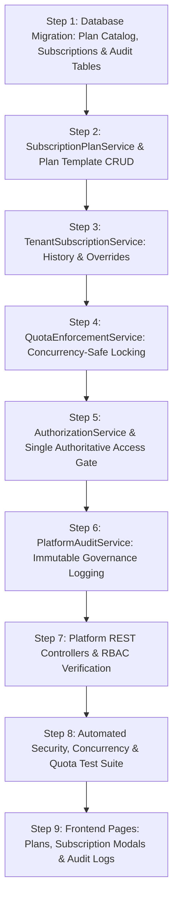

# Phased Implementation Plan for Phase 5, 8 & 9 (Revised)

## 1. Executive Summary
This document defines the revised sequential implementation plan for Platform Configuration, Subscriptions, Plans, Multi-Resource Quotas, and Feature Entitlements.

---

## 2. Sequential Implementation Phases

---

## 3. Detailed Step-by-Step Breakdown

### Step 1: Database Schema & Entity Mappings
- Create `erp_subscription_plan` (Plan templates).
- Create `erp_tenant_subscription` (Historical & active subscriptions with `is_active` index).
- Create `erp_platform_audit_log` (Immutable audit trail).
- Seed 4 standard initial plans: `TRIAL`, `STANDARD_PRO`, `ENTERPRISE`, `CUSTOM`.
- Generate MyBatis entities, mappers, and XML definitions.

### Step 2: Plan Catalog Services
- Implement `SubscriptionPlanService.java`:
  - `createPlan(SubscriptionPlanDto)`
  - `updatePlan(id, SubscriptionPlanDto)`
  - `getActivePlans()`
  - `getPlanByCode(planCode)`

### Step 3: Tenant Subscription & Override Engine
- Implement `TenantSubscriptionService.java`:
  - `assignPlanToTenant(tenantId, planId, durationDays, reason, operatorUser)`: Manages active vs historical pointer.
  - `setQuotaOverrides(tenantId, overrideDto, reason, operatorUser)`: Records overrides with operator & reason.
  - `setFeatureOverrides(tenantId, featureDto, reason, operatorUser)`.
  - `getSubscriptionHistory(tenantId, page, size)`.
  - `isTenantAccessible(tenantId)`: Evaluates single authoritative access rule.

### Step 4: Concurrency-Safe Quota Enforcement
- Implement `QuotaEnforcementService.java`:
  - `validateUserQuotaOrThrow(tenantId)`: Acquires pessimistic lock on active subscription, compares active non-deleted users against effective quota.
  - `validateDepotQuotaOrThrow(tenantId)`.
  - `validateOrgQuotaOrThrow(tenantId)`.
  - Hook into `UserService.addUser()`, `DepotService.insertDepot()`, `OrganizationService.insertOrganization()`.

### Step 5: AuthorizationService Integration
- Update `AuthorizationService.java`:
  - Check `isTenantAccessible(tenantId)` before processing tenant requests.
  - Intercept feature-gated endpoints and verify against active subscription's enabled features.

### Step 6: Platform Audit Service
- Implement `PlatformAuditService.java`:
  - `recordEvent(...)`: Logs immutable event with before/after JSON diff, operator, IP, and reason.

### Step 7: REST Controllers
- Implement `SubscriptionPlanController.java`, `TenantSubscriptionController.java`, `PlatformAuditController.java`.
- Secure endpoints strictly via `PLATFORM.*` permissions and `isPlatformAdmin`.

### Step 8: Automated Test Suite
- Implement `PlatformSubscriptionAndQuotaSecurityTest.java`:
  - Plan CRUD, Plan assignment & history, Quota exceedance blocks, Super Admin overrides, Safe plan downgrades, Concurrency race-condition test, Suspended tenant blocks, Immutable platform audit verification.

### Step 9: Frontend UI Integration
- Implement `PlanManagementPage.tsx` (`/platform/plans`).
- Implement `TenantSubscriptionModal.tsx` for `TenantList.tsx` and `PlatformDashboardPage.tsx`.
- Implement `PlatformAuditPage.tsx` (`/platform/audit`).
