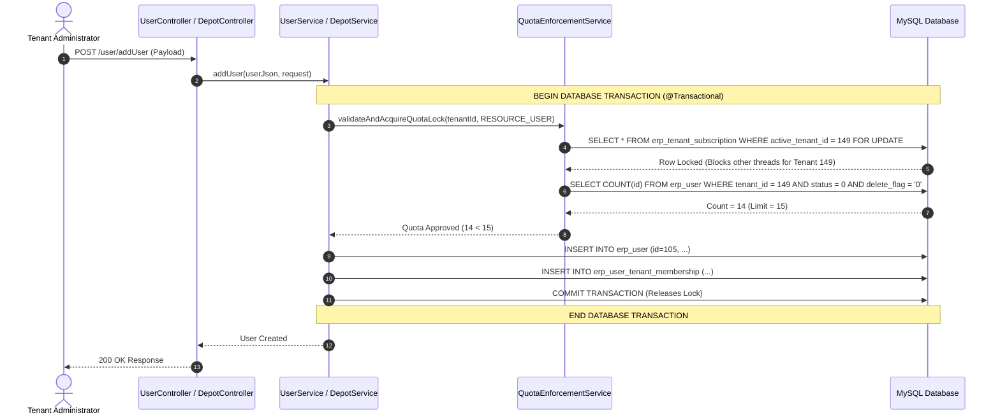
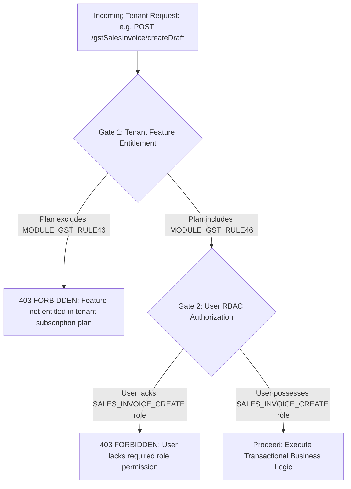

# Recommended Technical Design for Phase 5, 8 & 9 (Final Refinement)

## 1. Executive Summary
This document delivers the final, hardened technical design for **Phase 5 (Platform Configuration), Phase 8 (Subscription & Plans), and Phase 9 (Multi-Resource Quotas & Entitlements)**.

---

## 2. Quota Transaction Boundary Architecture

To eliminate race conditions and guarantee that quota validation cannot be separated from entity insertion, all resource creation workflows execute inside a **Single Atomic Database Transaction**:



### 2.1 Transactional Methods:
- `UserService.addUser(...)`: `@Transactional` wraps subscription row lock, active user count, quota check, and `erp_user` + `erp_user_tenant_membership` inserts.
- `DepotService.insertDepot(...)`: `@Transactional` wraps subscription lock, active depot count, quota check, and `erp_depot` insert.
- `OrganizationService.insertOrganization(...)`: `@Transactional` wraps subscription lock, active branch count, quota check, and `erp_organization` insert.

---

## 3. Dual-Gate Authorization: Feature Entitlement vs User RBAC



### Strict Separation:
1. **Tenant Feature Entitlement (`TenantSubscription.enabled_features`)**:
   - Answer: *"Does the customer organization pay for and have access to this module capability?"*
   - Examples: `MODULE_SALES`, `MODULE_PURCHASE`, `MODULE_INVENTORY`, `MODULE_FINANCIAL`, `MODULE_GST_EINVOICE`, `MODULE_SUPPORT_CENTER`.
2. **User RBAC Permission (`SecurityContext.permissions`)**:
   - Answer: *"Is this specific employee/operator authorized to execute this specific business action?"*
   - Examples: `SALES_ORDER_CREATE`, `SALES_INVOICE_POST`, `DEPOT_MANAGE`, `FINANCE_PAYMENT_POST`.

---

## 4. Single Authoritative Access Gate

In `AuthorizationService.resolveSecurityContext()`:
```java
public boolean isTenantAccessible(Long tenantId) {
    if (tenantId == null || tenantId <= 0L) {
        return true; // Platform scope evaluated separately
    }

    Tenant tenant = tenantMapper.selectByTenantId(tenantId);
    if (tenant == null || Boolean.FALSE.equals(tenant.getEnabled()) || "1".equals(tenant.getDeleteFlag())) {
        return false; // Hard-suspended by Super Admin
    }

    TenantSubscription activeSub = tenantSubscriptionMapper.selectActiveByTenantId(tenantId);
    if (activeSub == null) {
        return false; // No active subscription instance
    }

    String status = activeSub.getStatus();
    Date now = new Date();

    if ("ACTIVE".equalsIgnoreCase(status) || "TRIAL".equalsIgnoreCase(status)) {
        if (activeSub.getEndDate() != null && now.after(activeSub.getEndDate())) {
            // Expired: Check if within 7-day grace period
            return activeSub.getGracePeriodEnd() != null && now.before(activeSub.getGracePeriodEnd());
        }
        return true;
    } else if ("GRACE_PERIOD".equalsIgnoreCase(status)) {
        return activeSub.getGracePeriodEnd() == null || now.before(activeSub.getGracePeriodEnd());
    }

    return false; // SUSPENDED, EXPIRED, REPLACED, CANCELLED
}
```
