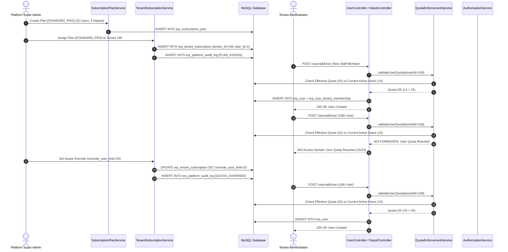
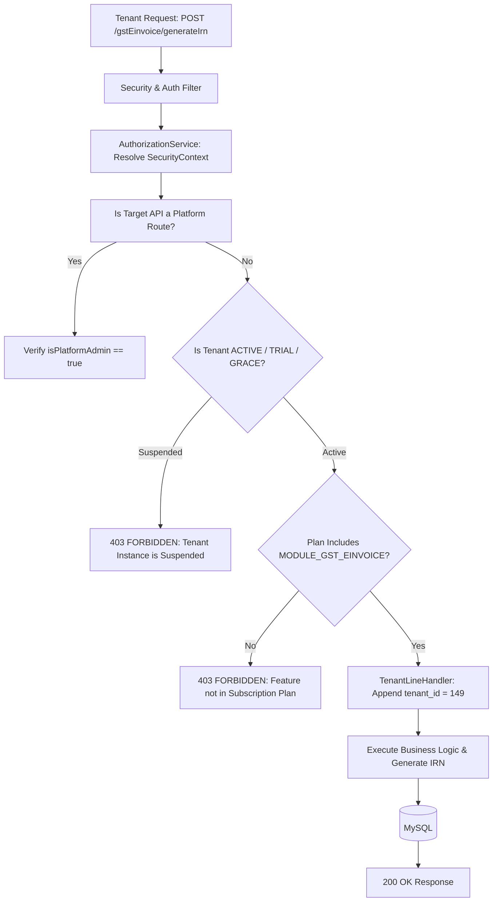

# Platform End-to-End Business & Technical Workflow Diagrams

## 1. Executive Summary
This document provides visual sequence and workflow diagrams for Plan Assignment, Quota Enforcement, Feature Entitlement Gatekeeping, and Lifecycle Suspensions.

---

## 2. End-to-End Subscription & Quota Lifecycle

---

## 3. Feature Entitlement & API Interception Flow

