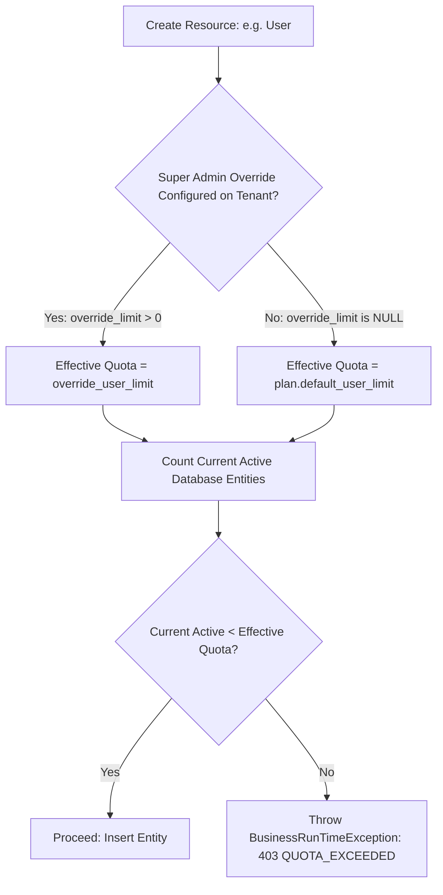

# Quota & Feature Entitlement Enforcement Analysis

## 1. Executive Summary
This document analyzes multi-dimensional resource quota enforcement (`Users`, `Depots`, `Organizations`, `Monthly Invoices`) and feature module entitlements (`SALES`, `PURCHASE`, `INVENTORY`, `FINANCE`, `GST_EINVOICE`, `SUPPORT_CENTER`).

---

## 2. Multi-Resource Quota Matrix

| Resource Metric | Enforcement Point | Count Strategy | Quota Exceeded Behavior |
| :--- | :--- | :--- | :--- |
| **Active Users** | `UserService.addUser()` | `COUNT(id) FROM erp_user WHERE tenant_id = ? AND delete_flag = '0' AND status = 0` | **403 FORBIDDEN**: "User quota reached (N/N). Upgrade plan or deactivate existing users." |
| **Warehouses / Depots** | `DepotService.insertDepot()` | `COUNT(id) FROM erp_depot WHERE tenant_id = ? AND delete_flag = '0'` | **403 FORBIDDEN**: "Depot quota reached (N/N). Upgrade plan or contact Super Admin." |
| **Organization Units** | `OrganizationService.insertOrganization()` | `COUNT(id) FROM erp_organization WHERE tenant_id = ? AND delete_flag = '0'` | **403 FORBIDDEN**: "Organization branch quota reached (N/N)." |
| **Monthly Invoices** | `DepotHeadService.addDepotHeadAndDetail()` | `COUNT(id) FROM erp_depot_head WHERE tenant_id = ? AND create_time >= FIRST_OF_MONTH` | Soft-warning / Hard-block based on plan policy. |

---

## 3. Super Admin Quota Override Mechanics

In real enterprise deployments, Super Admins frequently grant special temporary or permanent quota increases without altering the base subscription plan (e.g. adding 5 emergency user seats during seasonal audit).

### Precedence Model:

---

## 4. Feature Entitlement & API Interception

### 4.1 Entitlement Definition
Features are grouped into semantic entitlement tokens:
- `MODULE_SALES`
- `MODULE_PURCHASE`
- `MODULE_INVENTORY`
- `MODULE_FINANCIAL`
- `MODULE_GST_EINVOICE`
- `MODULE_ADVANCED_P2P`
- `MODULE_SUPPORT_CENTER`

### 4.2 Two-Tier Entitlement Enforcement:
1. **Frontend Menu Filtering**: UI router and sidebar hide disabled modules so users are not presented with irrelevant navigation items.
2. **Backend API Gatekeeper (`AuthorizationService`)**:
   - Every controller endpoint declares or maps to a required feature module.
   - If Tenant A attempts direct HTTP POST to `/gstEinvoice/generateIrn` while `MODULE_GST_EINVOICE` is not enabled in Tenant A's active plan:
     - Returns `403 FORBIDDEN: Feature [MODULE_GST_EINVOICE] is not included in current subscription plan.`

---

## 5. Edge Case Analysis & Mitigations

### 1. Plan Downgrade Below Current Usage:
- **Scenario**: Tenant with 12 active users is downgraded to `TRIAL` (Max 3 Users).
- **Policy**: Existing 12 user accounts remain intact and functioning, but creation of new users is blocked until active user count drops below 3. Zero destructive data loss.

### 2. Deleted & Inactive Entities:
- **Scenario**: Tenant deletes 2 users to create 2 new staff members.
- **Rule**: Quota counting strictly filters `WHERE delete_flag = '0' AND status = 0`. Soft-deleted or disabled accounts do not consume active seats.

### 3. Concurrency Race Conditions:
- **Scenario**: Two administrators in Tenant A simultaneously create a user when quota has 1 seat remaining.
- **Mitigation**: Evaluated inside transaction with pessimistic row lock (`SELECT ... FOR UPDATE` on `erp_tenant_subscription` or synchronized validation block).
