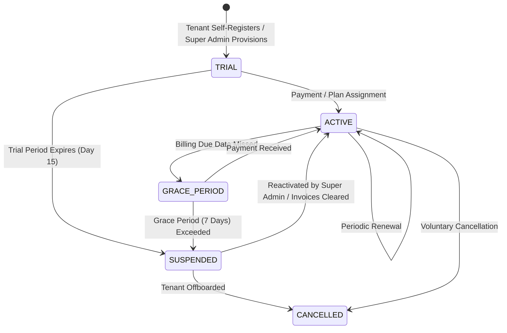

# Subscription & Plan Catalog Analysis

## 1. Executive Summary
This document analyzes the commercial subscription model, plan tiers (`BASIC`, `PRO`, `ENTERPRISE`, `CUSTOM`), lifecycle management, and architectural alignment with metasfresh and ERPNext.

---

## 2. Industry Benchmark Comparison

### 2.1 metasfresh (Client & Packaging Model)
- **Architecture**: Separates System Client (`0`) from Business Clients.
- **Packaging**: Uses module bundles and licensing plugins where features (e.g. Advanced EDI, E-Commerce Connector) are enabled per client instance.
- **Tenancy**: Enterprise-grade multi-organization support within each client.

### 2.2 ERPNext / Frappe (Cloud & Subscription System)
- **Architecture**: Uses Frappe Cloud / Subscription DocTypes (`Plan`, `Subscription`, `Subscription Plan`, `Usage Record`).
- **Billing Metrics**: Enforces seat quotas, database storage quotas, email limits, and custom domain entitlements.
- **Downgrade / Grace Periods**: Offers soft-lock / read-only grace periods when subscriptions expire before hard suspension.

---

## 3. Existing ERP vs Target Subscription Model

| Dimension | Existing ERP | Target Mid-Market Model (Phase 5/8/9) |
| :--- | :--- | :--- |
| **Plan Catalog** | Plain text column (`type` in `erp_tenant`) | Formal `erp_subscription_plan` catalog with semantic codes |
| **Plan Tiers** | `free`, `try`, `pay` | `COMMUNITY / TRIAL`, `STANDARD_PRO`, `ENTERPRISE_UNLIMITED`, `CUSTOM` |
| **Billing Cycle** | Ad-hoc `expire_time` date | Structured billing cycles (`MONTHLY`, `ANNUAL`, `PERPETUAL`) |
| **Subscription State Machine** | Boolean `enabled` | Formal states: `TRIAL`, `ACTIVE`, `PAST_DUE`, `GRACE_PERIOD`, `SUSPENDED`, `CANCELLED` |
| **Quota Allocation** | Hardcoded `user_num_limit` | Multi-resource quotas (`maxUsers`, `maxDepots`, `maxOrgs`, `maxInvoicesPerMonth`) |
| **Feature Packages** | All active modules enabled for all tenants | Modular feature entitlements (`ENABLED_MODULES` JSON set) |

---

## 4. Proposed Standard Plan Tier Catalog

### Plan 1: `TRIAL` (Free Evaluation)
- **Duration**: 14 Days
- **Quotas**: Max 3 Users, Max 1 Depot, Max 1 Organization Unit.
- **Entitled Modules**: Commercial Sales, Basic Purchasing, Standard Inventory.
- **Excluded**: Multi-GSTIN, E-Invoice / E-Way Bill Integration, Advanced 3-Way Matching, Support Center Access.

### Plan 2: `STANDARD_PRO` (Growing Businesses)
- **Billing**: Monthly / Annual
- **Quotas**: Max 15 Users, Max 3 Depots, Max 3 Organization Units.
- **Entitled Modules**: Full Sales, Purchasing, Inventory, Financial Ledgers, Standard GST Reports.
- **Excluded**: Statutory Direct IRP/NIC API Gateway Integration, Advanced Audit Trails.

### Plan 3: `ENTERPRISE` (Multi-Branch Mid-Market)
- **Billing**: Annual
- **Quotas**: Max 100 Users, Max 20 Depots, Max 10 Organization Units.
- **Entitled Modules**: Complete ERP Suite, Indian Statutory E-Invoice & E-Way Bill Gateway, 3-Way Matching, Support Center & Consent Access.

### Plan 4: `CUSTOM_OVERRIDE` (Enterprise Tailored)
- **Billing**: Custom Agreement
- **Quotas**: Unlimited / Bespoke quotas configured by Platform Super Admin.
- **Entitled Modules**: Custom selection of features with explicit Super Admin overrides.

---

## 5. Subscription Lifecycle State Machine

