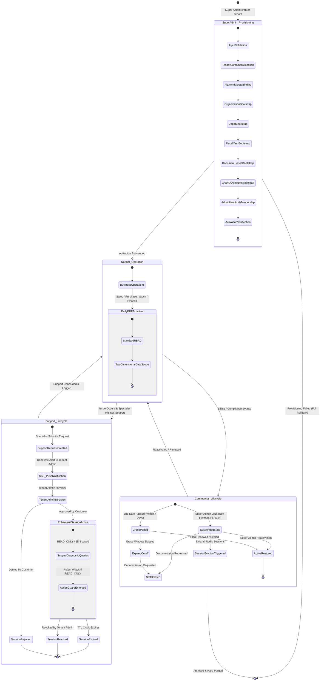
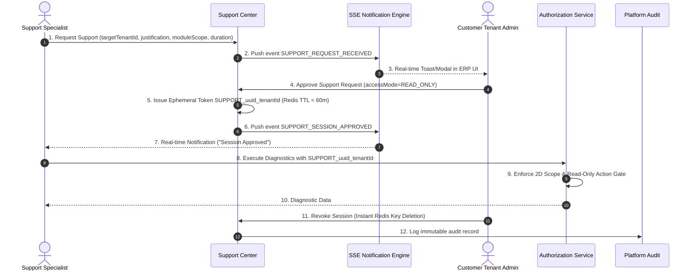
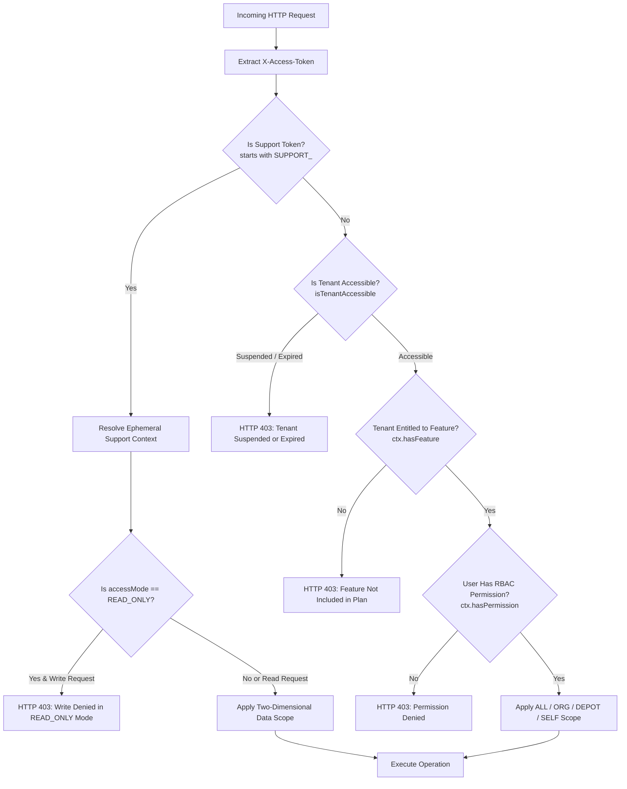

# Phase 6, 7, 11 & 12 Research — Combined Lifecycle Architecture

## 1. Master End-to-End Enterprise Lifecycle Diagram

This diagram unifies the complete enterprise lifecycle across all platform phases:

---

## 2. Dedicated Domain Architecture Diagrams

### 1. Support Access & Consent Workflow

### 2. Multi-Factor Security & Authorization Gate Flow

