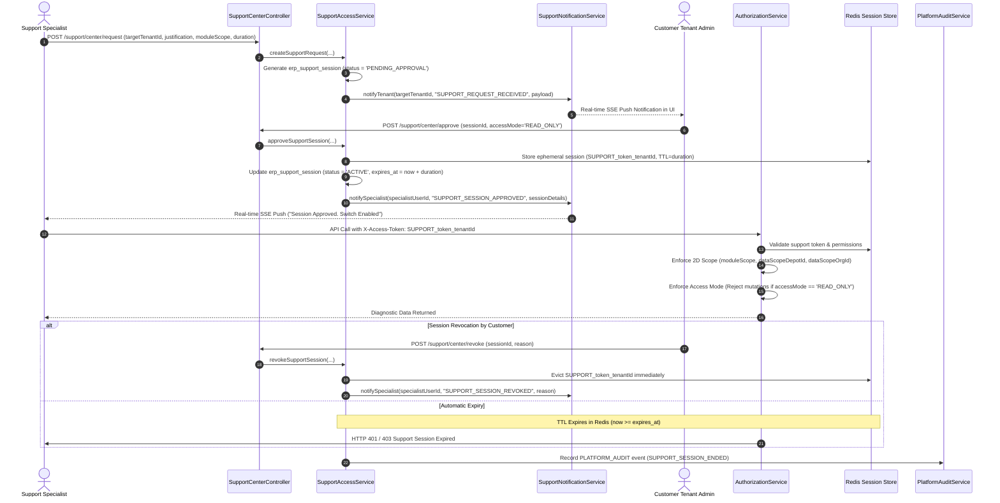

# Phase 6, 7, 11 & 12 Research — Support Operations & Support Access Analysis

## 1. Enterprise Support Operations Architecture

In enterprise cloud SaaS (SAP / Salesforce / Oracle Work-Centre), platform support engineers must **never** possess permanent, unrestricted backdoor access into customer tenant databases. Support access must be **ephemeral, time-bounded, scoped to specific modules and organizations, consent-gated by the customer tenant administrator, and strictly audited**.

---

## 2. Key Support Operational Capabilities

### 1. Zero Customer DB Mutation Invariant
- **Strict Prohibition**: Support access must **never** create temporary user accounts in the customer tenant, modify `erp_user_business`, or alter customer role tables.
- **Mechanism**: The ephemeral session is created entirely in the platform Redis session store and platform table `erp_support_session`. When the token expires or is revoked, access vanishes instantly with zero database cleanup needed in the customer tenant.

### 2. Platform Super Admin vs Support Specialist / Operator

| Dimension | Platform Super Admin | Support Specialist / Operator |
|---|---|---|
| **Role Code** | `Super Admin` (`roleId = 4`) | `SYSTEM_SUPPORT` / `Support Specialist` (`roleId = 101`) |
| **Originating Domain** | `PLATFORM` | `SUPPORT_OPERATIONS` |
| **Direct Emergency Access** | Can generate immediate emergency session with audit | **Requires mandatory customer tenant approval** |
| **Max Session Duration** | Configurable up to 120 minutes | Configurable up to 60 minutes |
| **Permitted Access Modes** | `READ_ONLY` or `APPROVED_WRITE` | **Strictly `READ_ONLY`** (cannot perform mutating operations) |
| **Allowed Menus** | Full Platform Administration + Support Center | Support Work Centre & Diagnostics only |

---

## 3. Two-Dimensional Support Scoping (2D Scoping)

Support access is constrained along two orthogonal dimensions:

1. **Functional Module Scope**:
   - `ALL_DIAGNOSTICS` — Broad read access across basic modules.
   - `INVENTORY` — Scoped exclusively to Depot, Stock, and Material inspection.
   - `SALES` — Scoped exclusively to Sales Orders and Deliveries.
   - `PURCHASE` — Scoped exclusively to Purchase Orders and Receipts.
   - `FINANCIAL` — Scoped to General Ledger and Payment Vouchers.
   - `TAX_GST` — Scoped to GSTIN and Tax Rules.
2. **Organizational / Depot Data Scope**:
   - `dataScopeOrgId`: Restricts query visibility to a specific branch/department.
   - `dataScopeDepotId`: Restricts query visibility to a specific warehouse/depot.

---

## 4. Action-Based Mutation Guard in `READ_ONLY` Mode

When a support session is initialized with `accessMode = 'READ_ONLY'`:
- Any attempt to execute mutating actions (`CREATE`, `UPDATE`, `DELETE`, `POST`, `UNAPPROVE`) is intercepted by `AuthorizationService.validateBusinessAction(...)`.
- The request is immediately rejected with `HTTP 403 Forbidden: Action [ACTION] is prohibited in READ_ONLY support mode`.
- The security rejection is logged to `PlatformAuditLog` with operator identity, IP, and timestamp.
