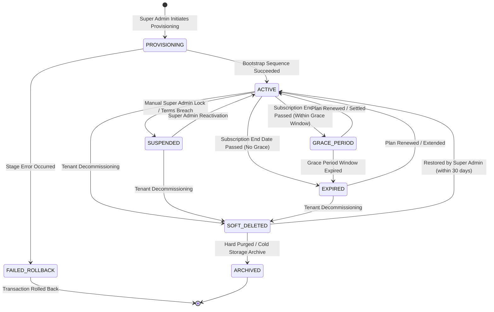

# Phase 6, 7, 11 & 12 Research — Tenant Lifecycle Analysis

## 1. Enterprise Tenant Lifecycle State Machine

A multi-tenant SaaS ERP requires explicit state transition logic to govern access throughout a customer's commercial relationship. Relying on an unstructured boolean flag (`enabled = 0 / 1`) fails to handle critical operational scenarios such as billing grace periods, administrative security suspensions, and session evictions.

---

## 2. State Rules, Access Permissions & Session Eviction

| Lifecycle State | Operational Meaning | Business User Login | API Access Scope | Support Access Permitted | Session Eviction Action | Audit Log Event |
|---|---|:---:|---|:---:|---|---|
| **`PROVISIONING`** | Tenant resources being generated. | **DENIED** | Internal provisioning services only | **DENIED** | No active sessions exist | `TENANT_PROVISIONING_STARTED` |
| **`ACTIVE`** | Fully operational customer tenant. | **ALLOWED** | Full access governed by RBAC and Feature Gate | **ALLOWED** (requires customer consent) | None | `TENANT_ACTIVATED` |
| **`SUSPENDED`** | Locked by Super Admin due to non-payment or compliance violation. | **DENIED** | All endpoints return HTTP 403 `TENANT_SUSPENDED` | **ALLOWED** (Super Admin troubleshooting only) | **Immediate eviction of all active Redis tokens for tenant** | `TENANT_SUSPENDED` |
| **`GRACE_PERIOD`** | Subscription expired; operating within statutory/courtesy grace window (e.g. 7 days). | **ALLOWED** | Full access with renewal warning banner OR Read-Only mode | **ALLOWED** | None (warning pushed via SSE) | `TENANT_GRACE_PERIOD_ENTERED` |
| **`EXPIRED`** | Subscription expired and grace period elapsed. | **DENIED** | All endpoints return HTTP 403 `SUBSCRIPTION_EXPIRED` | **ALLOWED** (with Super Admin override) | **Immediate eviction of non-admin sessions** | `TENANT_EXPIRED` |
| **`SOFT_DELETED`** | Marked for deletion (`delete_flag = '1'`). Data retained for retention window. | **DENIED** | All endpoints return HTTP 404 / 403 `TENANT_NOT_FOUND` | **DENIED** | **Complete purge of all Redis session keys** | `TENANT_SOFT_DELETED` |
| **`ARCHIVED`** | Cold storage archive or irreversible purge after statutory retention. | **DENIED** | Database records removed / exported | **DENIED** | N/A | `TENANT_ARCHIVED` |

---

## 3. Deep Lifecycle Operations & Mechanics

### 1. Suspension & Real-Time Session Eviction
- **Business Action**: Super Admin issues suspension via `/platform/tenant/suspend` with mandatory justification reason.
- **Backend Flow**:
  1. `TenantService` updates `erp_tenant.status = 'SUSPENDED'` and `erp_tenant.enabled = false`.
  2. `TenantSubscriptionService` updates active subscription row `status = 'SUSPENDED'`.
  3. `RedisService` scans and evicts all active tokens matching `*_<tenantId>` or sessions where `tenantId = targetTenantId`.
  4. Subsequent API calls by logged-in users receive immediate `HTTP 403 Forbidden: Tenant is suspended`.
  5. `PlatformAuditService` records immutable audit log with operator ID, reason, and client IP.

### 2. Reactivation
- **Business Action**: Super Admin issues reactivation via `/platform/tenant/reactivate` after verifying payment or resolution.
- **Backend Flow**:
  1. Validates that the active subscription `end_date` is in the future.
  2. Updates `erp_tenant.status = 'ACTIVE'` and `erp_tenant.enabled = true`.
  3. Updates `erp_tenant_subscription.status = 'ACTIVE'`.
  4. Records `TENANT_REACTIVATED` audit event.

### 3. Grace Period & Expiration Evaluation
- Evaluated dynamically in `AuthorizationService.isTenantAccessible(tenantId)`:
  $$\text{Accessible} = (\text{tenant.enabled} == \text{true}) \land (\text{sub.status} \in \{\text{'ACTIVE'}, \text{'TRIAL'}, \text{'GRACE\_PERIOD'}\}) \land (\text{now} < \text{sub.grace\_period\_end})$$
- If `now > sub.end_date` but `now < sub.grace_period_end`, the tenant operates in grace period mode.
- Once `now \ge sub.grace_period_end`, access is rejected across all business requests.

### 4. Soft Deletion & Data Retention
- **Business Action**: Super Admin calls `/platform/tenant/delete`.
- **Backend Flow**:
  1. Sets `erp_tenant.delete_flag = '1'`.
  2. Sets `erp_tenant_subscription.is_active = 0, status = 'TERMINATED'`.
  3. Sets `erp_user_tenant_membership.status = 'REVOKED'`.
  4. Purges all active sessions from Redis.
  5. Retains underlying transactional data for 30 to 90 days (statutory GST compliance) before hard cold-storage export.
