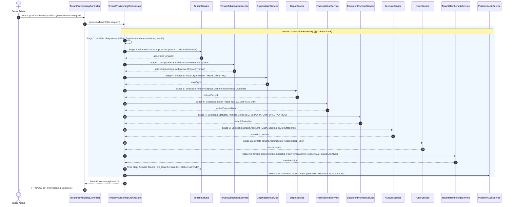

# Phase 6, 7, 11 & 12 Research — Tenant Provisioning Analysis

## 1. Executive Summary

Tenant provisioning in a multi-tenant SaaS ERP is the atomic process that instantiates a fully operational, statutory-compliant enterprise tenant from a blank state. It bridges platform administration (Super Admin) with tenant-level operations (Tenant Admin), establishing all data containers, subscriptions, organizational units, fiscal calendars, statutory document sequences, accounts, and administrator memberships in a single transaction.

---

## 2. End-to-End Tenant Provisioning Trace

---

## 3. Step-by-Step Technical & Business Breakdown

| Step | Business Action | Backend Service | Database Changes | Validation Performed | Failure & Rollback Behavior | Audit Event |
|---|---|---|---|---|---|---|
| **1. Validate Plan & Credentials** | Super Admin inputs company profile, admin user handle, password, and selects subscription plan. | `TenantProvisioningOrchestrator` | None (read-only validation) | Checks `loginName` uniqueness across `erp_user` and `erp_tenant`; rejects reserved names (`admin`, `jsh`, `system`); verifies `planId` is active. | Throws `BusinessRunTimeException` (400/409); 0 rows touched. | N/A |
| **2. Create Tenant Container** | Instantiates isolated tenant namespace in platform catalog. | `TenantService` | `INSERT INTO erp_tenant (tenant_id, login_name, company_name, status='PROVISIONING', enabled=0)` | Validates auto-increment ID generation and non-null constraints. | Transaction rollback removes `erp_tenant` row. | N/A |
| **3. Assign Subscription Plan** | Binds tenant to approved pricing tier with quotas and feature entitlements. | `TenantSubscriptionService` | `INSERT INTO erp_tenant_subscription (tenant_id, plan_id, is_active=1, status='ACTIVE', active_tenant_id=tenant_id, override_user_limit=NULL)` | Validates plan template existence; database unique index `uk_single_active_subscription` prevents double-assignment. | Transaction rollback removes subscription row. | `PLAN_ASSIGN` |
| **4. Bootstrap Root Organization** | Creates legal root company entity and head office branch. | `OrganizationService` | `INSERT INTO erp_organization (tenant_id, org_abr='HQ', org_name=companyName+' - Head Office', org_type=1, org_parent_id=-1, enabled=1)` | Validates name length and parent hierarchy. | Transaction rollback removes organization row. | `ORG_ADD` |
| **5. Bootstrap Primary Depot** | Establishes central physical storage warehouse for logistics and stock control. | `DepotService` | `INSERT INTO erp_depot (tenant_id, name='General Warehouse', type=0, is_default=1, enabled=1, delete_flag='0')` | Validates depot quota capacity (ensures quota $\ge 1$). | Transaction rollback removes depot row. | `DEPOT_ADD` |
| **6. Bootstrap Fiscal Calendar** | Establishes current statutory fiscal year (e.g. Indian FY 01-Apr to 31-Mar). | `FinancialYearService` | `INSERT INTO erp_financial_year (tenant_id, name='2026-27', code='26-27', start_date='2026-04-01', end_date='2027-03-31', status='ACTIVE')` | Validates date non-overlapping intervals and FY naming format. | Transaction rollback removes financial year row. | `FY_BOOTSTRAP` |
| **7. Bootstrap Statutory Number Series** | Generates sequential document numbering rules for core ERP transactions. | `DocumentNumberService` | `INSERT INTO erp_document_number_series` (8 rows: SO, INV, PO, GRN, CRN, DRN, PAY, REC) | Validates prefix uniqueness and 16-character statutory rule limit. | Transaction rollback removes all 8 series rows. | `SERIES_BOOTSTRAP` |
| **8. Bootstrap Chart of Accounts** | Seeds basic general ledger cash/bank accounts and income/expense categories. | `AccountService`, `InOutItemService` | `INSERT INTO erp_account` (Cash, Bank) + `INSERT INTO erp_in_out_item` (Sales, Purchase, Ops, Other) | Validates account serial number uniqueness per tenant. | Transaction rollback removes account and in/out rows. | `COA_BOOTSTRAP` |
| **9. Create Admin & Membership** | Generates primary customer administrator credentials and canonical RBAC membership. | `UserService`, `TenantMembershipService` | `INSERT INTO erp_user (login_name, password, ismanager=1, leader_flag='1', tenant_id=tenant_id)` + `INSERT INTO erp_user_tenant_membership (user_id, tenant_id, role_id=3, data_scope_type='ALL', status='ACTIVE', is_default=1)` | Password MD5 hash check; user quota capacity check. | Transaction rollback removes user and membership rows. | `USER_ADD`, `MEMBERSHIP_CREATE` |
| **10. Activate Tenant** | Formally marks tenant instance operational and available for customer login. | `TenantProvisioningOrchestrator` | `UPDATE erp_tenant SET status='ACTIVE', enabled=1, admin_user_id=adminUserId WHERE tenant_id=tenant_id` | Verifies all preceding 9 steps produced valid non-null IDs. | If activation fails, transaction rolls back all rows. | `TENANT_PROVISION_SUCCESS` |

---

## 4. Transaction Boundaries & Idempotency Rules

1. **Unified Transactional Boundary**:
   The entire 10-step sequence is governed by a single `@Transactional(value = "transactionManager", rollbackFor = Exception.class, isolation = Isolation.READ_COMMITTED)` annotation on `TenantProvisioningOrchestrator.provisionTenant`.
2. **Failure & Rollback Behavior**:
   If any exception is thrown at any point during stages 1 through 10, the database transaction is aborted. MySQL automatically reverts all inserted rows across all 11 touched tables. No orphan, zombie, or partial tenant records persist.
3. **Concurrency Lock**:
   A tenant-level lock keyed by `loginName.toLowerCase()` is acquired before execution, preventing race conditions or double-submissions.
4. **Idempotency Guarantee**:
   Provisioning with an identical `idempotencyKey` within a 5-minute cache window returns the previous successful result without re-executing database operations.
