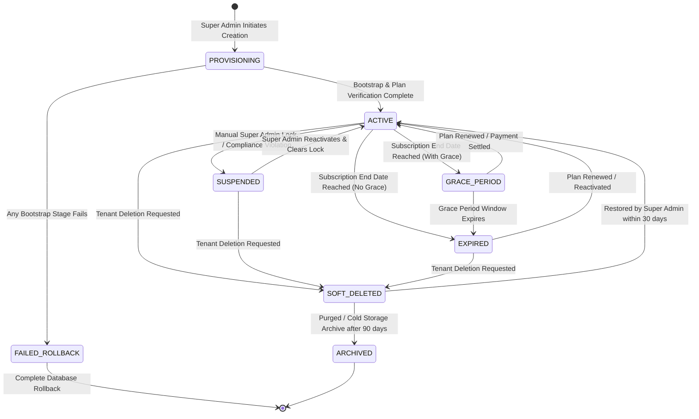

# Phase 6 & 7 Research — Tenant Lifecycle State Machine

## 1. Lifecycle States Overview

To guarantee enterprise governance, tenant access cannot be modeled as a simple binary flag (`enabled = 0 / 1`). It requires a deterministic, event-driven state machine governing the complete lifespan of a customer tenant.

---

## 2. State Definitions & Operational Rules

| State | Description | Tenant Login Allowed | API Operations Permitted | Support Access Permitted | Session Eviction Action |
|---|---|:---:|:---:|:---:|---|
| **`PROVISIONING`** | Tenant container and bootstrap pipeline currently executing. | **DENIED** | Restricted to internal bootstrap services | **DENIED** | No active sessions exist |
| **`ACTIVE`** | Fully operational tenant instance with valid subscription and active status. | **ALLOWED** | Full access governed by RBAC and Feature Gate | **ALLOWED** (with customer consent) | None |
| **`SUSPENDED`** | Administratively locked by Super Admin due to non-payment, terms violation, or security hold. | **DENIED** | All business APIs blocked (HTTP 403 `TENANT_SUSPENDED`) | **ALLOWED** (Super Admin troubleshooting only) | Immediate broadcast eviction of all active user tokens |
| **`GRACE_PERIOD`** | Subscription duration expired, but running within statutory/courtesy grace window (e.g. 7 days). | **ALLOWED** (or Read-Only) | Configurable: Full access with renewal banner OR Read-Only mode | **ALLOWED** | None (warning banner pushed via SSE) |
| **`EXPIRED`** | Subscription expired and grace period elapsed. | **DENIED** | Blocked with HTTP 403 `SUBSCRIPTION_EXPIRED` | **ALLOWED** | Immediate eviction of non-admin sessions |
| **`SOFT_DELETED`** | Marked for decommission (`delete_flag = '1'`). All operations halted. | **DENIED** | All APIs blocked (HTTP 404 / 403 `TENANT_NOT_FOUND`) | **DENIED** | Complete purge of all active tokens from Redis |
| **`ARCHIVED`** | Data purged or transitioned to cold storage after statutory retention period. | **DENIED** | Inactive | **DENIED** | Permanent removal from runtime DB |

---

## 3. Detailed Lifecycle Transitions & Enforcement Rules

### 1. Provisioning to Active (`PROVISIONING` $\rightarrow$ `ACTIVE`)
- **Trigger**: `TenantProvisioningOrchestrator` completes all 9 bootstrap stages without error.
- **Enforcement**:
  1. Verifies `erp_tenant` row exists.
  2. Verifies active `erp_tenant_subscription` row exists with valid plan.
  3. Verifies default Organization and Depot are created.
  4. Sets `erp_tenant.enabled = true` and `erp_tenant.status = 'ACTIVE'`.
  5. Records `TENANT_ACTIVATED` event in `PlatformAuditLog`.

### 2. Active to Suspended (`ACTIVE` $\rightarrow$ `SUSPENDED`)
- **Trigger**: Super Admin calls `POST /platform/tenant/suspend`.
- **Enforcement**:
  1. Sets `erp_tenant.enabled = false` and `erp_tenant.status = 'SUSPENDED'`.
  2. Sets `erp_tenant_subscription.status = 'SUSPENDED'`.
  3. **Session Eviction**: Scans Redis session registry for all tokens where `tenantId = targetTenantId` and deletes them immediately.
  4. Records `TENANT_SUSPEND` audit event with operator ID, reason, and client IP.

### 3. Suspended to Active (`SUSPENDED` $\rightarrow$ `ACTIVE`)
- **Trigger**: Super Admin calls `POST /platform/tenant/reactivate`.
- **Enforcement**:
  1. Validates that the active subscription has not expired.
  2. Sets `erp_tenant.enabled = true` and `erp_tenant.status = 'ACTIVE'`.
  3. Sets `erp_tenant_subscription.status = 'ACTIVE'`.
  4. Records `TENANT_REACTIVATE` audit event.

### 4. Active to Grace Period & Expired (`ACTIVE` $\rightarrow$ `GRACE_PERIOD` $\rightarrow$ `EXPIRED`)
- **Trigger**: Automated scheduled job or dynamic check in `AuthorizationService.isTenantAccessible(tenantId)`:
  - If `now > subscription.end_date` AND `now < subscription.grace_period_end`: Status is `GRACE_PERIOD`.
  - If `now >= subscription.grace_period_end`: Status is `EXPIRED`.
- **Enforcement**:
  - In `GRACE_PERIOD`, tenant remains accessible, and frontend displays renewal countdown.
  - In `EXPIRED`, access is cut off with HTTP 403 `Subscription Expired`.

### 5. Soft Deletion (`*` $\rightarrow$ `SOFT_DELETED`)
- **Trigger**: Super Admin calls `DELETE /platform/tenant/delete?id=...`.
- **Enforcement**:
  1. Sets `erp_tenant.delete_flag = '1'`.
  2. Sets `erp_tenant_subscription.is_active = 0, status = 'TERMINATED'`.
  3. Sets `erp_user_tenant_membership.status = 'REVOKED'`.
  4. Evicts all Redis tokens for the tenant.
  5. Records `TENANT_DELETE` audit event.
