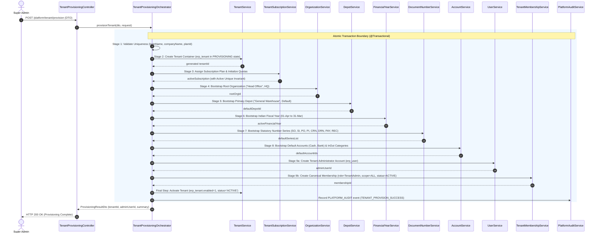

# Phase 6 & 7 Research — Provisioning & Bootstrap Orchestrator

## 1. Orchestrated Provisioning Sequence

The tenant provisioning pipeline is designed as an atomic 9-stage sequence executed inside a unified transactional boundary. If any stage fails, all previously inserted entities are immediately rolled back, preventing zombie or corrupt partial tenants.

---

## 2. Detailed 9-Stage Specification

### Stage 1: Input Validation & Pre-Flight Checks
- Validates that `loginName` does not collide with reserved platform names (`admin`, `jsh`, `system`, `manager`) or existing tenant login names in `erp_user` / `erp_tenant`.
- Validates that `planId` refers to an existing, active `SubscriptionPlan`.
- Validates password strength (minimum 6 characters) and hashes password using MD5.

### Stage 2: Tenant Container Generation
- Allocates a new distinct `tenantId` (auto-increment primary key in `erp_tenant`).
- Inserts `erp_tenant` with:
  - `status = 'PROVISIONING'`
  - `enabled = false`
  - `delete_flag = '0'`
  - `create_time = NOW()`

### Stage 3: Subscription Plan Assignment & Active Invariant
- Calls `TenantSubscriptionService.assignPlanToTenant(tenantId, planId, durationDays, "Initial Provisioning", request)`.
- Creates `erp_tenant_subscription` record with `is_active = 1, status = 'ACTIVE'`.
- Virtual generated column `active_tenant_id = tenantId` enforces the **Active Subscription Invariant** at the database level.
- Multi-resource quotas (`default_user_limit`, `default_depot_limit`, `default_org_limit`) and feature entitlement tokens (`enabled_features`) are bound.

### Stage 4: Root Organization Bootstrap
- Creates the Root Head Office in `erp_organization`:
  - `org_abr = "HQ"`
  - `org_name = companyName + " - Head Office"`
  - `org_type = 1` (Root Company / Head Office)
  - `org_parent_id = -1`
  - `tenant_id = tenantId`
  - `enabled = true`

### Stage 5: Primary Warehouse / Depot Bootstrap
- Creates the primary default warehouse in `erp_depot`:
  - `name = "General Warehouse"`
  - `type = 0` (Standard Warehouse)
  - `is_default = true`
  - `enabled = true`
  - `delete_flag = '0'`
  - `tenant_id = tenantId`

### Stage 6: Fiscal Calendar / Financial Year Bootstrap
- Resolves and creates the current Indian Financial Year (01-April to 31-March) via `FinancialYearService`:
  - `name = "2026-27"`
  - `code = "26-27"`
  - `start_date = 2026-04-01 00:00:00`
  - `end_date = 2027-03-31 23:59:59`
  - `status = "ACTIVE"`
  - `tenant_id = tenantId`

### Stage 7: Statutory Document Numbering Series Bootstrap
- Initializes 8 baseline document numbering series for the active Financial Year:
  1. `SO` — Sales Orders (`prefix = "SO/26-27/", paddingLength = 4, nextNumber = 1`)
  2. `INVOICE` — Sales Invoices (`prefix = "INV/26-27/", paddingLength = 4, nextNumber = 1`)
  3. `PO` — Purchase Orders (`prefix = "PO/26-27/", paddingLength = 4, nextNumber = 1`)
  4. `PURCHASE_RECEIPT` — Purchase Inward (`prefix = "GRN/26-27/", paddingLength = 4, nextNumber = 1`)
  5. `CREDIT_NOTE` — GST Credit Notes (`prefix = "CRN/26-27/", paddingLength = 4, nextNumber = 1`)
  6. `DEBIT_NOTE` — GST Debit Notes (`prefix = "DRN/26-27/", paddingLength = 4, nextNumber = 1`)
  7. `PAYMENT` — Financial Payments (`prefix = "PAY/26-27/", paddingLength = 4, nextNumber = 1`)
  8. `RECEIPT` — Financial Receipts (`prefix = "REC/26-27/", paddingLength = 4, nextNumber = 1`)

### Stage 8: Chart of Accounts & InOut Category Bootstrap
- Creates default financial accounts in `erp_account`:
  1. `Cash on Hand` (`serial_no = "1001"`, `initial_amount = 0`, `is_default = true`)
  2. `Main Operating Bank Account` (`serial_no = "1002"`, `initial_amount = 0`, `is_default = false`)
- Creates standard InOut categories in `erp_in_out_item`:
  1. `Sales Revenue` (`type = "In"`)
  2. `Purchase Cost` (`type = "Out"`)
  3. `Operating Expenses` (`type = "Out"`)
  4. `Other Income` (`type = "In"`)

### Stage 9: Tenant Admin Account & Canonical Membership
- Creates the Tenant Administrator in `erp_user`:
  - `login_name = loginName`
  - `username = adminFullName != null ? adminFullName : loginName`
  - `password = md5(password)`
  - `ismanager = 1`
  - `leader_flag = "1"`
  - `tenant_id = tenantId`
  - `status = 0` (Normal)
- Creates canonical membership in `erp_user_tenant_membership`:
  - `user_id = adminUserId`
  - `tenant_id = tenantId`
  - `role_id = 3` (Tenant Admin Role)
  - `data_scope_type = "ALL"`
  - `is_default = true`
  - `status = "ACTIVE"`
- Binds user to the Root Organization via `erp_orga_user_rel`.
- Binds user to the Default Depot via `erp_user_business` (`type = "UserDepot"`).

---

## 3. Final Activation Gate
Upon successful execution of Stages 1 through 9:
1. `erp_tenant.status` transitions from `PROVISIONING` to `ACTIVE`.
2. `erp_tenant.enabled` is set to `true`.
3. An audit record (`TENANT_PROVISION_SUCCESS`) is committed to `erp_platform_audit_log`.
4. The transaction commits. The newly provisioned tenant is immediately ready for production login.
