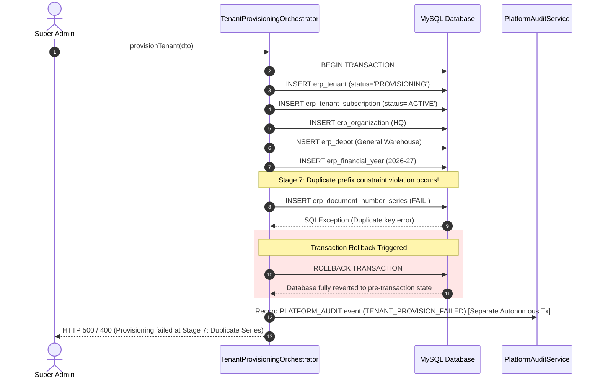

# Phase 6 & 7 Research — Transaction Boundaries, Rollback & Idempotency

## 1. Unified Transactional Envelope

A core failure mode in multi-tenant SaaS platforms is **Partial Provisioning** (Zombie Tenants). If tenant provisioning spans multiple independent bean calls without a unified transaction coordinator, a failure in Stage 7 (e.g. database error during Document Number Series initialization) will leave the `erp_tenant`, `erp_user`, and `erp_organization` records orphaned in the database. When the administrator re-attempts creation, the system fails with a duplicate key error on `login_name`, leaving the system in a corrupted, half-provisioned state.

### Unified Transaction Boundary Design
```
@Transactional(value = "transactionManager", rollbackFor = Exception.class, isolation = Isolation.READ_COMMITTED)
public TenantProvisioningResultDto provisionTenant(TenantProvisioningDto dto, HttpServletRequest request) {
    ...
}
```

By placing the `@Transactional` boundary at the entry point of `TenantProvisioningOrchestrator`:
1. Spring's `TransactionManager` encloses all 9 stages within a single MySQL database transaction.
2. Any uncaught `Exception` or `BusinessRunTimeException` triggers an immediate, full ACID database rollback.
3. Every single table touched (`erp_tenant`, `erp_tenant_subscription`, `erp_organization`, `erp_depot`, `erp_financial_year`, `erp_document_number_series`, `erp_account`, `erp_in_out_item`, `erp_user`, `erp_user_tenant_membership`, `erp_orga_user_rel`, `erp_user_business`) is restored to its exact pre-invocation state.
4. Zero orphaned or zombie rows remain in the database.

---

## 2. Failure Path & Rollback Trace



---

## 3. Idempotency & Concurrency Control

### 1. Concurrency Lock
To prevent two Super Admins (or double-clicking in the UI) from attempting to provision the same tenant concurrently:
- A tenant provisioning lock keyed by `loginName.toLowerCase()` is acquired using a `ConcurrentHashMap<String, ReentrantLock>` or Redis distributed lock with a 30-second TTL.
- If a second request arrives with the same `loginName` while provisioning is in progress, it is immediately rejected with `HTTP 409 Conflict` ("Tenant provisioning is already in progress for this login name").

### 2. Idempotency Key
- The UI can supply an optional `idempotencyKey` (UUID) in the request payload.
- The backend checks if a tenant with that `idempotencyKey` has already been successfully provisioned within the last 5 minutes.
- If already provisioned, the orchestrator returns the existing `TenantProvisioningResultDto` without executing duplicate database inserts.

---

## 4. Partial Provisioning Recovery & Retry Strategy

| Failure Scenario | Rollback Behavior | System State After Failure | Safe Retry Allowed? |
|---|---|---|:---:|
| **Stage 1 Failure** (Invalid plan or reserved loginName) | Throws `BusinessRunTimeException` before DB write | Database completely untouched | **YES** (Immediate) |
| **Stage 2-6 Failure** (DB constraint error during Org/Depot/FY) | Automatic Transaction Rollback | All newly created rows rolled back | **YES** (Immediate) |
| **Stage 7-8 Failure** (Error during Series/Account bootstrap) | Automatic Transaction Rollback | All newly created rows rolled back | **YES** (Immediate) |
| **Stage 9 Failure** (Admin user creation / membership failure) | Automatic Transaction Rollback | All newly created rows rolled back | **YES** (Immediate) |
| **Network Timeout / Client Disconnect** | If DB commit succeeded, tenant is Active; if aborted, DB rolls back | Consistent Active OR Clean Non-existent | **YES** |

---

## 5. Audit Logging on Failure
Audit logs for failed provisioning attempts must be preserved even when the primary provisioning transaction rolls back.
- `PlatformAuditService.recordEvent(...)` is executed with `Propagation.REQUIRES_NEW` for failure events, ensuring the failure audit record is committed to `erp_platform_audit_log` with the exact failure reason and stack summary.
