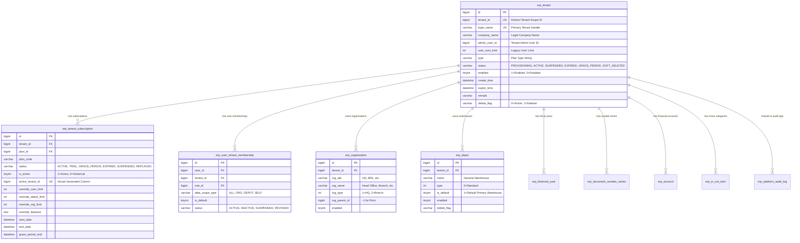

# Phase 6 & 7 Research — Database & Domain Model

## 1. Entity-Relationship Diagram



---

## 2. Proposed Database Schema DDL Changes

```sql
-- 1. Add status, company_name, admin_user_id columns to erp_tenant
ALTER TABLE `erp_tenant` 
    ADD COLUMN IF NOT EXISTS `company_name` VARCHAR(128) NULL COMMENT 'Legal Enterprise / Company Name' AFTER `login_name`,
    ADD COLUMN IF NOT EXISTS `admin_user_id` BIGINT(20) NULL COMMENT 'Primary Administrator User ID' AFTER `company_name`,
    ADD COLUMN IF NOT EXISTS `status` VARCHAR(32) NOT NULL DEFAULT 'ACTIVE' COMMENT 'Lifecycle State: PROVISIONING, ACTIVE, SUSPENDED, EXPIRED, GRACE_PERIOD, SOFT_DELETED' AFTER `type`;

-- 2. Add index for fast status queries
ALTER TABLE `erp_tenant` 
    ADD INDEX IF NOT EXISTS `idx_tenant_status` (`status`, `delete_flag`);
```

---

## 3. Java Data Transfer Objects (DTOs)

### 1. `TenantProvisioningDto.java`
```java
public class TenantProvisioningDto {
    private String loginName;          // Required: e.g. "acme_corp"
    private String companyName;        // Required: e.g. "Acme Technologies Pvt Ltd"
    private String adminFullName;      // Optional: e.g. "John Doe"
    private String adminEmail;         // Optional: e.g. "admin@acme.com"
    private String adminPhone;         // Optional: e.g. "9876543210"
    private String password;           // Optional: default "123456"
    private Long planId;               // Required: Subscription Plan ID
    private Integer durationDays;      // Optional: default 30 (Trial) or 365 (Annual)
    private String initialDepotName;   // Optional: default "General Warehouse"
    private String initialOrgName;     // Optional: default "Head Office"
    private String remark;             // Optional description
}
```

### 2. `TenantProvisioningResultDto.java`
```java
public class TenantProvisioningResultDto {
    private Long tenantId;
    private Long adminUserId;
    private String loginName;
    private String companyName;
    private String planCode;
    private String status;
    private Long rootOrgId;
    private Long defaultDepotId;
    private Long activeFinancialYearId;
    private Integer documentSeriesCount;
    private List<Long> defaultAccountIds;
    private Date expireTime;
    private String message;
}
```

### 3. `TenantLifecycleActionDto.java`
```java
public class TenantLifecycleActionDto {
    private Long tenantId;
    private String action;             // "SUSPEND", "REACTIVATE", "RENEW", "DELETE"
    private String reason;             // Required: Justification for audit log
    private Integer extendDays;        // Optional for RENEW action
    private Long newPlanId;            // Optional for plan change during renewal
}
```
