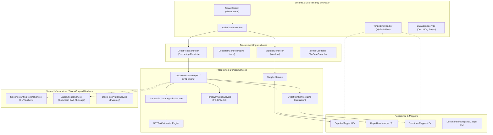

# 01 - Procurement Graph Subgraph & Dependency Map

**Extraction Base**: Certified Graphify Backend Baseline (`graphify-out/graph.json`)  
**Commit SHA**: `5d546ab15cc0047442e33d0533131e38d65a7253`  
**Research Date**: 2026-08-21  

---

## 1. Graphify Procurement Subgraph Summary

The Graphify backend knowledge graph identified **72 primary source files** and **2,619 constituent nodes/edges** directly participating in or interfacing with Procurement / Purchasing functions:

```text
========================================================================================
                          PROCUREMENT GRAPH INVENTORY
========================================================================================
  REST Controllers       : 6  (DepotHeadController, DepotItemController, InOutItemController,
                               SupplierController, TaxRateController, TaxRuleController)
  Domain Services        : 14 (SupplierService, DepotHeadService, DepotItemService, 
                               ThreeWayMatchService, InOutItemService, TaxRateService,
                               TaxRuleService, PartyTaxProfileService, ProductTaxProfileService,
                               TransactionTaxIntegrationService, GSTTaxCalculationEngine,
                               DocumentTaxSnapshotService, GSTTaxValidationService, Phase1TaxValidationStub)
  MyBatis Mappers        : 12 (SupplierMapper, SupplierMapperEx, DepotHeadMapper, 
                               DepotHeadMapperEx, DepotItemMapper, DepotItemMapperEx,
                               InOutItemMapper, InOutItemMapperEx, TaxRateMapperEx,
                               TaxRuleMapperEx, DocumentTaxSnapshotMapperEx, DocumentItemTaxSnapshotMapperEx)
  Data Entities & DTOs   : 26 (Supplier, DepotHead, DepotItem, ThreeWayMatchHeader, 
                               ThreeWayMatchItem, InOutItem, TaxRate, TaxRule, 
                               DocumentTaxSnapshot, DocumentItemTaxSnapshot, + 16 DTOs/VOs)
  Automated Test Suites  : 5  (DepotHeadControllerPostingStatusTest, EffectiveDatedTaxRuleTest,
                               GSTTaxCalculationEngineEnterpriseTest, GSTTaxCalculationEngineTest,
                               PartyTaxProfileAndTransactionIntegrationEnterpriseTest)
========================================================================================
```

---

## 2. Graph Dependency Topology



---

## 3. Cross-Module Dependencies & Shared Boundaries

| Upstream Dependency | Procurement Usage Point | Shared With Sales? | Security & Tenant Isolation Boundary |
|---|---|:---:|---|
| **`Supplier` / Vendor Master** | PO Vendor, Bill Vendor, GSTIN profile | Shared (`erp_supplier.type = '厂商'`) | Parameterized `tenant_id` + `TenantLineHandler` |
| **`Material` / Item Master** | PO line items, HSN code, purchase cost | Yes | Filtered by `tenant_id` & `enabled = 1` |
| **`Depot` / Warehouse** | Goods Receipt destination depot | Yes | Scoped via `DataScopeService` (Depot permission mask) |
| **`TaxRule` / GST Engine** | Input GST, RCM determination, ITC profile | Yes | Tenant GSTIN vs Vendor GSTIN Place of Supply |
| **`SalesAccountingPostingService`** | GRNI accruals, AP vouchers, Expense GL | Yes | Authoritative `erp_gl_journal_entry` double-entry posting |
| **`DocumentRelationshipService`** | PO $\rightarrow$ GRN $\rightarrow$ Purchase Invoice DAG | Yes | Directional DAG in `erp_document_relationship` |
