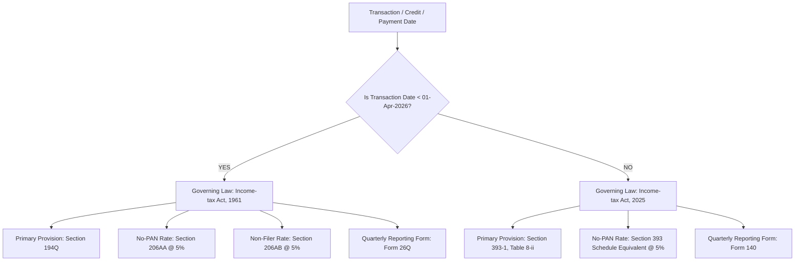
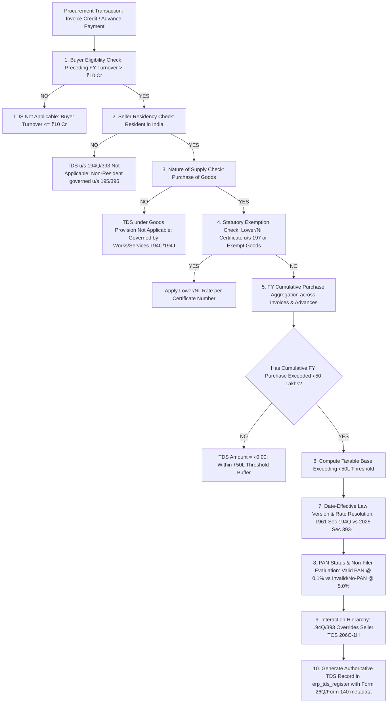

# 03 - Procurement Phase P6: Indian Income Tax TDS Law Versioning & Statutory Verification

**Document Ref**: `PROC-P6-VERIF-03-REV2`  
**Evaluation Date**: August 2026  
**Status**: **STATUTORY DESIGN WITH DATE-EFFECTIVE LAW VERSIONING & REPORTING FORMS**  

---

## 1. Dual-Track Income Tax Legislative Baseline

The ERP engine models date-effective income tax statutory law versioning based on the legally relevant transaction date (earlier of invoice credit or payment/advance disbursement):

### 1.1 Historical Audit & Dual Reference Matrix

| Attribute | Pre-01-Apr-2026 Regime | Post-01-Apr-2026 Regime | ERP Internal Representation |
| :--- | :--- | :--- | :--- |
| **Law Version** | `INCOME_TAX_ACT_1961` | `INCOME_TAX_ACT_2025` | Stored in `erp_tds_register.law_version` |
| **Primary Provision Reference** | `Section 194Q` | `Section 393(1), Table 8(ii)` | Stored in `erp_tds_register.provision_ref` |
| **No-PAN Rate Provision** | `Section 206AA` (5.0%) | `Section 397(2)` (5.0%) | Stored in `erp_tds_register.penalty_rate_ref` |
| **Non-Filer Special Rate** | `Section 206AB` (5.0%) | `Section 397(2)` (5.0%) | Stored in `erp_tds_register.penalty_rate_ref` |
| **Lower/Nil Certificate** | `Section 197` | `Section 395` | Stored in `erp_tds_register.lower_cert_section_ref` |
| **Statutory Reporting Return** | `Form 26Q` (Quarterly TDS) | `Form 140` (Quarterly TDS Return) | Stored in `erp_tds_register.reporting_form` |
| **Threshold in FY** | ₹50,00,000 (Resident Seller) | ₹50,00,000 (Resident Seller) | Evaluated on cumulative FY purchases |
| **Normal Statutory Rate** | **0.1%** on amount $> ₹50\text{L}$ | **0.1%** on amount $> ₹50\text{L}$ | Computed on net taxable value |

---

## 2. 10-Point Authoritative Backend TDS Determination Engine

The backend service `TdsDeterminationService` is the **sole authoritative source of truth**. Frontend components only receive calculated preview metadata and cannot override determination results.

### Detailed Evaluation Steps:
1. **Buyer Eligibility**: Checks whether company's gross turnover in immediately preceding FY exceeded ₹10 Crore.
2. **Seller Residency**: Verifies seller is an Indian tax resident.
3. **Purchase of Goods**: Verifies transaction represents goods procurement (services route to 194C/194J).
4. **Statutory Exemptions & Nil/Lower Certificates**: Checks for valid Section 197 / Section 397 certificates.
5. **FY Cumulative Threshold**: Aggregates all approved purchase invoices and unadjusted advances for the resident seller in the current Financial Year (1-Apr to 31-Mar).
6. **Taxable Base**:
   - On Invoice Credit: Excludes GST component if separately invoiced (CBDT Circular 13/2021).
   - On Advance Payment: Evaluated on gross advance disbursed.
7. **Date-Effective Law Version**: Resolves `INCOME_TAX_ACT_1961` (pre-01-Apr-2026) or `INCOME_TAX_ACT_2025` (post-01-Apr-2026).
8. **PAN & Non-Filer Status**:
   - Valid 10-digit PAN + Regular Filer $\rightarrow$ Rate = **0.1%**.
   - Invalid / Missing PAN (Section 206AA / 2025 Equivalent) $\rightarrow$ Rate = **5.0%**.
   - Specified Non-Filer (Section 206AB / 2025 Equivalent) $\rightarrow$ Rate = **5.0%**.
9. **TDS vs TCS Precedence**: Section 194Q / Section 393(1) takes statutory precedence over seller TCS (Section 206C(1H)). Seller is legally barred from charging TCS once buyer deducts TDS.
10. **TDS Register Output**: Emits structured record with `law_version`, `provision_ref`, `reporting_form` (`Form 26Q` or `Form 140`), `pan`, `tds_base`, `tds_rate`, and `tds_amount`.

---

## 3. Advance Payment Accounting Sequence & Double-Entry Proof

When an advance payment is disbursed to a supplier exceeding the cumulative ₹50L threshold:

### Step 1: Gross Advance Obligation & TDS Determination
- **Gross Agreed Advance**: ₹100,000.00
- **TDS u/s 194Q / 393(1) @ 0.1%**: ₹100.00
- **Net Bank Disbursement**: ₹99,900.00

### Step 2: Double-Entry Journal Entry
$$\text{Debit: 1105 Supplier Advances \& Prepayments} \quad [₹100,000.00]$$
$$\text{Credit: 1002 Bank / Cash Account} \quad [₹99,900.00]$$
$$\text{Credit: 2205 TDS Payable (194Q / 393)} \quad [₹100.00]$$

$$\sum \text{DEBIT} = ₹100,000.00 \quad=\quad \sum \text{CREDIT} = ₹99,900.00 + ₹100.00 = ₹100,000.00 \quad (\Delta = ₹0.00)$$

### Step 3: Subsequent Purchase Invoice Offset
When the invoice is posted (Taxable ₹100,000 + 18% GST = ₹118,000), the ₹100,000 advance is adjusted:
$$\text{Debit: 2101 Supplier Accounts Payable} \quad [₹100,000.00]$$
$$\text{Credit: 1105 Supplier Advances \& Prepayments} \quad [₹100,000.00]$$
$$\sum \text{DEBIT} = \sum \text{CREDIT} = ₹100,000.00 \quad (\Delta = ₹0.00)$$
*TDS Non-Duplication*: Since TDS was already deducted at the advance stage, the invoice clearing journal deducts TDS only on the balance unpaid portion (if any), preventing double-withholding.

---

## 4. Payment Settlement Mathematical Proof

When settling posted purchase invoices with cash discounts and payment-stage TDS:

$$\text{Gross AP Settled} = \text{Net Bank Remittance} + \text{TDS Withheld} + \text{Cash Discount Received}$$

### Mathematical Balance Proof:
$$\text{Debit: 2101 Accounts Payable (Creditors)} \quad [\text{Gross Invoiced AP}]$$
$$\text{Credit: 1002 Bank / Cash Account} \quad [\text{Net Cash Paid}]$$
$$\text{Credit: 2205 TDS Payable} \quad [\text{TDS Withheld}]$$
$$\text{Credit: 4205 Cash Discount Received} \quad [\text{Prompt Payment Rebate}]$$

$$\sum \text{DEBIT} = \text{Gross AP} \quad=\quad \sum \text{CREDIT} = \text{Bank} + \text{TDS} + \text{Discount} \quad (\text{Exact Zero Difference})$$
