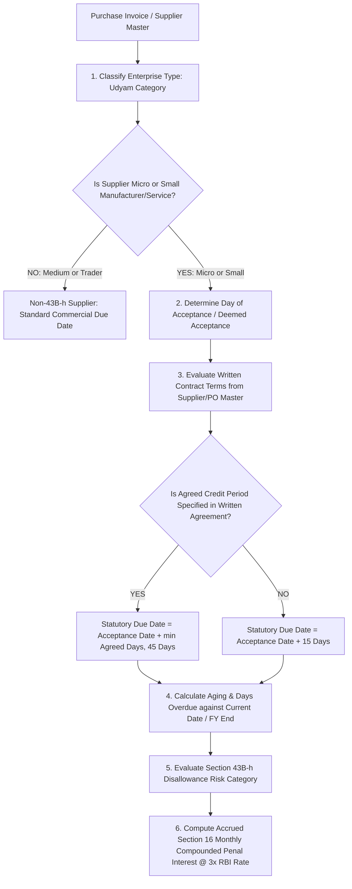

# 04 - Procurement Phase P6: MSME Act & Section 43B(h) Statutory Verification

**Document Ref**: `PROC-P6-VERIF-04-REV2`  
**Evaluation Date**: August 2026  
**Status**: **AUTHORITATIVE BACKEND ENGINE & STATUTORY COMPLIANCE**  

---

## 1. Statutory Context & Legal Provisions

### 1.1 Micro, Small and Medium Enterprises Development (MSMED) Act, 2006
- **Section 15**: Liability of buyer to make payment within statutory period:
  - **No Written Agreement**: Maximum **15 days** from the day of acceptance or deemed acceptance.
  - **Written Agreement**: Mutually agreed days, **strictly capped at 45 days** from acceptance.
- **Section 16**: Mandatory penal interest on delayed payment at **3 times the RBI Bank Rate**, compounded with monthly rests.
- **Section 22 & 23**: Mandatory statutory disclosure in Annual Financial Statements; penal interest is **strictly NOT allowable as deductible business expenditure** under the Income-tax Act.

### 1.2 Income-tax Act, 1961 — Section 43B(h)
- **Inserted by Finance Act, 2023** (Applicable from AY 2024-25 onwards).
- **Statutory Text**: Any sum payable by the assessee to a **Micro or Small enterprise** beyond the time limit specified in Section 15 of the MSMED Act, 2006 shall be allowed as a deduction **only in the previous financial year in which such sum is actually paid**.
- **Year-End Impact**: If an invoice from a Micro/Small supplier remains unpaid past the statutory due date at the end of the financial year (31st March), the entire taxable purchase expenditure is **disallowed and added back to taxable business profits** for that FY.

---

## 2. Authoritative Backend Determination via `MsmeComplianceService`

The backend service `MsmeComplianceService` is the **authoritative single source of truth** for all MSME compliance attributes. Frontend UI components strictly render backend calculations and cannot modify compliance determinations.

---

## 3. Supplier Classification & Exclusion Rules

| Category | Investment in Plant & Machinery | Annual Turnover | Section 43B(h) & MSMED Sec 15 Protection | Backend Classification |
| :--- | :--- | :--- | :--- | :--- |
| **Micro Enterprise** | $\le \text{₹1 Crore}$ | $\le \text{₹5 Crore}$ | **PROTECTED** | `MICRO` |
| **Small Enterprise** | $\le \text{₹10 Crore}$ | $\le \text{₹50 Crore}$ | **PROTECTED** | `SMALL` |
| **Medium Enterprise** | $\le \text{₹50 Crore}$ | $\le \text{₹250 Crore}$ | **EXCLUDED** (No 43B(h) protection) | `MEDIUM` |
| **Wholesale & Retail Traders** | Any (Udyam NIC 45, 46, 47) | Any | **EXCLUDED** (Per MSME Office Memo 02/07/2021 & 01/09/2021) | `TRADER` |
| **Non-MSME / Large** | $> \text{₹50 Cr}$ | $> \text{₹250 Cr}$ | **EXCLUDED** | `NON_MSME` |

---

## 4. Statutory Due Date Calculation Engine

$$\text{Day of Acceptance} = \begin{cases} 
\text{Date of Delivery}, & \text{if no objection raised within 15 days} \\
\text{Date Objection Removed}, & \text{if formal written objection raised (Deemed Acceptance)}
\end{cases}$$

$$\text{Statutory Due Date} = \begin{cases}
\text{Day of Acceptance} + \min(\text{Agreed Credit Days}, 45), & \text{if written agreement exists} \\
\text{Day of Acceptance} + 15, & \text{if no written agreement}
\end{cases}$$

---

## 5. Section 43B(h) Risk Categorization

The backend evaluates risk states for every open purchase invoice:

| Compliance Status Code | Condition | Income Tax Implication | UI Presentation Badge |
| :--- | :--- | :--- | :--- |
| `COMPLIANT_PAID` | Paid on or before statutory due date | 100% Tax Deductible in Current FY | **Green: Compliant Paid** |
| `WITHIN_LIMIT` | Unpaid, but current date $\le$ statutory due date | Active safe payment window | **Blue: Within Limit** |
| `OVERDUE_AT_RISK` | Unpaid, current date $>$ statutory due date, FY still open | Penal interest accruing; Must pay before 31st March | **Orange: Overdue (Risk)** |
| `DISALLOWED_43BH` | Unpaid past statutory due date as of 31st March | **Disallowed for current FY** (added to taxable income) | **Red: Disallowed 43B(h)** |

---

## 6. Section 16 Penal Interest Formula

$$\text{Compounded Monthly Interest} = P \times \left(1 + \frac{3 \times \text{RBI Bank Rate}}{12}\right)^m - P$$

Where:
- $P$ = Unpaid principal amount of the invoice.
- $\text{RBI Bank Rate}$ = Current Reserve Bank of India Bank Rate (e.g. 6.75% $\rightarrow 3 \times 6.75\% = 20.25\% \text{ p.a.}$).
- $m$ = Number of completed months of delay beyond the statutory due date.
- General Ledger Account: `5802 Inadmissible Penal Interest on MSME Delay` (`tax_deductible = FALSE`).
