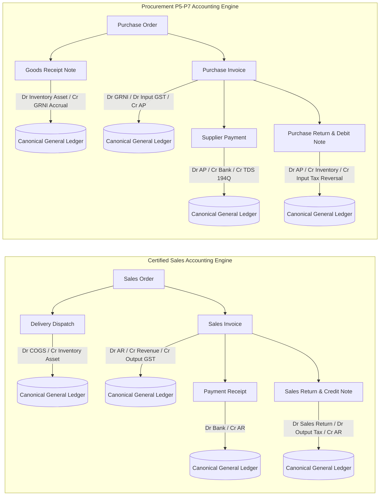

# 12 - Cross-Module Accounting Architecture Review & Shared Service Reuse

**Document Ref**: `PROC-P5-P7-ARCH-REVIEW-12`  
**Evaluation Date**: August 2026  
**Status**: **CANONICAL CORE ALIGNMENT & ANTI-PATTERN DEFENSE**  

---

## 1. Architectural Symmetry: Sales vs Procurement

To maintain a robust, single-source-of-truth ERP platform, Procurement Phases P5–P7 are architected as exact mirrors of the certified Sales Phases S4–S7:

---

## 2. Mandatory Shared Core Services & Reused Infrastructure

| Shared Engine Layer | Certified Implementation | Reused In Procurement P5–P7 | Prohibited Anti-Pattern |
| :--- | :--- | :--- | :--- |
| **General Ledger (GL)** | `erp_gl_journal_entry`, `erp_gl_journal_line` | P5 GRNI, P5 Landed Cost, P6 AP Payment, P7 Returns | **NO separate procurement GL tables** |
| **Inventory Valuation** | `erp_material_current_stock`, `purchase_decimal` (Moving Average) | P3 GRN inward, P5 Landed Cost Capitalization, P7 Return Outward | **NO separate procurement inventory engine** |
| **Financial Vouchers** | `erp_account_head` (type `收款`/`付款`), `erp_account_item` | P6 Supplier Payment & Multi-Invoice Settlement | **NO separate AP payment tables** |
| **Party Master Balances**| `erp_supplier` (`all_need_get`, `all_need_pay`) | P6 Supplier Open AP Decrement, P7 Debit Note Adjustment | **NO disconnected party ledger balances** |
| **Document Lineage DAG** | `DocumentRelationshipService`, `erp_document_relationship` | `PO` $\rightarrow$ `GRN` $\rightarrow$ `INVOICE` $\rightarrow$ `PAYMENT` $\rightarrow$ `RETURN` | **NO unlinked procurement transactions** |
| **Chart of Accounts** | Enterprise Unified COA | Shared Accounts: `1002`, `1101`, `1105`, `1301-1303`, `1401`, `2101`, `2105`, `2106`, `2205`, `5101`, `5105`, `5901` | **NO redundant or ad-hoc account codes** |

---

## 3. Transaction Boundary & Concurrency Guarantees

1. **Transactional Integrity (`@Transactional(rollbackFor = Exception.class)`)**:
   - Every posting operation (GRNI accrual, Landed Cost allocation, AP payment, Purchase Return) executes inside an atomic database transaction.
   - If GL journal insertion fails or unbalanced debit/credit occurs, stock updates and document status changes automatically roll back.
2. **Optimistic Locking & State Guards**:
   - Invoices and GRNs cannot be posted more than once (enforced by unique compound index on `[tenant_id, source_document_type, source_document_id]`).
   - Payment allocations cannot over-allocate open invoice balances (`allocAmt <= openBalance`).
