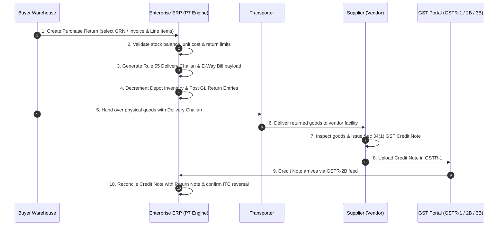

# 01 - Procurement Phase P7: Purchase Return & Supplier Adjustment Workflow

**Document Ref**: `PROC-P7-VERIF-01`  
**Evaluation Date**: August 2026  
**Status**: **READ-ONLY STATUTORY & WORKFLOW SPECIFICATION**  

---

## 1. Objective & Scope
This document specifies the end-to-end operational, physical, commercial, and financial workflows for Purchase Returns and Supplier Adjustments in the enterprise ERP. It establishes the complete lifecycle across physical goods returns, commercial/rate dispute settlements, and Reverse Charge Mechanism (RCM) self-credit adjustments.

---

## 2. Business Scenarios Analysis

### Scenario A: Physical Purchase Return
- **Trigger**: Defective goods, wrong specification, quality failure discovered post-receipt, or excess quantity received.
- **Preconditions**:
  1. Purchase Order (PO) exists and is `APPROVED`.
  2. Goods Receipt Note (GRN) exists in `POSTED` status with accepted stock deposited in a designated warehouse depot (`erp_material_current_stock`).
  3. Purchase Invoice may be `DRAFT`, `POSTED`, `PARTIALLY_PAID`, or `FULLY_PAID` (or not yet created).
- **Process Steps**:
  1. **Initiation**: Buyer initiates Purchase Return with reference to original GRN and/or Purchase Invoice.
  2. **Validation**: System validates that $\text{Return Qty} \le \text{Current On-Hand Depot Stock}$ and $\text{Cumulative Return Qty} \le \text{Accepted Qty}$.
  3. **Physical Transport Document**: System issues an Outward **Delivery Challan under Rule 55** of CGST Rules with unique FY serial number.
  4. **E-Way Bill**: If consignment value $> \text{₹50,000}$ (or applicable state threshold), E-Way Bill is generated with Sub-type `Return / Rejection`.
  5. **Physical Outward Dispatch**: Stock is decremented from the source depot in `erp_material_current_stock` via `erp_depot_head` (type `出库`, sub_type `采购退货`).
  6. **Financial Document**: System generates a **Commercial Purchase Return Note / Buyer Debit Note** to record AP adjustment in ERP.
  7. **Vendor Acceptance & Statutory Credit Note**: Vendor receives goods, accepts return, and issues a **Statutory GST Credit Note under Section 34(1)** of CGST Act.
  8. **Reconciliation & ITC Reversal**: Supplier Credit Note appears in GSTR-2B; ERP matches it against the Purchase Return Note and reverses Input Tax Credit (ITC) in GSTR-3B Table 4(B)(2).



---

### Scenario B: Commercial / Price Dispute (No Physical Goods Movement)
- **Trigger**: Invoiced unit rate exceeds agreed PO contract rate, retroactive vendor volume rebates/discounts, short delivery acknowledged commercially without physical return, or agreed quality allowance deduction.
- **Preconditions**:
  1. Purchase Invoice is in `POSTED` status.
  2. Inventory has already been consumed, processed, or remains in stock without return.
- **Process Steps**:
  1. **Initiation**: Buyer logs a Commercial Price Adjustment / Debit Request against the specific Purchase Invoice.
  2. **No Physical Movement**: Inventory quantities in warehouse remain unchanged.
  3. **Accounting Impact**: Reduces Supplier AP liability (`2101`) and credits Purchase Price Variance (`5105`) or Purchase Rebates / Discount Income (`4205`).
  4. **GST Treatment**:
     - If the price reduction includes a GST refund: Vendor must issue a statutory **Credit Note with Tax under Section 34(1)**, and Buyer reverses corresponding ITC.
     - If the vendor issues a financial/commercial credit note without tax adjustment (e.g. post-sale volume discount where Section 15(3)(b) conditions are not met): Only commercial AP is reduced; no ITC reversal occurs.

---

### Scenario C: Reverse Charge Mechanism (RCM) Specific Buyer Adjustment
- **Trigger**: Return or price adjustment on goods/services procured under Section 9(3) or Section 9(4) (unregistered vendor supplies, GTA, legal counsel).
- **Statutory Authority**: Section 31(3)(f) [Self-Invoice] & Section 31(3)(g) [Payment Voucher] & Rule 53.
- **Process Steps**:
  1. For RCM supplies, the buyer is the deemed taxpayer liable to pay GST to the government.
  2. When RCM goods are returned, the buyer generates an internal **Self-Credit Note / RCM Adjustment Voucher** under Section 31(3)(g).
  3. Reduces RCM Output Tax Liability in GSTR-3B Table 3.1(d) and reverses corresponding RCM ITC in GSTR-3B Table 4(B)(2).
  4. Reduces AP payable to the unregistered vendor for the base taxable amount.

---

## 3. Workflow State Transition Matrix

```
[INITIATED / DRAFT]
        │
        ├── Validate Stock & Lineage Limits
        │
        ▼
   [APPROVED]
        │
        ├── Generate Rule 55 Delivery Challan & E-Way Bill
        │
        ▼
   [DISPATCHED] ── (Inventory Asset decremented)
        │
        ├── Generate Commercial Debit Note / Accounting Entry
        │
        ▼
[SUPPLIER_CN_PENDING]
        │
        ├── Match against Supplier Credit Note in GSTR-2B
        │
        ▼
  [RECONCILED] ── (ITC Reversal Confirmed in GSTR-3B Table 4B2)
        │
        ▼
    [CLOSED]
```

---

## 4. Cancellation & Reversal Workflow
- **Pre-Dispatch Cancellation**: If a return is cancelled before goods leave warehouse (`DRAFT` or `APPROVED`), the return document is marked `CANCELLED`; no inventory or GL entry is posted.
- **Post-Dispatch Reversal**: If dispatched goods are rejected by vendor and returned back to buyer:
  1. A Return Inbound Reversal Receipt is created (`入库`, `采购退货红冲`).
  2. Inventory stock is restored at original unit valuation.
  3. AP liability and ITC accounts are restored to their pre-return state with clear historical audit log.
