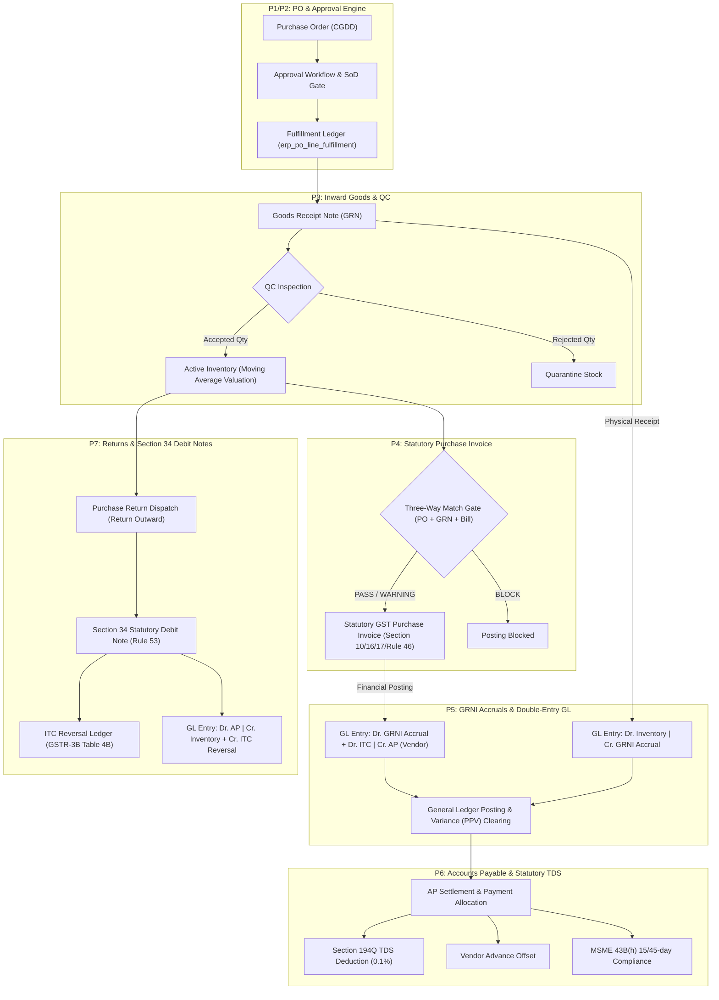

# Enterprise Procurement Phases P5, P6 & P7: Unified Architecture & Implementation Plan

**Module**: Enterprise Procure-to-Pay (P2P) Complete Accounting, Settlement & Returns  
**Version**: 2.0 (Unified Backend + Frontend + Statutory Compliance)  
**Standard References**:
- **Accounting**: AS-2 / Ind AS 2 (Inventories), Accrual Accounting (GRNI Suspense), Double-Entry General Ledger.
- **Taxation**: 
  - CGST / IGST Act 2017 (Sections 9, 10, 16, 17, 34, 170 & Rules 37, 46, 53).
  - Income Tax Act 1961 (Section 194Q TDS on Purchase of Goods, Section 206AB, Section 40(a)(ia)).
  - MSME Development Act 2006 (Section 43B(h) 15/45-day payment compliance).
- **ERP Reference Systems**: Metasfresh (Double-entry match & GRNI clearing), ERPNext (AP allocation & Debit Note reversal), Nexterp (Indian GST/TDS).

---

## Architecture Overview: End-to-End P2P Lifecycle

---

# Phase P5: Double-Entry General Ledger, GRNI Clearing & Landed Cost Engine

### 1. Statutory & Accounting Principles
- **Accrual Basis Accounting**: Receipt of goods incurs an immediate liability to unbilled suppliers (**GRNI — Goods Received Not Invoiced**).
- **Ind AS 2 Inventory Valuation**: Capitalizes purchase price, freight/transportation, non-recoverable duties (e.g. Section 17(5) Blocked GST), less trade discounts.
- **Purchase Price Variance (PPV)**: Automatically captures and posts differences between PO receipt valuation and finalized supplier invoice price to the P&L PPV clearing account.

### 2. Backend Implementation (`ERPSystem-boot`)
* **Core Service**: [`ProcurementAccountingPostingService.java`](file:///e:/Codes/ERP/jshERP-master/ERPSystem-boot/src/main/java/com/jsh/erp/service/ProcurementAccountingPostingService.java)
* **Landed Cost Service**: `LandedCostAllocationService.java`
* **Data Models**:
  - `erp_procurement_gl_mapping`: Dynamic mapping of inventory asset, GRNI accrual, input CGST/SGST/IGST, RCM liability, and PPV accounts per depot/category.
  - `erp_landed_cost_voucher` & `erp_landed_cost_item`: Freight/Customs/Insurance allocation vouchers.
* **Double-Entry Journal Postings**:
  1. **On Goods Receipt (GRN)**:
     - `Dr. 1301 Inventory / Raw Materials Asset` (Valuation Rate $\times$ Accepted Qty)
     - `Cr. 2105 GRNI Suspense / Accrued Receipt Liability`
  2. **On Purchase Invoice Posting**:
     - `Dr. 2105 GRNI Suspense / Accrued Receipt Liability` (Reverses GRN accrual)
     - `Dr. 1151 Input CGST Recoverable` (if ITC eligible)
     - `Dr. 1152 Input SGST Recoverable` (if ITC eligible)
     - `Dr. 1153 Input IGST Recoverable` (if ITC eligible)
     - `Dr./Cr. 5104 Purchase Price Variance (PPV)` (Invoice Price $-$ GRN Valuation)
     - `Cr. 2101 Accounts Payable (Trade Creditors)` (Full Invoice Gross Amount)
  3. **On Section 9(3) Reverse Charge Mechanism (RCM)**:
     - `Dr. 1154 Input GST Under RCM (Asset)`
     - `Cr. 2154 Output GST Under RCM (Self-Liability)`

### 3. Frontend Retrofit (`ERPSystem-web-react`)
* **Pages & Components**:
  - `GrniReconciliationDashboard.tsx`: Interactive reconciliation dashboard showing:
    - Open uninvoiced receipts aging (0-15, 16-30, 31-60, 60+ days).
    - Unbilled accrual liability balance vs general ledger balance.
    - One-click trigger to generate invoice draft from unbilled GRNs.
  - `LandedCostVoucherPage.tsx` & `LandedCostFormModal.tsx`:
    - Select multiple GRNs and distribute extra logistics charges (Freight, Customs Duty, Insurance) across line items by **Value**, **Quantity**, or **Weight**.
    - Live preview of unit cost adjustments and recalculation of moving average stock valuation.
  - `GeneralLedgerDrilldownModal.tsx`:
    - Double-entry accounting tab embedded in PO, GRN, and Invoice detail views showing balanced debits and credits with GL account codes and transaction lineage.

### 4. Dedicated Test Suite
* `ProcurementP5_GrniAndAccountingPostingSecurityTest.java` (Backend)
* `ProcurementP5FrontendAccountingWorkflow.test.ts` (Frontend)

---

# Phase P6: Accounts Payable, Payment Allocation, Advances & Statutory TDS

### 1. Statutory & Regulatory Principles
- **Section 194Q Income Tax Act**: Deducts 0.1% TDS on aggregate purchase value exceeding ₹50,000,000 in a financial year from Indian resident suppliers (5% if PAN is not furnished under Section 206AA / 206AB).
- **Section 43B(h) MSME Act Compliance**: Payments to registered Micro and Small enterprises must be settled within **15 days** (or **45 days** if written agreement exists); otherwise, tax deduction is disallowed and penal interest applies.
- **Advance Payment Offsets**: Automatic FIFO or explicit allocation of vendor advances against finalized purchase bills.

### 2. Backend Implementation (`ERPSystem-boot`)
* **Core Service**: [`VendorPaymentAllocationService.java`](file:///e:/Codes/ERP/jshERP-master/ERPSystem-boot/src/main/java/com/jsh/erp/service/VendorPaymentAllocationService.java)
* **TDS Engine**: `StatutoryTdsWithholdingService.java`
* **Data Models**:
  - `erp_vendor_payment_header`: Payment voucher, bank account, payment mode (NEFT/RTGS/Cheque), transaction reference.
  - `erp_vendor_payment_allocation`: Line-level allocation against `erp_purchase_invoice` (settled principal, cash discount, TDS deducted).
  - `erp_vendor_advance`: Advance payments linked to Purchase Orders.
  - `erp_vendor_tds_ledger`: Section 194Q TDS accumulation tracker per supplier PAN per financial year.
* **Double-Entry Journal Postings**:
  - `Dr. 2101 Accounts Payable (Trade Creditors)` (Full Allocated Bill Amount)
  - `Cr. 1002 Bank / Cash Account` (Net Amount Paid)
  - `Cr. 2161 TDS Payable Under Section 194Q` (0.1% TDS deducted)
  - `Cr. 5201 Early Settlement Cash Discount Received` (Discount earned)

### 3. Frontend Retrofit (`ERPSystem-web-react`)
* **Pages & Components**:
  - `VendorPaymentAllocationPage.tsx`:
    - Supplier selection auto-loads outstanding invoices sorted by due date.
    - Quick settlement buttons: **"Auto-Allocate FIFO"**, **"Clear Oldest Bills"**.
    - Real-time TDS u/s 194Q calculation card displaying YTD threshold turnover and deducted tax.
    - Advance offset selector linking unconsumed advances.
  - `ApAgingScheduleReportPage.tsx`:
    - Comprehensive aging grid with buckets (Current, 1-30, 31-60, 61-90, 90+ days).
    - **MSME 43B(h) Compliance Badges**: Color-coded urgency alerts for Micro/Small enterprises approaching statutory 15/45-day cutoffs.
  - `VendorAdvancePaymentModal.tsx`:
    - Form to record advance payments directly against an approved Purchase Order.

### 4. Dedicated Test Suite
* `ProcurementP6_AccountsPayableAndTdsSecurityTest.java` (Backend)
* `ProcurementP6FrontendApPaymentWorkflow.test.ts` (Frontend)

---

# Phase P7: Purchase Returns, Section 34 Debit Notes & Statutory ITC Reversal

### 1. Statutory & Regulatory Principles
- **Section 34(1) CGST Act 2017**: Mandates issuance of Debit Notes by recipient buyers for goods returned or downward price adjustments.
- **Rule 53 CGST Rules**: Mandatory reference to original tax invoice number, date, HSN, original tax rate, and tax adjustment breakdown.
- **Section 16(2) Proviso & GSTR-3B Table 4(B)**: Automatic computation and posting of **Input Tax Credit (ITC) Reversal** corresponding to returned merchandise.

### 2. Backend Implementation (`ERPSystem-boot`)
* **Core Service**: [`PurchaseReturnService.java`](file:///e:/Codes/ERP/jshERP-master/ERPSystem-boot/src/main/java/com/jsh/erp/service/PurchaseReturnService.java)
* **Debit Note Service**: `StatutoryDebitNoteService.java`
* **Data Models**:
  - `erp_purchase_return_header` & `erp_purchase_return_item`: Return dispatch order linked to original GRN and PO.
  - `erp_purchase_debit_note` & `erp_purchase_debit_note_item`: Section 34 compliant statutory debit note.
  - `erp_itc_reversal_ledger`: GSTR-3B Table 4(B) compliance ledger.
* **Double-Entry Journal Postings**:
  - `Dr. 2101 Accounts Payable (Trade Creditors)` (Gross Return Amount)
  - `Cr. 1301 Inventory / Material Asset` (Moving Average Valuation Cost)
  - `Cr. 1151 Input CGST Recoverable (ITC Reversal)`
  - `Cr. 1152 Input SGST Recoverable (ITC Reversal)`
  - `Cr. 1153 Input IGST Recoverable (ITC Reversal)`
  - `Dr./Cr. 5105 Return Price Variance` (if return credit differs from inventory cost)

### 3. Frontend Retrofit (`ERPSystem-web-react`)
* **Pages & Components**:
  - `PurchaseReturnListPage.tsx`: Manage return dispatch orders and tracking statuses (Draft, Dispatched, Credit Acknowledged).
  - `PurchaseReturnCreateModal.tsx`:
    - Lookup historical GRN / Invoice items.
    - Input return quantity (validated against accepted inventory balance) with return reason codes (Defective, Damaged, Expired, Spec Mismatch).
  - `GstRule53DebitNotePrint.tsx`:
    - Official government-compliant Rule 53 Debit Note printable layout with QR code, original invoice linkage, GSTIN details, and tax reversal breakdown.
  - `ItcReversalReportPage.tsx`:
    - Audit report showing all statutory ITC reversals ready for GSTR-3B Table 4(B) reporting.

### 4. Dedicated Test Suite
* `ProcurementP7_PurchaseReturnsAndDebitNoteSecurityTest.java` (Backend)
* `ProcurementP7FrontendReturnsWorkflow.test.ts` (Frontend)

---

# Verification & Phased Execution Roadmap

| Phase | Core Objective | Backend Deliverable | Frontend Deliverable | Statutory / Accounting Anchor | Verification Suite |
|:---|:---|:---|:---|:---|:---|
| **P3 (Frontend)** | Inward Receipts, QC & 3-Way Match | Controller Endpoints | `GoodsReceiptListPage.tsx`, `ThreeWayMatchViewerModal.tsx` | Moving Average & Tolerance Gates | `ProcurementP3FrontendWorkflow.test.ts` |
| **P4 (Frontend)** | Statutory Indian GST Purchase Bills | Controller Endpoints | `PurchaseInvoiceListPage.tsx`, `GstPurchaseInvoiceFormModal.tsx` | Section 10/16/17 GST & Rule 46 | `ProcurementP4FrontendGSTSecurity.test.ts` |
| **P5 (Full)** | GRNI Accruals & Double-Entry GL | `ProcurementAccountingPostingService` | `GrniReconciliationDashboard.tsx`, `LandedCostVoucherPage.tsx` | Ind AS 2 / GRNI Accrual Accounting | `ProcurementP5_GrniAndAccountingPostingSecurityTest` |
| **P6 (Full)** | Accounts Payable & Statutory TDS | `VendorPaymentAllocationService` | `VendorPaymentAllocationPage.tsx`, `ApAgingScheduleReportPage.tsx` | Section 194Q TDS & MSME 43B(h) | `ProcurementP6_AccountsPayableAndTdsSecurityTest` |
| **P7 (Full)** | Purchase Returns & Section 34 Debit Notes | `PurchaseReturnService` | `PurchaseReturnListPage.tsx`, `GstRule53DebitNotePrint.tsx` | Section 34 CGST Act & GSTR-3B Table 4(B) | `ProcurementP7_PurchaseReturnsAndDebitNoteSecurityTest` |
