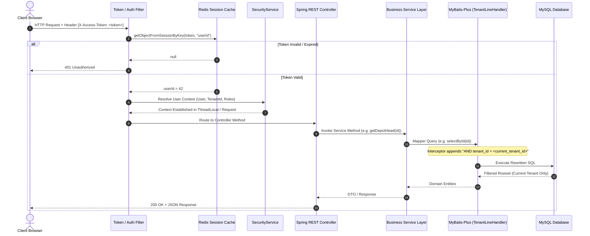

# Access Control & Request Pipeline Security Analysis

## Executive Summary
This document provides an in-depth security analysis of the access control model, authentication mechanism, role-based access control (RBAC), and request lifecycle in our ERP system. It traces an API request from client dispatch to database execution, analyzes multi-layer isolation guarantees, identifies vulnerability vectors, and compares our security architecture against **metasfresh** and **ERPNext**.

---

## 1. End-to-End Request Pipeline Trace



---

## 2. Step-by-Step Security Pipeline Breakdown

### Step 1: Authentication & Token Validation
* **Mechanism**: Bearer token passed via HTTP header `X-Access-Token`.
* **Storage**: Tokens are stored in Redis (`redisService.storageObjectBySession(token, "userId", user.getId())`).
* **Multi-Tenant Token Format**: `UUID_tenantId` (e.g. `c9a12b4e..._149`), providing quick visual identification while storing authoritative user session mappings in Redis.

### Step 2: User Identity & Tenant Resolution
* **Resolution**: The authenticated user is extracted from Redis by `userId`.
* **Tenant Derivation**: Derived directly from `user.getTenantId()`.
* **Zero-Trust Rule**: The backend **never** trusts client-provided `tenantId` in request query parameters or JSON bodies. The active `tenantId` is strictly extracted from the server-validated user session (`SecurityService.getCurrentTenantId()`).

### Step 3: Role & Permission Resolution
* **Legacy Role Binding**: Stored in `jsh_user_business` with `type = 'UserRole'` and `keyId = userId`.
* **Standardized Enterprise Permissions**: Evaluated using [`PermissionRegistry.java`](file:///e:/Codes/ERP/jshERP-master/ERPSystem-boot/src/main/java/com/jsh/erp/security/PermissionRegistry.java) which maps UI function endpoints to fine-grained permission tokens (e.g. `SALES_ORDER_VIEW`, `SALES_ORDER_CREATE`, `FINANCE_PAYMENT_POST`).
* **Authority Domains**: Gated by `SecurityService.getUserEffectiveAuthorization()`:
  * `PLATFORM`: Platform Super Admin (`tenantId == 0/1`, `isSuperAdmin = true`).
  * `SUPPORT_OPERATIONS`: System Support Specialists (`isSystemSupport = true`).
  * `TENANT`: Customer Tenant Administrators and Standard Business Users.
  * `SUPPORT_SESSION`: Temporary, consent-based diagnostic access.

### Step 4: Database Query & Tenant Isolation
* **Interceptor**: `TenantLineInnerInterceptor` in `TenantConfig.java`.
* **Execution**: MyBatis-Plus uses JSqlParser to rewrite the AST of all SQL queries, appending `WHERE tenant_id = ?` (or `AND tenant_id = ?`) before sending queries to MySQL.

---

## 3. Layered Isolation Enforcement Analysis

| Architectural Layer | Isolation Enforcement Level | Implementation & Effectiveness |
| :--- | :--- | :--- |
| **1. API / Gateway Layer** | **High** | Token validation filter rejects unauthenticated calls; endpoints gate platform and specialist routes using `SecurityService` checks. |
| **2. Controller Layer** | **Moderate** | Request parameters sanitization; rejects manual `tenantId` spoofing. |
| **3. Service Layer** | **High** | Services verify object ownership and business rules before mutating records. |
| **4. Persistence / ORM Layer** | **Very High** | MyBatis-Plus automatic AST query rewriting ensures `tenant_id` predicate injection on all non-whitelisted tables. |
| **5. Database Layer** | **Shared** | Single MySQL database and schema; relies on application-tier SQL filtering (no DB-level Row Level Security / RLS policies). |

---

## 4. Threat Modeling & Cross-Tenant Leakage Analysis

### Threat Scenario: Can Tenant A Access Tenant B Data?

```text
[Tenant A User: tenantId = 149]
         │
         ▼
Sends GET /depotHead/getDetailByNumber?number=PO-999
(PO-999 belongs to Tenant B: tenantId = 150)
         │
         ▼
[MyBatis-Plus Tenant Interceptor Rewrites Query]:
SELECT * FROM jsh_depot_head WHERE number = 'PO-999' AND tenant_id = 149
         │
         ▼
[Database Result]: 0 Rows Found
         │
         ▼
[Outcome]: Access Safely Blocked (Tenant A receives 404 / empty result)
```

### Potential Vulnerability Vectors & Mitigation:
1. **Raw Native SQL / Custom Mapper Bypasses**:
   - *Risk*: If a developer writes a custom mapper with raw native SQL annotations (e.g. `@Select("SELECT * FROM jsh_depot_head WHERE id = #{id}")`) that does not go through the standard MyBatis-Plus parser or explicitly disables the interceptor, cross-tenant data can leak.
   - *Mitigation*: All XML and mapper queries must be covered by automated security unit tests verifying that `tenant_id` filtering is strictly enforced.
2. **Whitelisted / Ignored Tables**:
   - *Risk*: If a business table is erroneously added to `TenantConfig.ignoreTable(...)`, multi-tenant filtering will be disabled for that table.
   - *Mitigation*: Maintain strict whitelist auditing; only reference tables (HSN, State Codes) and system configuration tables may be ignored.

---

## 5. Architectural Comparison: Our ERP vs. Reference Systems

| Dimension | Our Current ERP | metasfresh | ERPNext / Frappe |
| :--- | :--- | :--- | :--- |
| **Authentication** | Token-based via Redis session (`X-Access-Token`). | Token / Session-based with `AD_Session`. | Session Cookie / Token (`Authorization: token api_key:api_secret`). |
| **Context Resolution** | Server-side resolution via `SecurityService` / ThreadLocal. | Context resolution via `Env.getCtx()`. | Request context in `frappe.local.session.user`. |
| **RBAC Granularity** | Role $\rightarrow$ Function URL + fine-grained permission codes (`PermissionRegistry`). | Role $\rightarrow$ Window/Process/Field access (`AD_Window_Access`, `AD_Field_Access`). | Role $\rightarrow$ DocType permission (`DocPerm`) with level 0/1 read/write/submit/cancel. |
| **Data Scoping** | Global per tenant; enhanced via `UserTenantMembership` data scopes. | Organizational scoping (`AD_User_OrgAccess`) with multi-org tree inheritance. | Document permissions with `User Permission` filtering by Company, Cost Center, Warehouse. |

---

## 6. Structured Recommendation

#### 1. What We Have
A centralized `SecurityService` and MyBatis-Plus `TenantLineHandler` interceptor that rewrites SQL queries to ensure `tenant_id` isolation, combined with `PermissionRegistry` for mapping function endpoints to fine-grained permission codes.

#### 2. What Reference Systems Do
- **metasfresh**: Enforces two-dimensional access control: (1) Role-based functional permissions, and (2) Organizational data-access filtering (`AD_User_OrgAccess`), allowing users to work across multiple branches while restricting unauthorized sub-units.
- **ERPNext**: Combines DocType permissions with `User Permissions` (e.g., User X can only view documents where `Warehouse == 'South Depot'`).

#### 3. What is Missing
Our ERP currently has coarse-grained tenant-level isolation, but lacked fine-grained multi-branch and multi-depot data scoping natively enforced across all service queries until the recent `UserTenantMembership.dataScopeType` introduction.

#### 4. What Should Change
Ensure `SecurityService` and MyBatis interceptors systematically apply `UserTenantMembership` data scopes (`ORG`, `DEPOT`, `SELF`) across all transactional queries (Sales, Purchase, Inventory, Finance).

#### 5. Why
Enables enterprise customers with multiple branches and regional warehouses to restrict sales reps and warehouse staff to their assigned operating locations while allowing executives company-wide visibility.

#### 6. How It Should Work
1. When a user authenticates, `SecurityService` extracts their active `dataScopeType` and `dataScopeValues`.
2. For `DEPOT` scope, queries automatically append `AND depot_id IN (...)`.
3. For `ORG` scope, queries automatically append `AND org_id IN (...)`.
4. Platform Super Admins and Support Specialists remain governed by zero-trust session boundaries.
