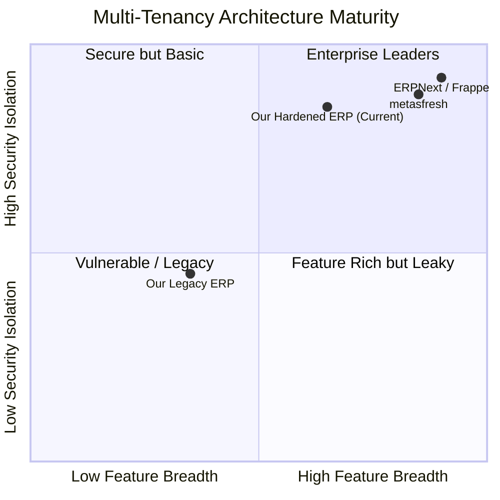

# Multi-Tenancy & Access Governance Gap Analysis

## Executive Summary
This document identifies, analyzes, and prioritizes architectural, functional, and security gaps in our current multi-tenancy, RBAC, provisioning, and administration implementation. All identified gaps are classified into **Critical**, **High**, **Medium**, and **Low** severity tiers to guide target architecture design.

---

## 1. Severity Classification Matrix

```text
┌─────────────────────────────────────────────────────────────┐
│                   GAP SEVERITY BREAKDOWN                    │
│                                                             │
│  🔴 CRITICAL : Security, tenant isolation, privilege leakage│
│  🟠 HIGH     : Major missing core functionality or seed gap │
│  🟡 MEDIUM   : Usability, administrative friction & tooling │
│  🔵 LOW      : Minor future polish & aesthetic enhancements │
└─────────────────────────────────────────────────────────────┘
```

---

## 2. Detailed Gap Inventory

### 🔴 Critical Priority (Security & Data Isolation)

| Gap ID | Area | Current State | Risk & Impact | Required Resolution |
| :--- | :--- | :--- | :--- | :--- |
| **GAP-SEC-01** | **Mapper Interceptor Coverage** | MyBatis-Plus interceptor rewrites standard queries, but un-tested custom XML queries could bypass `tenant_id` if not carefully mapped. | Cross-tenant data leakage if an un-scoped query executes. | Mandatory security integration tests verifying 100% of mappers inject `tenant_id`. |
| **GAP-SEC-02** | **Super Admin Identification** | Legacy code in some services checked `loginName.equals("admin")` or `loginName.equals("jsh")` directly. | Inconsistent authority resolution and risk of privilege escalation. | Centralize 100% of Super Admin checks through `SecurityService.isSuperAdmin()`. |
| **GAP-SEC-03** | **Zero-Trust Request Context** | Several legacy controller methods accepted `tenantId` in request bodies. | Tenant spoofing vulnerability if client overrides server context. | Strictly ignore client-supplied `tenantId`; enforce derivation from `SecurityService.getCurrentTenantId()`. |

---

### 🟠 High Priority (Major Missing Core Capabilities)

| Gap ID | Area | Current State | Risk & Impact | Required Resolution |
| :--- | :--- | :--- | :--- | :--- |
| **GAP-FEAT-01** | **Automated Tenant Seed Pipeline** | Tenant creation only inserts `jsh_tenant` and `jsh_user`, leaving accounting, depots, and series blank. | Requires 30+ minutes of manual master setup per new tenant. | Implement automated `TenantBootstrapService` seeding Chart of Accounts, default depot, FY, and numbering series. |
| **GAP-FEAT-02** | **Multi-Branch Data Scoping** | Coarse-grained tenant-wide isolation without mandatory branch/depot filtering. | Warehouse or retail branch users see company-wide transactions. | Enforce `UserTenantMembership.dataScopeType` (`DEPOT`, `ORG`, `SELF`) across transactional service queries. |
| **GAP-FEAT-03** | **Real-Time Support Notification** | Support session approval previously relied on periodic interval polling. | High polling overhead and 15–30s latency for consent approvals. | Implement authenticated Server-Sent Events (SSE) for instant support notifications (Phase 6). |
| **GAP-FEAT-04** | **Referential Integrity for Roles** | User-to-role mappings stored as serialized JSON strings in `jsh_user_business`. | Brittle parsing, impossible to perform relational joins or cascade deletes. | Formalize relational foreign keys in `erp_user_tenant_membership`. |

---

### 🟡 Medium Priority (Administration & Usability)

| Gap ID | Area | Current State | Risk & Impact | Required Resolution |
| :--- | :--- | :--- | :--- | :--- |
| **GAP-ADM-01** | **Tiered Subscription Packaging** | `userNumLimit` and `expireTime` configured manually per tenant without plan templates. | Manual overhead and billing inconsistency across tenants. | Introduce `SubscriptionTier` entity (Basic, Professional, Enterprise) with pre-bundled quotas and feature flags. |
| **GAP-ADM-02** | **Role-Based Widget Visibility** | Home dashboard renders identical KPI cards for all users regardless of functional role. | Warehouse workers see company-wide sales and profit figures. | Implement `hasPermission` gates on individual dashboard metric cards. |
| **GAP-ADM-03** | **Self-Service Password Reset** | Forgotten passwords require Super Admin intervention. | High support ticket volume for trivial password resets. | Implement secure email-based self-service password reset token flow. |

---

### 🔵 Low Priority (Future Enhancements)

| Gap ID | Area | Current State | Risk & Impact | Required Resolution |
| :--- | :--- | :--- | :--- | :--- |
| **GAP-ENH-01** | **Tenant-Level Custom Branding** | All tenants share the platform's default logo and theme color scheme. | Limited white-labeling capability for enterprise customers. | Add tenant-specific logo URL and primary color overrides in `jsh_system_config`. |
| **GAP-ENH-02** | **Single Sign-On (SSO / SAML)** | Authentication limited to username/password, phone, and WeChat OAuth. | Enterprise customers cannot use Okta, Azure AD, or Google Workspace. | Implement OAuth2 / OIDC / SAML2 tenant identity federation. |

---

## 3. Comparative Summary vs. metasfresh & ERPNext


