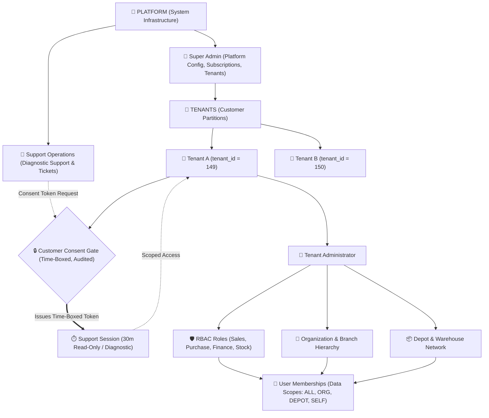
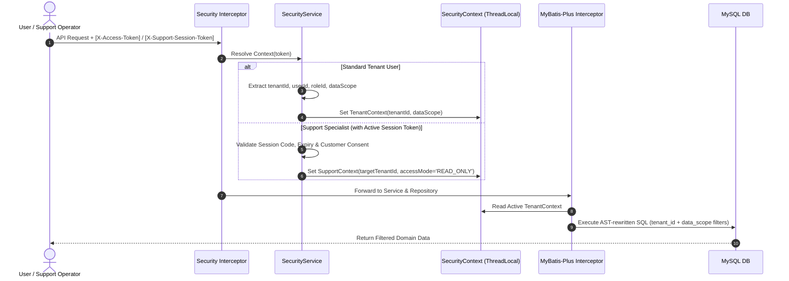

# Target Access Control & Multi-Tenant Security Architecture

## Executive Summary
This document defines the target enterprise access control and multi-tenancy architecture designed specifically to fit our ERP's existing Spring Boot (`ERPSystem-boot`) and React (`ERPSystem-web-react`) foundation. It formalizes four orthogonal authority domains, multi-tiered organizational and warehouse data scoping, unified relational memberships, and a zero-trust request processing pipeline.

---

## 1. Target Authority Hierarchy Model



---

## 2. The Four Orthogonal Authority Domains

```text
┌─────────────────────────────────────────────────────────────────────────┐
│                    FOUR ORTHOGONAL AUTHORITY DOMAINS                    │
├──────────────────────────┬──────────────────────────────────────────────┤
│ 1. PLATFORM              │ Governs system-wide infrastructure, tenant   │
│    (Super Admin)         │ provisioning, quota caps, and global dictionaries.│
├──────────────────────────┼──────────────────────────────────────────────┤
│ 2. SUPPORT_OPERATIONS    │ Governs platform technical support engineers,│
│    (Support Specialist)  │ ticket triage, and diagnostic pipelines.     │
├──────────────────────────┼──────────────────────────────────────────────┤
│ 3. TENANT                │ Governs customer commercial business data,   │
│    (Customer Org & Staff)│ branch setups, sales/purchase/GST ledgers.   │
├──────────────────────────┼──────────────────────────────────────────────┤
│ 4. SUPPORT_SESSION       │ Temporary, consent-gated diagnostic access   │
│    (Time-Boxed Operator) │ into a specific customer tenant partition.   │
└──────────────────────────┴──────────────────────────────────────────────┘
```

---

## 3. Relational Membership & Data Scoping Model

The target model unifies user identity with tenant access using the relational entity [`UserTenantMembership.java`](file:///e:/Codes/ERP/jshERP-master/ERPSystem-boot/src/main/java/com/jsh/erp/datasource/entities/UserTenantMembership.java):

```text
┌─────────────────────────┐         ┌─────────────────────────────────────┐
│       jsh_user          │         │    erp_user_tenant_membership       │
├─────────────────────────┤         ├─────────────────────────────────────┤
│ id (PK)                 │1       N│ id (PK)                             │
│ username                │─────────│ user_id (FK -> jsh_user.id)         │
│ login_name              │         │ tenant_id (FK -> jsh_tenant.tenant_id)│
│ password                │         │ role_id (FK -> jsh_role.id)         │
│ phonenum / email        │         │ is_default (BOOLEAN)                │
└─────────────────────────┘         │ status (ACTIVE / INACTIVE)          │
                                    │ data_scope_type                     │
                                    │ data_scope_values                   │
                                    └─────────────────────────────────────┘
```

### Data Scope Resolution Matrix:
1. **`ALL` (Full Tenant Visibility)**:
   - Granted to Tenant Administrators, Managing Directors, Chief Financial Officers.
   - Query Filter: `WHERE tenant_id = ?`
2. **`ORG` (Branch / Department Scoping)**:
   - Granted to Regional Branch Managers and Department Supervisors.
   - Query Filter: `WHERE tenant_id = ? AND org_id IN (child_org_ids)`
3. **`DEPOT` (Warehouse / Depot Scoping)**:
   - Granted to Warehouse Supervisors, Inventory Clerks, Dispatch Staff.
   - Query Filter: `WHERE tenant_id = ? AND depot_id IN (assigned_depot_ids)`
4. **`SELF` (Creator-Only Scoping)**:
   - Granted to Field Sales Representatives, Individual Requisitioners.
   - Query Filter: `WHERE tenant_id = ? AND creator = current_user_id`

---

## 4. Target Zero-Trust Request Pipeline



---

## 5. Architectural Benefits of Target Model

1. **Strict Defense-in-Depth**: Combines token validation at API gateways, zero-trust context derivation in services, AST rewriting at ORM layers, and data-scoping predicates.
2. **Zero Standing Privilege for Support**: Support staff cannot inspect customer data without explicit, time-boxed customer consent.
3. **Enterprise Multi-Branch Readiness**: Enterprises can safely onboard hundreds of branch locations and regional warehouses onto a single tenant account without data cross-contamination.
4. **Backward Compatibility**: Fully compatible with existing `jsh_*` database schemas and REST API contracts.
