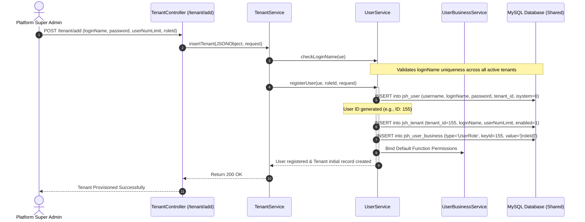
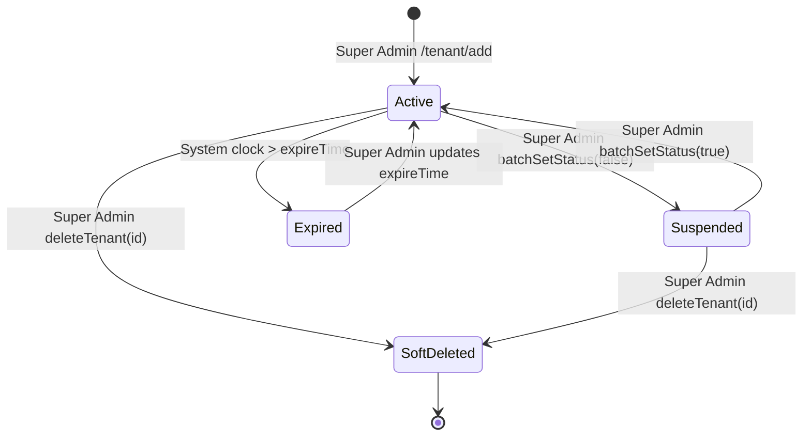

# Tenant Provisioning & Onboarding Lifecycle

## Executive Summary
This document provides a detailed end-to-end trace of tenant creation, initial provisioning, administrative setup, and lifecycle states in our ERP system. It evaluates transaction boundaries, default seed data generation, error recovery mechanisms, and compares the provisioning pipeline with **metasfresh** and **ERPNext**.

---

## 1. End-to-End Tenant Provisioning Flow

---

## 2. Step-by-Step Execution Breakdown

### Step 1: Request Initiation & Authorization
* **Endpoint**: `POST /tenant/add` in [`TenantController.java`](file:///e:/Codes/ERP/jshERP-master/ERPSystem-boot/src/main/java/com/jsh/erp/controller/TenantController.java)
* **Caller Authorization**: Executed by Super Admin (`loginName = 'admin'`, `tenantId == 0/1`, or `leaderFlag = '1'`).
* **Input Payload**: `loginName`, `password`, `userNumLimit`, `type`, `roleId`, `expireTime`, `remark`.

### Step 2: Uniqueness Validation
* **Service**: `UserService.checkLoginName(ue)`
* **Validation**: Query `jsh_user` ignoring `tenant_id` (`userMapperEx.getUserByLoginNameIgnoreTenant`) to guarantee global uniqueness of the login name.
* **Failure Mode**: Throws `BusinessRunTimeException(USER_LEADER_IS_EXIST_CODE, "Login name already exists")` if a conflict is found.

### Step 3: Admin User & Tenant Record Creation
* **Service**: `UserService.registerUser(UserEx ue, Integer roleId, HttpServletRequest request)`
* **Database Actions**:
  1. `jsh_user`: Hashes initial password using MD5 encryption (`Tools.md5Encryp(password)`), sets `status = 0`, `deleteFlag = '0'`.
  2. `jsh_tenant`: Uses the generated `user.getId()` as the new `tenantId` (ensuring 1-to-1 linkage for the root tenant administrator). Sets `enabled = true` and configured user limits.
  3. `jsh_user_business`: Associates the user with the specified `roleId` (or default manager role `manageRoleId = 6`).

### Step 4: Transactional Boundaries & Failure Handling
* **Transaction Wrapper**: `@Transactional(value = "transactionManager", rollbackFor = Exception.class)` on `TenantService.insertTenant()` and `UserService.registerUser()`.
* **Atomicity**: If user insertion fails or user-business binding encounters a database constraint, the transaction rolls back cleanly, avoiding orphan tenant or user records.

---

## 3. Gaps in Current Provisioning (What Seed Data is Missing)

When a tenant is provisioned in the current system, **only the user and tenant row are created**. The tenant is left with an empty business workspace:

| Provisioned Component | Current ERP | metasfresh Reference | ERPNext Reference |
| :--- | :--- | :--- | :--- |
| **Root Admin User** | Yes (`jsh_user`) | Yes (`AD_User`) | Yes (`User`) |
| **Tenant Record** | Yes (`jsh_tenant`) | Yes (`AD_Client`) | Yes (`Company`) |
| **Role & Menu Access** | Assigned default role ID | Creates Client Admin & User roles with complete security tree | Creates Company Manager, Accounts User, Stock User roles |
| **Chart of Accounts** | **Missing** (Empty) | Pre-loads Standard Chart of Accounts (`C_ElementValue`) | Automatically generates country-specific CoA (Standard, Indian, etc.) |
| **Default Depot / Warehouse** | **Missing** (Empty) | Creates Default Warehouse & Locator (`M_Warehouse`, `M_Locator`) | Creates "Stores", "Work In Progress", "Finished Goods" |
| **Organization / Branch** | **Missing** (Empty) | Creates `AD_Org` with `*` (HQ) organizational unit | Creates Default Company and Cost Center |
| **Financial Year / Series** | **Missing** (Empty) | Creates standard Calendar & Period definitions | Creates Fiscal Year and Document Naming Series |
| **Tax Profiles** | **Missing** (Manual) | Pre-configures Tax Categories and Tax Rates | Pre-configures GST / VAT Tax Templates |

---

## 4. Tenant Lifecycle State Machine

### State Definitions:
1. **`Active` (`enabled = true`, `expireTime >= now`)**:
   - Users belonging to the tenant can authenticate, issue API calls, and process transactions.
2. **`Suspended` (`enabled = false`)**:
   - Login attempts blocked at `UserService.validateUser()` returning `BLACK_TENANT` (`tenant is black`).
   - Active tokens rejected by interceptors upon next request.
3. **`Expired` (`expireTime < now`)**:
   - Login attempts blocked returning `EXPIRE_TENANT` (`tenant is expire`).
4. **`SoftDeleted` (`deleteFlag = '1'`)**:
   - Excluded from all active tenant queries and list endpoints.

---

## 5. Architectural Comparison & Recommendations

### Comparison Table

| Feature | Our Current ERP | metasfresh | ERPNext |
| :--- | :--- | :--- | :--- |
| **Provisioning Trigger** | Super Admin UI form or `/tenant/add` API. | Initial Client Setup Wizard (`InitialClientSetupProcess`). | Setup Wizard on first site visit (`setup_wizard.py`). |
| **Seed Data Automation** | Minimal (User + Role link only). | Comprehensive (Accounting, Tax, Document types, Locators). | Comprehensive (CoA, Cost Centers, Warehouses, Fiscal Years). |
| **User Quota Enforcement** | Checked dynamically via `userNumLimit` count query. | License-based concurrent user sessions. | Subscription / Seat-based limits in SaaS manager. |
| **Rollback Capability** | Single DB transaction rollback. | Database savepoints during batch seed scripts. | Multi-table database transaction rollback. |

---

### Structured Recommendation

#### 1. What We Have
A fast, single-transaction tenant creation method in `TenantService.insertTenant()` and `UserService.registerUser()` that creates `jsh_tenant`, `jsh_user`, and links a default role.

#### 2. What Reference Systems Do
Both metasfresh and ERPNext execute an automated **Tenant Bootstrapping Seed Pipeline** upon tenant creation. This automatically generates:
- Default root organization (`Main Branch / HQ`).
- Default primary warehouse/depot (`Main Warehouse`).
- Default financial year and document numbering sequences (`INV-2026-00001`).
- Standard Indian Chart of Accounts & GST master profiles.

#### 3. What is Missing
Our newly provisioned tenants currently start in a "blank slate" state. The tenant administrator must manually configure organizations, depots, account heads, and numbering series before they can create a single sales or purchase order.

#### 4. What Should Change
Implement an automated, pluggable `TenantBootstrapService` that runs immediately inside the provisioning transaction to seed essential business defaults for the new `tenantId`.

#### 5. Why
Drastically reduces tenant onboarding time from 30+ minutes of manual master setup to 0 seconds, eliminates configuration human error, and ensures immediate out-of-the-box readiness for sales, purchases, and invoicing.

#### 6. How It Should Work
1. When `TenantService.insertTenant()` completes the base user and tenant records, it invokes `TenantBootstrapService.seedNewTenant(tenantId, companyName)`.
2. The seeder creates:
   - `jsh_organization`: Default "Headquarters" (`org_no = '001'`, `parent_id = -1`).
   - `jsh_depot`: Default "Main Storage Depot" (`type = 0`, `is_default = true`).
   - `erp_financial_year` & `erp_document_number_series`: Active FY with standard sales/purchase sequences.
   - `jsh_account`: Default Cash and Bank accounts.
3. All seed operations execute within the same database transaction boundary (`@Transactional`).
