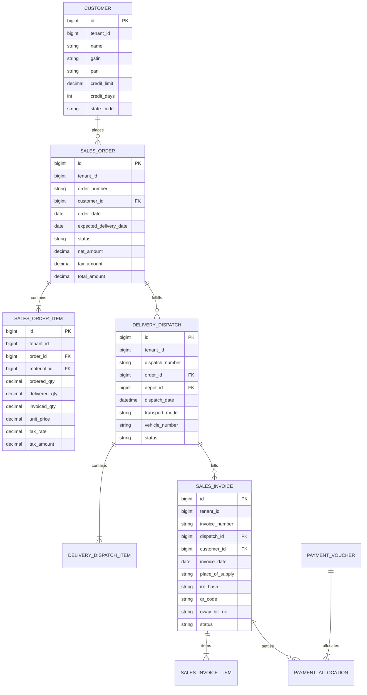

# Round 1: Sales Module Architectural Deep-Dive & Gap Analysis

---

## 1. Executive Summary

### 1.1 Purpose & Domain Responsibility
The **Sales Module** governs the entire Quote-to-Cash (Q2C) revenue lifecycle of the enterprise. It is responsible for converting customer inquiries and commercial negotiations into legally binding sales contracts (Orders), executing physical fulfillment (Outbound Deliveries/Dispatches), issuing statutory Tax Invoices compliant with GST Rule 46, managing commercial adjustments (Credit Notes/Returns), and realizing liquid cash through Collections and Customer Payment Allocations.

### 1.2 Target Audience & Market Positioning (Mid-Market ERP)
Our target market is the **mid-market enterprise** (turnover ₹10 Cr to ₹500 Cr across trading, distribution, light manufacturing, and engineering services).
* **Essential Mid-Market Requirements**: Multi-tier pricing, customer credit limits, multi-step order approvals, stock availability checks and allocation, split/partial deliveries, statutory Indian GST compliance (Rule 46 tax invoices, HSN summaries, IRN e-Invoicing, E-Way Bill generation), advance receipt reconciliation, and automated double-entry ledger posting (Accounts Receivable vs Revenue vs Output GST).
* **Unnecessary Enterprise Complexity to Omit**: Multi-variant matrix configurators, dynamic ATP (Available-To-Promise) multi-echelon network routing, complex CPQ (Configure, Price, Quote) rule engines with constraint programming, and EDI X12/EDIFACT integration suites.

---

## 2. Our Current Module Architecture

### 2.1 Existing Menus & Navigation
In our current React frontend ([`menuTranslations.ts`](file:///e:/Codes/ERP/jshERP-master/ERPSystem-web-react/src/shared/utils/menuTranslations.ts) & [`Sidebar.tsx`](file:///e:/Codes/ERP/jshERP-master/ERPSystem-web-react/src/layouts/MainLayout/Sidebar.tsx)), the Sales domain is exposed as:
```text
Sales Management (销售管理)
├── Sales Orders (销售订单)       -> /bill/sale-order
├── Sales Dispatch (销售出库)     -> /bill/sale-outbound
└── Sales Returns (销售退货)      -> /bill/sale-return

Financial Management (财务管理) [Related Submenus]
├── Collection Notes (收款单)     -> /financial/collection
└── Advance Receipts (收预付款)   -> /financial/advance-receipt

Reports & Analytics (报表查询) [Related Submenus]
├── Sales Trends (销售统计)       -> /report/sales-trends
├── Outbound Details (出库明细)   -> /report/outbound-details
└── Customer Statements (客户对账) -> /report/customer-statement
```

### 2.2 Existing Screens & Frontend Components
* [`SaleOrderList.tsx`](file:///e:/Codes/ERP/jshERP-master/ERPSystem-web-react/src/features/bill/pages/SaleOrderList.tsx): List view for Sales Orders (`sub_type='销售订单'`).
* [`SaleOutboundList.tsx`](file:///e:/Codes/ERP/jshERP-master/ERPSystem-web-react/src/features/bill/pages/SaleOutboundList.tsx): List view for Sales Dispatch documents (`sub_type='销售出库'`).
* [`SaleReturnList.tsx`](file:///e:/Codes/ERP/jshERP-master/ERPSystem-web-react/src/features/bill/pages/SaleReturnList.tsx): List view for Sales Returns (`sub_type='销售退货'`).
* [`BillModal.tsx`](file:///e:/Codes/ERP/jshERP-master/ERPSystem-web-react/src/features/bill/components/BillModal.tsx): Generic modal component managing header fields, line items table, depot selection, customer selection, and discount calculations.
* [`GstSalesInvoiceForm.tsx`](file:///e:/Codes/ERP/jshERP-master/ERPSystem-web-react/src/features/gst/pages/GstSalesInvoiceForm.tsx): Dedicated statutory GST Rule 46 invoice generator.
* [`GstEInvoiceDashboard.tsx`](file:///e:/Codes/ERP/jshERP-master/ERPSystem-web-react/src/features/gst/pages/GstEInvoiceDashboard.tsx): IRN lifecycle and E-Way Bill generation dashboard.

### 2.3 Existing Backend Stack & APIs
* **Controllers**:
  * [`DepotHeadController.java`](file:///e:/Codes/ERP/jshERP-master/ERPSystem-boot/src/main/java/com/jsh/erp/controller/DepotHeadController.java): `/depotHead/addDepotHeadAndDetail`, `/depotHead/updateDepotHeadAndDetail`, `/depotHead/list`, `/depotHead/deleteDepotHeadAndDetail`.
  * [`GstSalesInvoiceController.java`](file:///e:/Codes/ERP/jshERP-master/ERPSystem-boot/src/main/java/com/jsh/erp/controller/GstSalesInvoiceController.java): `/gst/sales-invoice/create`, `/gst/sales-invoice/{id}/submit`, `/gst/sales-invoice/{id}/post`.
  * [`AccountHeadController.java`](file:///e:/Codes/ERP/jshERP-master/ERPSystem-boot/src/main/java/com/jsh/erp/controller/AccountHeadController.java): `/accountHead/addAccountHeadAndDetail`.
* **Services**:
  * [`DepotHeadService.java`](file:///e:/Codes/ERP/jshERP-master/ERPSystem-boot/src/main/java/com/jsh/erp/service/DepotHeadService.java): Core document header CRUD, numbering, approval status toggling, and multi-depot resolution.
  * [`DepotItemService.java`](file:///e:/Codes/ERP/jshERP-master/ERPSystem-boot/src/main/java/com/jsh/erp/service/DepotItemService.java): Line item persistence, stock balance calculation, cost tracking.
  * [`GstSalesInvoiceService.java`](file:///e:/Codes/ERP/jshERP-master/ERPSystem-boot/src/main/java/com/jsh/erp/service/GstSalesInvoiceService.java): Statutory tax calculation (Rule 46), HSN tax aggregation, snapshot generation.
  * [`AccountItemService.java`](file:///e:/Codes/ERP/jshERP-master/ERPSystem-boot/src/main/java/com/jsh/erp/service/AccountItemService.java): Payment ledger entries and financial accounting records.

### 2.4 Existing Database Tables
* `erp_supplier` (where `type = '客户'`): Customer Master data (name, contact, phone, GSTIN, credit limits).
* `erp_depot_head`: Document header table (stores Sales Orders `type='其它', sub_type='销售订单'`, Outbound Dispatches `type='出库', sub_type='销售'`, Sales Returns `type='入库', sub_type='销售退货'`).
* `erp_depot_item`: Document line items (product ID, quantity, unit price, tax rate, tax money, total amount).
* `erp_gst_sales_invoice`: Statutory Indian GST Invoice document headers (Rule 46 fields, POS, IRN, QR code, Ack No).
* `erp_account_head` & `erp_account_item`: Payment collection vouchers and advance receipts.

### 2.5 Current Workflow in Code
Currently, our ERP handles sales through the following baseline flow:
```text
Customer Master (erp_supplier)
   ↓
Sales Order (erp_depot_head, sub_type='销售订单')
   ↓ (Manual selection or direct creation)
Sales Dispatch / Outbound (erp_depot_head, sub_type='销售')
   ↓ (Decrements physical inventory in erp_depot_item)
Financial Collection (erp_account_head, type='收款')
   ↓ (Records payment voucher against customer account)
GST Sales Invoice (erp_gst_sales_invoice) [Parallel compliance record]
```

---

## 3. Current Functional Gap Analysis

| Requirement | Current ERP Status | Assessment | Technical Gap Description |
|---|:---:|:---:|---|
| **Customer Master Management** | Exists | Complete | Stores address, GSTIN, PAN, credit limit, contact person. Complete for mid-market. |
| **Sales Quotation / Proforma** | Missing | **Missing** | No formal `Quotation` document type exists. Customers cannot receive quote revisions before sales order commitment. |
| **Sales Order (SO)** | Exists | Partial | SO exists in `erp_depot_head`, but lacks formal multi-level approval hierarchy, validity dates, and payment term binding. |
| **Credit Limit & Overdue Check** | Missing | **Missing** | System does not prevent or warn on SO confirmation if customer's outstanding balance + new SO exceeds credit limit. |
| **Stock Allocation / Reservation** | Missing | **Missing** | Stock is only deducted when Dispatch is saved; no temporary stock reservation exists between SO Approval and Delivery Dispatch. |
| **Outbound Delivery / Dispatch Note** | Exists | Partial | Exists in `erp_depot_head` (`sub_type='销售'`), but is not formally linked to the parent SO to track `delivered_qty` vs `ordered_qty`. |
| **Picking & Packing Slips** | Missing | Optional | Useful for larger warehouses with picklists, but not critical for basic mid-market wholesale/distribution. |
| **GST Tax Invoice (Rule 46)** | Exists | Complete | Implemented in `GstSalesInvoiceService` with full Place of Supply, reverse charge, HSN breakdown, IRN e-Invoicing, and QR code. |
| **Automated COGS & AR Accounting** | Exists | Partial | Financial Collection exists, but automated journal posting on Invoice generation (Dr Accounts Receivable, Cr Sales Revenue, Cr Output GST) requires formal GL voucher link. |
| **Sales Return / Credit Notes** | Exists | Partial | Return exists in `erp_depot_head`, and GST Credit Note exists in `GstCreditDebitNoteService`, but stock restock must link back to original delivery batch. |
| **Advance Payment Reconciliation** | Exists | Partial | Advance Receipt vouchers exist in `AccountHead`, but automatic settlement against finalized Sales Invoices requires direct allocation UI. |

---

## 4. Business Process (Target Standard)

```text
       [ Customer Inquiry ]
               │
               ▼
   1. [ Sales Quotation ] ─────────► (Revision / Negotiation)
               │
               ▼ (Customer Accepts)
   2. [ Sales Order (SO) ]
               │
         ┌─────┴────────────────────────┐
         │ 2a. Customer Credit Check    │
         │ 2b. Price & Margin Check     │
         │ 2c. Stock Availability Check │
         └─────┬────────────────────────┘
               │
               ▼
   3. [ Order Approval Gate ] ──────► (Manager Approved / Confirmed)
               │
               ▼ (Stock Soft Reservation)
   4. [ Delivery Dispatch Note ] ───► [ Physical Stock Reduction ]
               │                          (Depot Inventory Ledger Updated)
               ▼
   5. [ GST Sales Tax Invoice ] ────► [ Financial Ledger Posted ]
               │                          (Dr Customer AR, Cr Revenue, Cr GST)
         ┌─────┴────────────────────────┐
         │ 5a. E-Invoice Portal (IRN)   │
         │ 5b. E-Way Bill Generation    │
         └─────┬────────────────────────┘
               │
               ▼
   6. [ Customer Payment Entry ] ───► [ Bank / Cash Debit & AR Cleared ]
               │
               ▼ (In case of dispute / damaged goods)
   7. [ Sales Return / Credit Note ] ─► [ Stock Restocked & Ledger Credited ]
```

### Transition-by-Transition Technical Breakdown

#### Transition 1: Quotation $\rightarrow$ Sales Order
* **Trigger**: Customer formally accepts price and commercial terms.
* **Document Created**: `Sales Order` (copies line items, negotiated discounts, payment terms, and delivery schedules from Quotation).
* **Database Changes**: Insert into `erp_depot_head` with `sub_type = 'SALES_ORDER'`, `link_number = quote_number`, and `status = 'DRAFT'`.
* **Inventory Changes**: None.
* **Accounting Changes**: None.

#### Transition 2: Sales Order $\rightarrow$ Order Approval
* **Trigger**: Sales Representative submits SO for commercial verification.
* **Validations**:
  1. *Credit Limit Check*: `Customer Outstanding Receivables + Unbilled Approved Orders + Current SO Total <= Customer Credit Limit`.
  2. *Margin Protection Check*: Selling price $\ge$ Product Base Cost.
* **Status Change**: `status` transitions from `DRAFT` $\rightarrow$ `SUBMITTED` $\rightarrow$ `APPROVED`.
* **Inventory Changes**: Creates soft reservation (`reserved_qty`) in inventory to prevent overselling.

#### Transition 3: Approved Sales Order $\rightarrow$ Outbound Delivery / Dispatch Note
* **Trigger**: Warehouse manager prepares physical dispatch.
* **Document Created**: `Delivery Note` (`erp_depot_head`, `sub_type = 'SALES_DISPATCH'`).
* **Database Changes**:
  * Sets parent SO reference: `link_number = so_number`.
  * Increments `delivered_qty` on parent SO lines.
  * If `sum(delivered_qty) == sum(ordered_qty)`, parent SO status becomes `COMPLETED`; if partial, `PARTIALLY_DELIVERED`.
* **Inventory Changes**:
  * Decrements physical stock in `erp_depot_item` (`oper_number = -qty`).
  * Decrements soft reservation (`reserved_qty`).
* **Accounting Changes**:
  * Optional Perpetual Inventory Entry: `Dr Cost of Goods Sold (COGS)`, `Cr Finished Goods Inventory`.

#### Transition 4: Delivery Dispatch $\rightarrow$ GST Sales Tax Invoice
* **Trigger**: Billing department generates legal commercial invoice.
* **Document Created**: `GST Sales Tax Invoice` (`erp_gst_sales_invoice`).
* **Validations**: GSTIN format, Place of Supply determination (Inter-state IGST vs Intra-state CGST+SGST), HSN mandatory classification, Rule 46 mandatory invoice fields.
* **Accounting Changes**:
  * `Dr Customer Accounts Receivable` (Full Gross Amount)
  * `Cr Sales Revenue Account` (Net Taxable Value)
  * `Cr Output CGST Account` (if Intra-state)
  * `Cr Output SGST Account` (if Intra-state)
  * `Cr Output IGST Account` (if Inter-state)
* **Status Change**: Delivery Note marked as `INVOICED`.

#### Transition 5: Tax Invoice $\rightarrow$ E-Invoice / E-Way Bill Integration
* **Trigger**: Automated or manual trigger for B2B taxpayers (turnover $\ge$ statutory threshold).
* **System Action**: Generates standard JSON payload, calls NIC/IRP API, receives signed IRN (64-character hash) and QR Code string, persists into `erp_gst_sales_invoice`.
* **Document Output**: PDF rendered with statutory QR code and IRN.

#### Transition 6: Tax Invoice $\rightarrow$ Customer Payment Entry / Collection
* **Trigger**: Customer remits payment via Bank NEFT/RTGS/Cheque or Cash.
* **Document Created**: `Collection Note` (`erp_account_head`, `type='收款'`).
* **Database Changes**: Inserts `erp_account_item` referencing `invoice_id`.
* **Accounting Changes**:
  * `Dr Bank / Cash Account`
  * `Cr Customer Accounts Receivable`
* **Status Change**: Invoice status becomes `PAID` (or `PARTIALLY_PAID`).

---

## 5. Document Lifecycle State Machines

### 5.1 Sales Order Lifecycle
```text
[ DRAFT ] ──────────► [ SUBMITTED ] ──────────► [ APPROVED ]
   │                       │                         │
   ▼                       ▼                         ▼
[ CANCELLED ]         [ REJECTED ]         [ PARTIALLY_DELIVERED ]
                                                     │
                                                     ▼
                                              [ FULLY_DELIVERED ]
                                                     │
                                                     ▼
                                                [ CLOSED ]
```
* **DRAFT**: Creator can freely modify quantities, prices, delivery dates. No inventory or credit impact.
* **SUBMITTED**: Locked for editing. Awaiting sales manager commercial approval.
* **APPROVED**: Credit verified. Soft stock reservation created. Downstream delivery allowed.
* **PARTIALLY_DELIVERED**: Delivery note generated for part of the ordered line items.
* **FULLY_DELIVERED**: All line quantities fully dispatched.
* **CLOSED**: Fully invoiced and fulfilled. Locked permanently against modifications.

### 5.2 Delivery Dispatch Lifecycle
```text
[ DRAFT ] ───► [ SUBMITTED ] ───► [ DISPATCHED ] ───► [ INVOICED ]
   │
   ▼
[ CANCELLED ]
```
* **DISPATCHED**: Physical stock deducted from depot ledger. Cannot be edited. Reversal requires formal Return/Credit document.

### 5.3 GST Sales Invoice Lifecycle
```text
[ DRAFT ] ───► [ SUBMITTED ] ───► [ POSTED ] ───► [ PAID ]
   │                                   │
   ▼                                   ▼
[ CANCELLED ]                   [ CANCELLED_IRN ] (Requires Credit Note after 24h)
```
* **POSTED**: Double-entry accounting vouchers generated. If e-Invoiced, registered on government portal. Cannot be deleted or edited.

---

## 6. Database & Domain Model



---

## 7. Inventory Impact Analysis

```text
Sales Order Confirmation:
    → Stock Available: Unchanged
    → Stock Reserved:  +Ordered Quantity (Soft Reservation)
    → Stock Physical:  Unchanged

Delivery Dispatch Execution:
    → Stock Physical:  -Delivered Quantity (Stock Ledger Entry in `erp_depot_item`)
    → Stock Reserved:  -Delivered Quantity (Reservation Released)
    → Stock Available: Recalculated = Physical - Reserved
```
* **Warehouse & Bin Allocation**: Dispatch note specifies target `depot_id` per line item.
* **Batch & Expiry Enforcement**: Items configured with `enable_batch=1` require batch number selection during dispatch.
* **Serial Number Tracking**: Serial numbers entered at dispatch are marked `STATUS_SOLD` in `erp_serial_number`.

---

## 8. Accounting & Financial Impact

### 8.1 Automated Double-Entry Ledger Schedule

| Event / Trigger | Debit Account | Credit Account | Value Basis |
|---|---|---|---|
| **Delivery Dispatch** (Perpetual Inventory Mode) | **Cost of Goods Sold (COGS)** | **Finished Goods Inventory** | Standard Unit Cost $\times$ Qty |
| **Sales Invoice Posting** (Statutory Revenue) | **Customer Accounts Receivable** | **Sales Revenue Account** | Taxable Value |
| | | **Output CGST Account** | CGST Amount (Intra-state) |
| | | **Output SGST Account** | SGST Amount (Intra-state) |
| | | **Output IGST Account** | IGST Amount (Inter-state) |
| **Customer Payment / Collection** | **Bank / Cash Account** | **Customer Accounts Receivable** | Amount Remitted |
| **Sales Return / Credit Note** | **Sales Return / Revenue Adjustment** | **Customer Accounts Receivable** | Taxable Value |
| | **Output GST Adjustment** | | Tax Value |
| | **Finished Goods Inventory** | **Cost of Goods Sold** | Restocked Cost |

---

## 9. Tax & GST Compliance (Indian Statutory Rules)

* **Place of Supply (POS) Engine**:
  * If `Customer State Code == Supplier State Code` $\rightarrow$ **Intra-State**: `CGST` (50% of GST rate) + `SGST` (50% of GST rate).
  * If `Customer State Code != Supplier State Code` $\rightarrow$ **Inter-State**: `IGST` (100% of GST rate).
* **HSN/SAC Validation**: Mandatory 4-digit / 6-digit / 8-digit HSN code on every item based on supplier aggregate annual turnover.
* **GST Rule 46 Mandatory Invoice Fields**:
  * Supplier GSTIN, Legal Name, Address.
  * Consecutive Serial Number ($\le 16$ characters, unique per Financial Year).
  * Date of Issue.
  * Customer Name, Address, GSTIN/UIN (if registered) or State & Code (if unregistered and value $\ge ₹50,000$).
  * Total Taxable Value, Tax Rates, and Itemized Tax Amounts.
* **E-Invoicing (IRN) & E-Way Bill**:
  * Standard Schema (Version 1.03) compliant JSON payload generation.
  * E-Way Bill generation required for consignments exceeding ₹50,000.

---

## 10. Reference Analysis: metasfresh

### 10.1 Architecture & Workflow in metasfresh
* **Core Entities**:
  * `C_Order`: Single unified header for Quotations, Sales Orders, and Blanket Orders (differentiated by `DocSubTypeSO` and `DocBaseType`).
  * `M_InOut`: Outbound Material Receipt / Shipment document tracking physical stock movement.
  * `C_Invoice`: Legal accounting billing document.
* **Shipment & Billing Rules**:
  * metasfresh uses `DeliveryRule` (e.g. `Availability`, `Complete Order`, `Manual`) and `DeliveryViaRule` (`Pickup`, `Delivery`).
  * `C_OrderLine.QtyReserved` and `QtyOrdered` track open balances separately from `QtyDelivered`.
* **Key Takeaway for Our ERP**:
  * Clean separation of **Physical Fulfillment** (`M_InOut` $\rightarrow$ our `SaleOutbound`) from **Financial Billing** (`C_Invoice` $\rightarrow$ our `GstSalesInvoice`).
  * Explicit quantity balance tracking on Order Line items (`ordered_qty`, `delivered_qty`, `invoiced_qty`).

---

## 11. Reference Analysis: ERPNext

### 11.1 Architecture & Workflow in ERPNext
* **Core DocTypes**:
  * `Quotation` $\rightarrow$ `Sales Order` $\rightarrow$ `Delivery Note` $\rightarrow$ `Sales Invoice` $\rightarrow$ `Payment Entry`.
* **India Compliance App**:
  * Direct GSP integration for e-Invoice (IRN generation via JSON API) and E-Way Bill JSON generation.
  * Automatic Tax Template determination based on Customer Billing and Shipping address state codes.
* **Key Takeaway for Our ERP**:
  * Use of intuitive status pills (`To Deliver and Bill`, `To Bill`, `Completed`, `Closed`).
  * Strict validation blocking Delivery Notes when parent Sales Order is not in `Approved` status.

---

## 12. Three-Way ERP Architectural Comparison

| Architectural Dimension | Our Current ERP | metasfresh | ERPNext | Mid-Market ERP Recommendation |
|---|---|---|---|---|
| **Quote-to-Order Conversion** | Missing (Direct SO only) | Native via `C_Order` Document Types | Dedicated `Quotation` DocType | **Add lightweight `Quotation` entity & UI** |
| **Order Approval Flow** | Basic status flag | Workflow Engine (BPMN / State) | Multi-tier Role-based Approval Rule | **Add 2-step Approval (Draft $\rightarrow$ Approved)** |
| **Stock Allocation** | Immediate on Dispatch | `M_Storage` soft reservations | Soft Reservation / Pick List | **Add `reserved_qty` tracking on SO Approval** |
| **Physical vs Financial Split** | Partially shared in `DepotHead` | Strict (`M_InOut` vs `C_Invoice`) | Strict (`Delivery Note` vs `Sales Invoice`) | **Maintain clean Dispatch vs Invoice separation** |
| **GST Rule 46 & IRN** | Dedicated `GstSalesInvoiceService` | Requires custom plugin | Built-in via `india_compliance` | **Leverage our verified `GstSalesInvoiceService`** |
| **Payment Reconciliation** | Generic `AccountHead` vouchers | `C_Payment` & Allocation Engine | `Payment Entry` against Invoice | **Add direct Invoice-to-Payment allocation link** |

---

## 13. Recommended Design for Our ERP

```text
[ Customer Master (erp_supplier, type='客户') ]
                     │
                     ▼
       [ 1. Sales Quotation (erp_quotation) ]
                     │ (Convert to Order)
                     ▼
       [ 2. Sales Order (erp_depot_head, sub_type='SALES_ORDER') ]
                     │ (Approval & Reservation)
                     ▼
       [ 3. Delivery Dispatch (erp_depot_head, sub_type='SALES_DISPATCH') ]
                     │ (Generates Tax Invoice)
                     ▼
       [ 4. GST Sales Invoice (erp_gst_sales_invoice) ]
                     │ (Collect Payment)
                     ▼
       [ 5. Payment Voucher (erp_account_head, type='收款') ]
```

---

## 14. Recommended Menu & Navigation Structure

```text
Sales Management (销售管理)
├── Customers (客户信息)                     [ Existing  - Master Data ]
├── Sales Quotations (销售报价单)             [ Missing   - To Add (Phase 1) ]
├── Sales Orders (销售订单)                  [ Existing  - Modify to add Approval & Tracking ]
├── Outbound Deliveries / Dispatches (销售出库) [ Existing  - Modify to link parent SO ]
├── GST Sales Invoices (销售发票)             [ Existing  - Link with Delivery & Auto-GL ]
├── Sales Returns / Credit Notes (销售退货)    [ Existing  - Link with original Invoice/Batch ]
├── Customer Payments (客户收款单)            [ Existing  - Add direct Invoice Allocation ]
│
└── Sales Reports & Analytics (销售报表)
    ├── Sales Register / Daybook (销售明细表)  [ Existing ]
    ├── Customer Outstanding Ledger (客户对账单) [ Existing ]
    └── Pending Order Status (订单执行跟踪)   [ Missing   - To Add (Phase 2) ]
```

---

## 15. Phased Implementation Roadmap

### Phase 1: Core Order Fulfillment & Document Lineage (High Priority)
* **Backend**: Add `link_number` and quantity tracking (`delivered_qty`, `invoiced_qty`) in `DepotItemMapperEx` and `DepotHeadService`.
* **Database**: Add `delivered_qty` and `invoiced_qty` columns to `erp_depot_item`.
* **Frontend**: Update `SaleOrderList.tsx` and `SaleOutboundList.tsx` to support 1-click "Create Dispatch from SO".

### Phase 2: Quotations & Approval Hierarchy (Medium Priority)
* **Backend**: Create `QuotationService` and `QuotationController` (`/quotation/*`).
* **Frontend**: Add `QuotationList.tsx` and "Convert Quotation to Sales Order" action modal.

### Phase 3: Automated General Ledger Posting & Payment Allocation (Medium Priority)
* **Backend**: Connect `GstSalesInvoiceService.postInvoice` to `FinancialJournalService` to automatically generate Accounts Receivable vouchers.
* **Frontend**: Add payment reconciliation grid in `CollectionList.tsx`.

---

## 16. Concrete End-to-End Test Scenarios

### Scenario 1: Standard Order-to-Cash (O2C) Workflow
1. Create Sales Order for Customer $C_1$ (100 units of Material $M_1$ @ ₹1,000/unit + 18% GST).
2. Approve Sales Order $\rightarrow$ Order status becomes `APPROVED`; 100 units soft-reserved.
3. Create Delivery Dispatch for 100 units $\rightarrow$ Physical stock decremented by 100; Order status becomes `FULLY_DELIVERED`.
4. Generate GST Tax Invoice $\rightarrow$ Tax invoice created with ₹1,00,000 Taxable + ₹18,000 GST; Ledger debits Customer AR ₹1,18,000.
5. Record Payment Collection of ₹1,18,000 $\rightarrow$ Customer balance cleared to ₹0; Invoice marked `PAID`.

### Scenario 2: Partial Delivery & Partial Invoicing
1. Sales Order placed for 200 units.
2. Delivery Dispatch 1 created for 120 units $\rightarrow$ SO status becomes `PARTIALLY_DELIVERED` (`delivered_qty = 120, remaining = 80`).
3. GST Tax Invoice 1 created for 120 units $\rightarrow$ Customer billed for 120 units.
4. Delivery Dispatch 2 created for remaining 80 units $\rightarrow$ SO status becomes `FULLY_DELIVERED`.
5. GST Tax Invoice 2 created for 80 units $\rightarrow$ Complete order fulfilled and billed.

### Scenario 3: Order Cancellation with Soft Reservation Release
1. Sales Order created and approved for 50 units $\rightarrow$ 50 units soft-reserved in warehouse.
2. Customer cancels order prior to delivery $\rightarrow$ Manager clicks `Cancel Order`.
3. Order status transitions to `CANCELLED`; soft reservation released; physical stock remains intact.

### Scenario 4: Post-Invoice Sales Return & Credit Note
1. Customer returns 10 damaged units from an invoiced delivery of 100 units.
2. Create Sales Return document linked to original Invoice.
3. Generate GST Credit Note (`GstCreditDebitNoteService`) $\rightarrow$ Reduces Customer AR by ₹11,800 and credits Output GST.
4. Restock 10 units to warehouse damaged goods depot.

---

## 17. Risks & Edge Cases Checklist

* **Concurrent Stock Allocation Race Conditions**: Two concurrent orders attempting to claim the last available stock units. *Mitigation*: Pessimistic lock (`SELECT ... FOR UPDATE`) on stock balances during SO Approval / Delivery save.
* **Customer Credit Limit Breaches**: Preventing order dispatch when existing uncollected invoices exceed agreed credit limits.
* **GST State Code Mismatches**: Customer shipping address state differing from billing address state (Place of Supply must derive from shipping address for physical deliveries under Section 10(1)(a) of IGST Act).
* **IRN 24-Hour Cancellation Window**: If an e-Invoice is cancelled after 24 hours on the government portal, it cannot be deleted in the ERP; a formal GST Credit Note must be issued instead.
* **Rounding Discrepancies**: Decimal rounding on multi-line items (Tax calculated per line vs tax calculated on total). Our engine strictly computes tax per line and sums standard rounded amounts to prevent 1-paisa discrepancies.

---

## 18. Final Architectural Recommendation Summary

| Component | Status Today | Action Recommended | Implementation Priority |
|---|---|---|:---:|
| **Customer Master** | Complete in `erp_supplier` | Maintain existing structure | Low (Stable) |
| **Sales Quotation** | Missing | Add lightweight `erp_quotation` entity & UI | **Medium** |
| **Sales Order Tracking** | Partial in `erp_depot_head` | Add `delivered_qty` & `invoiced_qty` tracking | **High** |
| **Order Approval Gate** | Partial | Enforce 2-step Draft $\rightarrow$ Approved validation | **High** |
| **Outbound Dispatch** | Complete in `erp_depot_head` | Link to parent Sales Order | **High** |
| **GST Rule 46 Tax Invoice** | Complete in `GstSalesInvoiceService` | Connect to automated GL posting | **High** |
| **Payment Allocation** | Partial in `erp_account_head` | Add invoice settlement allocation grid | **Medium** |
| **IRN / E-Way Bill** | Complete in `GstEInvoiceDashboard` | Maintain current portal integration | Low (Complete) |
