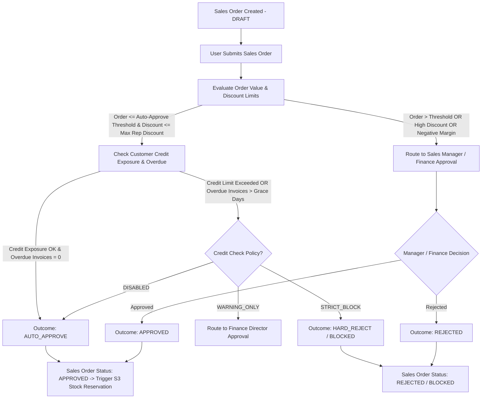

# Phase S2: Sales Order Multi-Tier Approval Workflow

---

## 1. Executive Summary & Objective
In mid-market enterprises, Sales Orders represent legal and financial delivery commitments. Orders must pass through a structured, rule-based **Approval Engine** before warehouse fulfillment and stock reservation can proceed.

Approval decisions evaluate commercial parameters (Gross Value, Line Discounts, Gross Margin) and risk parameters (Customer Credit Exposure, Overdue Invoices).

---

## 2. Approval Decision Flowchart



---

## 3. Configurable Approval Rule Engine

To avoid hardcoding thresholds directly into controllers, approval rules are evaluated through a dedicated rule definition structure:

```sql
CREATE TABLE IF NOT EXISTS `erp_sales_approval_rule` (
    `id` bigint(20) NOT NULL AUTO_INCREMENT PRIMARY KEY,
    `tenant_id` bigint(20) NOT NULL,
    `rule_name` varchar(128) NOT NULL,
    `organization_id` bigint(20) DEFAULT NULL, -- NULL = All Tenant Branches
    `min_order_value` decimal(18,4) DEFAULT 0.0000,
    `max_auto_approve_value` decimal(18,4) DEFAULT 100000.0000, -- e.g. Auto-approve up to ₹1,00,000
    `max_salesrep_discount_rate` decimal(10,4) DEFAULT 5.0000, -- Up to 5% discount
    `min_margin_rate` decimal(10,4) DEFAULT 15.0000, -- Minimum 15% margin
    `require_finance_approval_on_credit_breach` tinyint(1) DEFAULT 1,
    `approver_role_id` bigint(20) DEFAULT 3, -- Role required for manual approval (e.g. Sales Manager / Tenant Admin)
    `status` varchar(20) DEFAULT 'ACTIVE',
    `create_time` datetime DEFAULT CURRENT_TIMESTAMP,
    KEY `idx_appr_rule_tenant` (`tenant_id`, `organization_id`)
) ENGINE=InnoDB DEFAULT CHARSET=utf8mb4;
```

---

## 4. Evaluation Engine Outcomes & Audit Trail

### 4.1 Decision Outcomes
1. **`AUTO_APPROVE`**: Order meets all commercial thresholds, credit exposure is within limits, zero overdue invoices. Status transitions directly to `APPROVED`.
2. **`MANAGER_APPROVAL`**: High order value or discount requires Sales Manager review. Status set to `PENDING_APPROVAL`.
3. **`FINANCE_APPROVAL`**: Credit limit breach or low margin requires Finance Manager approval. Status set to `PENDING_FINANCE_APPROVAL`.
4. **`REJECT`**: Hard violation under `STRICT_BLOCK` policy. Order status set to `REJECTED`.

### 4.2 Immutable Approval Audit History (`erp_approval_history`)
Every approval or rejection action records:
* `document_type`: `"SALES_ORDER"`
* `document_id`: Sales Order Primary Key
* `document_number`: Sales Order Number (e.g. `SO-2026-0001`)
* `action`: `"APPROVE"`, `"REJECT"`, `"AUTO_APPROVE"`
* `previous_status` $\rightarrow$ `new_status`
* `operator_id`, `operator_name`, `operator_role`
* `decision_reason`
* `oper_time`
