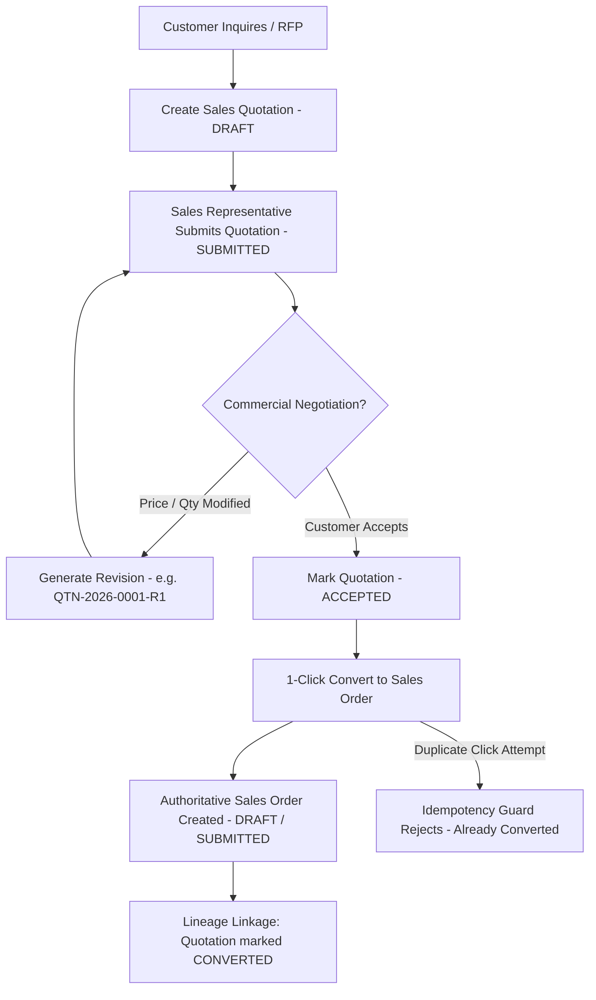

# Phase S2: Sales Quotation Architecture & Conversion Analysis

---

## 1. Executive Summary & Business Requirements
A **Sales Quotation** (also termed Commercial Proposal or Proforma Offer) represents the non-binding commercial offer submitted to a prospective or existing customer detailing items, quantities, agreed unit rates, applicable trade discounts, Place of Supply, payment milestones, and validity expiry dates.

In mid-market enterprise operations, a single customer inquiry often goes through multiple rounds of commercial negotiation before contract commitment. Therefore, the quotation architecture must support **Quotation Versioning / Revisions**, **Validity Tracking**, and an **Idempotent 1-Click Conversion to Sales Order** that guarantees zero duplicate orders.

---

## 2. End-to-End Quotation to Sales Order Flow



---

## 3. Data Model for Sales Quotations (`erp_quotation` & `erp_quotation_item`)

### 3.1 Header Entity: `erp_quotation`
```sql
CREATE TABLE IF NOT EXISTS `erp_quotation` (
    `id` bigint(20) NOT NULL AUTO_INCREMENT PRIMARY KEY,
    `tenant_id` bigint(20) NOT NULL,
    `quotation_number` varchar(64) NOT NULL,
    `revision_number` int(11) NOT NULL DEFAULT 0,
    `customer_id` bigint(20) NOT NULL,
    `customer_name` varchar(128) NOT NULL,
    `quotation_date` date NOT NULL,
    `valid_until_date` date NOT NULL,
    `salesperson_id` bigint(20) DEFAULT NULL,
    `organization_id` bigint(20) DEFAULT NULL,
    `currency` varchar(10) DEFAULT 'INR',
    `place_of_supply` varchar(10) NOT NULL,
    `is_inter_state` tinyint(1) NOT NULL DEFAULT 0,
    `total_taxable_amount` decimal(18,4) NOT NULL DEFAULT 0.0000,
    `total_tax_amount` decimal(18,4) NOT NULL DEFAULT 0.0000,
    `discount_rate` decimal(10,4) DEFAULT 0.0000,
    `discount_amount` decimal(18,4) DEFAULT 0.0000,
    `grand_total` decimal(18,4) NOT NULL DEFAULT 0.0000,
    `payment_terms` varchar(255) DEFAULT NULL,
    `delivery_terms` varchar(255) DEFAULT NULL,
    `status` varchar(30) NOT NULL DEFAULT 'DRAFT', -- DRAFT, SUBMITTED, ACCEPTED, CONVERTED, EXPIRED, REJECTED
    `converted_so_id` bigint(20) DEFAULT NULL,
    `remark` varchar(1024) DEFAULT NULL,
    `create_time` datetime DEFAULT CURRENT_TIMESTAMP,
    `creator` bigint(20) DEFAULT NULL,
    `delete_flag` varchar(1) DEFAULT '0',
    UNIQUE KEY `uk_qtn_rev` (`tenant_id`, `quotation_number`, `revision_number`),
    KEY `idx_qtn_cust` (`tenant_id`, `customer_id`),
    KEY `idx_qtn_date` (`tenant_id`, `quotation_date`)
) ENGINE=InnoDB DEFAULT CHARSET=utf8mb4;
```

### 3.2 Line Item Entity: `erp_quotation_item`
```sql
CREATE TABLE IF NOT EXISTS `erp_quotation_item` (
    `id` bigint(20) NOT NULL AUTO_INCREMENT PRIMARY KEY,
    `tenant_id` bigint(20) NOT NULL,
    `quotation_id` bigint(20) NOT NULL,
    `material_id` bigint(20) NOT NULL,
    `material_extend_id` bigint(20) DEFAULT NULL,
    `material_unit` varchar(20) DEFAULT NULL,
    `quantity` decimal(18,4) NOT NULL,
    `unit_price` decimal(18,4) NOT NULL,
    `discount_rate` decimal(10,4) DEFAULT 0.0000,
    `discount_amount` decimal(18,4) DEFAULT 0.0000,
    `tax_rate` decimal(10,4) NOT NULL DEFAULT 0.0000,
    `tax_amount` decimal(18,4) NOT NULL DEFAULT 0.0000,
    `total_amount` decimal(18,4) NOT NULL,
    `hsn_code` varchar(30) DEFAULT NULL,
    `remark` varchar(255) DEFAULT NULL,
    `delete_flag` varchar(1) DEFAULT '0',
    KEY `idx_qtn_item_hdr` (`tenant_id`, `quotation_id`)
) ENGINE=InnoDB DEFAULT CHARSET=utf8mb4;
```

---

## 4. Quotation Lifecycle States & Transition Rules
* **DRAFT**: Editable by creator. Prices, discounts, line items can be adjusted freely.
* **SUBMITTED**: Locked against edits. Formal quotation document generated for the customer.
* **ACCEPTED**: Customer accepts commercial terms. Enables the "Convert to Sales Order" action.
* **CONVERTED**: Sales Order successfully instantiated. Quotation is permanently locked; `converted_so_id` points to the created Sales Order.
* **EXPIRED**: `current_date > valid_until_date` and status is not `ACCEPTED`/`CONVERTED`. Cannot be converted to Sales Order without generating a new revision.
* **REJECTED**: Customer rejects quote.

---

## 5. Idempotent Conversion Safeguards
To prevent double-click or concurrent duplicate creation of Sales Orders:
1. `converted_so_id` is evaluated in a database transaction with atomic CAS:
   ```sql
   UPDATE erp_quotation 
   SET status = 'CONVERTED', converted_so_id = :soId 
   WHERE id = :qtnId AND tenant_id = :tenantId AND status = 'ACCEPTED' AND converted_so_id IS NULL;
   ```
2. If update count is 0, the request is rejected with `409 Conflict: Quotation already converted or invalid state`.
