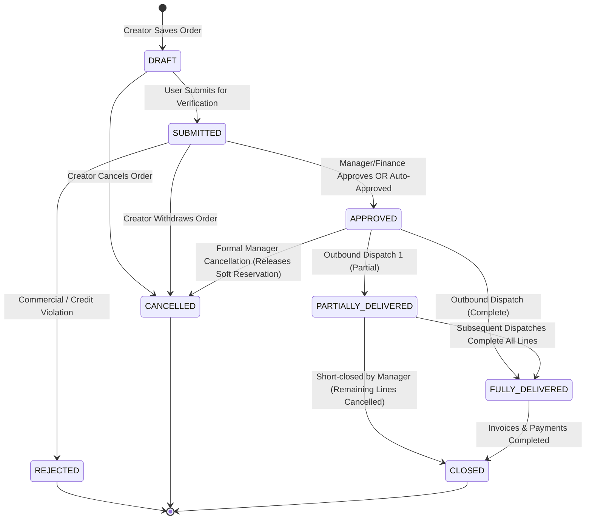

# Phase S2: Sales Order State Machine & Transition Rules

---

## 1. Executive Summary & Lifecycle State Machine

A Sales Order progresses through a finite set of legal states with strict transition gates:

---

## 2. Comprehensive Transition Matrix

| From State | Trigger Event | Authorized Role | Pre-Conditions & Validations | To State | Downstream Effects |
|---|---|---|---|---|---|
| **DRAFT** | Submit Order | Sales Representative / Creator | Line items $> 0$, valid customer selected | **SUBMITTED** | Order locked against editing. Triggers approval evaluation. |
| **DRAFT** | Cancel Order | Sales Representative / Creator | None | **CANCELLED** | Document terminated. |
| **SUBMITTED**| Auto-Approve / Manual Approve | Sales Manager / Finance Admin | Credit Exposure $\le$ Limit; Overdue Invoices $\le$ Grace Days | **APPROVED** | **Triggers Phase S3 Stock Soft-Reservation**. Enables delivery dispatch. |
| **SUBMITTED**| Reject Order | Sales Manager / Finance Admin | Policy breach or commercial unviability | **REJECTED** | Order locked. Zero stock reserved. |
| **APPROVED** | Post Partial Delivery | Warehouse Manager | Dispatch Qty $\le$ Remaining Delivery Qty | **PARTIALLY_DELIVERED** | Line allocation updated in `erp_so_line_fulfillment`. Stock deducted. |
| **APPROVED** | Post Complete Delivery | Warehouse Manager | All line items fully dispatched | **FULLY_DELIVERED** | All line allocations marked `FULLY_DELIVERED`. Stock deducted. |
| **APPROVED** | Cancel Order | Sales Manager / Tenant Admin | Zero physical deliveries dispatched | **CANCELLED** | **Releases Phase S3 Stock Soft-Reservation**. |
| **PARTIALLY_DELIVERED** | Complete Dispatches | Warehouse Manager | Cumulative delivered qty == ordered qty | **FULLY_DELIVERED** | Order marked complete. |
| **PARTIALLY_DELIVERED** | Short-Close Order | Sales Manager / Tenant Admin | Customer agrees to cancel remaining unfulfilled balance | **CLOSED** | Releases remaining soft reservation for unfulfilled balance. |
| **FULLY_DELIVERED** | Settle & Archive | System / Finance Manager | All goods delivered and fully invoiced | **CLOSED** | Permanent terminal state. |

---

## 3. Stock Reservation Invariants by State
1. **`DRAFT` / `SUBMITTED` / `REJECTED` / `CANCELLED`**: **Zero stock reserved**.
2. **`APPROVED`**: Soft stock reservation active for $100\%$ of ordered line quantities.
3. **`PARTIALLY_DELIVERED`**: Soft stock reservation active strictly for `remaining_delivery_quantity`.
4. **`FULLY_DELIVERED` / `CLOSED`**: Soft stock reservation is $0$ (fully converted into physical stock decrements or released).
