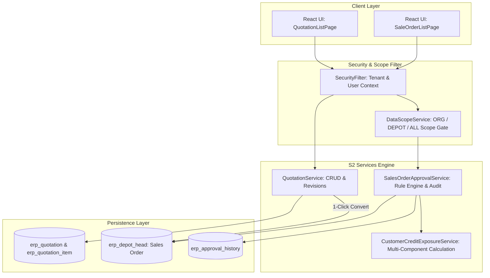

# Phase S2: Recommended Architectural Design

---

## 1. Architectural Overview & Component Structure

---

## 2. Platform Security & Authorization Enforcement
1. **Zero Client Trust**: All tenant IDs, user IDs, and organization boundaries are derived exclusively from the authenticated server `SecurityContext`.
2. **Data Scope Gate**: Approval operations verify that the target Sales Order's `organization_id` falls within the manager's authorized `DataScopeType` (`ALL`, `ORG`, `DEPOT`, `SELF`).
3. **Role Authorization**: Approving orders with credit limit breaches requires Role ID 3 (Tenant Admin) or specific `SALES_CREDIT_OVERRIDE` permission.
